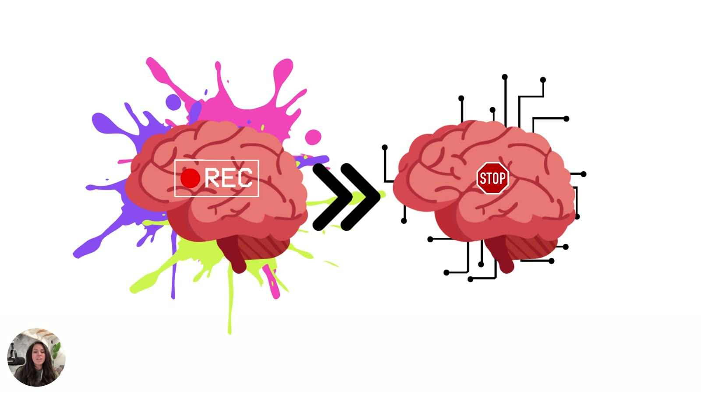
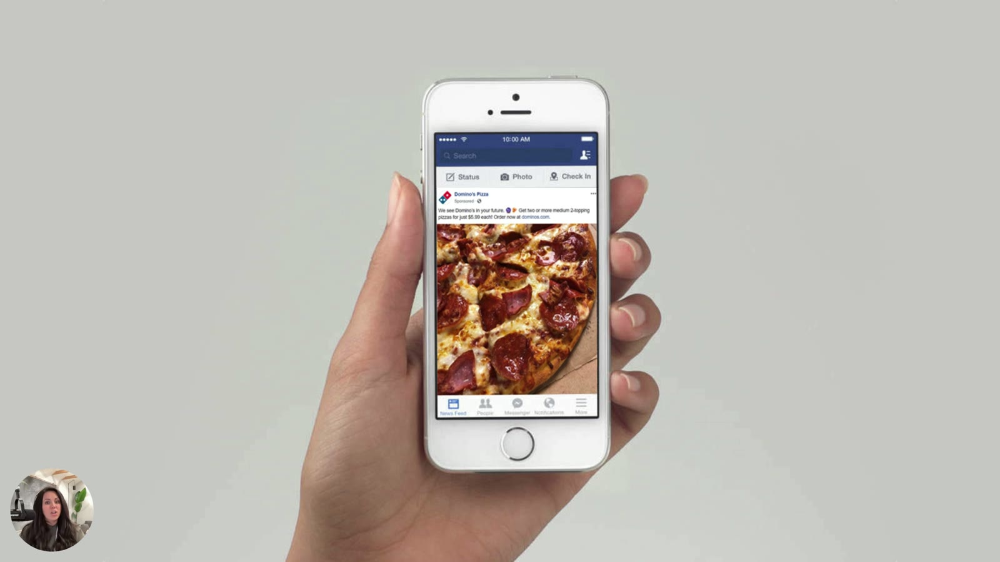
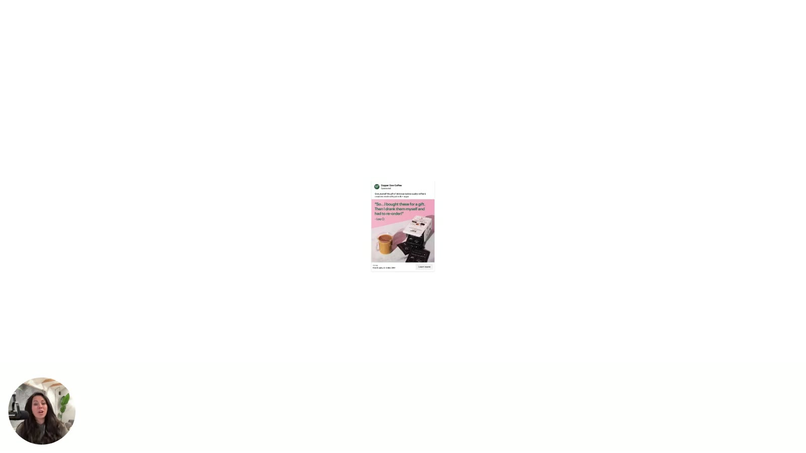

# Targeting the Decision-Making Brain

> Before you write an ad, know which part of the brain you're talking to. Buying decisions run through the fast, emotional, shortcut-taking subconscious, and heuristics are how it decides.

Page description: "Before you write another ad, you need to know which part of the brain you're talking to — the fast, emotional, shortcut-taking one. This module breaks down how decisions *actually* get made and why psychology beats persuasion every time."

## 🤖 Agent use
- **Use when:** setting the strategic stance for any script or teardown (does this ad speak to the subconscious?), or explaining why a spec-heavy competitor ad is weak.
- **Inputs → outputs:** a draft or competitor ad, plus the customer's category associations → a subconscious-fit verdict and a list of the heuristics to apply.
- **Rules:**
  - DO write for the fast, emotional, reactive subconscious (11M bits/s), not the slow conscious mind (40 bits/s).
  - DO connect the ad to a need the viewer has right now (the pizza mechanism).
  - DO map what the customer already associates with the category (mom's coffee, this morning's cup, the beans that made them sick) and lean into the positive associations.
  - DON'T rely on rational pros/cons. Viewers "are not rationally weighing the pros and cons."
- **See also:** [Subconscious vs conscious mind](../../../concepts/subconscious-vs-conscious-mind.md), [Heuristics hub](../../../concepts/heuristics.md).

## TL;DR
- People don't rationally weigh pros and cons when they see an ad. They take **mental shortcuts**, which behavioral science calls **heuristics** [00:11]–[00:21].
- There are two minds. The **subconscious** is old, fast (~**11 million bits/sec**), reactive and emotional. The **conscious** is slow, calculated and controlled (~**40 bits/sec**) [01:23]–[02:12].
- **The subconscious makes most daily decisions.** It constantly feeds the conscious mind, usually without you noticing [02:33]–[03:07].
- The subconscious keeps a map of everything it knows about every object. It checks each ad against that map to decide whether to stop and pay attention [04:12]–[04:56].
- You don't need a psychology degree, "you just need to know what buttons to push" [00:52].

## Key ideas

### Heuristic = mental shortcut [00:00]
- The course teaches "nine psychological shortcuts that you can use in your ads that will sell for you. So you don't have to" [00:00]–[00:11].
- A heuristic is "a really fast way for the brain to decide, is this going to be something that I want to focus on? Or is it something that I am not interested in giving my attention to?" [00:21]–[00:31]
- If you understand them, "you can build ads that really do sell before your customer will even realize why" [00:37]. "The best marketers" use these shortcuts "to really just get results faster" [00:43]. Some you'll recognise and some will be new [00:48].

### The brain and its two minds [01:02]

*Slide at [03:41]: a colourful "● REC" brain (the subconscious, recording everything) sends signals (») to a wired brain with a STOP sign. This shows the subconscious feeding the conscious mind the cue to stop and act.*

- The brain is about three pounds, mostly water and fat. It's "screaming fast on one side" and "quite slow" on the other [01:02]–[01:18].

| | Subconscious mind | Conscious mind |
|---|---|---|
| Age | "Pretty old... been around for a very, very long time" [01:34] | Newer (implied) |
| Speed | ~**11 million bits/second**, "screaming fast" [01:39] | ~**40 bits/second** [02:07] |
| Style | Reactive, emotional, "not logic at all," reacting to its environment rather than deciding [01:45]–[01:57] | "Very slow and calculated," controlled [02:02]–[02:17] |
| When it's in charge | Most daily decisions. We have little control because it's reactive, and it struggles to slow down and weigh options [02:33]–[02:57] | Buying a car, comparing computers, "a very concerted decision" [02:17]–[02:26] |

- "When you see something, typically we just react to it. We don't make a conscious decision to do anything with it." [02:53]
- **They work together.** "The subconscious mind is constantly feeding information to your conscious to try and make good decisions on the daily," usually without you knowing [02:57]–[03:12].
- More detail: [Subconscious vs conscious mind](../../../concepts/subconscious-vs-conscious-mind.md).

### The pizza example [03:12]

*Slide at [03:18]: a hand holding a phone showing a sponsored Domino's Pizza ad in the Facebook feed. This is the kind of ad your subconscious stops on when you're hungry.*

- You skipped breakfast and coffee. Your subconscious has been tracking your glucose and "where you are in space and time." All it's built to do is "record and make sure that it's keeping you safe and alive" [03:19]–[03:32].
- You pass an ad that relates to what you're experiencing. The subconscious tells the conscious: "Hey, we don't have any food in the system. We really need to get something in here quickly. We like pizza," based on everything stored about food. "We need to stop and get something" [03:32]–[03:57].
- The e-book version: "It's the reason you 'suddenly' crave pizza at 3PM even if you didn't plan to eat out... It made the decision before your conscious mind even logged on. **Good ads talk to the boss. The subconscious.**" (e-book p.3)

### The subconscious draws a map of everything [04:02]

*Slide at [04:03]: a small sponsored DTC coffee ad (appears to be Copper Cow Coffee: "So… I bought these for a gift. Then I drank them myself and had to re-order!"). It illustrates the coffee example.*

- When building ads, speak to "the brain that's in charge, which is the subconscious mind, the one that's just kind of running on autopilot" [04:02]–[04:12].
- That mind is "drafting a map all day, every day of every single thing it knows about every object it comes in contact with" [04:12]–[04:20].
- **Coffee example:** your customer sees an ad for a coffee shop or DTC coffee brand. Their mind judges it "based upon everything it knows about coffee" [04:26]–[04:34]:
  - What kind of coffee did my mom drink?
  - What kind of coffee did I have this morning?
  - What kind of coffee do I like the most?
  - What's my favorite coffee cup?
  - Which coffee beans made me sick that one time?
  
  It checks all of these "to see, is this something that's important and something I need to stop... on and actually pay attention to" [04:42]–[04:56].
- All of this happens in the background. The brain makes these quick judgments "primarily... by building what we call heuristics, mental shortcuts" [05:01]–[05:12].
- Next, the nine shortcuts. They matter most for paid advertising, but also "everywhere in your ecosystem... to help people make decisions faster" [05:12]–[05:28].

*Title slide [00:00]: "9 Psychological Shortcuts That Sell for You (So You Don't Have To)."*

## Ad teardowns

| Brand / product (niche) | Format | Hook / opening | What works | What fails | Fix suggested | Principle | Source |
|---|---|---|---|---|---|---|---|
| Domino's Pizza (QSR) | Facebook feed ad (photo) | Close-up pepperoni pizza + "Get two or more medium 2-topping pizzas for just $5.99 each" | Hits a current physiological need (hunger), and the subconscious stops on it | — (illustration only) | — | Ads that match the viewer's present state get the stop | [03:18] |
| Copper Cow Coffee (appears to be; DTC coffee) | Sponsored static | "So… I bought these for a gift. Then I drank them myself and had to re-order!" | Shown as an example of an ad the customer judges against their personal coffee "map" | — (illustration only) | — | The subconscious checks every ad against what it already knows about the category | [04:03] |

## Rules of thumb
- **DO** talk to "the brain that's in charge... the subconscious" [04:02].
- **DO** assume viewers react rather than decide: "When you see something, typically we just react to it" [02:53].
- **IF** the decision is big and considered (a car, a computer) **THEN** expect the conscious mind to come online. Most ad decisions aren't like that [02:17].

## Notable quotes
- "Heuristic equals mental shortcut." [00:21]
- "You don't need a psychology degree to go through these... You just need to know what buttons to push." [00:52]
- "Your subconscious mind is the one that's making most of the decisions on the daily." [02:33]
- E-book: "Your customer isn't sitting there rationally weighing options like a mini CFO." (p.2)

## How to apply
- [ ] Write ads for the subconscious: emotional, visual, instantly understood. Don't build rational feature debates.
- [ ] Ask what your customer's "map" already holds about your category (memories, habits, bad experiences), and make the ad match the good associations.
- [ ] Tie the ad to a state the viewer is likely in right now (hungry, tired, cold…), like the pizza example.

## Related
- Brand case files: [Domino's](../../../brands/dominos.md) · [Copper Cow Coffee](../../../brands/copper-cow-coffee.md) · [all brands by niche](../../../brands/README.md)
- [Subconscious vs conscious mind](../../../concepts/subconscious-vs-conscious-mind.md) · [Heuristics](../../../concepts/heuristics.md)
- Next lesson: [Using Biases That Sell](02-using-biases-that-sell.md)
- [Heuristics 101 e-book](../../../resources/heuristics-101-ebook.md), pages 2–5
- Module: [Heuristics 101](README.md)

## Sources
- Transcript: [1. Targeting the Decision-Making Brain.txt](../../../../raw/tether-lab/_transcripts/2.%20Heuristics%20101/1.%20Targeting%20the%20Decision-Making%20Brain.txt)
- Page text: [extracted lesson page](../../../../raw/tether-lab/_extracted/2.%20Heuristics%20101/1_1_Targeting_the_Decision_Making_Brain_Heuristics_101_.md)
- E-book: [7. Heuristics 101 e-book.md](../../../../raw/tether-lab/_extracted/2.%20Heuristics%20101/7.%20Heuristics%20101%20e-book.md)
