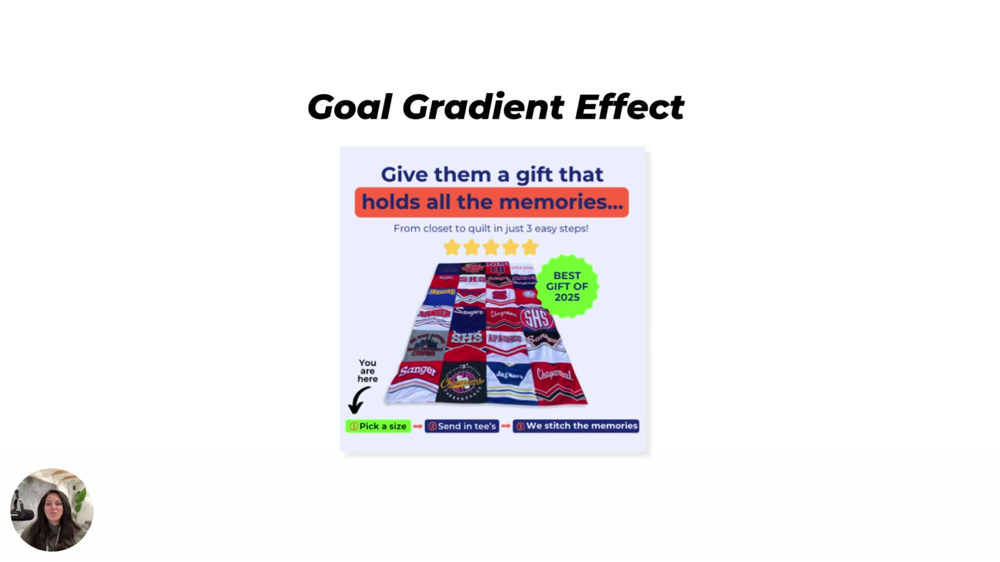
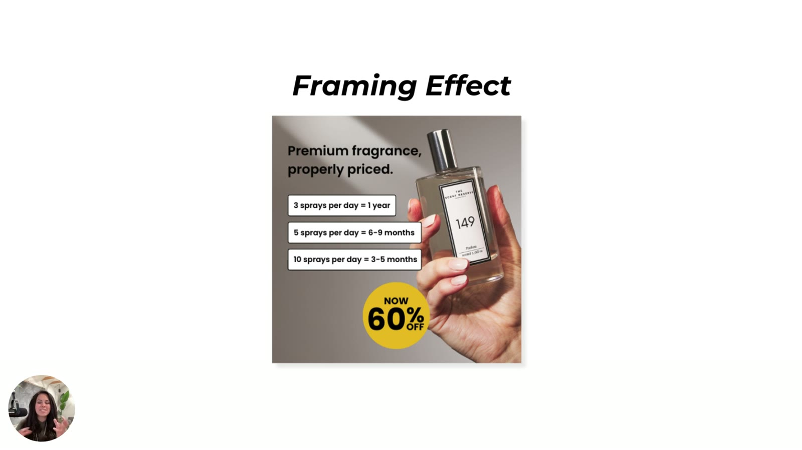

# Hook Attention, Guide Behavior

> Three underused shortcuts for attention, motivation and pricing psychology: **salience bias**, the **goal gradient effect** and the **framing effect**.

Page description: "Salience bias, goal gradient effect, and framing effect are underused — but they're the reason people stop scrolling and start taking action. Master these and your ads start working like a choose-your-own-adventure book."

## 🤖 Agent use
- **Use when:** designing the first frame and colour contrast (salience), writing "how it works" step beats or checkout/CRO copy (goal gradient), or presenting price, size and value (framing). Also use it to tear down thumb-stopping or value-led competitor ads.
- **Inputs → outputs:** product colour and palette; the purchase/usage process; absolute numbers (ml, price, duration) → a contrast plan, a 3-step strip with "You are here," and per-use reframes.
- **Rules:**
  - DO put one drastic-colour object dead centre on a calm single-colour field. DON'T use all-muted palettes.
  - DO show "You are here" at step 1 and keep the path to about 3 steps.
  - DO convert absolute numbers into usage units ("3 sprays/day = 1 year," cost per wear).
  - DO combine these with other heuristics. "These shouldn't be used in standalone ways."
- **See also:** [Salience bias](../../../concepts/heuristics/salience-bias.md), [Goal gradient effect](../../../concepts/heuristics/goal-gradient-effect.md), [Framing effect](../../../concepts/heuristics/framing-effect.md), [Heuristic stacking](../../../concepts/heuristic-stacking.md).

## TL;DR
- "We are wired to move... when something is urgent, novel, or like clearly worth it." These three drive attention, motivation and "specifically pricing psychology" [00:20]–[00:30].
- **[Salience bias](../../../concepts/heuristics/salience-bias.md):** "shiny quarter syndrome." Contrast grabs attention. The best version is a calm, single-colour field with one drastically different object dead centre [00:33]–[02:09].
- **[Goal gradient effect](../../../concepts/heuristics/goal-gradient-effect.md):** the closer we feel to a goal, the more motivated we get. Put a "You are here" step indicator in the ad, like checkout progress bars [02:11]–[03:54].
- **[Framing effect](../../../concepts/heuristics/framing-effect.md):** her "ultimate favorite" and the most versatile heuristic. The brain doesn't judge absolute value, only comparisons. "100 ml" → "3 sprays/day = 1 year" [03:56]–[06:51].
- These heuristics should be combined in one ad, not used standalone [06:59]–[07:19].

## Key ideas

### Recap [00:00]
- So far: scarcity, social proof, authority (she says "authority proof" here), affect heuristic, processing fluency, temporal discounting [00:07]–[00:16].

### 7. Salience bias [00:33]

*Salience Bias slide [00:16]: a fragrance ad. Three dark-capped green bottles (labelled Shay & Blue) on a bright coral/watermelon-and-palm-leaf background. Big white headline "Trust us, they won't forget you." Yellow corner tag "Get 2 for ~~$180~~ $150", two review cards, footer "★★★★★ Rated 9/10 best fragrance".*

- **What it is:** "We have **shiny quarter syndrome** as humans... What stands out captures a whole lot of attention" [00:39]–[00:49].
- **Why it works:** "Novelty really does trigger awareness for the brain. It flags it as important" [00:50]–[00:54].
- **Example:** a "bright sea of... peachy color" with something darker in the centre and text on top. The brain "is going to kind of get sucked into the middle where this kind of black color is" [00:56]–[01:11]. One way to use salience is to break up the outer colour with darker colours inside [01:13]–[01:19].
- **The best version she's seen:** "make everything around one color, like white space, and then something dead in the center, another color that's pretty drastic. So red, orange, black" [01:22]–[01:34].
- "Muted colors in particular tend to kind of wash together" [01:38].
- **Applications:** "very visual contrast, like bold colors, odd formats, odd objects." It "comes down to something that's strange, odd, or... a little bit different color... Contrast between two things" [01:47]–[02:07].

### 8. Goal gradient effect [02:11]

*Goal Gradient Effect slide [02:00]: a T-shirt quilt ad. "Give them a gift that holds all the memories…" / "From closet to quilt in just 3 easy steps!", five stars, a "Best gift of 2025" badge, and a hand-drawn "You are here ↓" arrow pointing at step 1 of a three-step bar: ① Pick a size → ② Send in tee's → ③ We stitch the memories.*

- "I cannot get enough of this particular one because it helps me just in general as a human" [02:13].
- **What it is:** "The closer we feel to a goal, the more motivated we get to go after that goal" [02:18].
- **Why it works:** progress, "especially near the finish line," is something the brain is very sensitive to. "**If it can see the carrot, it will just keep going after it.**" "Humans are very, very emotional about their goals" [02:24]–[02:41].
- **Example:** the quilt ad "looks pretty normal" with best-gift and social-proof elements. The goal gradient is the added "**you are here**" message with an arrow at the first action (pick a size). It shows that only two more steps stand between them and the quilt "made out of all of these awesome t-shirts that you've collected over time... as like a memory or a keepsake" [02:41]–[03:14].
- **Where it's used best: CRO.** A bar at the top of checkout ("You're in your cart. The next is payment. The next is... shipping. And then... checkout") shows people how close they are to the goal [03:14]–[03:34].
- **Use:** progress bars, completion steps, unlockable rewards [03:34]–[03:44].
- "I wish we would use this so more often, understanding and placing people in the sequence of where they are in the purchasing process. Huge, huge for the brain" [03:46]–[03:54].

### 9. Framing effect [03:56]

*Framing Effect slide [04:00]: a fragrance ad Tether designed. A hand holding a bottle labelled "149", headline "Premium fragrance, properly priced.", three boxes "3 sprays per day = 1 year / 5 sprays per day = 6–9 months / 10 sprays per day = 3–5 months", and a yellow "Now 60% off" badge.*

- "Probably one of my favorites... might be my ultimate favorite... I have never seen a heuristic be so versatile. You can use this everywhere in any capacity" [03:58]–[04:15].
- **What it is:** "How you present the information... will change how people perceive it. Especially if the numbers are the same" [04:15]–[04:25].
- **Why it works:** "The brain does not evaluate absolute value." It won't look at a phone, remote or glasses and ask "what is this made of? What did that material cost? And what kind of value should I place on this?" It "just compares to what is kind of the environment around it" [04:29]–[04:59].
- **Example (perfume):** "We could have just put a hundred milliliters on here and hoped that our audience would understand how long a hundred mil... bottle lasts." Sarah wasn't sure this audience knew. If every perfume on your dresser says 100 ml but some run out faster, how do you know how long one lasts [05:05]–[05:34]?
  - So she broke it down by sprays: **3 sprays/day = 1 year; 5/day = 6–9 months; 10/day = 3–5 months** [05:36]–[05:51].
  - "This is using the framing effect to take the exact same number... it's comparative." The brain understands it "a whole lot better because we took the time to break down, not just like how much is in the bottle, but how many sprays you can get from it" [05:51]–[06:15].
- **Apply anywhere:**
  - "Try reframing your price in usage terms... **cost per wear**, or like **long-term value comparison**, **savings**" [06:18]–[06:26].
  - "Take whatever it is you actually... are using as your benefit or your value and **break it down into smaller units**" [06:26]–[06:34].
  - Especially for value-seeking, "budget friendly people who really, really want a good bang for their buck" [06:38]–[06:47].

### Wrap-up [06:51]
- These three "help people pay attention... fuel progress... and build believability in your product" [06:51]–[06:59].
- Next lesson: combine shortcuts in one ad "so you have kind of an exponential effect. These shouldn't be used in standalone ways. These really should be used in tandem with each other... capitalize on the amount of mental shortcuts that already exist in the brain" [06:59]–[07:19].

## Hooks

| Hook (verbatim or near) | Heuristic(s) | Emotion / zone | Self targeted | Why it works | Source |
|---|---|---|---|---|---|
| "Trust us, they won't forget you." | Salience (visual) + social proof (reviews) | — (not specified) | — | Contrast pulls the eye to the centre bottles and headline | [00:16]–[01:11] |
| "Give them a gift that holds all the memories…" / "From closet to quilt in just 3 easy steps!" | Goal gradient | *inferred:* nostalgia | — | "You are here" shows only two steps left | [02:41]–[03:14] |
| "Premium fragrance, properly priced." + "3 sprays per day = 1 year" | Framing | — | — | Usage units replace an opaque "100 ml" | [04:59]–[05:51] |

## Ad teardowns

| Brand / product (niche) | Format | Hook / opening | What works | What fails | Fix suggested | Principle | Source |
|---|---|---|---|---|---|---|---|
| Fragrance, bottles labelled Shay & Blue (perfume) | Static | "Trust us, they won't forget you." | Bright peach/coral field with darker centre bottles draws the eye to the middle; "Get 2 for $150" tag; review cards | — | Best practice: single-colour/white field + one drastic centre colour | Contrast captures attention | [00:16]–[01:34] |
| T-shirt memory quilt (custom gifts) | Static | "Give them a gift that holds all the memories…" | "You are here ↓" on ① Pick a size → ② Send in tee's → ③ We stitch the memories | — | — | Show progress and how few steps remain | [02:41]–[03:14] |
| Checkout flows (CRO pattern) | Site | Progress bar cart → payment → shipping → checkout | Shows how close to the goal | — | — | Goal gradient in CRO | [03:17]–[03:34] |
| Fragrance "149" (perfume) | Static | "Premium fragrance, properly priced." | 3/5/10 sprays-per-day duration boxes; "Now 60% off" | — | — | The brain compares rather than judging absolute value | [04:59]–[06:15] |

## Rewrites (before → after)

| Before | After | What changed (verb / visual / promise / self / intensity) | Source |
|---|---|---|---|
| "100 ml" | "3 sprays per day = 1 year · 5 sprays per day = 6–9 months · 10 sprays per day = 3–5 months" | Absolute size → usage duration (concrete promise) | [05:09]–[05:51] |
| Sticker price | Cost per wear / long-term value comparison / savings | Price → smaller usage units | [06:18]–[06:34] |

## Rules of thumb
- **DO** make "everything around one color, like white space," with "something dead in the center... pretty drastic. So red, orange, black" [01:22].
- **DON'T** use muted palettes. They "wash together" [01:38].
- **DO** place people "in the sequence of where they are in the purchasing process" [03:46].
- **DO** "try reframing your price in usage terms" [06:18]. **DO** break value "into smaller units" [06:26].
- **IF** the audience is budget-driven ("bang for their buck") **THEN** lead with framing [06:44].
- **DON'T** use these standalone. Combine them in one ad [07:06].

## Notable quotes
- "We have shiny quarter syndrome as humans." [00:39]
- "If it can see the carrot, it will just keep going after it." [02:32]
- "The brain does not evaluate absolute value." [04:34]
- "Try reframing your price in usage terms." [06:18]

## How to apply
- [ ] Salience: put one high-contrast hero object on a calm background. Avoid an all-muted palette.
- [ ] Goal gradient: add a 3-step "You are here → … → done" strip to statics for customised or multi-step products. Add progress bars to checkout.
- [ ] Framing: turn size, price or duration into per-use or per-day units (sprays, wears, cups, days).

## Related
- Brand case files: [Shay & Blue](../../../brands/shay-and-blue.md) · [all brands by niche](../../../brands/README.md)
- [Salience bias](../../../concepts/heuristics/salience-bias.md) · [Goal gradient effect](../../../concepts/heuristics/goal-gradient-effect.md) · [Framing effect](../../../concepts/heuristics/framing-effect.md)
- [Heuristic stacking](../../../concepts/heuristic-stacking.md)
- Previous: [Emotion, Clarity, Urgency](03-emotion-clarity-urgency.md) · Next: [Stacking Psychology for Growth](05-stacking-psychology-for-growth.md)
- [Heuristics 101 e-book](../../../resources/heuristics-101-ebook.md), pages 13–15

## Sources
- Transcript: [4. Hook Attention, Guide Behaviour.txt](../../../../raw/tether-lab/_transcripts/2.%20Heuristics%20101/4.%20Hook%20Attention,%20Guide%20Behaviour.txt)
- Page text: [extracted lesson page](../../../../raw/tether-lab/_extracted/2.%20Heuristics%20101/4_4_Hook_Attention,_Guide_Behavior_Heuristics_101_·_Tet.md)
