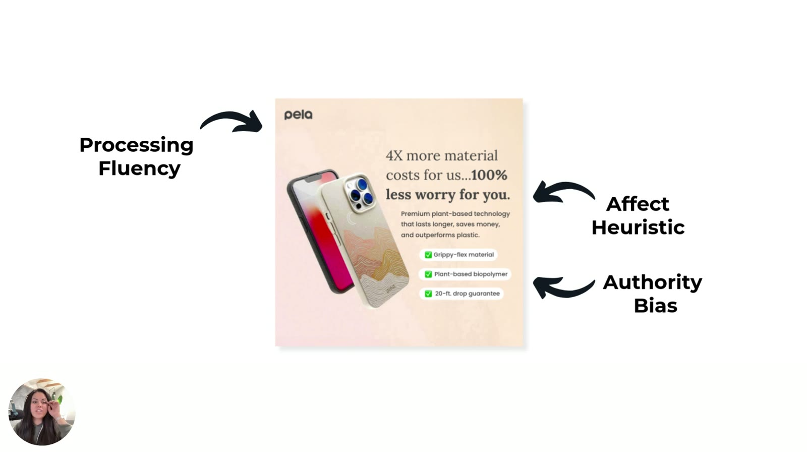
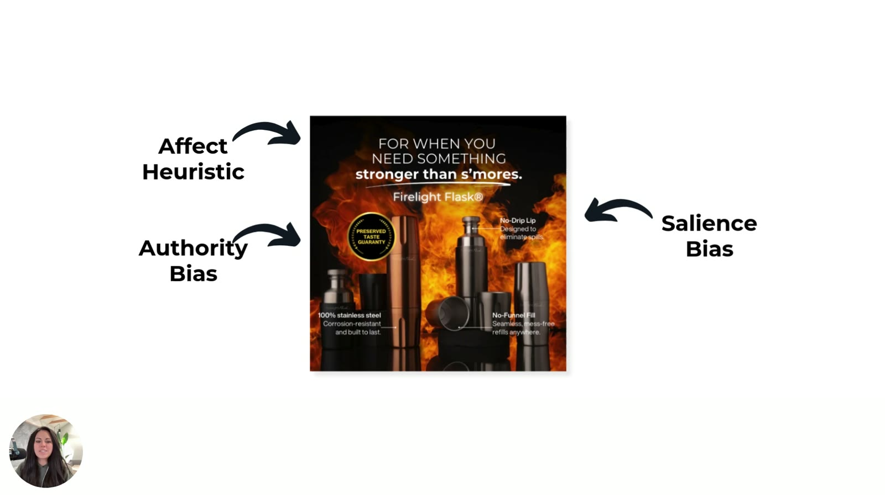
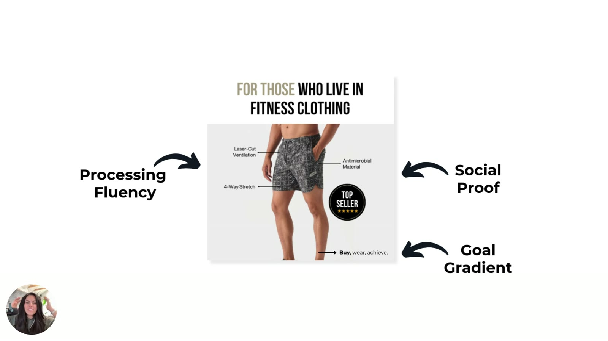
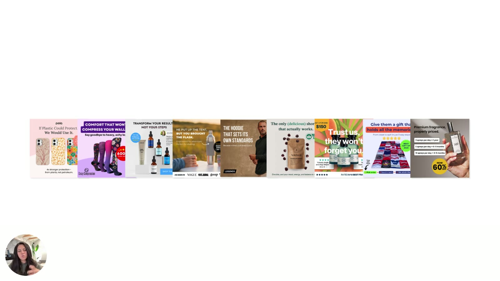

# Stacking Psychology for Growth

> The real win is combining shortcuts. Sarah breaks down three of her own static ads that each layer three heuristics, then sends you off to stack two or three in your next campaign.

Page description: "The real win isn't just using these shortcuts — it's combining them. This module shows you how the best-performing ads layer multiple heuristics to guide the brain from interest to action (without needing to shout or oversell)."

## 🤖 Agent use
- **Use when:** composing a new static or UGC concept, remixing a competitor's winning ad (identify its stack, rebuild it with our proof), or QA-ing a draft for single-lever weakness.
- **Inputs → outputs:** product facts (reviews, guarantee, tech terms, steps) → a 2–3 heuristic stack mapped to headline, image, badge, callouts and CTA.
- **Rules:**
  - DO layer 2–3 heuristics per ad, with processing fluency as the base.
  - DO use authority *bias* (authoritative terms, guarantees) when no expert is available or trusted.
  - DO add a 3-step goal-gradient line to acquisition ads ("Buy, wear, achieve.").
  - DO test "Top Seller" vs "Best Seller."
  - DON'T convince or shout. Make the brain's shortcuts easier.
- **See also:** [Heuristic stacking](../../../concepts/heuristic-stacking.md), [Authority bias](../../../concepts/heuristics/authority-bias.md), [Heuristics 101 e-book](../../../resources/heuristics-101-ebook.md) (p.17 checklist).

## TL;DR
- The nuanced, less-known heuristics get "a whole lot more success," keep "costs low," and reach more people "just by making our ads easier to process to the brain" [00:21]–[00:35].
- **Pela:** processing fluency + affect heuristic + authority bias [00:46]–[03:13].
- **Firelight Flask:** affect heuristic + authority bias (guarantee) + salience bias [03:13]–[05:26].
- **Fitness shorts:** processing fluency + social proof ("Top Seller") + goal gradient ("Buy, wear, achieve.") [05:26]–[07:02].
- **Authority bias ≠ authority proof.** You can sound authoritative ("plant-based biopolymer") without quoting an expert [02:06]–[03:13].
- Heuristics are "more persuasive if you layer them on top of each other." Pick **two or three per ad** using the worksheet/e-book [07:12], [08:06]–[08:31].
- Concept page: [Heuristic stacking](../../../concepts/heuristic-stacking.md).

## Key ideas

### Why go beyond the usual suspects [00:00]
- Social proof and authority bias "are incredibly helpful... for anybody who's just looking to inject a little bit more psychology into their ads." But the nuanced ones are "how we generate a whole lot more success and get a lot better results, keeping our costs low and reaching more people just by making our ads easier to process to the brain" [00:08]–[00:35].

### Ad 1: Pela phone case (fluency + affect + authority) [00:46]

*Slide at [00:48]: Pela ad annotated with arrows. Processing Fluency (whole ad), Affect Heuristic (headline "4X more material costs for us…100% less worry for you."), Authority Bias (checklist "Plant-based biopolymer"). Body copy: "Premium plant-based technology that lasts longer, saves money, and outperforms plastic." Checklist: Grippy-flex material · Plant-based biopolymer · 20-ft. drop guarantee.*

- An ad "we generated for Pela" using three of the heuristics [00:46]–[00:55].
- **Processing fluency:** "making our ads very simple to process by the brain... We don't want a lot of colors. We don't want crazy backgrounds... make it easy for the brain to process everything in the ad within split seconds" [01:00]–[01:26].
- **Affect heuristic:** "a mental picture inside the brain by offering some sort of **visual imagery in text form**": "four times more material costs for us, 100% less worry for you." People think "I do actually worry about my phone," or "start to feel it a little bit when you bring up that kind of **worry** word" [01:26]–[01:49].
  - "The affect heuristic doesn't have to be a full-on like story-based example." A single emotional word can do it [01:49]–[01:59].
- **Authority bias:** "in just one specific place... this **plant-based polymer**" (on the ad: "biopolymer"). "Anytime you can use larger scale words" [02:06]–[02:12].
  - "Authority bias doesn't have to be just a quote from somebody who is in a position of authority. It could also just be you **using terms that somebody in a position of authority would use**" [02:12]–[02:29].
  - "You often don't have to resort to pulling in any sort of doctor-based quotes... a great way to do this is just to sound more authoritative" [02:29]–[02:41].
- **Authority bias vs authority proof** [02:41]:
  - "**Authority proof** requires somebody in a position of authority to have said something. It's a quote, it's a five stars, it's their picture."
  - "**Authority bias** just says that we are sensitive to people who are in a position of authority." If your ads "call up this particular bias, we can do a lot better to... teach people how authoritative we are as a brand" [02:41]–[03:13].

### Ad 2: Firelight Flask (affect + authority + salience) [03:13]

*Slide at [03:17]: Firelight Flask® ad annotated with Affect Heuristic (headline "For when you need something stronger than s'mores." over a fire background), Authority Bias (gold "Preserved Taste Guaranty" seal), Salience Bias (fiery background vs metal products). Feature callouts: "100% stainless steel: Corrosion-resistant and built to last," "No-Drip Lip: Designed to eliminate spills," "No-Funnel Fill: Seamless, mess-free refills anywhere."*

- **Affect heuristic:** shown mostly in the image, but "the headline and the image are actually paired together very, very carefully" to create a mental picture: "for when you need something stronger than s'mores." "The fire and the s'mores are creating kind of a dual... mental picture," which helps call out emotion. The headline also "solves a large problem" [03:18]–[04:10].
- **Authority bias:** "Anytime that you can have any sort of **guarantee** or... long-term benefits to your product, this automatically creates a level of authority." It tells the brain the seller backs their product. Guarantees make people "feel a whole lot safer... the authority is going to take care of it if it doesn't work out for me" [04:10]–[04:38].
- **Salience bias:** a "really bright kind of fiery background" with "sharp metal" products in the foreground creates contrast [04:38]–[04:48].
  - Reminder: salience works best with a calm background ("white or a gray background") and "something vibrant in the center, like a red ball, blue ball." This ad does the opposite: vibrant background, subdued products [04:48]–[05:09].
  - **Her redesign:** "I would probably just use one particular product in the middle... and make that product kind of a standalone darker color so that... vibrant background stands out." "Anything distinctive inside the ad is going to get the most attention" [05:09]–[05:26].

### Ad 3: Fitness shorts (fluency + social proof + goal gradient) [05:26]

*Slide at [05:30]: "For those who live in fitness clothing." Shorts on a plain grey background with callouts (Laser-Cut Ventilation, 4-Way Stretch, Antimicrobial Material), annotated Processing Fluency, Social Proof ("Top Seller ★★★★★" badge) and Goal Gradient ("→ Buy, wear, achieve.").*

- Sarah "redesigned this one slightly just so that you guys can understand you can use goal gradient basically everywhere" [05:32]–[05:42].
- **Goal gradient:** "**Buy, wear, achieve.** That's it... only three steps." "Goal gradient really has to do with where are you in the process... the closer you get to the end, the higher the chance that you'll want to actually complete whatever the task is" [05:42]–[06:05].
  - "Add this to your ads." It teaches how long the process is and "cuts down on a little bit of **expectation issues**." Consumers "get kind of bogged down" in colours, sizes and so on, "We want to keep it pretty high level for them on acquisition" [06:05]–[06:26].
- **Social proof:** "a DTC best practice." The badge says **Top Seller**. "I've read a couple of studies that talk about the fact that **top seller does a lot better than best seller**... interesting thing to test in your ads" [06:26]–[06:40].
- **Processing fluency:** "I try and use processing fluency as much as I possibly can... the simpler you can make the ad, the faster the brain is going to process it, the quicker it's going to be for people to understand why they need your product. And then they'll go and buy" [06:40]–[07:02].

### Layer, don't single-shot [07:02]

*Slide at [07:00]: all nine single-heuristic example ads from lessons 2–4 in a row (Pela, Crazy Compression, Maelove, flask, LEGENDS, Ankhway, fragrance salience, quilt, fragrance framing).*

- Sarah offers more examples if you ask [07:02]–[07:07].
- "You're not just using any of these heuristics one at a time. They're more persuasive if you layer them on top of each other." They "diminish the amount of brain processing" needed to understand the ad and decide it's for them [07:12]–[07:31].
- **Not covered yet:** "There's the **IKEA effect**. We've got **status quo bias**, **paradox of choice**. There's so, so many more that I'm going to dive into" [07:31]–[07:46]. *(Later covered: [IKEA effect](../../../concepts/heuristics/ikea-effect.md), [Choice overload / paradox of choice](../../../concepts/heuristics/choice-overload.md); status quo bias is only named, see [Switching behavior](../../../concepts/switching-behavior.md). Full list: [heuristics hub catalog](../../../concepts/heuristics.md#every-heuristic-page-catalog).)*
- "Behavioral marketing is a deep, deep ocean... These nine shortcuts though, are kind of your **cheat code**. These are the ones that I constantly use." A couple "are kind of like obscure... you guys are going to be the first to know and try them." Master them "and you're going to outperform 99% of the marketers who are out there still guessing" [07:46]–[08:06].

### Final call to action [08:06]
- "Download the **worksheet** that came with this course... use it as kind of a **cheat sheet**." The next time you create a campaign, "especially if you're going to be using statics... just **pick two or three and layer them** on top of each other." The worksheet has examples so you can "drag and drop." (The downloadable here is presumably the [Heuristics 101 e-book / Playbook](../../../resources/heuristics-101-ebook.md).) [08:06]–[08:31]
- "The best ads do not just convince customers that it's time to buy... **I don't think anybody should be out here convincing anybody to do things.** All of this comes down to how well the brain can make shortcuts." Make shortcuts easier and you get better results, lower costs, high engagement and "a better brand" [08:31]–[08:53].
- "Let's make smarter ads using psychology." Share what you create in the comments [08:53]–[09:02].

*End card [08:00]: tether. consumer insights, @sarahlevinger (Twitter, LinkedIn, YouTube), tetherinsights.io, @tetherinsights.*

## Framework: stacking checklist (from this lesson and e-book p.16–17)
1. Start with **processing fluency**: a clean layout, one clear message, no bullet-point clutter.
2. Add an **emotional hook**: the affect heuristic in the headline or image (an experience, or a feeling word like "worry").
3. Add a **trust layer**: authority (technical terms, guarantee) or social proof ("Top Seller," named crowd).
4. Optionally add an **attention or motion layer**: salience (contrast) or goal gradient ("Buy, wear, achieve.").
5. Check: are there at least 2–3 heuristics, and is the ad still simple? "The ad isn't shouting. It's whispering all the right things to the subconscious." (e-book p.16)

## Hooks

| Hook (verbatim or near) | Heuristic(s) | Emotion / zone | Self targeted | Why it works | Source |
|---|---|---|---|---|---|
| "4X more material costs for us…100% less worry for you." | Affect + authority bias + fluency | *inferred:* relief from worry | — (not specified) | The word "worry" evokes phone-drop anxiety, and the line resolves it | [01:26]–[01:49] |
| "For when you need something stronger than s'mores." | Affect + salience | *inferred:* playful indulgence | — | Headline and fire image form one mental picture | [03:18]–[04:10] |
| "For those who live in fitness clothing" + "Buy, wear, achieve." | Fluency + goal gradient + social proof | — | *inferred:* identity ("those who live in") | A simple identity line plus a 3-step path | [05:26]–[06:05] |

## Ad teardowns

| Brand / product (niche) | Format | Hook / opening | What works | What fails | Fix suggested | Principle | Source |
|---|---|---|---|---|---|---|---|
| Pela (eco phone cases) | Static | "4X more material costs for us…100% less worry for you." | Fluency (soft background, few colours) + affect ("worry") + authority bias ("Plant-based biopolymer," "20-ft. drop guarantee") | — | — | Stack 3; authority without an expert | [00:46]–[03:13] |
| Firelight Flask (drinkware) | Static | "For when you need something stronger than s'mores." | Affect (fire + s'mores) + authority ("Preserved Taste Guaranty") + salience (fiery background vs metal) | Salience inverted: vibrant background, subdued products | One standalone darker product centred so the vibrant background makes it pop | Anything distinctive gets the most attention | [03:13]–[05:26] |
| Fitness shorts (apparel), redesigned by Sarah | Static | "For those who live in fitness clothing" | Fluency (plain grey, 3 callouts) + social proof ("Top Seller") + goal gradient ("Buy, wear, achieve.") | — | Test Top Seller vs Best Seller | Goal gradient fits almost any ad | [05:26]–[07:02] |

## Rewrites (before → after)

| Before | After | What changed (verb / visual / promise / self / intensity) | Source |
|---|---|---|---|
| Doctor quote for authority | Authoritative term ("plant-based biopolymer") or a guarantee | Authority proof → authority bias (no expert needed) | [02:12]–[02:41], [04:10] |
| "Best Seller" badge | "Top Seller" badge | Badge wording (studies Sarah cites favour "top seller") | [06:31] |
| Vibrant background + subdued products (Firelight) | Calm background or one standalone dark product in the centre | Visual contrast inverted to create salience | [05:09]–[05:17] |
| Fitness ad with no process cue | Adds "→ Buy, wear, achieve." | Added a 3-step goal-gradient line | [05:38]–[05:57] |

## Rules of thumb
- **DO** layer heuristics. They're "more persuasive if you layer them on top of each other" [07:17].
- **DO** sound authoritative instead of always quoting doctors [02:36].
- **DO** add a guarantee. It "automatically creates a level of authority" [04:15].
- **DO** keep acquisition ads high level and avoid bogging people down in colours and sizes [06:15]–[06:26].
- **DO** pick 2–3 heuristics per static from the worksheet [08:17].
- **DON'T** try to convince. Make the shortcuts easier [08:35].

## Notable quotes
- "The affect heuristic doesn't have to be a full-on like story-based example." [01:49]
- "Authority proof requires somebody in a position of authority to have said something... Authority bias just says that we are sensitive to people who are in a position of authority." [02:46]
- "Top seller does a lot better than best seller." [06:35]
- "Behavioral marketing is a deep, deep ocean... These nine shortcuts though, are kind of your cheat code." [07:46]
- "I don't think anybody should be out here convincing anybody to do things." [08:35]

## How to apply
- [ ] Audit your top 3 statics. Label each heuristic in use. If an ad has fewer than two, add one.
- [ ] Replace one expert quote with authoritative language or a guarantee, and A/B test it.
- [ ] Test "Top Seller" vs "Best Seller" badges.
- [ ] Add a 3-word step line ("Buy, wear, achieve.") to an acquisition ad.

## Related
- Brand case files: [Pela](../../../brands/pela.md) · [High Camp Flasks](../../../brands/high-camp-flasks.md) · [all brands by niche](../../../brands/README.md)
- [Heuristic stacking](../../../concepts/heuristic-stacking.md) · [Heuristics hub](../../../concepts/heuristics.md)
- [Processing fluency](../../../concepts/heuristics/processing-fluency.md) · [Affect heuristic](../../../concepts/heuristics/affect-heuristic.md) · [Authority bias](../../../concepts/heuristics/authority-bias.md) · [Salience bias](../../../concepts/heuristics/salience-bias.md) · [Social proof](../../../concepts/heuristics/social-proof.md) · [Goal gradient effect](../../../concepts/heuristics/goal-gradient-effect.md)
- Previous: [Hook Attention, Guide Behavior](04-hook-attention-guide-behavior.md) · Module: [Heuristics 101](README.md)
- [Heuristics 101 e-book](../../../resources/heuristics-101-ebook.md), pages 16–18

## Sources
- Transcript: [5. Stacking Psychology for growth.txt](../../../../raw/tether-lab/_transcripts/2.%20Heuristics%20101/5.%20Stacking%20Psychology%20for%20growth.txt)
- Page text: [extracted lesson page](../../../../raw/tether-lab/_extracted/2.%20Heuristics%20101/5_5_Stacking_Psychology_for_Growth_Heuristics_101_·_Tet.md)
