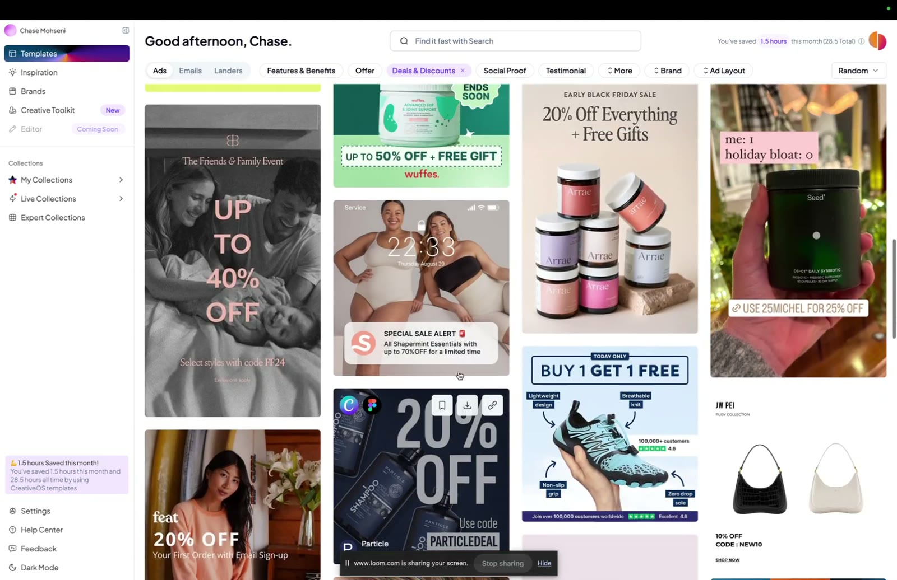
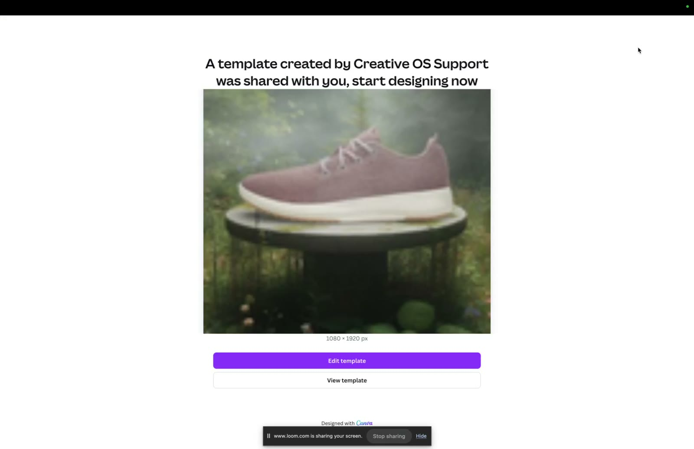
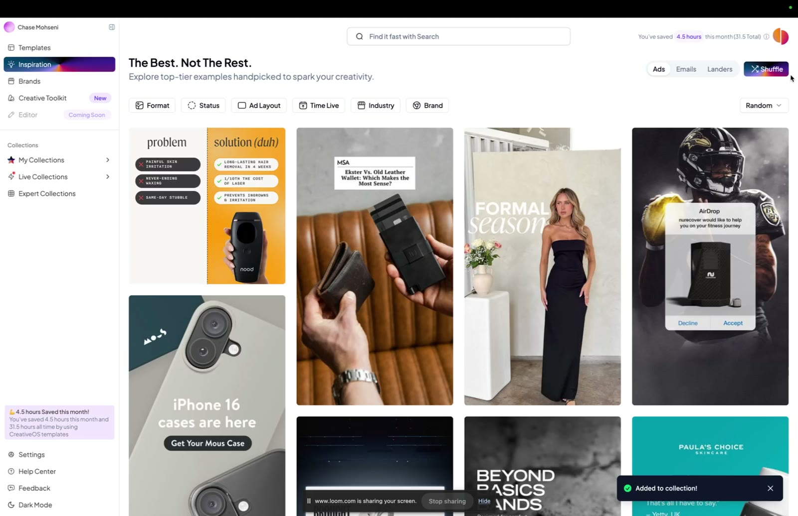
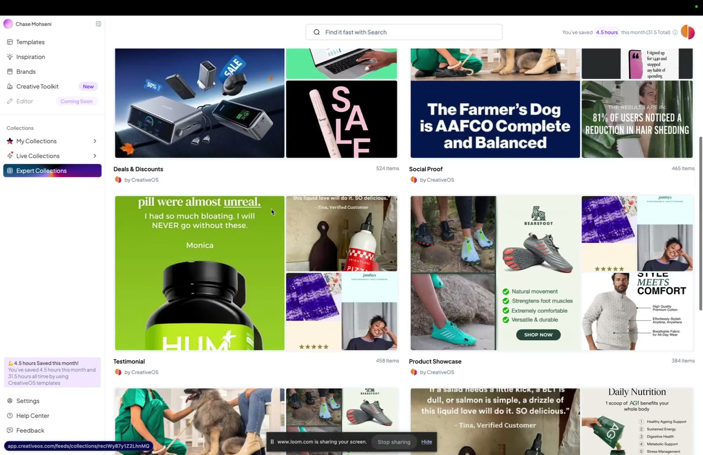
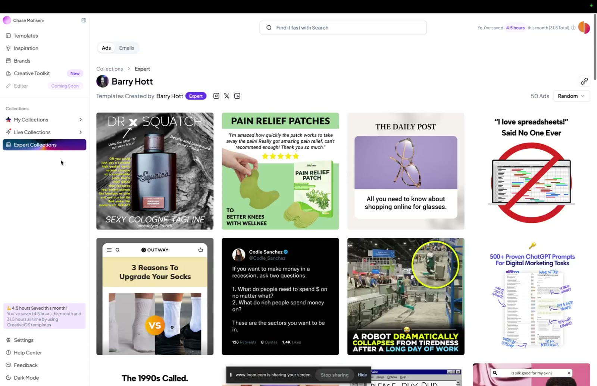
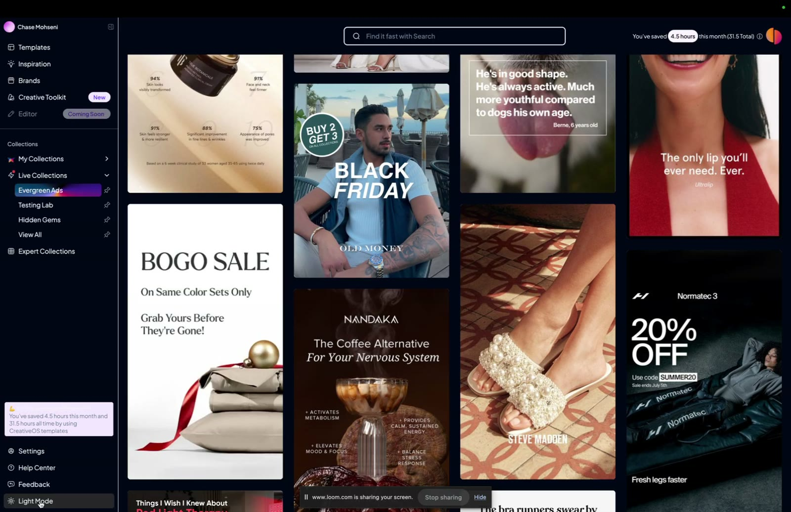

# Bonus: Get CreativeOS (1 Month Free)

> A partner bonus. Tether Lab members get one month of [CreativeOS](../../../tools/creativeos.md), a library of static-ad, email and landing-page templates and inspiration, free with code **`TETHER`**. A 5½-minute product walkthrough is included.

## 🤖 Agent use
- **Use when:** researching performing creative (Inspiration, Brands, Evergreen = live 90+ days), finding a static layout for a chosen heuristic, grading copy, sizing a test, or checking ad↔landing-page congruence.
- **Inputs → outputs:** a heuristic tag or competitor brand → reference ads and templates; ad copy → a readability grade and gaps; budget → a test-volume recommendation.
- **Rules:**
  - DO start teardown research from **Evergreen ads** (live > 90 days = presumed winners).
  - DO filter by tags that map to heuristics (Social Proof, Testimonial, Deals & Discounts, Offer, Features & Benefits).
  - DO aim copy at about first-grade readability, and check it for urgency, benefits, scarcity and social proof (the Copy Grader's critique).
  - DON'T reuse template assets as-is. Export, then swap in our product, brand and claims.
- **See also:** [CreativeOS tool page](../../../tools/creativeos.md), [Heuristic stacking](../../../concepts/heuristic-stacking.md).

## TL;DR
- **Offer:** 1 month free at <https://www.creativeos.com/> with discount code **TETHER**.
- **Why Tether partnered with them:** "static ad templates are the quickest, easiest way to put the ideas we teach into action." You spot the psychological angle in Tether Lab, then test it fast with a template.
- **Workflow:** find a template → export to **Canva** or **Figma** → swap in your product, brand images and fonts → launch.
- **Features demoed:** Templates (tags, brand, layout, search), Inspiration library (Shuffle, performance drawer, readability and persuasion scores, collections), Brand pages, **Creative Toolkit** (Copy Grader, Ad-Test Calculator, Funnel Congruence Analysis), Expert Collections, Live Collections (Evergreen = live 90+ days), dark mode.

## Page text (verbatim)
> ## Get 1 month FREE with CreativeOS by using the discount code: Tether
>
> We've partnered with Creative OS because we genuinely believe static ad templates are the quickest, easiest way to put the ideas we teach into action.
>
> A big part of what we do inside Tether Lab is helping you spot winning concepts and psychological angles. But theory doesn't mean much unless you can test it fast.
>
> Creative OS gives you instant access to thousands of proven templates, no creative team or design skill required. You just copy to Figma, tweak the branding, and you're ready to launch.
>
> This makes it easier to:
> - **Test concepts quickly and consistently**
> - **Validate ideas without long production cycles**
> - **Learn what works through real-world data, not guesswork**
>
> As a Tether Lab member, you get **1 month free** using the code `TETHER`.

## Video walkthrough
The video is a Loom screen-share recorded from a CreativeOS account named "Chase Mohseni." The narrator doesn't introduce themselves, and it is **not Sarah**. Whisper transcribed "CreativeOS" as "Creative West."

### Templates [00:00]

*CreativeOS home [00:00]: sidebar (Templates, Inspiration, Brands, Creative Toolkit [New], Editor [Coming Soon]; Collections: My Collections, Live Collections, Expert Collections), "Where would you like to start?" (Browse Templates / Be Inspired / View My Collections / Use Creative Toolkit), and "Browse The Newest Templates" with filters Ads · Emails · Landers · Features & Benefits · Offer · Deals & Discounts · Social Proof · Testimonial · More · Brand · Ad Layout.*

- "You're going to always come here." There are thousands of templates. Depending on your plan you can browse **ads, emails, or landing pages** [00:00]–[00:13].
- There are several ways to find things [00:13]–[00:57]:
  - **Tags**, e.g. *Deals and discounts*, which returns "hundreds of different options." Other tag categories are available.
  - **Brand**, e.g. Allbirds, which shows "everything that they have."
  - **Layout**.
  - **Search**, e.g. "purple" finds templates with purple backgrounds.

*[00:23] The Deals & Discounts tag applied: a grid of discount-led templates ("Up to 40% off," "Buy 1 Get 1 Free," "20% off everything + free gifts").*

### Export to Canva / Figma [01:01]

*[01:07] Exporting a template to Canva: "A template created by Creative OS Support was shared with you, start designing now" → Edit template.*

- In **Canva** (export → "Edit template"), page 1 is the original example. The next page is where "you're going to curate your own... pull in your own product image, brand image, fonts, et cetera, and customize and remix" before exporting [01:01]–[01:31].
- **Figma** works the same way: export, copy into Figma, and you get the example plus an editable template [01:31]–[01:43].

### Inspiration [01:43]

*[02:35] Inspiration ("The Best. Not The Rest. Explore top-tier examples handpicked to spark your creativity."): Ads/Emails/Landers tabs, a Shuffle button, filters (Format, Status, Ad Layout, Time Live, Industry, Brand), and an "Added to collection!" toast.*

- Like an ad library, with ads, emails and landing pages [01:43]–[01:50].
- **Shuffle:** with "hundreds of thousands of pieces of creative," shuffle surfaces random pieces "that might spark your interest" [01:50]–[02:03].
- **Request a template:** their internal team, the one that makes the thousands of templates, will build it [02:03]–[02:13].
- Filter by format, status and other "vectors" [02:13]–[02:17].
- **Open the drawer** on a piece to see how long it has been running ("how long the performance has been"), open its landing page, and check its **readability and persuasion scores** [02:17]–[02:26].
- **Save to a collection** (e.g. a "demo" board) [02:26]–[02:45].

### Brands [02:45]
- Pages for every brand they pull from. "We make a really conscientious effort to pull from only the best brands so that you're not looking through... tens of thousands of brands that have no real impact." There are "thousand plus brands" [02:45]–[03:12].

### Creative Toolkit [03:12]

*[03:32] Creative Toolkit ("Your Imagination. Our Tools."): **Copy Grader** (New), "See the readability score of your copy based on the Flesch-Kincaid Grade Level"; **Ad-Test Calculator** (New), "Calculate the optimal creative testing volume and budget allocation"; **Funnel Congruence Analysis** (Beta), "Get AI-powered analysis for your Ad to Landing Page journey and valuable recommendations to improve."*

- **Copy Grader:** drop in any asset. The demo pulls one from the inspiration library and clicks Analyze [03:17]–[03:40]. The result for that ad [03:40]–[03:59]:
  - "It's plain English... a decent reading score, but still hard to really understand."
  - "We want this at like **first grade level** so anyone can understand it."
  - "It lacks a lot of **urgency** or the **benefits**," and "could have a little bit more **scarcity and social proof**."
  
  These are the same levers as [processing fluency](../../../concepts/heuristics/processing-fluency.md), [scarcity](../../../concepts/heuristics/scarcity-heuristic.md) and [social proof](../../../concepts/heuristics/social-proof.md).
- **Ad-Test Calculator:** "how many pieces of creative you should be testing, given your budget" [03:59]–[04:05].
- **Funnel Congruence Analysis:** upload your ad and a screenshot of your landing page. You get a score for "what is working and not working" and recommendations "so that you know how you can make your funnel work incredibly well" [04:05]–[04:34].

### Collections [04:34]

*[04:34] Collections by CreativeOS, grouped by tag: Deals & Discounts (524 items), Social Proof (465), Testimonial (458), Product Showcase (384).*

- **Expert Collections:** big collections per tag, e.g. "I want to just look at all the social proof" and scroll every social-proof template [04:34]–[04:48].
- On a **pro package**, you can also see collections from e-commerce experts, i.e. "what they think are meaningful ad creatives." Example: **Barry Hott** (Whisper: "Berry Hop") [04:48]–[05:02].

*[04:57] An expert collection, "Templates Created by Barry Hott" (50 ads).*

- **Live Collections:** CreativeOS grades its inspiration library "based on certain permutations." **Evergreen ads** = "live for longer than 90 days... we can assume that these things have incredible... performance, or they wouldn't be set live for such a long period of time." The sidebar also shows Testing Lab and Hidden Gems [05:02]–[05:23].

*[05:22] Live Collections → Evergreen Ads, in dark mode.*

- Sign-off: "Throw it in dark mode... really excited for you to use this" [05:23]–[05:32].

## Rules of thumb
- **DO** treat ads live longer than 90 days as strong performers: "they wouldn't be set live for such a long period of time" [05:12]–[05:23].
- **DO** write copy so "anyone can understand it," at about first-grade level [03:50].
- **IF** the Copy Grader says copy lacks urgency or benefits **THEN** add temporal-discounting, scarcity and social-proof elements [03:54].
- **DO** check that the ad and landing page are congruent before scaling (Funnel Congruence Analysis) [04:05].

## How to apply (Tether Lab workflow)
1. Pick a heuristic, or a stack of 2–3, from [Heuristics 101](README.md).
2. In CreativeOS, filter by the matching tag (Social Proof, Testimonial, Deals & Discounts…), or browse Evergreen ads in that style.
3. Export to Canva or Figma and replace the product, brand assets and copy.
4. Run the copy through **Copy Grader**. Aim for very simple language (fluency).
5. Use the **Ad-Test Calculator** to size the test, then launch and learn from real data.

## Related
- [CreativeOS (tool page)](../../../tools/creativeos.md) · [Heuristic stacking](../../../concepts/heuristic-stacking.md)
- Module: [Heuristics 101](README.md)

## Sources
- Transcript: [8. Bonus Get Creative OS(1 month Free)Heuristics 101.txt](../../../../raw/tether-lab/_transcripts/2.%20Heuristics%20101/8.%20Bonus%20Get%20Creative%20OS%281%20month%20Free%29Heuristics%20101.txt)
- Page text: [extracted bonus page](../../../../raw/tether-lab/_extracted/2.%20Heuristics%20101/8_Bonus_Get_CreativeOS_1_Month_Free_Heuristics_101_·_Te.md)
