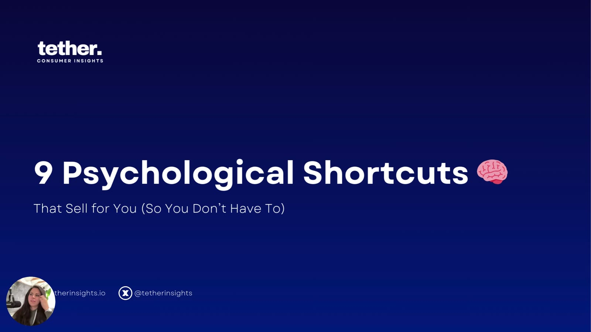

# Module 2: Heuristics 101

> "9 Psychological Shortcuts That Sell for You (So You Don't Have To)." This is Tether Lab's foundational course. It covers how the fast subconscious brain decides, and nine heuristics you can build into ad creative, alone and stacked.

## 🤖 Agent use
- **Use when:** labelling the psychological mechanism in any competitor ad, or choosing which shortcuts to build into a new UGC script or static.
- **Inputs → outputs:** an ad (ours or a competitor's) → heuristic labels, gaps, and a 2–3 heuristic stack. Start at the [Heuristics hub](../../../concepts/heuristics.md) decision table.
- **Rules:** DO talk to the subconscious (emotional, visual, fast). DO stack 2–3 heuristics on a processing-fluency base. DO favour the lesser-known six over the "expected" three. DON'T manipulate or over-design.
- **See also:** [Heuristic stacking](../../../concepts/heuristic-stacking.md), [Heuristics 101 e-book](../../../resources/heuristics-101-ebook.md), [Prompt Library](../07-prompt-library/README.md), [Valence–Intensity Diagnostic](../../../frameworks/valence-intensity-diagnostic.md).

Classroom tile: "Learn the must-know shortcuts your customers' brains use to make fast buying [decisions]." In the welcome tour, [Sarah Levinger](../../../people/sarah-levinger.md) calls it the beginner, "basic foundational level" course. She recommends it to experienced marketers too ([Welcome](../01-start-here/01-welcome-to-tether-lab.md) [02:06]–[02:45]).

*The slide deck used across lessons 1–5: "9 Psychological Shortcuts 🧠 That Sell for You (So You Don't Have To)," branded tether. consumer insights (tetherinsights.io, @tetherinsights).*

## Learning goals
After this module you should be able to:
1. Explain why ads should target the **subconscious** (fast, emotional, ~11 million bits/sec) rather than the **conscious** mind (slow, logical, ~40 bits/sec). See [Subconscious vs conscious mind](../../../concepts/subconscious-vs-conscious-mind.md).
2. Define [heuristics](../../../concepts/heuristics.md) (mental shortcuts) and why the brain uses them: to save energy and keep you alive.
3. Recognise and apply the nine shortcuts in copy and visuals.
4. **Stack** two or three heuristics in one static ad. See [Heuristic stacking](../../../concepts/heuristic-stacking.md).
5. Avoid the classic mistakes: over-designing, manipulating, using only one shortcut, and talking only to the conscious mind.

## Lessons

| # | Lesson | Length | Heuristics covered |
|---|---|---|---|
| 1 | [Targeting the Decision-Making Brain](01-targeting-the-decision-making-brain.md) | 5:34 | Two-minds model, what a heuristic is |
| 2 | [Using Biases That Sell](02-using-biases-that-sell.md) | 6:23 | [Scarcity](../../../concepts/heuristics/scarcity-heuristic.md), [Social proof](../../../concepts/heuristics/social-proof.md), [Authority bias](../../../concepts/heuristics/authority-bias.md) |
| 3 | [Emotion, Clarity, Urgency](03-emotion-clarity-urgency.md) | 6:18 | [Affect heuristic](../../../concepts/heuristics/affect-heuristic.md) (feeling), [Processing fluency](../../../concepts/heuristics/processing-fluency.md) (clarity), [Temporal discounting](../../../concepts/heuristics/temporal-discounting.md) (now beats later) |
| 4 | [Hook Attention, Guide Behavior](04-hook-attention-guide-behavior.md) | 7:21 | [Salience bias](../../../concepts/heuristics/salience-bias.md), [Goal gradient effect](../../../concepts/heuristics/goal-gradient-effect.md), [Framing effect](../../../concepts/heuristics/framing-effect.md) |
| 5 | [Stacking Psychology for Growth](05-stacking-psychology-for-growth.md) | 9:04 | Three real ads, each layering 3 heuristics |
| 6 | Quiz! | (Typeform) | See [Quiz](#quiz) below |
| 7 | [Heuristics 101 e-book](../../../resources/heuristics-101-ebook.md) | 18-page PDF | All nine, plus how to combine them and mistakes to avoid |
| 7b | [Bonus: Heuristics 101 Playbook](07-bonus-heuristics-101-playbook.md) | Page | Landing page for the e-book |
| 8 | [Bonus: Get CreativeOS (1 Month Free)](08-bonus-creativeos.md) | 5:33 video | [CreativeOS](../../../tools/creativeos.md) template-library demo; code `TETHER` |

## The nine shortcuts at a glance

| # | Heuristic | One-liner (e-book) | Use it by | Pro tip |
|---|---|---|---|---|
| 1 | [Scarcity heuristic](../../../concepts/heuristics/scarcity-heuristic.md) | If it's about to be gone, we want it more. | Limited stock, time-sensitive offers, purchase limits | Quantity limits often outperform time limits |
| 2 | [Social proof](../../../concepts/heuristics/social-proof.md) | If others like it, it must be good. | Customer counts, testimonials/reviews/UGC, "Top Seller" badges | Show the people behind the stars |
| 3 | [Authority bias](../../../concepts/heuristics/authority-bias.md) | We trust perceived experts. | Expert recommendations, technical terms, guarantees | Not all audiences trust traditional experts |
| 4 | [Affect ("Effect") heuristic](../../../concepts/heuristics/affect-heuristic.md) | If it feels good, it must be good. | Paint the desired experience; sell the feeling | The faster they feel, the faster they buy |
| 5 | [Processing fluency](../../../concepts/heuristics/processing-fluency.md) | Easy to understand = more trustworthy. | Clean layouts, short headlines, no clutter | A 7-year-old should get it in 3 seconds |
| 6 | [Temporal discounting](../../../concepts/heuristics/temporal-discounting.md) | The brain craves instant rewards. | Immediate results, fast-action language | Talk about right now, not "someday" |
| 7 | [Salience bias](../../../concepts/heuristics/salience-bias.md) | Whatever stands out gets attention. | Bold colour on muted backgrounds, unexpected visuals, clear focal point | In a sea of beige, be the red balloon |
| 8 | [Goal gradient effect](../../../concepts/heuristics/goal-gradient-effect.md) | The closer to the finish line, the faster we move. | Progress bars, step-by-step visuals | Always show how close they are to "done" |
| 9 | [Framing effect](../../../concepts/heuristics/framing-effect.md) | How you present info changes how it's received. | Big numbers → daily units; cost per use | Frame it so the customer feels smart for buying |

The hub page is [Heuristics](../../../concepts/heuristics.md).

## Quiz
Lesson 6 is a Typeform quiz ("🧠 Quiz Time: How well do you know your heuristics (and how to *use* them)?"): <https://mqnukk249sy.typeform.com/to/wbrjS3EE>. The page asks you to share your score or biggest takeaway in the group.

**The quiz questions and answers aren't in the course files.** They live on Typeform and weren't captured. To test yourself, use the self-check below. It's written from the lesson content and is *not* the official quiz.

Self-check (not from the course quiz)

1. How fast does the subconscious mind process information compared with the conscious mind? → ~11 million vs ~40 bits per second ([L1 01:39, 02:07](01-targeting-the-decision-making-brain.md)).
2. Why do quantity limits ("4 per customer") work so well? → They tell people how much you expect them to buy and hint at how much others buy (KFC 2014) ([L2 01:44](02-using-biases-that-sell.md)).
3. How do you make "6,000 five-star reviews" more human? → Name the people: "6,000 sock lovers have adopted…" ([L2 03:33](02-using-biases-that-sell.md)).
4. When can authority bias backfire? → With audiences who distrust authority, e.g. many boomers who trust peers, nurses or functional practitioners over doctors ([L2 05:20](02-using-biases-that-sell.md)).
5. Does temporal discounting have anything to do with price? → No. It's about how soon the reward arrives ("one bite") ([L3 04:18](03-emotion-clarity-urgency.md)).
6. What's the best salience layout? → A calm, single-colour or white background with one drastically different element dead centre ([L4 01:22](04-hook-attention-guide-behavior.md)).
7. Authority *bias* vs authority *proof*? → Proof needs an authority figure's quote, stars or picture. Bias just means sounding authoritative, e.g. "plant-based biopolymer" ([L5 02:41](05-stacking-psychology-for-growth.md)).
8. How many heuristics should one ad stack? → At least two or three (e-book p.16).

## Mentioned but not covered in this module
At [07:31] in lesson 5, Sarah names the **IKEA effect**, **status quo bias** and **paradox of choice** as heuristics she'll "dive into" later. "Behavioral marketing is a deep, deep ocean." The live sessions later covered the [IKEA effect](../../../concepts/heuristics/ikea-effect.md) and [choice overload](../../../concepts/heuristics/choice-overload.md); see the [heuristics hub catalog](../../../concepts/heuristics.md#every-heuristic-page-catalog) for all 54 heuristic pages.

## Related
- [Tether Lab hub](../README.md) · [Module 1: Start Here](../01-start-here/README.md)
- Next: Valence & Intensity Model, covered in [Valence](../../../concepts/valence.md), [Intensity](../../../concepts/intensity.md), [Emotional zones](../../../concepts/emotional-zones.md), [Valence–Intensity Diagnostic](../../../frameworks/valence-intensity-diagnostic.md)
- [Prompt Library](../07-prompt-library/README.md), which pairs many of these biases inside ChatGPT prompts
