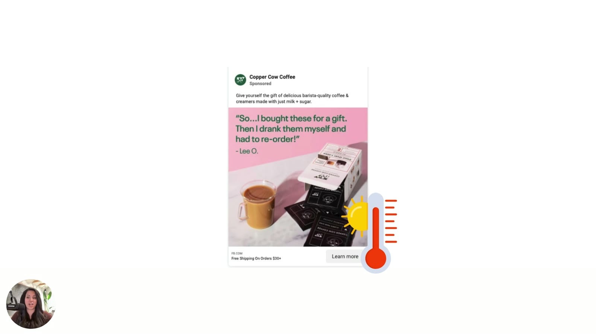

# The Real Reason Your Ad Isn't Working
> When an ad has a good offer, a strong headline and polished creative but still won't convert, the problem is almost never the creative. It's an **emotional tone mismatch** between the ad and where the customer is emotionally.

## 🤖 Agent use
- **Use when:** triaging an ad that "should work" (solid offer, headline, creative) but doesn't convert, before proposing new hooks, creators or targeting.
- **Inputs → outputs:** underperforming ad + context → a decision to run the [Valence-Intensity diagnostic](../../../frameworks/valence-intensity-diagnostic.md) first, plus a one-line hypothesis about the emotional mismatch.
- **Rules:**
  - DO suspect **emotional tone** first when surface elements are strong but conversion is weak. "It's not your hook, it's not your price, it's your vibe." [01:08–01:27]
  - DON'T react by changing targeting, turning it into a GIF, hiring a new UGC creator or drafting "70 new hooks". [00:55–01:05]
  - DO match the ad's **emotional temperature** to the customer's current moment and how they feel about their problem. [01:45]
  - DO optimize for **feel**, not just words. [02:01]
- **See also:** [Emotional misfire](../../../concepts/emotional-misfire.md) · [Valence-Intensity diagnostic](../../../frameworks/valence-intensity-diagnostic.md)

Lesson page blurb: *"Your copy, hook, and visuals might look right... But if your ad isn't hitting, it's almost always an emotional mismatch. Let's break down why your message feels 'off' to your audience and how to realign it to meet them where they are emotionally."*

## TL;DR
- The classic question: *"Sarah, this ad should be working. Why is it not?"* It usually comes up about an ad with a good offer, strong headline and beautiful, well-designed creative. [00:14–00:33]
- Brands react by changing everything else: targeting, making it a GIF, a new UGC creator, "70 new hooks". That usually doesn't work. [00:47–01:05]
- It's **not a creative problem, it's an emotional tone issue**: "It's not your hook, it's not your price, it's your vibe." [01:08–01:27]
- When the ad's **emotional temperature** doesn't match the customer's moment, "even great offers are going to fall completely flat". [01:45–01:57]
- **"Most marketers are going to optimize words… the winners are going to optimize for feel."** [02:01–02:05]

## Key ideas

### The "this ad should be working" moment [00:00–01:05]
- The module's goal is to diagnose why ads aren't working and then fix them, specifically ads that *seem like they should work*. [00:00–00:12]
- The ads in question typically have a good offer, a strong headline and beautiful, well-developed, well-designed creative, "but it's still not converting." Sarah calls it "a gut punch moment": *I have done all this research. I know this should hit with our audience.* [00:22–00:45]
- **The usual (wrong) reflex:** change targeting, turn it into a GIF, bring in a new UGC creator, "draft 70 new hooks", and "tweak and tweak and tweak and tweak". It typically doesn't help. [00:47–01:05]

*The running example for the module: a Copper Cow Coffee testimonial ad ("So…I bought these for a gift. Then I drank them myself and had to re-order!" – Lee O.). It has a good offer and nice design, but no sales. [00:30]*

### The real cause: emotional misalignment [01:08–01:43]
- "It's not a creative problem really. It's an emotional tone issue." [01:08–01:12]
- The ad is "misaligned with what your audience **believes about their problem**." It has to shift emotionally so people can "**feel** that buy", meaning feel the motivation to move forward. [01:14–01:23]
- "It's not your hook, it's not your price, it's your vibe that we need to adjust." [01:25–01:27]
- What Sarah typically sees: "The words on this ad are right, but the feeling is kind of wrong and customers feel this pretty deeply." As soon as they hit an ad like that, "they just kind of scroll on." [01:31–01:43]

### Emotional temperature [01:45–01:59]
- "When your ad's **emotional temperature** doesn't align with the moment that your customer is currently in, or how they're feeling about their problem, everything, even great offers, are going to fall completely flat." [01:45–01:57]
- That's why getting this step right is critical. [01:57–01:59]

*The "emotional temperature" metaphor: every ad runs at an emotional temperature that has to match the customer's current state. [01:30]*

### Optimize for feel, not words [02:01–02:25]
- "Most marketers are going to optimize words. They're going to optimize the copy itself, but the winners are going to optimize for feel." [02:01–02:05]
- Coming up: how to take an ad that "feels slightly off" to one that's "spot on emotionally with where your customers sit inside their **subconscious mind**", so the next test does better. [02:09–02:24] See [Subconscious vs conscious mind](../../../concepts/subconscious-vs-conscious-mind.md).

## Examples
- **Copper Cow Coffee testimonial ad** (on screen only, brand not spoken). Pink background, glass of latte, product box and sachets. Headline: *"So…I bought these for a gift. Then I drank them myself and had to re-order!" – Lee O.* Primary text: *"Give yourself the gift of delicious barista-quality coffee & creamers made with just milk + sugar."* Footer: "Free Shipping On Orders $30+", CTA "Learn more". It's diagnosed in [lesson 4](04-diagnosing-emotional-misfires.md) and rewritten in [lesson 5](05-fixing-the-tone-without-rebuilding-the-ad.md).

## Structured units

### Ad teardowns
| Brand / product (niche) | Format | Hook / opening | What works | What fails | Fix suggested | Principle | Source |
|---|---|---|---|---|---|---|---|
| Copper Cow Coffee (DTC Vietnamese pour-over coffee & creamers) | Static Meta image ad, customer testimonial on soft-pink background | "So…I bought these for a gift. Then I drank them myself and had to re-order!" – Lee O. | Good offer (free shipping $30+), strong headline, beautiful, well-designed, positive social proof | Doesn't convert. "The words on this ad are right, but the feeling is kind of wrong." | Re-align the emotional temperature to the customer's moment (diagnosed in L4, rewritten in L5) | Optimize for feel, not words | [00:30; 01:35–02:05] |

### Rules of thumb
- **IF** an ad has a good offer, strong headline and polished creative but won't convert **THEN** diagnose emotional tone before anything else. [01:08]
- **DON'T** answer a "should-work" flop with new targeting, a GIF version, a new UGC creator or "70 new hooks". [00:55]
- **DO** match the ad's emotional temperature to the customer's current moment and how they feel about their problem. [01:45]
- **DO** optimize for feel. "Most marketers are going to optimize words." [02:01]

## Notable quotes
- "It's not your hook, it's not your price, it's your vibe that we need to adjust." [01:25]
- "The words on this ad are right, but the feeling is kind of wrong and customers feel this pretty deeply." [01:35]
- "Most marketers are going to optimize words… but the winners are going to optimize for feel." [02:01]

## How to apply
- [ ] When an ad "should" work but doesn't, **stop** before rewriting hooks, swapping creators or changing targeting.
- [ ] Ask instead: *what does this ad make people feel, and does that match how they feel about their problem right now?*
- [ ] Run the [Valence-Intensity diagnostic](../../../frameworks/valence-intensity-diagnostic.md) on it.

## Related
- Brand case files: [Copper Cow Coffee](../../../brands/copper-cow-coffee.md) · [all brands by niche](../../../brands/README.md)
- [Emotional misfire](../../../concepts/emotional-misfire.md) · [Valence](../../../concepts/valence.md) · [Intensity](../../../concepts/intensity.md) · [Emotional zones](../../../concepts/emotional-zones.md)
- Next: [2. Understanding Valence & Intensity](02-understanding-valence-and-intensity.md) · Module: [README](README.md)
- E-book version: [Chapter 1 "The Real Reason Your Ad Isn't Working"](../../../resources/diagnose-why-your-ads-arent-working-ebook.md#chapter-1-the-real-reason-your-ad-isnt-working)

## Sources
- Transcript: [1. The Real Reason Your Ad Isn't Working.txt](../../../../raw/tether-lab/_transcripts/3.%20The%20Valence%20&%20Intensity%20Model/1.%20The%20Real%20Reason%20Your%20Ad%20Isn't%20Working.txt)
- Lesson page text: [1_1_The_Real_Reason….md](../../../../raw/tether-lab/_extracted/3.%20The%20Valence%20&%20Intensity%20Model/1_1_The_Real_Reason_Your_Ad_Isn’t_Working_The_Valence_&.md)
