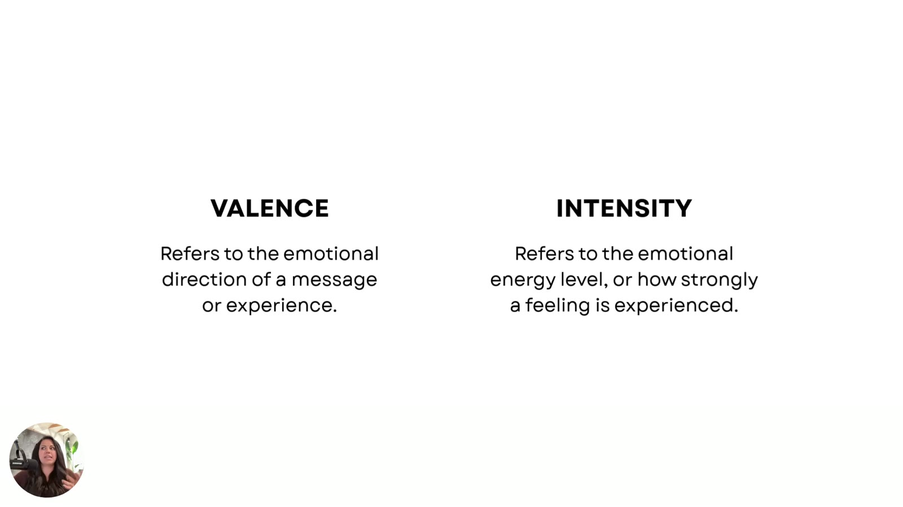

# Understanding Valence & Intensity
> Every emotion in an ad has two levers. **Valence** is *what* emotion you evoke (positive or negative). **Intensity** is *how hard* you hit it (whisper or scream). Together they place an ad in one of four emotional zones.

## 🤖 Agent use
- **Use when:** labelling the emotion in a competitor ad or our script, or choosing between a pull (aspirational) and a push (risk) angle.
- **Inputs → outputs:** ad/script → `valence` (positive/negative + named emotion) and `intensity` (low/high) labels.
- **Rules:**
  - DO label **valence = what is said emotionally** and **intensity = how hard it's said** as two separate fields. [01:21]
  - DO use positive valence for aspirational, pull-toward angles, and negative valence for risk / "secure your future" / "protect" angles. [01:48–02:07]
  - DO use high intensity for urgency and momentum, and low intensity for trust, recognition and reflection. [02:07–02:24]
  - DO grade intensity within one emotion family (irritation → rage) rather than just switching emotions. [01:29]
- **See also:** [Valence](../../../concepts/valence.md) · [Intensity](../../../concepts/intensity.md) · [Emotional zones](../../../concepts/emotional-zones.md)

Lesson page blurb: *"Every emotion has two levers: **Valence** (positive or negative) and **Intensity** (whisper or scream). You'll learn how to identify both and use them to pinpoint why your ad's emotional tone either connects or repels."*

## TL;DR
- The goal is to build your "**emotional radar**" so you can identify which piece of the ad didn't work. [00:09–00:14]
- Every feeling an ad creates lives in **one of four emotional zones**, and each zone leads to **different buyer behavior**. [00:14–00:26]
- **Valence = what I'm saying.** Which emotion am I trying to get this person to feel: positive (joy, pride, excitement, hope, comfort) or negative (fear, frustration, anxiety, FOMO, anger)? [00:36–01:16]
- **Intensity = how I'm saying it.** How deep does the emotion go: irritation or rage? [01:16–01:41]
- **Positive valence pulls** people toward what they want (aspirational marketing). **Negative valence pushes** them away from what they fear (risk marketing). **High intensity** gives urgency and momentum. **Low intensity** builds trust, recognition and reflection. [01:48–02:24]

## Key ideas

### Building your emotional radar [00:00–00:36]
- Before fixing anything, learn to identify which part of the ad didn't work. [00:09–00:14]
- "Every feeling that you create inside an ad lives in one of four emotional zones. And each of these zones kind of lead to **different buyer behavior**." [00:14–00:26]
- The zones are built from two categories: valence and intensity. [00:31–00:36]

*The definition slide. **Valence**: "Refers to the emotional direction of a message or experience." **Intensity**: "Refers to the emotional energy level, or how strongly a feeling is experienced." [00:30]*

### Valence: *what* emotion [00:36–01:16]
- "What kind of emotion you're trying to pull out from someone, aka like, **what am I trying to say?** Which emotion am I trying to get this person to feel?" [00:36–00:52]
- **Positive valence** = emotions that feel good: **joy, pride, excitement, hope, comfort**. [00:46–01:04]
- **Negative valence** = emotions that feel bad: **fear, frustration, anxiety, FOMO, anger**. "They're a little bit lower emotional tone." [01:04–01:16]
- Full concept page: [Valence](../../../concepts/valence.md).

### Intensity: *how hard* [01:16–01:48]
- "How hard you're hitting these emotions… **how am I saying this emotion?**" [01:16–01:21]
- "**Valence is what I'm saying. Intensity is how I'm saying it.**" [01:21–01:29]
- "How deep does this emotion go? Is it **irritation** or is it like **rage** that we're going after?" [01:29–01:36]
- "There are different levels of intensity, and how you map those in your ad is going to directly affect how well that ad performs." [01:36–01:48]
- Full concept page: [Intensity](../../../concepts/intensity.md).

### What each pole does for a buyer [01:48–02:24]

| Pole | Effect on buyer | Marketing style / use |
|---|---|---|
| **Positive valence** | **Pulls** people toward something they want | "Aspirational marketing is almost always positive valence." |
| **Negative valence** | **Pushes** people away from things they fear or dislike | "Risk level marketing": *secure your future, protect something* |
| **High intensity** | Stronger emotional arousal | Urgency, creating momentum |
| **Low intensity** | Softer emotional impact | Building trust, recognition, reflection |

[01:48–02:24]

### Recap and what's next [02:24–02:51]
- Valence = which emotion I'm trying to communicate or get customers to feel. Intensity = how hard I'm hitting that emotion. [02:24–02:35]
- Next, the emotions get mapped on **two simple axes**: "This is where really psychology meets application." Where does my ad sit, and where do I need to move to get people to buy? [02:35–02:51]

## Examples
- No new ad examples. The Copper Cow Coffee ad from [lesson 1](01-the-real-reason-your-ad-isnt-working.md) stays on screen as the reference ad. [00:18]
- Intensity scale example: **irritation → rage** (same negative valence, different intensity). [01:29]

## Structured units

### Angles
| Angle | Core desire / pain | Heuristic(s) | Best format | Example line | Source |
|---|---|---|---|---|---|
| Aspirational pull (positive valence) | Move *toward* something they want (joy, pride, excitement, hope, comfort) | (none stated) | Not specified | Not given in this lesson (see L5 Zone 2: "Straight-up dopamine in a mug") | [01:48–01:53] |
| Risk / protection push (negative valence) | Move *away* from what they fear or dislike | [Loss aversion](../../../concepts/heuristics/loss-aversion.md) (wiki tag) | Not specified | "Secure your future", "protect something" | [01:57–02:07] |

### Rules of thumb
- **DO** use **high intensity** to create urgency or momentum. [02:07]
- **DO** use **low intensity** to build trust, recognition or reflection. [02:13]
- **DO** treat "what emotion" (valence) and "how hard" (intensity) as separate decisions. [01:21]

## Notable quotes
- "Valence is what I'm saying. Intensity is how I'm saying it." [01:21]
- "Positive valence pulls people towards something they want… Negative valence… pushes people away from things they fear or dislike." [01:48]
- "This is where really psychology meets application." [02:35]

## How to apply
- [ ] For any ad, name the **one dominant emotion** it communicates. Is it positive or negative? That's its valence.
- [ ] Ask whether that emotion is delivered as a whisper or a scream. That's its intensity.
- [ ] Decide whether your product sale is a *pull* (aspiration) or a *push* (risk avoidance), and whether you need *momentum* (high intensity) or *trust* (low intensity).

## Related
- [Valence](../../../concepts/valence.md) · [Intensity](../../../concepts/intensity.md) · [Emotional zones](../../../concepts/emotional-zones.md)
- Previous: [1. The Real Reason Your Ad Isn't Working](01-the-real-reason-your-ad-isnt-working.md) · Next: [3. The 4 Emotional Zones](03-the-4-emotional-zones.md)
- E-book: [Chapter 2](../../../resources/diagnose-why-your-ads-arent-working-ebook.md#chapter-2-understanding-valence--intensity)

## Sources
- Transcript: [2.Understanding Valence & Intensity.txt](../../../../raw/tether-lab/_transcripts/3.%20The%20Valence%20&%20Intensity%20Model/2.Understanding%20Valence%20&%20Intensity.txt)
- Lesson page text: [2_2_Understanding_Valence….md](../../../../raw/tether-lab/_extracted/3.%20The%20Valence%20&%20Intensity%20Model/2_2_Understanding_Valence_&_Intensity_The_Valence_&_Int.md)
