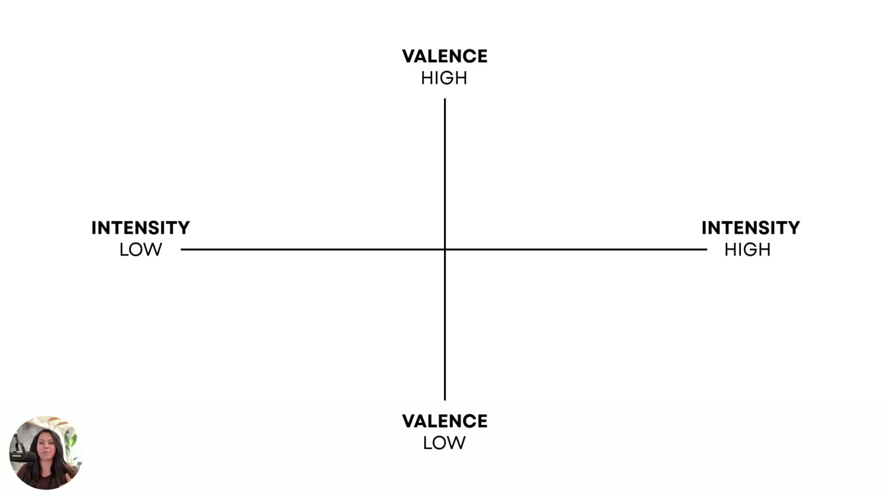
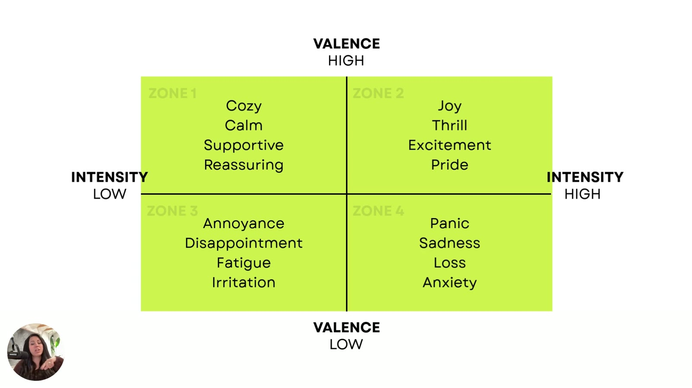

# The 4 Emotional Zones (a.k.a. Your Target Map)
> Plot valence (positive/negative) against intensity (low/high) and you get four emotional zones. Each zone fits different products, industries and buyer moments. Your job is to **choose the zone** your customer is most likely to respond to.

## 🤖 Agent use
- **Use when:** picking the target emotional zone for a new UGC script or creator brief; tagging competitor ads by zone during teardown.
- **Inputs → outputs:** product category + buyer moment + saturation level → zone (1–4) + zone emotion vocabulary + warnings.
- **Rules:**
  - IF the product should make people "feel okay inside" (wellness, luxury, intimacy, safety, belonging) THEN Zone 1. [01:49]
  - IF it's a launch, performance product, or you need people to *move* THEN Zone 2. [02:11–02:26]
  - IF you're building pain-point awareness or a before/after set-up THEN Zone 3, unless the category is saturated. [02:59–03:14]
  - IF it's a limited-time offer or health/safety THEN Zone 4, with care. [03:40–03:48]
  - DON'T make people feel bad or trigger trauma. Elicit the emotion already attached to their experience. [03:51–04:05]
  - DO remember no zone is wrong. Fit to the audience's emotional context decides. [04:13–04:40]
- **See also:** [Emotional zones](../../../concepts/emotional-zones.md) · [Valence-Intensity diagnostic](../../../frameworks/valence-intensity-diagnostic.md) · [Prompts](../../../resources/valence-intensity-prompts.md)

Lesson page blurb: *"Not all emotions are created equal. This chapter breaks down the four key emotional zones your ad can live in, and when to use each. From cozy reassurance to high-stakes urgency, you'll discover how to strategically choose the vibe your customer is most likely to respond to."*

## TL;DR
- It's a **four-quadrant axis model**: valence high (top) / low (bottom), intensity low (left) / high (right). [00:17–00:32]
- Mapping step 1: is the emotion **positive or negative**? Step 2: is it **low or high energy**? [00:32–01:05]
- **Zone 1 (high valence, low intensity)** is the feel-good zone. **Zone 2 (high/high)** is hype and anticipation. **Zone 3 (low/low)** is subtle frustration. **Zone 4 (low valence, high intensity)** is fear and urgency. [01:23–03:45]
- Avoid Zone 3 in **saturated industries** because "a lot of marketers live" there. Handle Zone 4 with **great care**: no trauma triggering. [03:10–04:05]
- **No zone is wrong.** A zone works when it matches the emotional context your audience is in. "You can write the smartest ad in the world. But if it's shouting the wrong emotional language, it's not going to land." [04:13–04:45]

## Key ideas

### Building the map [00:00–01:23]
- Now that we know the problem and the emotions involved in purchasing, we map them on the **valence intensity axis**. [00:05–00:22]
- "This is a four-quadrant axis model. So you have valence at the top, valence at the bottom, intensity low on the left, intensity high on the right." [00:22–00:32]

*The empty map. Valence high at top, low at bottom. Intensity low on the left, high on the right. [00:16]*

- **Step 1: map valence.** "Is the emotion that we use in this ad negative or positive? Where does it sit on this line?" Where it falls "is going to directly affect the reaction that we get" from readers. [00:32–00:59]
- **Step 2: map intensity.** "Is it a low energy or is it a high energy emotion?" That gives four quadrants. [00:59–01:09]
- Depending on intensity, "you may want to **dial it up or dial it back**, depending on where your customers sit emotionally with their problem and their experience." [01:09–01:18]

### The four zones [01:23–03:45]

*The completed target map. Zone 1: Cozy, Calm, Supportive, Reassuring. Zone 2: Joy, Thrill, Excitement, Pride. Zone 3: Annoyance, Disappointment, Fatigue, Irritation. Zone 4: Panic, Sadness, Loss, Anxiety. [04:00]*

#### Zone 1: High valence, low intensity ("the feel-good zone") [01:26–02:01]
- "High valence, meaning these are like really high emotions, but the intensity on them is really low. These are kind of **feel-good energy**." [01:33–01:40]
- "Zone one is all about like **reassuring, calm, supportive** messaging." [01:45]
- **Works for:** wellness, luxury brands, intimacy brands, safety brands, belonging brands. "Anytime you're selling a product where you want someone to **feel okay inside**, you want to be in zone one." [01:49–02:01]

#### Zone 2: High valence, high intensity ("hype and anticipation zone") [02:01–02:31]
- "Zone two is all about like **joy, thrill, excitement, pride**." [02:08]
- **Works for:** launching something, performance products and performance industries, achievement, momentum. [02:11–02:20]
- Use it "if you're trying to **push them to move**. We're trying to get them to do something physical in their world." [02:20–02:29]

#### Zone 3: Negative valence, low intensity ("subtle frustration") [02:31–03:27]
- "That kind of subtle frustration." Many brands sit here, "trying to pull out a little bit of frustrating emotions around the problem." [02:35–02:48]
- Use it to get people to feel **annoyed**, or to think about **unmet expectations, fatigue, irritation, disappointment**. [02:48–02:59]
- **Works for:** **pain-point building**, **before-and-after contrast**, and "setting up for a relief on the opposite side". [02:59–03:10]
- ⚠️ "A lot of marketers live in low intensity, low valence. So I **don't suggest you use this one if you're in a saturated industry**." There are lots of other places on the map. [03:10–03:21]
- Generally "really good if you're trying to get people to think about what their problems are." [03:21–03:27]

#### Zone 4: Negative valence, high intensity (fear and urgency) [03:27–04:13]
- "This is where your **fear and urgency** lives… that energy of **panic, scarcity**… **threats or loss** also kind of live in this particular zone." [03:27–03:40]
- **Works for:** **limited-time offers**, **health/safety-focused industries**. [03:40–03:45]
- ⚠️ "You have to be very careful with how you use this one. We do not want to trigger people negatively." [03:45–03:51]
- Related heuristics: [loss aversion](../../../concepts/heuristics/loss-aversion.md) and scarcity (see the [heuristics hub](../../../concepts/heuristics.md)).

### Ethics: elicit, don't wound [03:48–04:31]
- "In marketing, it is **not our job to make people feel bad** about something. All we want to do is elicit some sort of an emotion that's attached to their specific experience." [03:51–04:02]
- "You don't want to try and like **trigger traumas**." [04:02–04:05]
- "All we're trying to do is help them realize that the emotions around their problem could be solved with your specific product." [04:06–04:13]
- "None of these zones are wrong… there's nothing in here that's… an unethical thing that you could use. But they are things that are going to trigger emotions. So we have to think about this **consciously** as we go through the process of mapping." [04:13–04:31]

### Why a zone works [04:31–05:04]
- "Each zone is going to work because it **matches the emotional context your audience is in** when they see your ad and when they think about what they're experiencing." [04:31–04:40]
- "You can write the smartest ad in the world. But if it's shouting the wrong emotional language, it's not going to land." [04:40–04:45]
- Next lesson: map an actual ad from top to bottom and decide which zone it needs to live in "to elicit a better response and get the sale". [04:45–05:02]

## Framework / steps
1. Map **valence**: positive or negative?
2. Map **intensity**: low or high energy?
3. Read off the **zone** (1–4).
4. Decide whether to **dial intensity up or back** (or change valence) based on where customers sit emotionally with their problem.

→ The full procedure is in [Valence-Intensity diagnostic](../../../frameworks/valence-intensity-diagnostic.md).

## Summary table

| Zone | Valence / Intensity | Nickname | Emotions (slide) | Best for |
|---|---|---|---|---|
| 1 | High / Low | Feel-good zone | Cozy, calm, supportive, reassuring | Wellness, luxury, intimacy, safety, belonging. "Feel okay inside." |
| 2 | High / High | Hype & anticipation | Joy, thrill, excitement, pride | Launches, performance products, achievement, momentum, getting people to *move* |
| 3 | Low / Low | Subtle frustration | Annoyance, disappointment, fatigue, irritation | Pain-point building, before/after, set-up for relief. Not for saturated industries. |
| 4 | Low / High | Fear & urgency | Panic, sadness, loss, anxiety | Limited-time offers, health/safety. Use with great care. |

## Structured units

### Angles (one family per zone)
| Angle | Core desire / pain | Heuristic(s) | Best format | Example line | Source |
|---|---|---|---|---|---|
| Zone 1 reassurance ("feel okay inside") | Calm, safety, belonging, being supported | (none stated) | Wellness, luxury, intimacy, safety, belonging brands | "Finally, a coffee that slows you down—in the best way." (L5) | [01:45–02:01]; L5 [08:30] |
| Zone 2 hype / achievement | Joy, thrill, excitement, pride. Momentum, a push to *move* | (none stated) | Launches, performance products | "This coffee? Straight-up dopamine in a mug." (L5) | [02:04–02:29]; L5 [08:30] |
| Zone 3 pain-point whisper | Annoyance, unmet expectations, fatigue, disappointment | Before/after contrast (stated) | Pain-point building, set-up for relief. Not saturated categories. | "It's 2025. Why are we still drinking stale beans?" (L5) | [02:31–03:27]; L5 [08:30] |
| Zone 4 fear / urgency | Fear of loss, threat, panic, scarcity | Scarcity, [loss aversion](../../../concepts/heuristics/loss-aversion.md) (scarcity and loss stated as zone emotions) | Limited-time offers, health/safety | "The coffee you should have gifted—before it sold out." (L5) | [03:27–03:45]; L5 [08:30] |

### Rules of thumb
- **IF** the product should make people feel okay inside **THEN** use Zone 1. [01:54]
- **IF** you need buyers to physically act or you're launching **THEN** use Zone 2. [02:20]
- **IF** the category is saturated **THEN** don't sit in Zone 3: "a lot of marketers live" there. [03:10]
- **DO** use Zone 4 for limited-time offers and health/safety, and handle it with care. [03:40–03:48]
- **DON'T** make people feel bad or trigger trauma. Elicit the emotion already attached to their experience. [03:51–04:05]
- **DO** choose the zone that matches the audience's emotional context at exposure. No zone is wrong in itself. [04:13–04:40]

## Notable quotes
- "Anytime you're selling a product where you want someone to feel okay inside, you want to be in zone one." [01:54]
- "A lot of marketers live in low intensity, low valence. So I don't suggest you use this one if you're in a saturated industry." [03:10]
- "In marketing, it is not our job to make people feel bad about something." [03:51]
- "You can write the smartest ad in the world. But if it's shouting the wrong emotional language, it's not going to land." [04:40]

## How to apply
- [ ] Sort your current live ads into the four zones. Are they all in one zone? (If they're all in Zone 3 in a crowded category, that's a warning sign.)
- [ ] For your product, ask: do I want customers to *feel okay inside* (Z1), *move/act* (Z2), *notice the problem* (Z3), or *act now to avoid loss* (Z4)?
- [ ] If you use Zone 4, check that the fear is tied to the customer's real experience, not manufactured or trauma-adjacent.

## Related
- [Emotional zones](../../../concepts/emotional-zones.md) · [Valence](../../../concepts/valence.md) · [Intensity](../../../concepts/intensity.md)
- Previous: [2. Understanding Valence & Intensity](02-understanding-valence-and-intensity.md) · Next: [4. Diagnosing Emotional Misfires](04-diagnosing-emotional-misfires.md)
- E-book: [Chapter 3](../../../resources/diagnose-why-your-ads-arent-working-ebook.md#chapter-3-the-4-emotional-zones-aka-your-target-map) (adds visual cues per zone: "morning light, soft pastels", "bold type", "harsh lighting")

## Sources
- Transcript: [3.The 4 Emotional Zones (a.k.a Your Target Map).txt](../../../../raw/tether-lab/_transcripts/3.%20The%20Valence%20&%20Intensity%20Model/3.The%204%20Emotional%20Zones%20%28a.k.a%20Your%20Target%20Map%29.txt)
- Lesson page text: [3_3_The_4_Emotional_Zones….md](../../../../raw/tether-lab/_extracted/3.%20The%20Valence%20&%20Intensity%20Model/3_3_The_4_Emotional_Zones_a_k_a_Your_Target_Map_The_Val.md)
