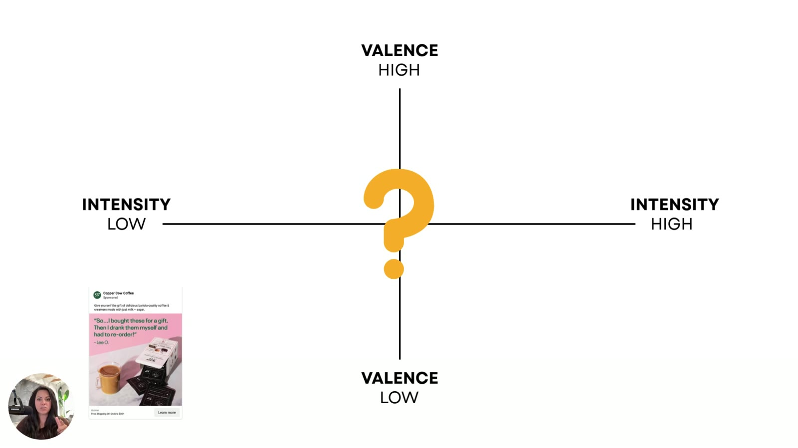
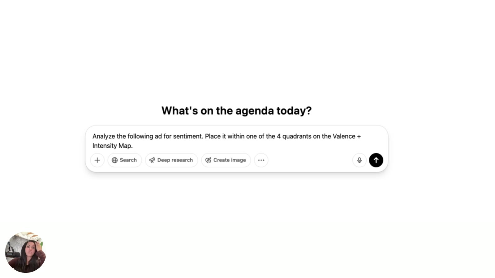
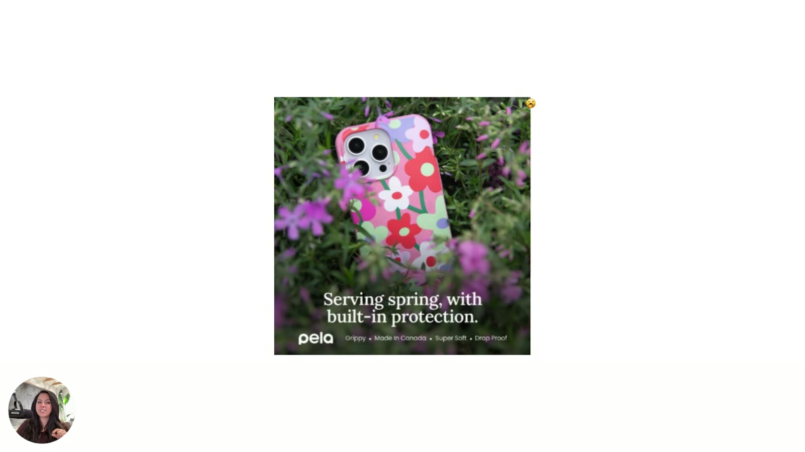
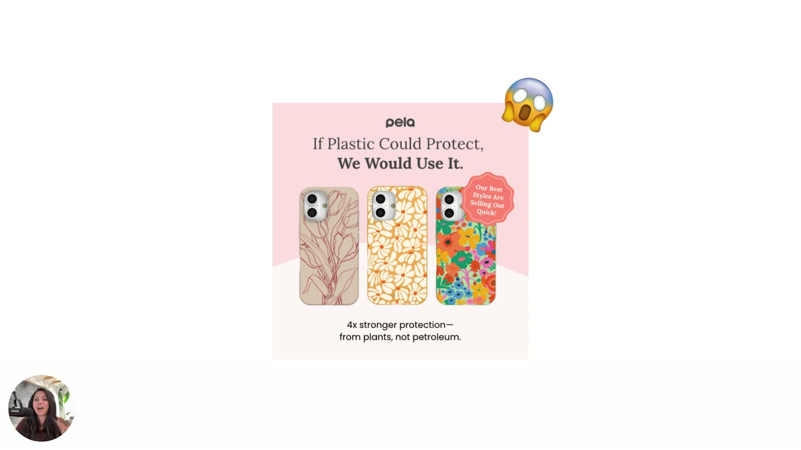

# Diagnosing Emotional Misfires
> A four-question diagnostic (plus a one-line ChatGPT shortcut) that tells you which zone your ad sits in and whether that zone matches what your customer is feeling. You fix the real issue "instead of rewriting endlessly".

## 🤖 Agent use
- **Use when:** tearing down a competitor ad's emotional tone; QA of our own static/UGC draft; post-mortem on a non-converting ad.
- **Inputs → outputs:** ad screenshot/script + customer state + purchase motive → zone + verdict (match / misfire / under-emotional) + direction to move. Full runnable version: [Valence-Intensity diagnostic](../../../frameworks/valence-intensity-diagnostic.md).
- **Rules:**
  - DO answer the four questions in order: valence → intensity → customer state at exposure → feeling needed. [00:42–01:34]
  - DO run the sentiment prompt with the ad screenshot (and the map) as a quick second opinion. [01:34–02:11]
  - DO read the core message from the **headline and image**. [02:41]
  - IF the buyer is stressed and wants fast solutions THEN don't serve a calm Zone 1 ad. [03:58–04:19]
  - IF the product is high-trust or luxury THEN avoid high-intensity promo styling (Jaguar). [04:19–04:54]
  - IF the purchase motive is energy (coffee = "a boost") THEN a cozy Zone 1 ad is a likely misfire. [05:04]
  - DO check whether the ad is **not emotional enough** for how strongly customers feel about the problem. [05:37]
- **See also:** [Emotional misfire](../../../concepts/emotional-misfire.md) · [Tone-shifting](../../../frameworks/tone-shifting.md)

Lesson page blurb: *"When an ad flops, it's rarely the design or copy alone. This lesson gives you a simple diagnostic tool to spot emotional tone mismatches fast, so you can fix the real issue instead of rewriting endlessly."*

## TL;DR
- **Four questions:** (1) Which emotional tone does the ad use, positive or negative? (2) Is its intensity high or low? (3) What emotional state is the customer in when they see it? (4) What emotional experience do we want them to have so they move forward? [00:39–01:34]
- **Shortcut prompt:** *"Analyze the following ad for sentiment. Place it within one of the 4 quadrants on the Valence + Intensity Map."* [01:34–02:11]
- ChatGPT put the Copper Cow Coffee ad in **Zone 1 (high valence, low intensity)**: positive, cozy, soft pink, gentle lighting, no urgency. [02:21–03:19]
- Zone 1 isn't bad in itself, but **for coffee** (bought "for a boost") it risks the "save for later" or "ignore" pile. [03:19–05:20]
- Classic misfires: calm ad shown to a **stressed buyer on a deadline** (ignored), and a high-energy promo for a **high-trust luxury** product (feels cheap; **Jaguar**). [03:58–04:54]
- Ads often underperform because they're **not emotional enough**, not because they're too emotional. [05:37–05:54]

## Key ideas

### Setting up the diagnosis [00:00–00:39]
- The approach: use the map with a real ad example so you can "spot these emotional misfires **before they take your ROAS**". [00:24–00:34]
- Scenario: "an ad that's just not converting… We don't know why." [00:34–00:42]


*The diagnostic question: where on the valence × intensity map does this ad sit? [00:30]*

### The four diagnostic questions [00:42–01:34]
1. **Valence:** "Which emotional tone is the ad currently using? Is it positive or is it negative? Which emotion are we communicating?" [00:42–00:53]
2. **Intensity:** "What's the emotional intensity of this ad? Is it high or is it low?… Are we communicating a lot of emotion or just a little bit of emotion?" [00:53–01:03]
3. **Customer state:** "What's the emotional state of the customer the moment [they're] seeing our ad?" "Most of the time they're in some sort of a **dopamine scrolling** thing", but they could be thinking about their problem, at work, or at home. "If our customer is kind of distracted, what kind of emotion should we be using to get them to think about their problem more?" [01:03–01:24]
4. **Target experience:** "What emotional experience do we want to communicate in order to get them to move forward and go check out what we have?" [01:24–01:34]

→ Packaged as a procedure in [Valence-Intensity diagnostic](../../../frameworks/valence-intensity-diagnostic.md).

### The ChatGPT shortcut [01:34–02:21]
- "If you're short on time, you can actually just use this prompt." [01:34–01:39]
- You can **drag and drop a screenshot of Sarah's valence map** into the prompt, or let ChatGPT find one, "because this is a well-known psychology model… it should know what the valence intensity curve is or map is." [01:39–01:55]
- You're asking it to analyze the ad for **sentiment**, i.e. the emotional tone, and place it in one of the four quadrants. [01:55–02:11]


*The on-screen prompt, verbatim: "Analyze the following ad for sentiment. Place it within one of the 4 quadrants on the Valence + Intensity Map." [01:30]*

```text
Analyze the following ad for sentiment. Place it within one of the 4 quadrants on the Valence + Intensity Map.
```
(Attach the ad screenshot, and optionally a screenshot of the map.) Also collected in [Valence + Intensity prompts](../../../resources/valence-intensity-prompts.md#diagnostic-prompt-from-lesson-4).

### What ChatGPT said about the Copper Cow ad [02:11–03:19]
Its verdict: **high valence, low intensity (Zone 1)**, for these reasons:
- **Valence:** sentiment is positive. The ad "revolves around kind of **enjoyment, indulgence, surprise, and delight**." [02:25–02:36]
- The **testimonial** drives most of the message. Sarah adds: "Your core message really is in your **headline** and in your **images**." It's "somewhat humorous… but it's really just more positive." [02:36–02:52]
- **Intensity:** "no urgency to this ad whatsoever. It's not really dramatic in tone. There's no high arousal emotions in here like fear or excitement or outrage. It's really just a **cozy** ad. It's lighthearted… **soft pink background**… **gentle lighting**… nice, soft, warm, fuzzy feeling." [02:52–03:08]


*The ad mapped to high valence + low intensity (Zone 1). [03:00]*

### Is Zone 1 a problem here? It depends on the customer [03:19–03:58]
- "Depending on how your customer views your product or brand… this quadrant might stick you in the **'save for later'** category, or it might even put you in the **ignore** category." [03:19–03:36]
- That verdict applies to *this* brand only. "I don't want you to think that… none of our ads can be in the comfort zone. That is not true at all. **It depends on what your customer wants to feel.** If you have a customer who wants to feel cozy, this might work incredibly well." [03:36–03:58]

### Examples of misfires [03:58–04:54]
| Ad tone | Shown to | Result | Why |
|---|---|---|---|
| Calm, soothing **Zone 1** ad | A **stressed-out buyer on a deadline**: "I just need something to get me from A to Z as quickly as possible" | **Completely ignored** | "Their brain is not attuned to finding calm solutions. Their brain is attuned to finding quick solutions." [03:58–04:19] |
| **High-energy, promotionally heavy** ad | Buyers of a **high-trust luxury product** | **Feels cheap** | Mismatch with a customer who prefers low intensity, high valence. **Jaguar** example. [04:19–04:54] |

- **Jaguar:** "This is what just happened to Jaguar not so long ago. They did these really… ridiculously intense, lots of colors, really high on the intensity side… so colorful and vibrant. And a lot of their customer types actually appreciated a little bit low intensity, high valence for their particular products." [04:31–04:54]
  - *(Context, not from course: this refers to Jaguar's late-2024 rebrand campaign, which used vivid colours and abstract imagery and drew heavy public backlash.)*

### Making the judgment call [04:54–05:26]
- "We need to make a very good judgment call based upon where our ad currently sits and based upon what we know our customers are probably trying to solve for." [04:54–05:04]
- **Coffee:** "Customers are looking for a **boost**. They… like the comfort aspect of it, but the reason we drink coffee is to boost energy." So a cozy Zone 1 coffee ad may be off-target. [05:04–05:16]
- Base the call on what you know about your **customer type, industry and product**. [05:16–05:26]

### Under-emotional ads [05:26–06:18]
- "The easiest way to think about this is really just to think deep about what's happening in the mind of your customer around their actual problem and experience. **How much emotion is going into their problem?** Are they feeling really heavy emotions?" [05:20–05:37]
- "Sometimes ads underperform not really because they're too emotional, but because **they're not emotional enough**." [05:37–05:54]
- "If you're stuck in this… more calming zone, maybe that's not where you want to be. Maybe your customer actually needs a lot **more motivation** to get them across that line and into your landing page." [05:54–06:09]
  - *Note:* the transcript says "low valence, low intensity zone, which is kind of like that more calming zone". By her own map the calming zone is Zone 1 (high valence, low intensity), so she most likely means **low intensity** in general.
- "Once you know where your ad sits zone-wise, you can finally **stop guessing**." [06:03–06:16]


*On-screen example (not narrated) shown while Sarah talks about ads that aren't emotional enough: Pela, "Serving spring, with built-in protection." Soft, natural, low-intensity. [05:27]*


*Contrasting Pela ad marked with a 😱 emoji: "If Plastic Could Protect, We Would Use It.", "4x stronger protection—from plants, not petroleum." and an "Our Best Styles Are Selling Out Quick!" badge (scarcity). More emotion and urgency. [05:30]*

## Examples
- **Copper Cow Coffee** gift/re-order testimonial → Zone 1 (positive, cozy, no urgency). Possibly off-target for a "boost" product.
- **Stressed deadline buyer vs calm ad** → ignored.
- **Jaguar** high-intensity rebrand vs a luxury audience that wanted calm and positive → felt cheap.
- **Pela** phone cases (on screen only): low-emotion "Serving spring" ad vs higher-emotion "If plastic could protect…" ad with a scarcity badge.

## Structured units

### Ad teardowns
| Brand / product (niche) | Format | Hook / opening | What works | What fails | Fix suggested | Principle | Source |
|---|---|---|---|---|---|---|---|
| Copper Cow Coffee (DTC coffee) | Static Meta testimonial | "So…I bought these for a gift. Then I drank them myself and had to re-order!" | Positive, somewhat humorous, enjoyment/indulgence/surprise/delight | Zone 1: no urgency, soft pink, gentle light. Coffee is bought "for a boost", so it risks "save for later" or ignore. | Move toward higher intensity (L5: verbs, intense pink, "dopamine" promise) | Match zone to purchase motive | [02:11–05:16] |
| Jaguar (luxury cars) | Brand campaign (described, not shown) | n/a | (none stated) | "Ridiculously intense, lots of colors… so colorful and vibrant". Too high-intensity for luxury buyers who wanted low intensity, high valence. Felt cheap. | Lower intensity (Zone 1 styling) | High-trust/luxury → low intensity, high valence | [04:19–04:54] |
| Pela (eco phone cases) | Static image (shown on screen, not narrated) | "Serving spring, with built-in protection." | Pretty, on-brand floral product shot | Shown as the low-emotion example while Sarah says ads underperform when "not emotional enough" (wiki interpretation) | More emotion/intensity (see next row) | Under-emotional ads underperform | [05:27; 05:37] |
| Pela (eco phone cases) | Static image (shown on screen, not narrated), marked 😱 | "If Plastic Could Protect, We Would Use It." | Enemy contrast (plastic), proof "4x stronger protection—from plants, not petroleum.", scarcity badge "Our Best Styles Are Selling Out Quick!" | (none stated) | (none stated) | More emotional intensity (wiki interpretation) | [05:30] |

### Hooks
*Heuristic and Self columns are wiki tags (not stated in the course) unless a citation says otherwise. The course doesn't map these examples to the [Three Selves](../../../concepts/three-selves.md).*

| Hook (verbatim or near) | Heuristic(s) | Emotion / zone | Self targeted | Why it works | Source |
|---|---|---|---|---|---|
| "So…I bought these for a gift. Then I drank them myself and had to re-order!" | [Social proof](../../../concepts/heuristics/social-proof.md) (testimonial) | Indulgence, surprise & delight. Zone 1. | not specified | Positive and humorous, but low intensity. Diagnosed as a likely misfire for coffee. | [02:25–03:14] |
| "If Plastic Could Protect, We Would Use It." | Scarcity (badge), contrast/common enemy | Higher-intensity alarm (😱 on slide) | not specified | Challenges the default (plastic cases) with a bold claim and proof | [05:30] |

### Rules of thumb
- **DO** ask, in order: positive or negative? high or low? customer's state at exposure? what should they feel instead? [00:42–01:34]
- **DO** assume the default exposure state is distracted "dopamine scrolling" unless you know better. [01:07]
- **IF** short on time **THEN** run "Analyze the following ad for sentiment. Place it within one of the 4 quadrants on the Valence + Intensity Map." [01:34]
- **DO** locate the core message in the headline and images. [02:41]
- **IF** buyers are stressed and want fast solutions **THEN** a calm Zone 1 ad gets ignored. [04:13]
- **IF** the product is high-trust or luxury **THEN** high-energy promo styling feels cheap. [04:25]
- **IF** customers feel heavy emotion about the problem **THEN** check the ad isn't under-emotional. [05:32–05:54]

## Notable quotes
- "Spot these kind of emotional misfires before they take your ROAS." [00:30]
- "Your core message really is in your headline and in your images." [02:41]
- "It depends on what your customer wants to feel." [03:52]
- "Their brain is not attuned to finding calm solutions. Their brain is attuned to finding quick solutions." [04:13]
- "Sometimes ads underperform not really because they're too emotional, but because they're not emotional enough." [05:37]

## How to apply
- [ ] Pick one underperforming ad. Answer the four questions in writing.
- [ ] Run the sentiment prompt in ChatGPT with the ad screenshot (and the map image) as a second opinion.
- [ ] Write one sentence on *why people buy this product* (e.g., coffee = boost). Does the ad's zone serve that motive?
- [ ] Check for under-emotion: is the ad emotionally flat compared with how strongly customers feel about the problem?
- [ ] Then move to [Tone-shifting](../../../frameworks/tone-shifting.md).

## Related
- Brand case files: [Copper Cow Coffee](../../../brands/copper-cow-coffee.md) · [Pela](../../../brands/pela.md) · [Jaguar](../../../brands/jaguar.md) · [all brands by niche](../../../brands/README.md)
- [Emotional misfire](../../../concepts/emotional-misfire.md) · [Emotional zones](../../../concepts/emotional-zones.md) · [Valence-Intensity diagnostic](../../../frameworks/valence-intensity-diagnostic.md)
- [Social proof](../../../concepts/heuristics/social-proof.md) (the testimonial format of the Copper Cow ad) · [Loss aversion](../../../concepts/heuristics/loss-aversion.md)
- Previous: [3. The 4 Emotional Zones](03-the-4-emotional-zones.md) · Next: [5. Fixing the Tone Without Rebuilding the Ad](05-fixing-the-tone-without-rebuilding-the-ad.md)
- E-book: [Chapter 4](../../../resources/diagnose-why-your-ads-arent-working-ebook.md#chapter-4-diagnosing-emotional-misfires)

## Sources
- Transcript: [4. Diagnosing Emotional Misfires.txt](../../../../raw/tether-lab/_transcripts/3.%20The%20Valence%20&%20Intensity%20Model/4.%20Diagnosing%20Emotional%20Misfires.txt)
- Lesson page text: [4_4_Diagnosing_Emotional_Misfires….md](../../../../raw/tether-lab/_extracted/3.%20The%20Valence%20&%20Intensity%20Model/4_4_Diagnosing_Emotional_Misfires_The_Valence_&_Intensi.md)
