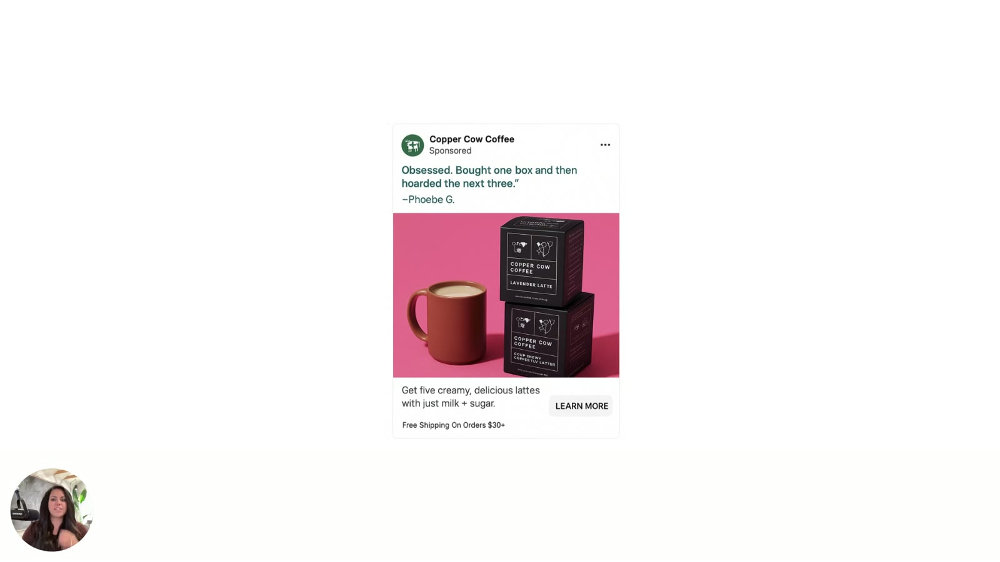
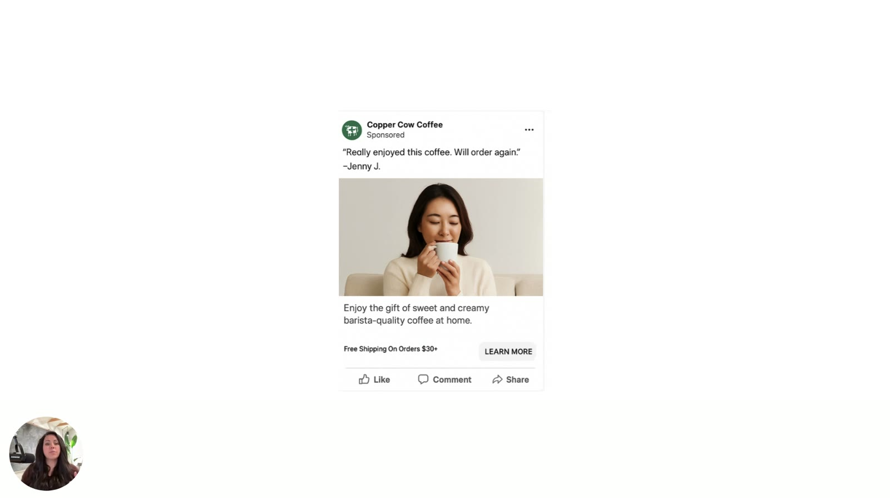
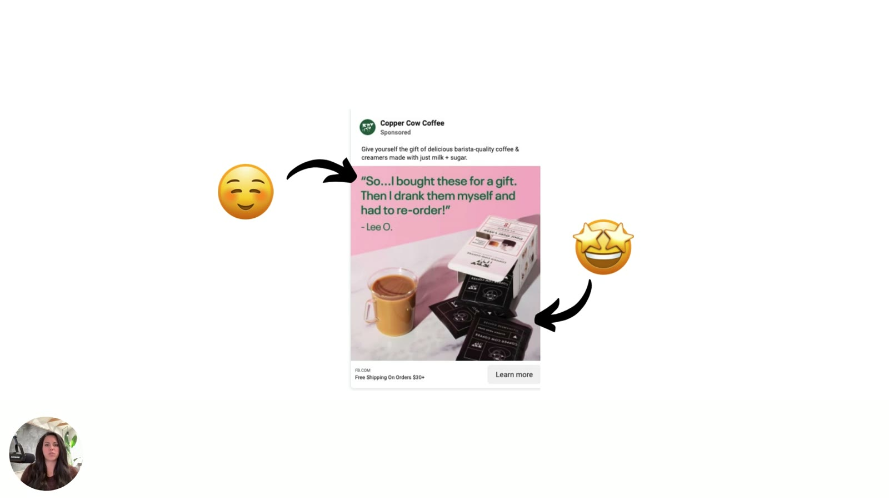
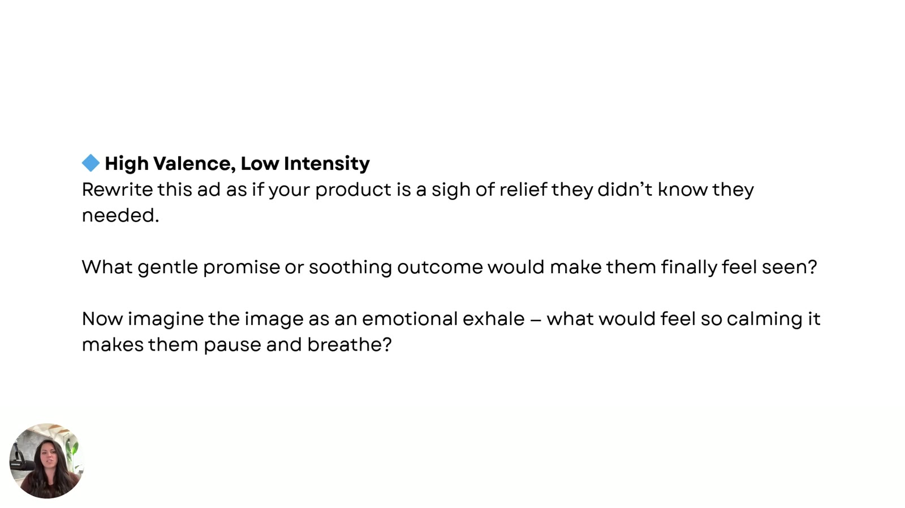

# Fixing the Tone Without Rebuilding the Ad
> You don't need to scrap an ad that misfires. Move it to a different emotional zone with three levers: **swap the verbs**, **shift the visuals**, and (most important) **change the emotion you're selling**. Then use four zone prompts to generate the new headlines and image ideas.

## 🤖 Agent use
- **Use when:** remixing a competitor's winner into our product's target zone; writing variant hooks for an iteration test; writing visual direction for a creator/production brief; fixing a diagnosed misfire.
- **Inputs → outputs:** original ad/script + target zone → variants with new headline/first line, visual direction (colour, framing, light) and named emotional promise. Use the zone prompts. Procedure: [Tone-shifting](../../../frameworks/tone-shifting.md).
- **Rules:**
  - DON'T scrap the ad. Tune its emotional temperature. [00:25]
  - DO make the largest headline match the image. The image is processed first, the headline second. [00:50–01:00]
  - DO raise intensity with sharp, definitive verbs and keep valence and message unchanged. [01:03–02:05]
  - DO raise visual intensity with saturated colour and close-ups. DO lower it by desaturating, zooming out and using morning light. [02:28–03:39]
  - DO prioritize the **emotional promise**: which emotion are we selling vs which should we sell? [03:42–04:03]
  - DO paste the zone prompt **plus the original ad** into the LLM. [06:52]
  - DON'T aim Zone 3/4 rewrites at shame or trauma. Aim for longing or urgent relevance. [05:01, 07:59]
- **See also:** [Valence + Intensity prompts](../../../resources/valence-intensity-prompts.md) · [Emotional promise](../../../concepts/emotional-promise.md) · [Intensity](../../../concepts/intensity.md)

Lesson page blurb: *"Don't scrap your entire ad. Instead, tweak your **verbs, visuals, and emotional promise** to shift the tone. This chapter shows you how small changes can turn a 'meh' ad into a money-making one."*

## TL;DR
- "**You don't need to scrap your ad.**" Most of the time you just need to tweak the emotional temperature. [00:19–00:32]
- **Lever 1, verbs/headline:** the brain processes the image first and the largest headline second, so the headline must match the image. Verbs are "**the emotional accelerators**". [00:44–02:05]
- **Lever 2, visuals:** to add intensity, use more intense colour, zoom in and use bolder colours. To remove it, desaturate, zoom out and use soft or morning light. [02:09–03:39]
- **Lever 3, emotional promise (the one to focus on):** which emotion are you selling now, and which *should* you be selling? Copper Cow sells "indulgence, surprise and delight". [03:42–05:57]
- Being "about **10% off** on the valence intensity map… is really all it takes to feel completely wrong." [05:17–05:23]
- **Four zone prompts** rewrite the ad (copy + image ideas) into any zone. "Don't run **static emotions in a dynamic feed**." [06:03–09:26]

## Key ideas

### Don't scrap, tune [00:00–00:44]
- Diagnosis tells you which quadrant you're in. Now you learn "how to shift the emotional tone to a different quadrant." [00:06–00:17]
- "You don't need to scrap your ad… Most of the time, you just need to tweak the **emotional temperature** that you're communicating." [00:25–00:32]
- Sarah has "three fast ways" to move an ad from one quadrant to another. [00:33–00:43]

*Starting point: the Copper Cow ad sits in Zone 1, and the yawning 🥱 emoji says it all (too sleepy for a coffee "boost"). Shown in this lesson at [00:21] and [01:30]; image taken from lesson 4 [03:00].*

### Lever 1: Swap the words, especially the verbs [00:44–02:09]
- "Words set the tone… Words are very, very important." [00:46–00:50]
- **Processing order:** "Most of the time, the [brain] is gonna process the **image** that your ad is using **first**, and then it's going to process the **largest headline second**. So that headline better match whatever you're trying to communicate inside the image itself." [00:50–01:00] *(Transcript says "the ad is gonna process"; context implies the viewer/brain.)*
- "Verbs in particular, action words, are how we do this. These are the **emotional accelerators**." [01:03–01:06]
- To move to a higher-intensity quadrant, use more intense verbs: help customers "understand why they should buy from us **right now**… motivate… push a little bit of this momentum in there." [01:08–01:19]
- Change the tone "from this kind of like **soft, conversational** to something that's **quick, sharp, and definitive** just by changing our headline." [01:21–01:28]
- "The ad stays the same all around", but the message shifts from "**please pay attention to us**" to "**hey, don't ignore this**". [01:31–01:40]
- That moves the ad **Zone 1 → Zone 2**. "We're gonna leave **valence high**… still communicating the same happiness… good vibes, but we're just using more intensity with the good vibes." [01:43–01:57]
- "Our core message really never changed, just the delivery did. And that's what intensity does. It just makes the delivery a little bit more urgent." [02:00–02:05]

*Lever 1 in action. ❌ "Soft, cozy, conversational.": "So…I bought these for a gift. Then I drank them myself and had to re-order!" → ✅ "Quick, sharp, definitive.": **"Obsessed. Bought one box and then hoarded the next three."** Same layout and product, higher intensity. [01:00]*

### Lever 2: Shift the visuals [02:09–03:42]
**To increase intensity:**
- Adding intensity to the image alone can "fix a lot of the problems that are happening in the ad account". [02:14–02:26]
- **Colour:** "I just went from that **soft baby pink** to a much more **intense pink** color. And I don't know what it is. Every time I test Meta with this pink color, it works really well every time." [02:28–02:36]
- **Zoom in on the product:** "Get real close. Up close and personal is very intense for people. Far away feels better because… proximity to people needs to be far away in order for me to feel comfortable." [02:38–02:56]
- Zooming in "creates more of a **sensory punch**". **Bolder colours** in particular help. [02:58–03:04]

*Visual intensity raised: saturated hot-pink background, product stacked large in frame, "Obsessed. Bought one box and then hoarded the next three." – Phoebe G. [02:00; discussed from 02:28]*

**To decrease intensity:**
- If the ad is intense ("bright, bold colors, really intense facial expressions or intense lifestyle imagery"), "sometimes **desaturating** the color slightly helps a lot." [03:05–03:14]
- "If you want to decrease the intensity, **zoom out**. Show more of the body, maybe like books or a different lighting, **softer lighting**. **Morning lighting** does really well… morning light is very calming to people." [03:18–03:35]
- "Desaturating the intensity will change how people respond to it." [03:37–03:39]

*Visual intensity lowered: a soft, desaturated, zoomed-out shot of a woman sipping with eyes closed. "Really enjoyed this coffee. Will order again." – Jenny J. / "Enjoy the gift of sweet and creamy barista-quality coffee at home." [03:00]*

### Lever 3: Shift the emotion you're selling (the emotional promise) [03:42–06:03]
- Levers 1 and 2 are "very, very important… they also help a ton if you're trying to make these quick switches… but **this is the one I wanna focus on most**." [03:42–03:51]
- "We need to focus on **which emotion we're currently selling and which one we should be selling**. This is kind of what it comes down to." [03:51–04:04]
- The Copper Cow ad "is solidly going after **indulgence, surprise and delight**". The quote proves it: *I bought these for a gift and then I drank them myself and I had to reorder*. "There isn't a whole lot of intensity that you could inject in that… this person had the greatest experience. It was super calm, super nice." [04:04–04:30]

*Reading the emotion the ad sells: ☺️ on the testimonial headline (contentment) and 🤩 on the product (delight). Indulgence, surprise and delight are all calm, positive emotions. [04:00]*

- You could move it from Zone 1 to, say, **Zone 4**: "We wanna map our ads based upon **what we want to say and how intense** we want to communicate it. This gives us much more control over how we're activating the brain… and it drives the message further into the **subconscious**." [04:30–04:53]
- "Right now we're sitting in cozy, calm, supportive, reassuring. Maybe we wanna go over and activate more **panic, sadness, or loss or anxiety**. And again, you gotta be very careful with this. We're not trying to trigger people's traumas." [04:53–05:06]
- The goal is to motivate people to "click through the ad and… start processing landing pages and offers." [05:06–05:17]
- "Your ad might be about **10% off** on the valence intensity map, but that's really all it takes to feel completely wrong." You have to "sing the perfect tune" so the customer hears it, recognizes it and buys. [05:17–05:41]
- If you're selling indulgence, surprise and delight, or calm reassurance, and want to jump to Zones 2, 3 or 4, "maybe you wanna start selling like **stimulation, instant rewards**, something that will drive them a little bit farther." [05:41–05:57]
- How: "**Generate new headlines based upon the quadrant we want to sit in**." [05:57–06:03]

*Changing the emotional promise from indulgence to stimulation/instant reward: **"This coffee? Straight-up dopamine in a mug."** on a saturated orange background with a pour-over shot. Sub-copy: "Experience café-quality pour overs inspired by Vietnam — wherever, whenever you want." [05:30]*

### The four zone prompts [06:03–08:31]
Drop these into ChatGPT **together with the underperforming ad** "so chat has good context for what we're currently working with, and what we need to move towards." Each one returns new copy plus **image suggestions**. [06:03–07:05] Full verbatim text: [Valence + Intensity prompts](../../../resources/valence-intensity-prompts.md).

| Target zone | Prompt core (verbatim from PDF) | Sarah's gloss |
|---|---|---|
| **Zone 1** High valence, low intensity | "Rewrite this ad as if your product is a sigh of relief they didn't know they needed." | Gentle promise, something soothing. The image is "an emotional exhale, so it feels calm". (The Copper Cow ad is already here.) [06:11–07:05] |
| **Zone 2** High valence, high intensity | "Rewrite this ad as if the reader is about to have their breakthrough moment — and your product is the catalyst." | Success, winning, aspirational. Images of "celebration or transformation", "feel unstoppable just by seeing it". [07:06–07:36] |
| **Zone 3** Low valence, low intensity | "Rewrite this ad as if your product is quietly calling out a truth they've been avoiding." | Disappointment, nostalgia, emptiness. The image's ache says *this used to mean something, I wish it meant something again*. "We're not trying to make people feel bad. We just want to **increase longing**." [07:36–08:09] |
| **Zone 4** Low valence, high intensity | "Rewrite this ad as if the reader is about to make a big mistake — and your product is the only thing that stops it." | Fear, frustration, snap to attention. Images that "interrupt the feed… something that feels **visually wrong**… that looks weird", to stop the scroll. [08:09–08:31] |

*The Zone 1 prompt as shown in the video, identical to the PDF bonus. [06:00]*

### The result: one ad, four zones [08:30–09:17]

*The four prompt outputs placed on the map (shown on screen, not read aloud). Z1 (top-left) "Finally, a coffee that slows you down—in the best way." Z2 (top-right) "This coffee? Straight-up dopamine in a mug." Z3 (bottom-left) "It's 2025. Why are we still drinking stale beans?" Z4 (bottom-right) "The coffee you should have gifted—before it sold out." [08:30]*

*The same four ads side by side. Note the visual shifts too: warm neutral morning light (Z1), saturated orange (Z2), muted pink with plain black coffee (Z3), bright smiling face with a scarcity/regret headline (Z4). [09:17]*

| Zone | Headline | Visual treatment |
|---|---|---|
| 1 | "Finally, a coffee that slows you down—in the best way." | Cream/beige, soft natural light, latte in glass mug + gift set |
| 2 | "This coffee? Straight-up dopamine in a mug." | Saturated orange, close-up pour-over action shot |
| 3 | "It's 2025. Why are we still drinking stale beans?" | Pale pink, plain black coffee in diner mug, product box |
| 4 | "The coffee you should have gifted—before it sold out." | Woman smiling holding mug + product; urgency comes from the copy (regret + scarcity) |

### Closing principles [08:31–09:55]
- "**None of these quadrants are wrong or right.** They're just simplifying how we activate the brain's emotional processing centers", which helps especially "if [customers are] sensitive to one specific quadrant." [08:31–08:55]
- The point is to "hit them right where we need to, exactly when they're ready to hear the message. And that is kind of the power of psychology-based advertising." [08:55–09:08]
- "**We don't wanna run static emotions in a dynamic feed.**" (said twice) "Instead, we need to draft and design our **emotional arcs** in our ads so that people will follow us… seek us out, because what we're communicating is so clearly the better option." [09:18–09:41]
- Next: apply the framework to your own ads in four steps. [09:43–09:55]

## Framework / steps
1. Confirm the current zone (from [lesson 4](04-diagnosing-emotional-misfires.md)).
2. Choose the target zone.
3. Pull the lightest lever that gets you there:
   - **Verbs/headline** to change intensity while keeping the message.
   - **Visuals** (colour saturation, zoom, light) to change intensity.
   - **Emotional promise** to change *which* emotion you sell (valence and/or intensity).
4. Generate new headlines and image ideas with the matching **zone prompt** plus the original ad.
5. Test.

→ Full procedure: [Tone-shifting](../../../frameworks/tone-shifting.md).

## Examples
- Verb shift: "So…I bought these for a gift. Then I drank them myself and had to re-order!" → "Obsessed. Bought one box and then hoarded the next three." (Z1 → Z2)
- Visual up: soft baby pink → intense pink, product larger in frame.
- Visual down: soft, desaturated lifestyle shot with a mild testimonial ("Really enjoyed this coffee. Will order again.").
- Emotion shift: indulgence → stimulation ("Straight-up dopamine in a mug").
- Four-zone set: see the table above.

## Structured units

### Rewrites (before → after)
| Before | After | What changed (verb / visual / promise / self / intensity) | Source |
|---|---|---|---|
| "So…I bought these for a gift. Then I drank them myself and had to re-order!" – Lee O. | "Obsessed. Bought one box and then hoarded the next three." – Aisan | Verb/headline: soft, cozy, conversational → quick, sharp, definitive. Intensity ↑, valence same (Z1 → Z2). | [01:00–02:05] |
| Soft baby-pink background, product small in scene | Intense hot-pink background, product stacked large | Visual: colour intensity ↑, closer framing. Intensity ↑. | [02:00–02:41] |
| Intense, bold, expressive imagery (generic case) | Desaturated, zoomed-out, soft-light shot of woman sipping. "Really enjoyed this coffee. Will order again." | Visual (+ milder copy): intensity ↓ | [03:00–03:39] |
| Testimonial selling indulgence, surprise & delight | "This coffee? Straight-up dopamine in a mug." (saturated orange, pour-over close-up) | Promise: indulgence → stimulation/instant reward. Z1 → Z2. | [05:30–05:57] |
| Original testimonial (Z1) | "Finally, a coffee that slows you down—in the best way." | Promise → relief (Zone 1 prompt). Morning-light, neutral styling. | [08:30] |
| Original testimonial (Z1) | "This coffee? Straight-up dopamine in a mug." | Promise + intensity → breakthrough/stimulation (Zone 2 prompt) | [08:30] |
| Original testimonial (Z1) | "It's 2025. Why are we still drinking stale beans?" | Promise + valence ↓ → quietly calling out a truth (Zone 3 prompt) | [08:30] |
| Original testimonial (Z1) | "The coffee you should have gifted—before it sold out." | Promise + valence ↓ + intensity ↑ → big-mistake/scarcity (Zone 4 prompt) | [08:30] |

### Hooks
*Heuristic and Self columns are wiki tags (not stated in the course) unless a citation says otherwise. The course doesn't map these examples to the [Three Selves](../../../concepts/three-selves.md).*

| Hook (verbatim or near) | Heuristic(s) | Emotion / zone | Self targeted | Why it works | Source |
|---|---|---|---|---|---|
| "Obsessed. Bought one box and then hoarded the next three." | [Social proof](../../../concepts/heuristics/social-proof.md) (testimonial) | Excitement. Zone 2. | not specified | Same story as the original, but sharp verbs ("obsessed", "hoarded") add intensity | [01:00] |
| "This coffee? Straight-up dopamine in a mug." | Instant gratification / reward (wiki tag) | Thrill, stimulation. Zone 2. | not specified | Sells the real motive (a boost) as an instant reward | [05:30; 08:30] |
| "Finally, a coffee that slows you down—in the best way." | (none) | Calm, relief. Zone 1. | not specified | "Sigh of relief" promise. Reframes slowing down as a treat. | [08:30] |
| "It's 2025. Why are we still drinking stale beans?" | Status-quo challenge (wiki tag) | Annoyance, disappointment. Zone 3. | not specified | Quietly calls out a truth the reader has been avoiding | [08:30] |
| "The coffee you should have gifted—before it sold out." | Scarcity, [loss aversion](../../../concepts/heuristics/loss-aversion.md) / anticipated regret (wiki tag) | Regret, loss. Zone 4. | not specified | "About to make a big mistake" frame plus sold-out scarcity | [08:30] |

### Rules of thumb
- **DON'T** scrap a misfiring ad. Tune its emotional temperature. [00:25]
- **DO** make the biggest headline match the image. The image is read first, the headline second. [00:50–01:00]
- **DO** use action verbs as "emotional accelerators" to raise intensity. [01:03]
- **IF** only intensity is wrong **THEN** keep the core message and change the delivery. [02:00]
- **DO** zoom in and saturate to raise intensity. **DO** zoom out, desaturate and use morning light to lower it. [02:38–03:39]
- **DO** test intense pink on Meta (Sarah: "works really well every time"). Anecdotal. [02:33]
- **DO** decide which emotion you're selling vs which you should sell. It's the most important lever. [03:51]
- **IF** you're ~10% off on the map **THEN** the ad will feel completely wrong. Fine-tune. [05:17]
- **DO** include the underperforming ad when running a zone prompt. [06:52]
- **IF** writing Zone 3 **THEN** aim for longing, not bad feelings. **IF** Zone 4 **THEN** use a "visually wrong" scroll-stopper image. [07:59; 08:23]
- **DON'T** run static emotions in a dynamic feed. Design emotional arcs. [09:18]

## Notable quotes
- "You don't need to scrap your ad." [00:25]
- "Verbs in particular, action words… These are the emotional accelerators." [01:03]
- "Our core message really never changed, just the delivery did. And that's what intensity does." [02:00]
- "Up close and personal is very intense for people." [02:41]
- "Your ad might be about 10% off on the valence intensity map, but that's really all it takes to feel completely wrong." [05:17]
- "We don't wanna run static emotions in a dynamic feed." [09:18]

## How to apply
- [ ] Rewrite only the headline of a misfiring ad with sharper, more definitive verbs. Keep everything else and test it.
- [ ] Make one visual variant with more intensity (saturate, zoom in) or less (desaturate, zoom out, morning light), depending on the direction you need.
- [ ] Write down the emotion the ad sells now (e.g., indulgence) and the one it *should* sell (e.g., stimulation).
- [ ] Paste the zone prompt and the ad into ChatGPT. Generate headlines and image concepts for the target zone (or all four, as Sarah did).
- [ ] Zone 3/4 check: are you creating longing or urgency, not shame or trauma?

## Related
- Brand case files: [Copper Cow Coffee](../../../brands/copper-cow-coffee.md) · [all brands by niche](../../../brands/README.md)
- [Tone-shifting](../../../frameworks/tone-shifting.md) · [Emotional promise](../../../concepts/emotional-promise.md) · [Intensity](../../../concepts/intensity.md) · [Emotional zones](../../../concepts/emotional-zones.md)
- [Valence + Intensity prompts](../../../resources/valence-intensity-prompts.md) · [Prompt library module](../07-prompt-library/README.md)
- [Subconscious vs conscious mind](../../../concepts/subconscious-vs-conscious-mind.md)
- Previous: [4. Diagnosing Emotional Misfires](04-diagnosing-emotional-misfires.md) · Next: [6. Map + Move Your Messaging](06-map-and-move-your-messaging.md)
- E-book: [Chapter 5](../../../resources/diagnose-why-your-ads-arent-working-ebook.md#chapter-5-fixing-the-tone-without-rebuilding-the-ad)

## Sources
- Transcript: [5. Fixing The Tone Without Rebuilding the ad.txt](../../../../raw/tether-lab/_transcripts/3.%20The%20Valence%20&%20Intensity%20Model/5.%20Fixing%20The%20Tone%20Without%20Rebuilding%20the%20ad.txt)
- Lesson page text: [5_5_Fixing_the_Tone….md](../../../../raw/tether-lab/_extracted/3.%20The%20Valence%20&%20Intensity%20Model/5_5_Fixing_the_Tone_Without_Rebuilding_the_Ad_The_Valen.md)
- Prompts PDF text: [9. Valence + Intensity - Prompts.md](../../../../raw/tether-lab/_extracted/3.%20The%20Valence%20&%20Intensity%20Model/9.%20Valence%20+%20Intensity%20-%20Prompts.md)
