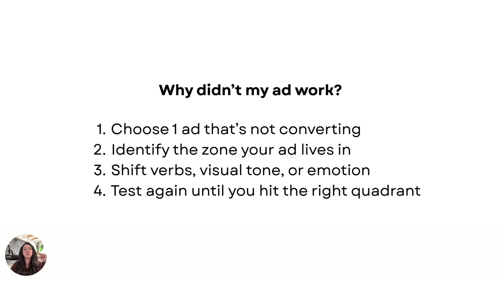

# Map + Move Your Messaging
> Apply the model to one of your own losing ads: pick it, find its zone, compare that with the customer's state and the feeling you want, then pull the right lever (verbs, visual tone, or emotional promise) and re-test until you land in the right quadrant.

## 🤖 Agent use
- **Use when:** planning an iteration test on a losing ad, or reviewing a winner to extract what to keep.
- **Inputs → outputs:** one ad + customer context → zone, mismatch, a single lever to change, a variant, and a re-test plan.
- **Rules:**
  - DO run the loop: choose 1 non-converting ad → identify zone → shift verbs, visual tone, or emotion → test until you hit the right quadrant. [01:06–01:23]
  - DO diagnose **winners** as well as losers. [00:12]
  - IF the intended emotion (e.g., empowerment) is under-expressed THEN shift the verbs. [01:46]
  - IF the ad is too intense and causes fear/anxiety where calm is wanted THEN shift the visual tone toward subdued. [01:56–02:10]
  - IF the intended message isn't being communicated at all THEN shift the emotional promise. [02:10–02:19]
- **See also:** [Valence-Intensity diagnostic](../../../frameworks/valence-intensity-diagnostic.md) · [Tone-shifting](../../../frameworks/tone-shifting.md)

Lesson page blurb: *"Once you know which emotional zone to target, you'll need to rewrite your messaging to match. Use these four simple prompts (one for each zone) to quickly shift your copy and visuals into alignment, without overthinking it."*

## TL;DR
- Diagnose your **low performers and your winners**, to learn whether "just a small tweak" was the difference and carry it into the next round. [00:08–00:27]
- **4 steps:** (1) choose 1 ad that's not converting, (2) identify its zone, (3) shift verbs, visual tone, or emotion, (4) test again until you hit the right quadrant. [01:01–01:23]
- Always compare three things: **the ad's zone**, **the customer's emotional state when they see it**, and **the state you want them to feel**. [01:23–01:46]
- **Which lever for which mismatch:** missing emotion (e.g., empowerment) → verbs. Too intense or fear-inducing → visual tone. Message absent altogether → emotional promise. [01:46–02:23]
- "**Every ad is an emotion… it's not just a message.**" [02:36–02:45]

## Key ideas

### Recap and why to review winners too [00:00–00:57]
- Sarah calls this "one of my favorite trainings that I've ever done." [00:00–00:08]
- "We need to diagnose the actual **low performers along with our winners**, so that we can understand what happened, why did that not perform well, and was it just a small tweak that we need to make, so we can apply that to our next round of winners as well." [00:12–00:27]
- Covered so far: placing the ad on the map, what each zone means, the three tactics ("swapping the verbs, getting the images swapped in and out, and then adjusting the emotion in particular", the most important), and the prompts. [00:27–00:52]

### The 4-step "Why didn't my ad work?" loop [00:52–01:23]
"Go dig into your ad account, find one that was like, oh, this one just did not do well at all, and use this framework." [00:57–01:06]

*The four-step loop, verbatim: "Why didn't my ad work? 1. Choose 1 ad that's not converting. 2. Identify the zone your ad lives in. 3. Shift verbs, visual tone, or emotion. 4. Test again until you hit the right quadrant." [01:00]*

1. **Choose 1 ad that's not converting.**
2. **Identify the zone your ad lives in** on the valence intensity map.
3. **Shift the verbs, the visual tone, or the emotion itself.**
4. **Test again until you hit the right quadrant.** [01:06–01:23]

### The three questions to hold side by side [01:23–01:46]
- **Which zone is your ad currently in?**
- **Which emotional state is your customer in when they see this ad?** "Are they distracted? Are they at work and they're stressed? Are they at home with like 17 kids and they don't know what to do with themselves?… What's their lifestyle like?"
- **What emotional state would I like them to feel when they hit this ad?** [01:23–01:46]

### Mismatch → lever [01:46–02:27]

| What you notice | Lever to pull | Quote |
|---|---|---|
| The emotion you wanted isn't there: "I really wanted them to feel like **empowered**, and we are not saying empowerment" | **Shift the verbs** | "Shift it, shift the verbs." [01:46–01:56] |
| Too intense: "we might be causing a little bit of like **fear or anxiety**… we really want them to just be more **calm** about their choice" | **Shift the visual tone / imagery** toward something more subdued | "Shift the visual tone, shift the imagery, shift it back towards something a little more subdued." [01:56–02:10] |
| "We weren't even communicating that message **at all**" | **Shift the emotional promise** | "Shift the emotional promise, guys." [02:10–02:19] |

- "Keep going until you hit the right quadrant. Keep testing, using those prompts." That alone, "just by altering your intensity and the emotions", gets you ads that hit "a whole lot better". [02:19–02:32]

### Wrap-up [02:32–02:59]
- "Download the worksheet. I have a cheat sheet that will help you plug this in. I also have all the prompts listed for you." [02:32–02:36] *(The downloads in this module are the [e-book](../../../resources/diagnose-why-your-ads-arent-working-ebook.md) and the [prompts PDF](../../../resources/valence-intensity-prompts.md). No separate worksheet file exists in the course files.)*
- "**Every ad is an emotion, guys. It's not just a message.** So we need to start treating it like an emotion." [02:36–02:45]
- Post screenshots of your reworked ads in the community. [02:45–02:58]

## Framework / steps
See [Valence-Intensity diagnostic](../../../frameworks/valence-intensity-diagnostic.md) (find the mismatch) and [Tone-shifting](../../../frameworks/tone-shifting.md) (fix it).

## Examples
- Customer-state examples: distracted; at work and stressed; "at home with like 17 kids".
- Target-emotion example: wanting customers to feel **empowered**.

## Structured units

### Rules of thumb
- **DO** take one non-converting ad → identify its zone → shift verbs, visual tone, or emotion → test until you hit the right quadrant. [01:06–01:23]
- **DO** diagnose winners too, to find the small tweak worth carrying forward. [00:12]
- **DO** profile the customer's state at exposure (distracted? stressed at work? "at home with like 17 kids"?). [01:28]
- **IF** the target emotion (e.g., empowerment) isn't being said **THEN** shift the verbs. [01:46]
- **IF** messaging is so intense it may cause fear or anxiety where you want calm **THEN** shift the visual tone toward subdued. [01:56]
- **IF** the intended message isn't communicated at all **THEN** shift the emotional promise. [02:10]
- **DO** keep testing with the zone prompts until it lands. [02:19]

## Notable quotes
- "We need to diagnose the actual low performers along with our winners." [00:12]
- "Keep going until you hit the right quadrant." [02:19]
- "Every ad is an emotion, guys. It's not just a message." [02:36]

## How to apply
- [ ] Today: pull your worst-performing ad from the last 30 days *(time window is a suggestion, not from course)*.
- [ ] Write: current zone → customer's state at exposure → desired feeling.
- [ ] Use the mismatch table to pick one lever. Change only that lever so the test reads cleanly.
- [ ] Run the matching zone prompt, launch the variant, and repeat until it lands.
- [ ] Do the same post-mortem on a winner: which zone was it in, and why did it match?

## Related
- [Valence-Intensity diagnostic](../../../frameworks/valence-intensity-diagnostic.md) · [Tone-shifting](../../../frameworks/tone-shifting.md) · [Emotional promise](../../../concepts/emotional-promise.md) · [Emotional misfire](../../../concepts/emotional-misfire.md)
- Previous: [5. Fixing the Tone Without Rebuilding the Ad](05-fixing-the-tone-without-rebuilding-the-ad.md) · Module: [README](README.md) (quiz + bonuses)
- E-book: [Chapter 6](../../../resources/diagnose-why-your-ads-arent-working-ebook.md#chapter-6-map--move-your-messaging)

## Sources
- Transcript: [6. Map + Move Your Messaging.txt](../../../../raw/tether-lab/_transcripts/3.%20The%20Valence%20&%20Intensity%20Model/6.%20Map%20+%20Move%20Your%20Messaging.txt)
- Lesson page text: [6_6_Map_+_Move_Your_Messaging….md](../../../../raw/tether-lab/_extracted/3.%20The%20Valence%20&%20Intensity%20Model/6_6_Map_+_Move_Your_Messaging_The_Valence_&_Intensity_M.md)
