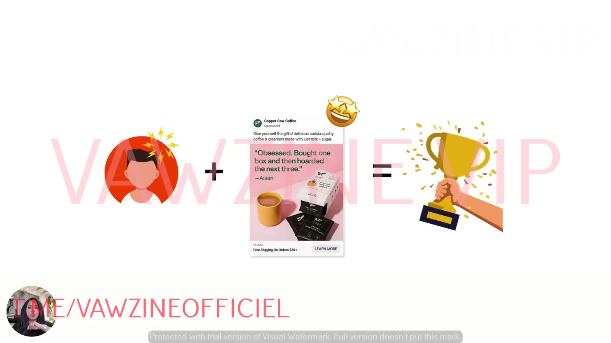
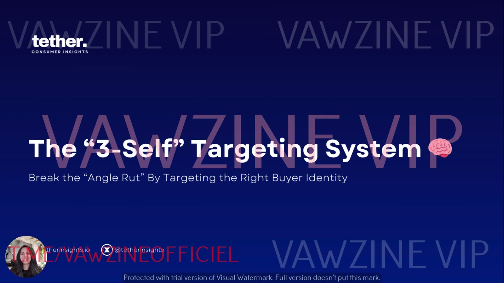

# Why Your Ads Stop Working Over Time
> Top ads stop performing because brands fall into an **angle rut**. The fix isn't a new offer: it's speaking to a different *self* of the same customer before fatigue hits.

## 🤖 Agent use
- **Use when:** planning an iteration roadmap for an account (ours or a competitor's) where a few ads or angles carry the spend, or deciding *what kind* of new variant to make next.
- **Inputs → outputs:** list of live ads plus their spend share → a judgement on angle-rut risk and an instruction to produce self-shifted variants of the winners (offer unchanged).
- **Rules:**
  - DO generate new variants while winners are still winning. Don't wait for CPA/ROAS to drop [02:24].
  - DO treat "2–3 ads propping up the account" as a red flag for angle rut [00:50].
  - DO change *which self the ad speaks to* before you change the offer, landing page or funnel [03:33].
  - DON'T keep cloning the same message in new formats and expect it to reach new buyers [00:21].
- **See also:** [Angle rut](../../../concepts/angle-rut.md) · [3 selves](../../../concepts/three-selves.md) · [Three selves diagnostic](../../../frameworks/three-selves-diagnostic.md) · [Rewriting ads for new selves](../../../frameworks/rewriting-ads-for-new-selves.md)

## TL;DR
- **Angle rut** means repeating the same few angles and messages and hoping they reach someone new. Every brand hits it, "from startups all the way up to nine figures" [00:08].
- Recovering after your winners fatigue is "slamming on the brakes after you've already hit the ice". By then you're too late [01:26].
- Great marketers don't panic. They **rotate creative *before* fatigue sets in**, and this module gives a scientific way to do it [02:19].
- Your customer "isn't just one person… They're actually three" (the [3 selves](../../../concepts/three-selves.md)). Only one of them is in control when your ad shows up [02:54].
- You don't need a new offer or landing page. You need to **shift which self your ad speaks to** so you reach buyers who've been ignoring you [03:33].

## Key ideas

### The scenario: a scaling account that's quietly stagnating [00:21]
- You have a solid offer, working ads and margins that scale nicely, "but lately, it just kind of feels like you guys are chunking out the same exact thing."
- You keep pushing ads into the system that "look, feel… [and] drive the same results every time." You're repeating one message and hoping it catches someone new. Lately it doesn't.
- **Symptoms:** ad costs creep up, and you start worrying: *what if the three ads propping up the whole account, the few angles you've chosen, stop working?* Then you'd be "scrambling to find new winners," and the account could go down with no idea how to fix it [00:50].

*Slide: the right customer self plus the right ad equals a win. The example ad is Copper Cow Coffee ("Obsessed. Bought one box and then hoarded the next three."). The point: only one self buys, so match the ad to it.*

### Why waiting doesn't work [01:01]
- "This happens to every single brand I've ever worked with." Once top performers stop scaling, "the results are just not pretty."
- Analogy: trying to recover an account after it loses its winners is "like slamming on the brakes after you've already hit the ice." Once winners fatigue, "it's going to be way too late to put any fail stops in place" [01:26].

### Angle rut, defined [01:41]
- Sarah calls the "rinse and repeat style of strategy" **angle rut**: "you get stuck in a rut with your angles and you can't seem to get out of it."
- She says it's "one of the only media buying and… creative strategy issues I see across the board", from startups to nine-figure brands. "Everybody experiences it. It's totally normal."
- Why it happens: we're always in "find winners, find winners, find winners" mode [02:04].
- See the concept page: [Angle rut](../../../concepts/angle-rut.md).

### What great marketers do instead [02:19]
- They "don't panic when things start to kind of blend or like beige out."
- They **rotate creative before the fatigue sets in.** "If you wait until performance drops, you've already lost."
- This system teaches how to do that "from a scientific method", grounded in psychology and behavioral science, by **targeting the three selves of your customer**.

### Your customer is three people, and only one buys [02:54]
- "Your customer isn't just one person… They're actually three."
- "When it comes to buying, only one of your customers is really in control." When your ad appears, only one customer mind is suited to "seeing that ad, liking what they see, attaching emotionally to it and buying. **Only one buys.**" [03:05]
- So: target the self "that's in the driver's seat", keep track of which one it is, connect deeply, and so reduce angle rut over time.
- "You don't need a new offer. You don't need a new landing page. You really just need to shift which self your ad is speaking to so you can reach new buyers who've been ignoring you up until now." [03:33]
- The module is plug-and-play: Sarah provides [prompts](../../../resources/three-selves-prompts.md), so you don't have to do the analysis yourself [03:45].

## Screenshots

*Title slide: "The '3-Self' Targeting System: Break the 'Angle Rut' By Targeting the Right Buyer Identity."*

## Knowledge units

**Ad teardowns**
| Brand / product (niche) | Format | Hook / opening | What works | What fails | Fix suggested | Principle | Source |
|---|---|---|---|---|---|---|---|
| Copper Cow Coffee (coffee, DTC) | Static, Meta feed, testimonial quote | "Obsessed. Bought one box and then hoarded the next three." — Aisan | Shown as the example of "right customer + right ad = win" | Not critiqued | – | Only one self buys. Match the ad to the self in control | [03:23] |

**Rules of thumb**
- **IF** a few ads or angles carry most of the spend **THEN** start self-shifted variants now. Recovering after fatigue is "slamming on the brakes after you've already hit the ice" [01:26].
- **DO** rotate creative *before* fatigue sets in [02:24].
- **DO** target the one self "in the driver's seat" and track which one it is [03:18].
- **DON'T** reach for a new offer or landing page first. "You really just need to shift which self your ad is speaking to" [03:33].

## Notable quotes
- "Trying to recover an ad account after it starts losing its winners is really just like slamming on the brakes after you've already hit the ice." [01:26]
- "If you wait until performance drops, you've already lost." [02:29]
- "Your customer isn't just one person… They're actually three." [02:54]
- "Only one buys." [03:20]

## How to apply
- [ ] Count how many ads and angles carry your account. If 2–3 ads carry most of the spend, you're exposed.
- [ ] Don't wait for CPA or ROAS to drop. Plan new self-targeted variants while the winners are still winning.
- [ ] Before you change offers or landing pages, try changing *which self* the ad speaks to (lessons 2–8).

## Related
- Brand case files: [Copper Cow Coffee](../../../brands/copper-cow-coffee.md) · [all brands by niche](../../../brands/README.md)
- [The 3 selves model](../../../concepts/three-selves.md) · [Self-targeting](../../../concepts/self-targeting.md) · [Angle rut](../../../concepts/angle-rut.md)
- Next: [02 – Diagnose Which Self Your Ads Target](02-diagnose-which-self-your-ads-target.md)
- [Module overview](README.md) · [Course hub](../README.md)

## Sources
- Transcript: [1. Why your Ads Stop Working Over Time.txt](<../../../../raw/tether-lab/_transcripts/4. The Self Targeting System/1. Why your Ads Stop Working Over Time.txt>)
- Page text: [1_1_Why_Your_Ads_Stop_Working_Over_Time…md](<../../../../raw/tether-lab/_extracted/4. The Self Targeting System/1_1_Why_Your_Ads_Stop_Working_Over_Time_The_Self_Target.md>)
- Transcript fix: "reduce that angle right over time" [03:20] means "angle rut".
