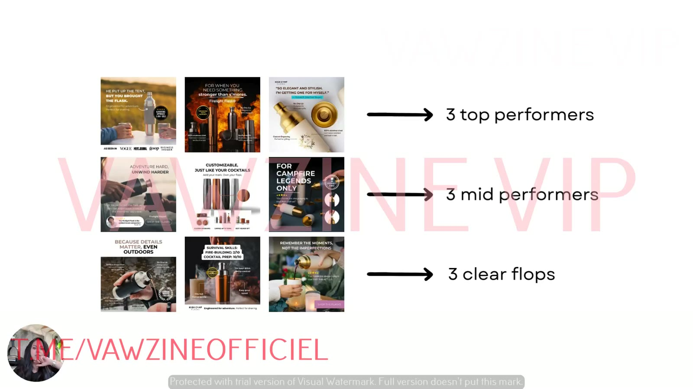
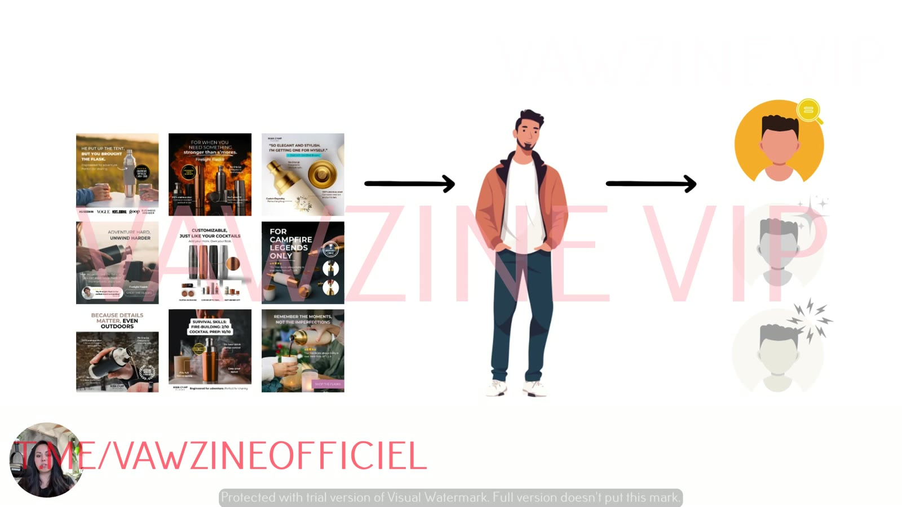

# Diagnose Which Self Your Ads Target
> Start with a small, deliberate sample of 9 ads (3 winners, 3 middling, 3 flops), the **"nine ad identity scan"**, to see which self you keep talking to and which selves you've ignored.

## 🤖 Agent use
- **Use when:** choosing *which* ads to tear down, either our account audit or a competitor's ad-library sweep, before running the [three selves diagnostic](../../../frameworks/three-selves-diagnostic.md).
- **Inputs → outputs:** an ad list with performance (ours) or longevity/visibility signals (competitor) → a 9-ad sample (3 top / 3 mid / 3 flop) ready for scoring.
- **Rules:**
  - DO sample 9 ads: 3 top, 3 mid, 3 clear flops [01:20].
  - DON'T dump the whole account into the model. It overwhelms the analysis [00:45].
  - DO read the result as *the creator's default self*, not as proof of what customers prefer [02:40].
  - DO aim new variants at the selves with the lowest scores. That's where the net-new audience is [02:50].
  - IF the competitor has no performance data **THEN** use proxies such as longest-running ads and most-duplicated creatives for "top", and recently paused ads for "flop". *(Agent adaptation, not from course.)*
- **See also:** [Three selves diagnostic](../../../frameworks/three-selves-diagnostic.md) · [Three selves prompts](../../../resources/three-selves-prompts.md) · [Angle rut](../../../concepts/angle-rut.md)

## TL;DR
- You don't need hundreds of ads. Running your whole account through ChatGPT will just overwhelm you, so **start small** [00:52].
- Use **9 ads: 3 top performers, 3 mid performers, 3 clear flops** [01:20].
- This gives a clean diagnostic set: which self you speak to, which self is ignored, and where there's a net-new audience to unlock [01:50].
- Sarah calls it the **nine ad identity scan** [02:03].
- What it really shows is **which self *your mind defaults to* as a creator**, not which self customers prefer. The untested selves are where to go next, to get ahead of fatigue and "expand the market from the inside out" [02:40].

## Key ideas

### Recap: targeting a self, not an avatar [00:00]
- The goal is to draw in more people who might be in the market, "specifically based upon who they are underneath": their [selves](../../../concepts/three-selves.md), not demographics.
- The analysis runs in ChatGPT ("chat") with Sarah's plug-and-play [prompts](../../../resources/three-selves-prompts.md). You don't have to write your own [00:20].

### Don't start with the whole account [00:30]
- You *can* pull everything down: screenshot every static, transcribe every video and throw it all into ChatGPT. But "if you run your entire ad account through there, you're going to likely just be overwhelmed" [00:45].
- Start with "a small little sample size". This also works if you're not running many ads right now: "you do not have to have hundreds of ads to do this" [00:52].
- If you *do* have hundreds, take a sample of what's running [01:05].

### The 9-ad sample [01:13]
| Bucket | Count | What qualifies (Sarah's words) |
|---|---|---|
| Top performers | 3 | "dang, these are just crushing for us" |
| Mid performers | 3 | "eh, these are okay, but they're not scaling super well. We're kind of just leaving them on to see what happens" |
| Clear flops | 3 | "dang, we ran these and they sucked" |

- Pick them by looking at your back-end metrics first [01:25].
- Taking three from each bucket shows "very, very clearly what happened in each and every one of these ad groups" when it comes to targeting the customer's selves [01:40].

*The 9-ad sample, shown with High Camp Flasks statics. Row labels are illustrative; Sarah later says she has no metric data for this brand ([lesson 5](05-run-the-3-selves-diagnostic-on-your-ads.md)).*

### What the scan reveals [01:50]
The set answers three questions:
1. **Which self are you speaking to?**
2. **Which self is being ignored** in the account?
3. **Where is the opportunity** to unlock a net-new audience?

*The "nine ad identity scan": run the 9 ads through the analysis to see which of the customer's three selves gets activated.*

### The real finding: your own default [02:09]
- "As marketers, we have a very specific customer in our head", typically one of the three selves.
- The analysis builds "a really clear picture of which angles you are overusing. Not necessarily which ones… the customers are currently… best suited to, but **which one your mind defaults to as you create ads**" [02:40].
- So the selves you *haven't* tested are "the ones that we actually have to go after the most so that we can get ahead of fatigue and kind of expand the market from the inside out" [02:50].

## Framework / steps
1. Pull performance data and pick **3 top / 3 mid / 3 flop** ads.
2. Collect their creative: screenshots for statics, transcripts for videos.
3. Run them through Prompt 1 (or Prompt 2 with metrics). See [Three selves diagnostic](../../../frameworks/three-selves-diagnostic.md).
4. Read the result as "my default self" and "my untested selves".

## Knowledge units

**Rules of thumb**
- **DO** start with a small sample. "You do not have to have hundreds of ads to do this" [01:01].
- **DO** stratify the sample by performance (3/3/3) so the contrast between winners and flops shows which self is working [01:40].
- **IF** one self dominates the scores **THEN** that's your (or the competitor's) default self and the source of angle rut. Write the next variants for the other two [02:40].
- **DON'T** confuse "the self we keep writing for" with "the self customers buy in" [02:40].

## Notable quotes
- "You do not have to have hundreds of ads to do this." [01:01]
- "I call this kind of a nine ad identity scan." [02:03]
- "…which one your mind defaults to as you create ads." [02:40]

## How to apply
- [ ] Export the last 30–90 days of ads and sort by your main KPI. Pick 3/3/3. *(The time window is my suggestion, not from the course.)*
- [ ] Keep the sample small for your first pass.
- [ ] After scoring, write down your default self and your two "unmet" selves. Those are your next tests.

## Related
- Brand case files: [High Camp Flasks](../../../brands/high-camp-flasks.md) · [all brands by niche](../../../brands/README.md)
- Previous: [01 – Why Your Ads Stop Working Over Time](01-why-your-ads-stop-working-over-time.md) · Next: [03 – Why One Self Isn't Enough to Scale](03-why-one-self-isnt-enough-to-scale.md)
- [Three selves diagnostic](../../../frameworks/three-selves-diagnostic.md) · [3 selves model](../../../concepts/three-selves.md) · [Angle rut](../../../concepts/angle-rut.md)

## Sources
- Transcript: [2. Diagnose Which Self Your Ads Target.txt](<../../../../raw/tether-lab/_transcripts/4. The Self Targeting System/2. Diagnose Which Self Your Ads Target.txt>)
- Page text: [2_2_Diagnose_Which_Self…md](<../../../../raw/tether-lab/_extracted/4. The Self Targeting System/2_2_Diagnose_Which_Self_Your_Ads_Target_The_Self_Target.md>)
