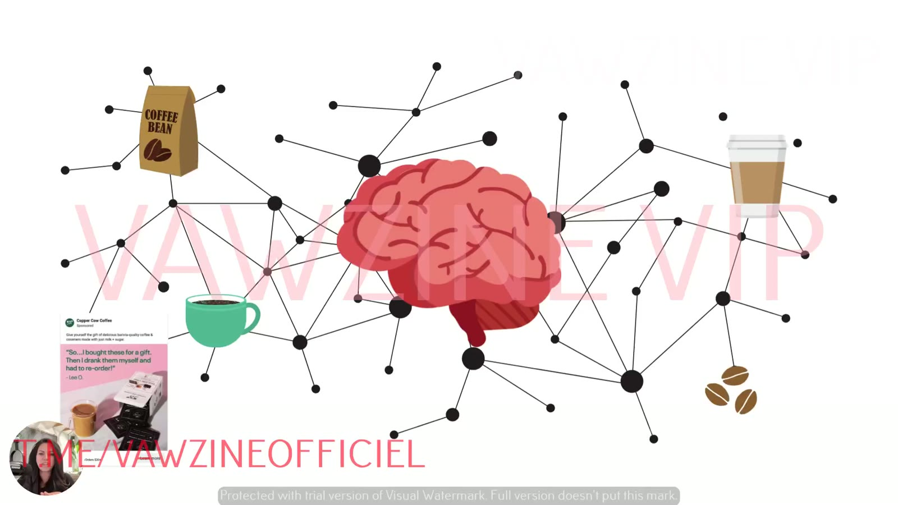
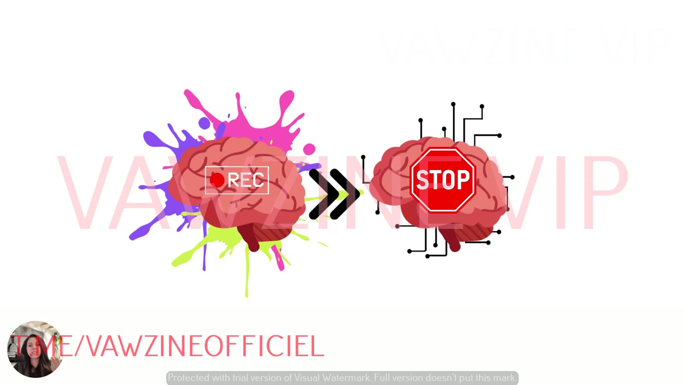
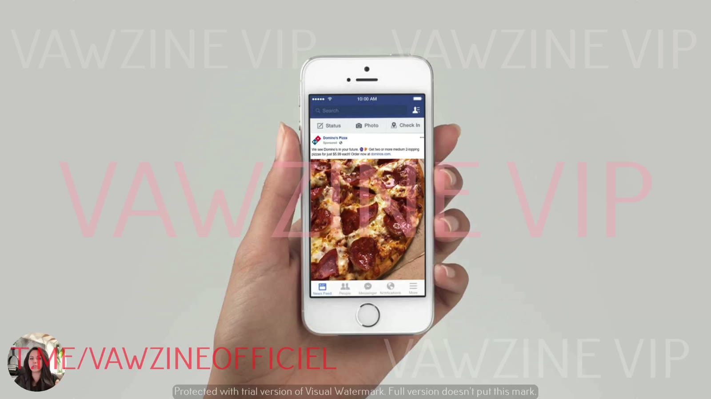

# Why One Self Isn't Enough to Scale
> Most marketers keep writing for the [Ideal Self](../../../concepts/ideal-self.md). That segment dries up. The customer is really a *system* of identities built by an energy-saving subconscious brain, so scale comes from rotating which self you address.

## 🤖 Agent use
- **Use when:** judging whether a competitor's (or our) creative set is stuck in aspirational Ideal-Self messaging, and explaining why diversifying selves will lift scale.
- **Inputs → outputs:** a set of ad scripts or headlines → a flag ("Ideal-Self rut: X of Y ads promise transformation") plus a brief to write Actual and Ought variants.
- **Rules:**
  - DO count transformation verbs ("become", "unlock", "next level", "change your life"). If they dominate, call it an Ideal-Self rut [00:40], [01:20].
  - DO keep aspiration for brand-level lines if wanted. In the ad account, rotate selves [01:33].
  - DON'T write for one "avatar". Write for the self the customer is in at that moment [02:00], [08:16].
  - DON'T re-run near-identical creative to people who already ignored it. You're "teaching it to ignore you" [04:14].
  - DO aim for something the subconscious registers as *new*, so it gets passed to conscious attention [05:10].
- **See also:** [Ideal Self](../../../concepts/ideal-self.md) · [Angle rut](../../../concepts/angle-rut.md) · [Subconscious vs conscious mind](../../../concepts/subconscious-vs-conscious-mind.md)

## TL;DR
- In audits, Sarah sees most ads written for **one self**, "almost always the ideal self" (the achiever, the dreamer, the doer) [00:34].
- Any segment eventually **gets tapped and dries up**. There aren't enough people in Ideal-Self mode *while purchasing* for that to last forever [00:58].
- Aspirational messaging is fine for **brand**, but in the **ad account it fatigues quickly** and makes your angles look the same [01:33].
- Your customer isn't one avatar. They're a **system**, a brain-built map of connected experiences: "hundreds of different avatars, all kind of wrapped into one person" [02:00].
- **95% of decisions are subconscious** [03:08], and the brain spends **~20% of your daily energy** [04:32], so it is ruthless about what it ignores. Repetitive ads *teach it to ignore you* [04:14].
- Memories, emotions and experiences harden into **identity banks**, and the selves come from these banks. So target the customer's *internal self*, not the avatar or the angle [06:15], [08:16].

## Key ideas

### The pattern in almost every account audit [00:00]
- In ad accounts and audits, "most of their ads… are drafted for one version of customers… one type of self for each customer". Usually "the achiever, the dreamer, the doer" [00:34].
- "We keep speaking to the same self over and over and over as marketers. And it's almost always the **ideal self**." [00:40]
- Marketers are trying to get the customer "up off the couch" to click, buy, "become someone better" [00:50].

### Why it stops scaling [00:58]
- "At some point that segment is going to get tapped. It's going to dry up."
- "There is not a large enough pool of people in any segment, even if we're talking about health and fitness… there's not enough people who are in ideal self **while they're purchasing**… for that to like last forever."
- If you keep using "this aspirational, you can do it. Everything's going to be great. Our product's going to change your lifestyle" marketing, "you're just kind of echoing the same thing that you said for the last like five to 10 years" [01:20].
- **Brand vs ads:** "Doing this for the brand side is not necessarily a bad thing if you want to attach your brand to aspiration. But in the ad account, this fatigues pretty quick and it makes it so that your angles start to look the same over time." [01:33]


*Visual metaphor: keep hitting one segment with the same ad and the pool "dries up", leaving ads buried in the desert.*

### Your customer is a system, not an avatar [01:55]
- "Your customer is not actually just one avatar. They're kind of a system." The brain builds "a map of all the different things that it's experienced around your particular industry and your product."
- So "your customer type is actually hundreds of different avatars, all kind of wrapped into one person" [02:06].
- **Coffee example** [02:21]: coffee connects to what they drank at Starbucks this morning, which connects to the beans at home, which connects to the coffee their mother drank when they were a kid, which connects to the coffee *she* swore she'd never drink because her father drank it and she hated it [02:38].
- "The brain… is a master at connecting ideas together. That's all the brain is built to do."


*The brain as an association map: every coffee experience (home beans, Starbucks, family memories, ads) is linked, so one "customer" holds many identities.*

### How the brain decides: autopilot [03:00]
- "We're working entirely off of a system that is basically on autopilot. So **95% of our decisions are made inside the subconscious mind**." [03:08] See [subconscious vs conscious mind](../../../concepts/subconscious-vs-conscious-mind.md).
- The subconscious is "a very old… subsection of the brain", "very reactive" and "very emotional". It doesn't weigh "is this right for me?". It makes "a split second decision. Should I do this or not? No. And then dips out if it's not important enough" [03:27].
- **"The subconscious is just a recorder"** [03:43]. It stores everything you experience (people, sights, touch, smell), processes it and makes sense of it, so the next time it meets the same experience "it will know what to do."

### Why stagnant creative gets ignored [04:09]
- If your creative repeats itself, "the brain, especially if it's ignored your ads in the past, it's going to keep ignoring them because **you're teaching it to ignore you**" [04:14].
- That isn't because it doesn't want your product. The brain processes so much that it's "super crazy careful on what it spends energy on."
- **Energy budget:** "about 20% of all your daily energy… glucose… is going just to running your brain" [04:32]. The brain avoids spending that on things that won't help keep you alive. Every day it makes "a judgment call on what it's going to spend its energy on and what things it's just going to ignore" [04:48].
- It builds "a memory bank of all the useful information" and only sends messages to the **conscious mind** (logical, analytical) when it meets something *new* that needs attention [05:10].


*The subconscious "records" everything, then decides what to stop on and what to ignore. Repeated, already-ignored ads get filtered out.*

### Pizza example [05:20]
- It's 11am, you skipped breakfast, you're starving and you see an ad for pizza. The subconscious makes a very quick decision on whether to stop, "based upon all of the things that it has seen in the past, all of those maps."
- "It wants you to get what you want." It does this for every decision, in the background, without you noticing [05:40].


*The pizza example: a hungry person's subconscious decides in a split second whether a Domino's ad is worth stopping for, based on stored associations.*

### From experiences to identities [05:59]
Sarah's chain, from the bottom up:

```
Context / situations → Experiences → Emotion → Memories → "Banks" → Habits, behaviours, IDENTITIES (selves)
```

- "Each bank is created from memories. Memories are built on emotion and then emotion is built from the experience you have in the world." Experience is also based on context [06:15].
- "If you use those banks long enough and you never update the systems… they become a part of the program. They become basically set. You can't change them very easily" [06:40]. They become your habits, behaviours "and most importantly, your identities, yourselves."
- These **identity banks** vary by person and activate differently depending on product, brand or offer, "but they're always there" [06:55].
- **The three selves are built from these identity banks** [07:12].

### So your customer is… [07:25]
- "A system of a lot of beliefs and identities that are all mapped together. They're not one static avatar and they never will be because humans are complex."
- Some days they try to **become somebody new** ([Ideal](../../../concepts/ideal-self.md)). Other days they **hold tight to who they are** ([Actual](../../../concepts/actual-self.md)). Sometimes they're "under immense amount of pressure and all they want to do is live up to the expectations of who they think they should be" ([Ought](../../../concepts/ought-self.md)) [07:38].
- All of this comes from "a brain that just wants to save energy and makes decisions quickly."

### The takeaway for ads [07:50]
- Tapping into **just one type of person is how you create an angle rut** ([angle rut](../../../concepts/angle-rut.md)).
- Instead, tap the brain's natural behaviour and "the different selves that it kind of morphs through all throughout the day, all throughout the year", to get better ROI "just by changing who you're targeting. Not… the angle, not the customer… not… avatars, but the actual **internal self** of your customer" [08:16].

## Knowledge units

**Angles** (the over-used default this lesson warns about)
| Angle | Core desire / pain | Heuristic(s) | Best format | Example line | Source |
|---|---|---|---|---|---|
| Aspirational transformation ("you can do it, our product changes your lifestyle") | Desire to become a better future self | – | Brand messaging, not the ad account | "Our product's going to change your lifestyle" | [01:20] |

**Ad teardowns**
| Brand / product (niche) | Format | Hook / opening | What works | What fails | Fix suggested | Principle | Source |
|---|---|---|---|---|---|---|---|
| Domino's Pizza (QSR) | Static, Facebook feed | Pizza close-up, "We see Domino's in your future" | Fits a hungry person's existing association map (11am, skipped breakfast) | Not critiqued | – | The subconscious decides in a split second from stored associations whether an ad is worth stopping for | [05:19] |

**Rules of thumb**
- **IF** most ads speak to the achiever/dreamer/doer **THEN** expect the segment to "dry up". Add Actual and Ought variants [00:58].
- **DON'T** echo the same aspirational promise you've used for 5–10 years [01:28].
- **DO** treat the customer as "hundreds of different avatars… wrapped into one person" and pick which identity to activate [02:06].
- **DON'T** repeat creative the brain has already learned to ignore [04:14].

## Notable quotes
- "It's almost always the ideal self." [00:40]
- "Your customer type is actually hundreds of different avatars, all kind of wrapped into one person." [02:06]
- "The subconscious is just a recorder." [03:43]
- "You're teaching it to ignore you." [04:14]
- "They're not one static avatar and they never will be because humans are complex." [07:25]

## How to apply
- [ ] Look at your last 10 ads. If most say "become / unlock / transform / next level", you're probably in an Ideal-Self rut.
- [ ] Keep aspiration for brand-level messaging if you want it, and diversify the selves you address in the ad account.
- [ ] Treat creative repetition as a cost: the brain learns to filter out ads it has already ignored.

## Related
- Brand case files: [Domino's](../../../brands/dominos.md) · [Copper Cow Coffee](../../../brands/copper-cow-coffee.md) · [all brands by niche](../../../brands/README.md)
- [3 selves model](../../../concepts/three-selves.md) · [Ideal Self](../../../concepts/ideal-self.md) · [Angle rut](../../../concepts/angle-rut.md) · [Subconscious vs conscious mind](../../../concepts/subconscious-vs-conscious-mind.md) · [Heuristics](../../../concepts/heuristics.md)
- Previous: [02](02-diagnose-which-self-your-ads-target.md) · Next: [04 – The 3 Selves That Drive Every Buying Decision](04-the-3-selves-that-drive-every-buying-decision.md)

## Sources
- Transcript: [3. Why One Self Isn't Enough to Scale.txt](<../../../../raw/tether-lab/_transcripts/4. The Self Targeting System/3. Why One Self Isn't Enough to Scale.txt>)
- Page text: [3_3_Why_One_Self…md](<../../../../raw/tether-lab/_extracted/4. The Self Targeting System/3_3_Why_One_Self_Isn’t_Enough_to_Scale_The_Self_Targeti.md>)
- Transcript fixes: "how this affects your apps" [07:45] means "ads". "We're going to do that in the next module" [08:20] means the next *lesson*.
- The 95% and 20% figures are as Sarah states them ("according to neuroscience"). The course gives no citation.
