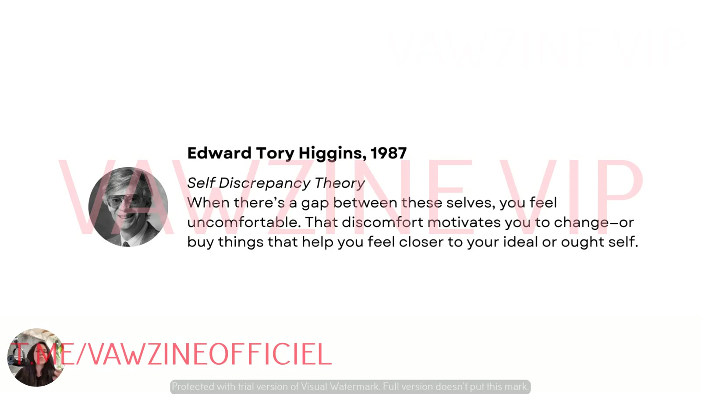

# The 3 Selves That Drive Every Buying Decision
> Based on E. Tory Higgins' **Self-Discrepancy Theory** (1987): every customer carries an **Ideal**, an **Actual** and an **Ought** self. Whichever one is "switched on" when the ad appears decides what messaging lands.

## 🤖 Agent use
- **Use when:** classifying the self in a competitor hook or script, or writing hooks and copy aimed at a chosen self (Actual / Ideal / Ought).
- **Inputs → outputs:** an ad, hook or script line → its self label plus a reason. Or: a target self plus a product → hook and copy lines in that self's register.
- **Rules:**
  - IF the copy promises a better *future* version ("step into", "unlock", "finally works") **THEN** label it Ideal and sell hope, aspiration, thrill, progress [02:43], [03:15].
  - IF the copy affirms who the viewer *already is* ("made for people like you", "you earned this") **THEN** label it Actual and say "you're already this type of person" [03:57], [04:25].
  - IF the copy invokes *should, duty, others counting on you, standards* **THEN** label it Ought and sell relief and reassurance [04:52], [05:36].
  - DO handle Ought carefully. It runs on pressure, so pay it off with relief [04:30].
  - DON'T reinvent the product. Reposition the message to meet the active self [07:05].
- **See also:** [3 selves](../../../concepts/three-selves.md) · [Three selves diagnostic](../../../frameworks/three-selves-diagnostic.md) · [Rewriting ads for new selves](../../../frameworks/rewriting-ads-for-new-selves.md)

## TL;DR
- The model comes from **Self-Discrepancy Theory** (Edward Tory Higgins, 1987). A **gap between versions of yourself feels uncomfortable**, and that discomfort motivates change, or buying things that close the gap [01:04].
- All three selves exist in the subconscious all the time, at different intensities. **Whichever is activated changes how you respond to ads** [01:53].
- **[Ideal Self](../../../concepts/ideal-self.md)** is *who you want to be*: future, hope, aspiration. Sell **hope, aspiration, thrill, progress** [02:20].
- **[Actual Self](../../../concepts/actual-self.md)** is *who you believe you are now*: consistency, validation. Say "**you're already this type of person**" [03:20].
- **[Ought Self](../../../concepts/ought-self.md)** is *who you think you should be*: duty, responsibility, external expectation. Sell **relief and reassurance**, and handle it carefully [04:30].
- Your job isn't to reinvent the product. It's to **reposition the message to meet them where they already are**, which opens up your TAM [07:05].

## Key ideas

### Recap [00:00]
- Your customer is "a system of beliefs and identities, not… one static avatar". Target the self "most actively in buying mode" to avoid stagnation and keep scaling.
- Sarah calls this "one psychology model that I was studying a lot last year, that I think just kind of drastically changed how I develop ads" [00:50].

### Self-Discrepancy Theory [01:04]
- Developed by **Edward Tory Higgins in 1987**, "a well renowned psychologist."
- "When there's a gap between the versions of yourself, you feel kind of uncomfortable." The discomfort between "who you are [and] who you want to be, or who you are, and who you feel you should be" "motivates you to change, right, or buy things that kind of make you feel closer to that version of yourself."
- "This whole course, really… is talking about self discrepancy theory."

*Slide text: "When there's a gap between these selves, you feel uncomfortable. That discomfort motivates you to change, or buy things that help you feel closer to your ideal or ought self."*

### Three selves, always present [01:53]
- "We all have three selves that exist within our subconscious mind: ideal self, actual self, and ought self."
- They "exist at all times, just in different… levels of… more intense, less intense." "Depending on the self that's currently activated inside your brain, you're going to respond differently to ads." [02:05]

*The course's visual shorthand used in every later lesson: Actual = orange with a magnifier, Ideal = green with sparkles, Ought = red with lightning.*

### Ideal Self: "who you want to be" [02:20]
- "Your dreams, your hopes, your aspirations." It responds to messaging "that paints a vivid picture of the future, like a better, more fulfilled version of you."
- **Example lines** [02:43]:
  - "Step into the version that's been waiting for you"
  - "Unlock your next level"
  - "Feel like yourself" *(Sarah lists this here, though it reads closer to Actual)*
  - "What if this is the thing that finally works?"
- "A lot of brands default to ideal self. I can't even think of a brand that doesn't currently message to ideal self." [02:56]
- "It's not about safety necessarily. **The ideal self wants potential.**" [03:11]
- **To target:** push messages like "here's what your life could look like if you just said yes to this particular product." **You're selling hope, aspiration, thrill of emotion, progress.**

*Ideal Self imagery: the runner becoming a fitter future self.*

### Actual Self: "who you currently believe you are" [03:20]
- "Aligned with consistency of identity." It isn't thinking about the future. It looks for "opportunities to validate what I already do, who I already am, lots of reassuring messages."
- **Example lines** [03:57]:
  - "You already know this works"
  - "This is made for people like you"
  - "Stick to what feels right"
  - "You earned this"
- "We're just talking about who you are now. You're not trying to change or transform anybody… You're just trying to reinforce who they already are." [04:05]
- **To target:** "instead of promising… a new version of themselves… messaging… that says **you're already this type of person**. And then the product is just going to fit… into that existent narrative in their head." [04:25]
- Shorthand: "we're targeting right now. **Who are you?**"

*Actual Self imagery: the gamer who already is a gamer. The product just fits the identity they already have.*

### Ought Self: "who you should be" [04:30]
- "I love ought self… but you have to be very careful with this one because ought self is all about **duty, responsibility, external expectation**."
- "**Should** is the word that comes into mind here the most if you're going to target this person." [04:52]
- Responds best to messaging about "safety, doing things the right way." **Example lines** [05:00]:
  - "Don't let this fall through the cracks"
  - "People are counting on you"
  - "Do what your future self will thank you for"
- It applies to role standards ("moms or… golfers or whatever else it is"): "It's not necessarily about dreams. **It's about duty.**" [05:14]
- **To target:** ads that say "**you have a standard to uphold and this is how you meet it.** So you're selling **relief and reassurance**." [05:36]

*Ought Self imagery: the responsible parent meeting a standard, driven by duty more than dreams.*

### The three time/social orientations [05:44]
| Self | Orientation Sarah describes |
|---|---|
| Ideal | **Future**: "I'm trying to make the future better" |
| Actual | **Present**: "I just want my current sense of self to feel reassured" |
| Ought | **Social**: "this is what society thinks I should be" |

> ⚠️ Slip at [06:41]: Sarah says "actual self talking about the future, ideal self talking about who they are right now". She has the two reversed. Everything else in the lesson, the e-book and the prompts has **Ideal = future, Actual = present**.

### Why knowing the active self helps [06:14]
Identifying the self (the prompts do it for you) helps you:
- **position products** more effectively
- **frame ads around emotional tension**, so you create more urgency
- **speak to their internal dialogue**, not just surface-level benefits
- stop "rinsing and repeating one self", and help people "attach to the version of themselves that's most likely to buy in this particular instance"

Each self has "a different emotional lens… different drivers, different language… different styles of ads" [06:46].

*All three selves are present at the moment of purchase. The ad decides which one gets activated.*

### Reposition, don't reinvent [07:05]
- "Your job is not to reinvent your product or your solution… It's your job to just **reposition the message to meet them where they already are**."
- "You've probably nailed one of these already." The plan: find which self you talk to most, then unlock the other two [07:10].
- "This is how we **open up our TAM** a little bit… so that way we can **target more people with the same amount of ads**." [07:28]

## Examples (summary)
| Self | Core question | Sell | Sample lines from the lesson |
|---|---|---|---|
| Ideal | Who do I want to be? | Hope, aspiration, thrill, progress, potential | "Step into the version that's been waiting for you" · "Unlock your next level" · "What if this is the thing that finally works?" |
| Actual | Who am I right now? | Validation, consistency, reassurance | "You already know this works" · "This is made for people like you" · "Stick to what feels right" · "You earned this" |
| Ought | Who should I be? | Relief, reassurance, meeting a standard | "Don't let this fall through the cracks" · "People are counting on you" · "Do what your future self will thank you for" |

## Knowledge units

**Hooks** (example lines Sarah gives per self)
| Hook (verbatim or near) | Heuristic(s) | Emotion / zone | Self targeted | Why it works | Source |
|---|---|---|---|---|---|
| "Step into the version that's been waiting for you" | – | Hope, aspiration | Ideal | Vivid picture of a better future self | [02:43] |
| "Unlock your next level" | – | Hope, thrill | Ideal | Progress and potential framing | [02:43] |
| "What if this is the thing that finally works?" | – | Hope | Ideal | Future-focused possibility | [02:49] |
| "Feel like yourself" | – | Comfort | Ideal (as listed. Reads closer to Actual) | Listed by Sarah among Ideal lines | [02:46] |
| "You already know this works" | – | Reassurance | Actual | Validates the current self, no change asked | [03:57] |
| "This is made for people like you" | – | Belonging, pride | Actual | Identity fit: product slots into their existing narrative | [03:57] |
| "Stick to what feels right" | – | Comfort | Actual | Consistency of identity | [04:00] |
| "You earned this" | – | Pride | Actual | Affirms the present self | [04:00] |
| "Don't let this fall through the cracks" | – | Pressure → relief | Ought | Duty, doing things the right way | [05:05] |
| "People are counting on you" | – | Responsibility | Ought | External expectation | [05:09] |
| "Do what your future self will thank you for" | – | Responsibility | Ought | Duty framing despite the future reference | [05:12] |

**Angles**
| Angle | Core desire / pain | Heuristic(s) | Best format | Example line | Source |
|---|---|---|---|---|---|
| "Here's what your life could look like if you said yes" | Desire for potential, progress | – | Any. The aspirational default | "Unlock your next level" | [03:15] |
| "You're already this type of person" | Desire for identity consistency and validation | – | Any. Product fits the existing narrative | "This is made for people like you" | [04:25] |
| "You have a standard to uphold and this is how you meet it" | Pressure of duty and expectation → relief | – | Any. Use carefully | "People are counting on you" | [05:36] |

**Rules of thumb**
- **DO** identify which self is active, then position the product, frame the ad around emotional tension and speak to the internal dialogue [06:14].
- **DON'T** "rinse and repeat one self over and over" [06:30].
- **DO** use the gap between selves as the source of motivation: discomfort with the gap drives buying [01:04].

## Notable quotes
- "I can't even think of a brand that doesn't currently message to ideal self." [02:56]
- "The ideal self wants potential." [03:11]
- "Should is the word that comes into mind here the most." [04:52]
- "It's not necessarily about dreams. It's about duty." [05:14]
- "Reposition the message to meet them where they already are." [07:05]

## How to apply
- [ ] For each running ad, ask: does it *promise a future* (Ideal), *affirm the present* (Actual), or *invoke a should* (Ought)?
- [ ] Write one line per self for your hero product using the sample lines as templates.
- [ ] Use Ought carefully: it runs on pressure and duty, so frame the payoff as relief and reassurance.

## Related
- Concepts: [3 selves model](../../../concepts/three-selves.md) · [Ideal Self](../../../concepts/ideal-self.md) · [Actual Self](../../../concepts/actual-self.md) · [Ought Self](../../../concepts/ought-self.md) · [Self-targeting](../../../concepts/self-targeting.md)
- E-book chapter 1: [Which 'You' Are You Selling To?](../../../resources/which-you-are-you-selling-to-ebook.md)
- Previous: [03](03-why-one-self-isnt-enough-to-scale.md) · Next: [05 – Run the 3 Selves Diagnostic](05-run-the-3-selves-diagnostic-on-your-ads.md)

## Sources
- Transcript: [4. The 3 Selves That Drive Every Buying Decision.txt](<../../../../raw/tether-lab/_transcripts/4. The Self Targeting System/4. The 3 Selves That Drive Every Buying Decision.txt>)
- Page text: [4_4_The_3_Selves…md](<../../../../raw/tether-lab/_extracted/4. The Self Targeting System/4_4_The_3_Selves_That_Drive_Every_Buying_Decision_The_S.md>)
- Transcript fixes: "Edward Torrey Higgins" is Edward Tory (E. Tory) Higgins. "stay away from that kind of angle" [00:58] means angle rut.
