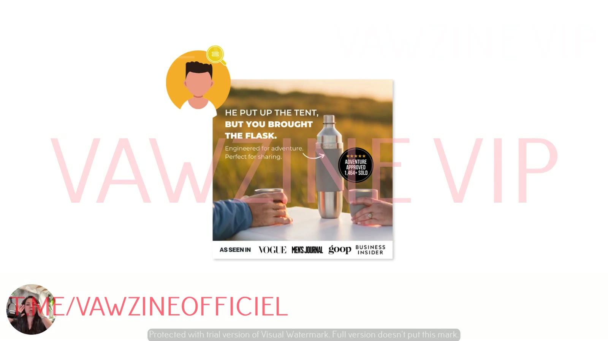
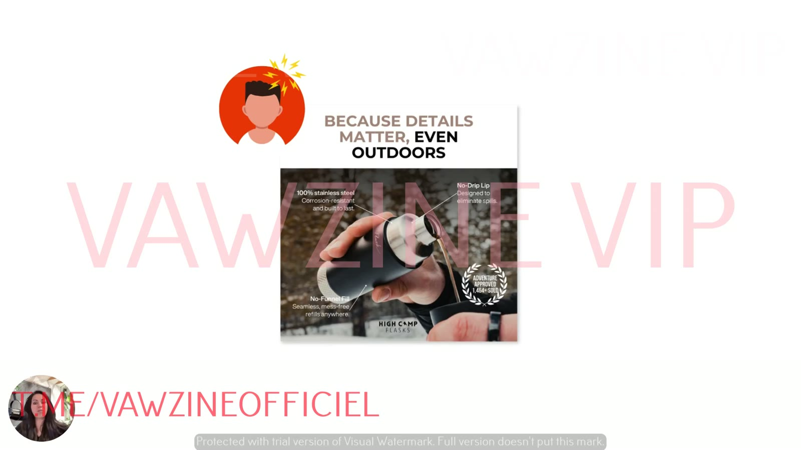
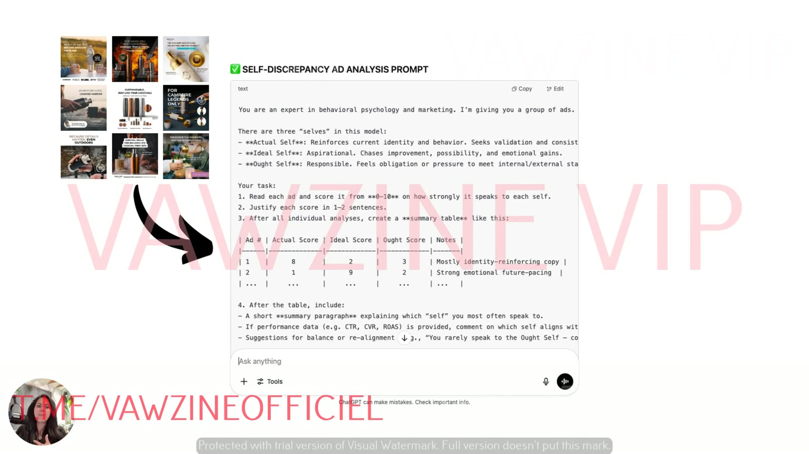
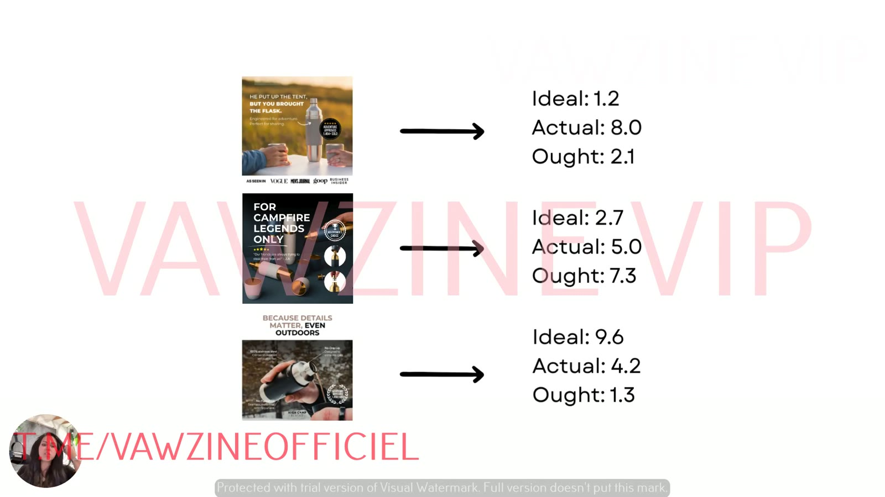
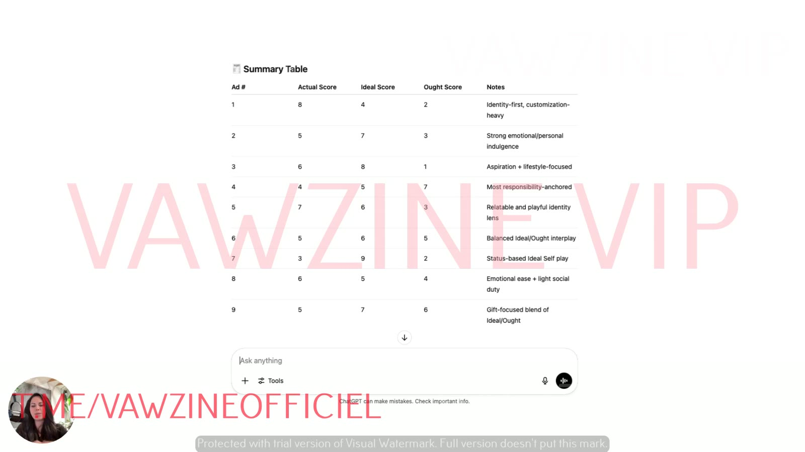
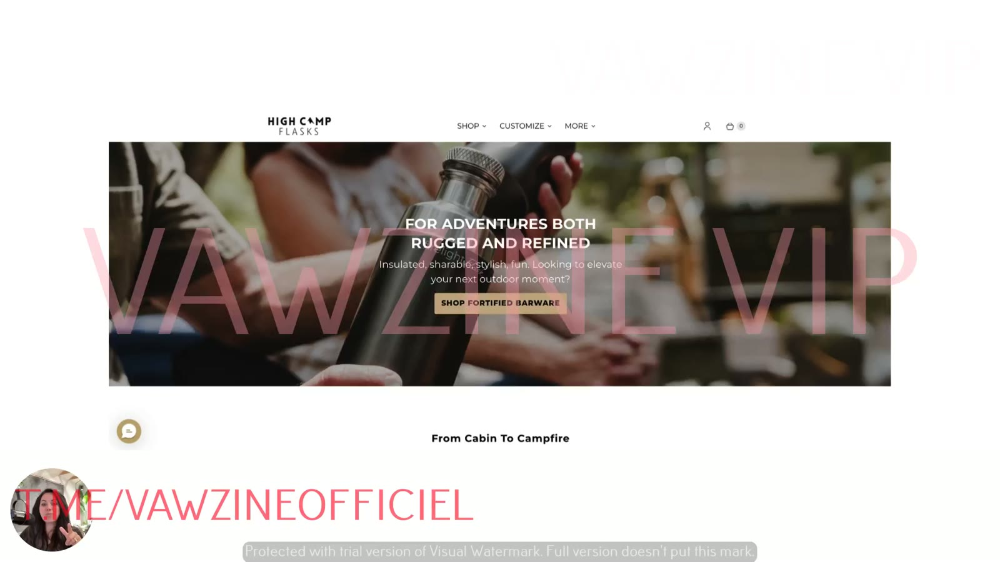

# Run the 3 Selves Diagnostic on Your Ads
> Hands-on: score your 9-ad sample for Actual / Ideal / Ought with ChatGPT (Prompt 1), or score it against performance metrics (Prompt 2), to see which selves you over-use and which you've never tried.

## 🤖 Agent use
- **Use when:** tearing down a competitor's ad set (or our own) to tag each ad by self and find the under-used selves to attack.
- **Inputs → outputs:** 9 ads as screenshots, copy or video transcripts (plus metrics if available) → a per-ad Actual / Ideal / Ought score table (0–10) with notes, the dominant self, and the gaps.
- **Rules:**
  - DO score copy *and* visuals: headline, subhead, badges, buttons, callouts, image [03:30].
  - DO transcribe video ads and score the script. Start with statics or core messaging when possible [04:00].
  - DO keep ad names (naming conventions) attached so results map back to ads [04:41].
  - IF performance data exists **THEN** use Prompt 2 with names mapped to metrics, not Prompt 1 [05:20].
  - DON'T trust a single slide or score blindly. The lesson's own example slide has swapped values (see the screenshot caption). Sanity-check scores against the copy.
- **See also:** [Three selves diagnostic](../../../frameworks/three-selves-diagnostic.md) · [Three selves prompts](../../../resources/three-selves-prompts.md)

## TL;DR
- The **three selves diagnostic** is what Sarah runs in full ad-account audits. It shows which self you talk to most, which converts best, and which you've never tried [00:13].
- Use ChatGPT. You *can* do it by hand, but it takes more work because you have to read the language closely [00:49].
- Example ads (High Camp Flasks): **Actual** "He put up the tent, but you brought the flask." · **Ideal** "For campfire legends only." · **Ought** "Because details matter, even outdoors." [01:30]
- ChatGPT scores **copy and images**: headlines, subheads, badges, buttons, callouts [03:30]. For video, **transcribe the script**. Starting with statics/core messaging is easier [03:55].
- Output: a table with each ad (numbered, or by name if you use naming conventions) and an **Actual / Ideal / Ought score + notes** [04:27].
- **Prompt 2** adds metrics. Upload a spreadsheet of ad names + ad text + key metrics, mapped by name, to see which self your customers *buy* from [05:20].

## Key ideas

### What the diagnostic is for [00:00]
- "Figure out how much of each self kind of exists inside your ad account already… what versions of your customer you're already speaking to, and then which ones are missing."
- Sarah uses it in "full ad account audits" to understand "which self are we talking to the most, which ones are going to be the most beneficial when it comes to actually driving conversions, and which ones have we really just not even tried to go after yet", so creative doesn't stagnate [00:25].
- Tool: ChatGPT. By hand is possible but "a little bit more labor intensive because you're going to have to pay close attention to the language" [00:49].

### Step 1: grab your sample [01:00]
- "Grab a good handful of ads… You can start with nine": **3 top performers, 3 mid performers, 3 clear flops** (see [lesson 2](02-diagnose-which-self-your-ads-target.md)).

### What each self looks like in an ad (High Camp Flasks) [01:20]

**Actual Self: "He put up the tent, but you brought the flask."** [01:30]
- Speaks to a partner or significant other and **reinforces their existing identity**: he's "the gear guy" who put up the tent, *you're* the one who "brings the fun and the ambiance because you brought the flask."
- "The language is really calm. It's proven. It's tested."

*Actual Self example: affirms who the buyer already is (the one who brings the flask). Also shows an "Adventure Approved, 1,464+ sold" badge and an "As seen in Vogue / Men's Journal / goop / Business Insider" bar.*

**Ideal Self: "For campfire legends only."** [02:04]
- For "somebody who aspires to become that person." The ad says "you could be this person if you had this product."
- "Speaking to growth goals, aspiration. The language is very transformational… It's next level."

*Ideal Self example: "For campfire legends only" invites the viewer to become a legend.*

**Ought Self: "Because details matter, even outdoors."** [02:34]
- "You should be the type of person who cares about the details no matter where you are."
- Evokes "responsibility, that pressure… a little bit of morality… protective language. Don't let them down."

*Ought Self example: "details matter" sets a standard the buyer should meet. Feature callouts justify it as the responsible choice.*

### Step 2: run Prompt 1 in ChatGPT [03:00]
- Copy the prompt from the classroom ([Three selves prompts](../../../resources/three-selves-prompts.md)) into ChatGPT, then paste or upload all the ads.
- ChatGPT analyses all nine and **scores them on the language in headlines, subheads, badges, buttons, callouts… but it's also going to score the images as well** [03:30], taking "all of your creative and all of your text" into account.
- **Video-only advertisers:** "transcribe your video and just run the script through", or screenshot the clips. Sarah finds it "works a lot easier if we can start with **core messaging** first, which is the reason I start with statics" [04:00].

*The prompt pasted into ChatGPT next to the 9 ads. This on-screen version differs slightly from the final Prompt 1 in the DOCX; both are on the [prompts page](../../../resources/three-selves-prompts.md#on-screen-variant-of-prompt-1-lesson-5).*

### Step 3: read the output table [04:15]
- You get "an organized table": ads numbered 1–9, or "even more beneficial if you have naming conventions, it will just go ahead and give you the names of the ads." Each ad gets an **actual score, ideal score, and ought score**, plus notes on why [04:41].
- It quickly shows "which self you're speaking to the most by ad", one ad at a time. It also gives numbers, which helps if you "want to get even more scientific" about tests [05:09].

*Example per-ad scores on a slide. ⚠️ The Actual ad scores as expected (Actual 8.0), but the other two rows contradict the narration: "For campfire legends only" (called Ideal) shows Ought 7.3, and "Because details matter" (called Ought) shows Ideal 9.6. The Ideal and Ought values for those two ads look swapped on the slide.*

*The kind of summary table Prompt 1 produces (transcribed below).*

| Ad # | Actual | Ideal | Ought | Notes (ChatGPT) |
|---|---|---|---|---|
| 1 | 8 | 4 | 2 | Identity-first, customization-heavy |
| 2 | 5 | 7 | 3 | Strong emotional/personal indulgence |
| 3 | 6 | 8 | 1 | Aspiration + lifestyle-focused |
| 4 | 4 | 5 | 7 | Most responsibility-anchored |
| 5 | 7 | 6 | 3 | Relatable and playful identity lens |
| 6 | 5 | 6 | 5 | Balanced Ideal/Ought interplay |
| 7 | 3 | 9 | 2 | Status-based Ideal Self play |
| 8 | 6 | 5 | 4 | Emotional ease + light social duty |
| 9 | 5 | 7 | 6 | Gift-focused blend of Ideal/Ought |

### Step 4 (optional): add performance data with Prompt 2 [05:20]
- "If you want to get even more technical… you can actually upload metric data." That's the second prompt.
- Upload a **spreadsheet** with "all of your ads with their naming conventions, their ad text, and then any key metric data that you want to analyze" [05:41]. **Map ad names to metrics** so ChatGPT can cross-reference them.
- Prompt 1 = "drag and drop" to see which selves you're talking to. Prompt 2 = the same analysis plus metrics, giving "a super clear picture as to who responds best to your ads… not the avatar… the self that your customers are shopping in the most" [06:13].

### The worked example [06:20]
- Brand: **High Camp Flasks** ("really good brand, cool people over there… good friends in that brand").
- No metric data for them, so the walkthrough (lesson 6) uses only Prompt 1 to show "which self high camp is talking to", then (lesson 7) how to revamp messaging to target different selves "using the exact same ad."

*The example brand's site: High Camp Flasks ("Insulated, sharable, stylish, fun… From Cabin To Campfire").*

## Framework / steps
See [Three selves diagnostic](../../../frameworks/three-selves-diagnostic.md) for the full procedure:
1. Pick 9 ads (3/3/3).
2. Paste Prompt 1 into ChatGPT, then upload screenshots (or paste copy / video scripts).
3. Read scores and notes per ad, plus the summary paragraph.
4. Optional: run Prompt 2 with a spreadsheet of names + copy + metrics.

## Knowledge units

**Hooks**
| Hook (verbatim or near) | Heuristic(s) | Emotion / zone | Self targeted | Why it works | Source |
|---|---|---|---|---|---|
| "He put up the tent, but you brought the flask." | Social proof (badge: "Adventure Approved, 1,464+ sold"), authority ("As seen in Vogue…") | Calm, pride | Actual | Reinforces the buyer's existing role (the one who brings the fun). "Calm… proven… tested" language | [01:30] |
| "For campfire legends only." | Exclusivity, social proof (★★★★★ "Our friends are always trying to steal them from us!") | Aspiration, thrill | Ideal | "You could be this person if you had this product." Transformational, "next level" | [02:04] |
| "Because details matter, even outdoors." | Authority/feature proof (callouts: 100% stainless steel, no-drip lip, no-funnel fill) | Responsibility, light pressure | Ought | "You should be the type of person who cares about the details." Protective "don't let them down" language | [02:34] |

**Ad teardowns**
| Brand / product (niche) | Format | Hook / opening | What works | What fails | Fix suggested | Principle | Source |
|---|---|---|---|---|---|---|---|
| High Camp Flasks (outdoor barware) | Static, lifestyle photo + press bar | "He put up the tent, but you brought the flask." | Clean Actual-Self identity affirmation for a couple | Not critiqued | – | Actual = "you already are this person" | [01:30] |
| High Camp Flasks | Static, dark product shot + review + badge | "For campfire legends only." | Aspirational identity invitation | Not critiqued | – | Ideal = "become the legend" | [02:04] |
| High Camp Flasks | Static, headline above a feature-callout photo | "Because details matter, even outdoors." | Standard-setting, responsible framing | Not critiqued | – | Ought = "you should care about details" | [02:34] |
| High Camp Flasks (other 3×3 grid ads, labels only) | Statics | "For when you need something stronger than s'mores" · "So elegant and stylish. I'm getting one for myself." · "Adventure hard, unwind harder" · "Customizable, just like your cocktails" · "Survival skills: fire-building 2/10, cocktail prep 10/10" · "Remember the moments, not the imperfections" | Shown as the 9-ad sample | Not scored individually on screen | – | Sample 3 top / 3 mid / 3 flop | [01:15] (L2) / [00:45] |

**Rules of thumb**
- **DO** score images as well as copy [03:44].
- **IF** you only run video **THEN** transcribe and score the scripts, or screenshot key clips [04:02].
- **DO** use numbers (0–10 per self) so you can compare ads and test scientifically [05:09].
- **IF** you have metrics **THEN** map ad names to metrics in a spreadsheet and use Prompt 2 [05:41].

## Notable quotes
- "It's going to score the images as well." [03:44]
- "Start with core messaging first, which is the reason I start with statics." [04:07]
- "Not the avatar… the self that your customers are shopping in the most." [06:13]

## How to apply
- [ ] Name your ads with a consistent convention before you export, so ChatGPT returns names instead of numbers.
- [ ] For video, export transcripts first.
- [ ] Build a sheet with columns: Ad name · Ad text · CTR · CVR · ROAS (plus AOV and LTV if you have them) for Prompt 2.

## Related
- Brand case files: [High Camp Flasks](../../../brands/high-camp-flasks.md) · [all brands by niche](../../../brands/README.md)
- [Three selves diagnostic](../../../frameworks/three-selves-diagnostic.md) · [Three selves prompts](../../../resources/three-selves-prompts.md) · [3 selves model](../../../concepts/three-selves.md)
- Previous: [04](04-the-3-selves-that-drive-every-buying-decision.md) · Next: [06 – How to Use the Prompts](06-how-to-use-the-prompts-for-instant-insights.md)

## Sources
- Transcript: [5. Run The 3 Selves Diagnostic on Your Ads.txt](<../../../../raw/tether-lab/_transcripts/4. The Self Targeting System/5. Run The 3 Selves Diagnostic on Your Ads.txt>)
- Page text: [5_5_Run_the_3_Selves_Diagnostic…md](<../../../../raw/tether-lab/_extracted/4. The Self Targeting System/5_5_Run_the_3_Selves_Diagnostic_on_Your_Ads_The_Self_Ta.md>)
- Transcript fixes: "props" means prompts. "odd score" means ought score. "high camp" is High Camp Flasks. "put it up the tent" is "put up the tent".
