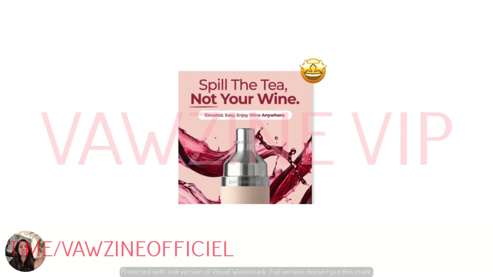
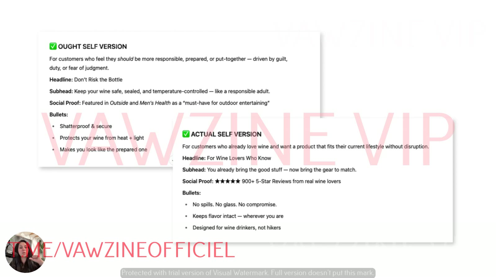
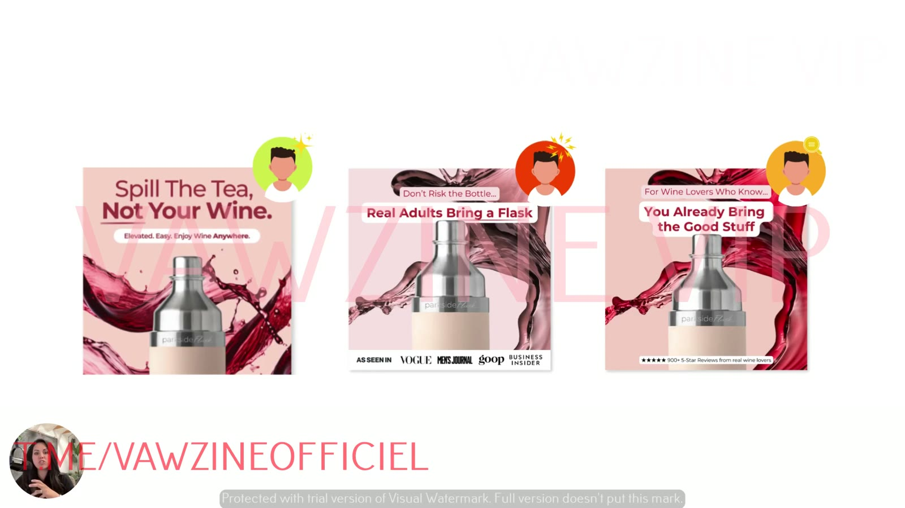

# How to Rewrite Winning Ads for New Selves
> Don't start from a blank page. Take a winning ad, have Prompt 3 identify its self, and rewrite it for the other two selves **without touching the offer**. You get new angles and data on which self buys.

## 🤖 Agent use
- **Use when:** turning a winning ad (ours, or a competitor's proven mechanism remixed for our product) into new angle variants by re-targeting it to the two selves it doesn't address. This is the core "take what's working and make it our own" move.
- **Inputs → outputs:** one winning ad (copy plus a visual description, or a script) + our product/offer facts → its primary self + two rewrites (headline 4–7 words, subhead 1–2 lines, optional social proof, bullets or badge, or a UGC script) for the missing selves.
- **Rules:**
  - DO keep the offer identical across variants: same CTA, landing page, price, discount/bundle [00:38].
  - DO change only the self-messaging (and the proof type that fits that self). Keep layout and visual as close as possible ([L8 01:35](08-how-to-test-your-ads-by-self-type.md)).
  - DO let the core message shift per self, **unless** it's a long-proven brand line ("ran it for two years… worked every single time"). Then keep it [02:41], [03:06].
  - DO switch the output to "generate an ad script" for UGC/video [02:18].
  - DON'T ship model-invented social proof (press mentions, review counts). Replace it with verified claims. *(Agent rule, from the L7 example where the final ad swapped in the real "As seen in" bar.)*
  - DON'T copy a competitor's assets or claims. Re-target the *mechanism* to a new self for our product.
- **See also:** [Rewriting ads for new selves](../../../frameworks/rewriting-ads-for-new-selves.md) · [Prompt 3](../../../resources/three-selves-prompts.md#prompt-3-rewrite-one-ad-for-all-three-selves) · [Testing ads by self type](../../../frameworks/testing-ads-by-self-type.md)

## TL;DR
- After the analysis comes "**fix the frame**": reposition **existing winners** to a different self, not new concepts from scratch [00:12].
- Two benefits: it **prevents angle rut**, and it gives "incredibly invaluable data on… which self is most likely to buy from you" [00:25].
- **The only rule: keep the offer the same.** Don't change landing-page CTAs or switch discount to bundle. Test **one self at a time**, CRO-style [00:38].
- Example: **"Spill The Tea, Not Your Wine."** (Ideal) becomes Ought **"Don't Risk the Bottle… Real Adults Bring a Flask"** and Actual **"For Wine Lovers Who Know… You Already Bring the Good Stuff"** [01:43].
- Need a video script instead? Change the prompt's output line from "full ad concepts" to "an ad script" [02:18].
- **Exception:** if you have a proven core message that has worked "for two years… every single time", **keep it**. That's brand-level work, not something to re-self [02:41].

## Key ideas

### Fix the frame [00:00]
- "Now that you know which self your ads are speaking to, it's time to rewrite. And we're not going to start with like a blank page. We're going to take existing ads that are currently crushing… and just reposition to a different version of your customer."
- Benefits: it prevents the [angle rut](../../../concepts/angle-rut.md), and it shows "which self is most likely to buy from you."

### The only rule: same offer [00:38]
- "You have to keep your offer the same."
- Don't "change CTAs on your landing page and test a different self." Don't change "offers from discounts to a bundle and test a different self."
- "Go very, very slowly. This is how we do kind of **CRO level work**. I want you to **test one version of self at a time**." [00:57]

### Running Prompt 3 [01:08]
- Take the ad that's currently winning. Copy the **final prompt** in the prompt doc ([Prompt 3](../../../resources/three-selves-prompts.md#prompt-3-rewrite-one-ad-for-all-three-selves)). It tells ChatGPT to analyse the ad, **identify which self the winner targets, and shift it to the other selves** [01:17].
- **Example winner (High Camp Flasks / Parkside Flask):** "Spill The Tea, Not Your Wine. Elevated. Easy. Enjoy Wine Anywhere." ChatGPT placed it as **Ideal Self**: "very much talking about like future focus… this is who you'd rather be as the type of person that's just classy." Sarah agrees ("pretty spot on") [01:43].

*The winning ad used as input. ChatGPT classed it as Ideal Self (classy, the person you'd rather be).*

- ChatGPT then produces versions for the two missing selves, here **Ought** and **Actual** [02:02]. The prompt's output structure gives **headline, subhead, social proof, bullet points**.

*ChatGPT's Prompt 3 output for the two missing selves (transcribed below).*

**✅ OUGHT SELF VERSION** (ChatGPT output, on screen)
> For customers who feel they *should* be more responsible, prepared, or put-together — driven by guilt, duty, or fear of judgment.
> **Headline:** Don't Risk the Bottle
> **Subhead:** Keep your wine safe, sealed, and temperature-controlled — like a responsible adult.
> **Social Proof:** Featured in *Outside* and *Men's Health* as a "must-have for outdoor entertaining"
> **Bullets:** Shatterproof & secure · Protects your wine from heat + light · Makes you look like the prepared one

**✅ ACTUAL SELF VERSION** (ChatGPT output, on screen)
> For customers who already love wine and want a product that fits their current lifestyle without disruption.
> **Headline:** For Wine Lovers Who Know
> **Subhead:** You already bring the good stuff — now bring the gear to match.
> **Social Proof:** ★★★★★ 900+ 5-Star Reviews from real wine lovers
> **Bullets:** No spills. No glass. No compromise. · Keeps flavor intact — wherever you are · Designed for wine drinkers, not hikers

> (Context, not from course:) ChatGPT may invent social proof. The "Featured in *Outside* and *Men's Health*" line was replaced in the final designed ad with the brand's real "As seen in" bar. Always check press, review and stat claims before you ship.

### Tweak the output format [02:18]
- The prompt generates full static concepts (headline, subhead, social proof, bullets). "If you want it to… generate a script, you can also just change the actual output in there. Instead of saying, generate me full ad concepts, you can say **generate an ad script** and it will do the same thing."

### The result: three ads, three selves [02:34]
- "What you're going to end up with is three versions of this ad that are speaking to three different versions of people."

*Final creative set: one product, one offer, three selves (Ideal, Ought, Actual), each tagged with its self icon. The Ought version swaps to authority social proof (Vogue, Men's Journal, goop, Business Insider). The Actual version uses peer proof ("900+ 5-Star Reviews from real wine lovers").*

### Core message: when to change it and when not to [02:41]
- The core message ("spill the tea, not your wine") **changed** across the three versions. "That's on purpose."
- **But:** "If you found a core message that you're like, every time we run this message, it works in these ads incredibly well, please, please, please adhere to that core message. And you don't necessarily need to change this to a different sense of self." [02:43]
- A message you've "ran for two years and it worked every single time" is a **core message to pull out and develop on the brand side**. Sarah says she has brand courses coming [03:06].
- This system is for accounts where "we have the same message running throughout the entire ad account, sometimes it works, sometimes it doesn't. We can't figure out what to do." [03:20]

### Why it works [03:35]
- "The whole play here is not to switch offers… We're just switching **who we're inviting in**. We're just opening an **emotional door** to a different window of themselves." [03:51]
- "That's how… we just unlock these new buyer types with **zero extra creative cost**." [04:00]
- "Your algorithm will do the heavy lifting for you, but you'll get much closer, much faster, much cheaper if you just activate a different sense of self." [04:12]

## Framework / steps
See [Rewriting ads for new selves](../../../frameworks/rewriting-ads-for-new-selves.md):
1. Pick a current **winner**.
2. Paste **Prompt 3** plus the ad into ChatGPT.
3. Confirm the **primary self** it identifies.
4. Get rewrites for the **two other selves** (headline 4–7 words, subhead, optional social proof, bullets or badge). Ask for scripts instead if you need video.
5. Design all three as close to identical as possible. **Keep the offer, CTA, landing page and price unchanged.**
6. Unless the core message is a long-proven brand line, letting it shift per self is fine.
7. Test them ([lesson 8](08-how-to-test-your-ads-by-self-type.md)).

## Knowledge units

**Rewrites (before → after)**
| Before | After | What changed (verb / visual / promise / self / intensity) | Source |
|---|---|---|---|
| **Ideal:** "Spill The Tea, Not Your Wine." / "Elevated. Easy. Enjoy Wine Anywhere." | **Ought:** "Don't Risk the Bottle" / "Keep your wine safe, sealed, and temperature-controlled — like a responsible adult." / Proof: "Featured in Outside and Men's Health as a 'must-have for outdoor entertaining'" (model-generated) / Bullets: Shatterproof & secure · Protects your wine from heat + light · Makes you look like the prepared one | Self Ideal → Ought. Promise moves from classy-future-you to avoiding risk and being the responsible adult. Proof moves to authority/press. Verb "Don't risk" (prevention) | [02:02] |
| Same Ideal ad | **Ought (final design):** "Don't Risk the Bottle… / Real Adults Bring a Flask" + "As seen in Vogue · Men's Journal · goop · Business Insider" | Same visual (wine splash + flask). Headline becomes a social-standard "should". Press bar for authority | [02:30] |
| Same Ideal ad | **Actual:** "For Wine Lovers Who Know" / "You already bring the good stuff — now bring the gear to match." / Proof: ★★★★★ 900+ 5-Star Reviews from real wine lovers / Bullets: No spills. No glass. No compromise. · Keeps flavor intact — wherever you are · Designed for wine drinkers, not hikers | Self Ideal → Actual. Promise moves from becoming classy to fitting who you already are ("you already…"). Peer proof from "real wine lovers". In-group identity callout | [02:02] |
| Same Ideal ad | **Actual (final design):** "For Wine Lovers Who Know… / You Already Bring the Good Stuff" + "★★★★★ 900+ 5-Star Reviews from real wine lovers" | Same visual. Headline becomes identity affirmation. Peer-review strip | [02:30] |

**Hooks**
| Hook (verbatim or near) | Heuristic(s) | Emotion / zone | Self targeted | Why it works | Source |
|---|---|---|---|---|---|
| "Spill The Tea, Not Your Wine." | Wordplay/pattern interrupt | Playful, classy | Ideal | "Who you'd rather be… the type of person that's just classy" | [01:43] |
| "Don't Risk the Bottle… Real Adults Bring a Flask" | Authority (press bar), social norm | Responsibility, mild pressure | Ought | Sets a standard (real adults) and relieves the risk | [02:30] |
| "For Wine Lovers Who Know… You Already Bring the Good Stuff" | Social proof (peer reviews), in-group identity | Pride, comfort | Actual | Affirms the existing identity. The product just fits | [02:30] |

**Rules of thumb**
- **DO** start from existing winners, never a blank page [00:18].
- **DO** keep the offer the same and test one self at a time (CRO-level discipline) [00:38], [00:57].
- **IF** a core message has worked consistently for a long time **THEN** keep it and treat it as brand. Don't re-self it [02:43], [03:06].
- **IF** the same message runs across the whole account and works only sometimes **THEN** re-self it [03:20].
- **DO** match the proof type to the self: authority/press for Ought, peer reviews for Actual (as in the example) [02:30].

## Notable quotes
- "The only rule… you have to keep your offer the same." [00:38]
- "We're just switching who we're inviting in." [03:45]
- "Opening an emotional door to a different window of themselves." [03:51]
- "Zero extra creative cost." [04:00]

## How to apply
- [ ] Choose 1–3 current winners and run each through Prompt 3.
- [ ] Fact-check any social proof the model writes.
- [ ] Leave long-proven brand taglines alone. Re-self the ads around them instead.

## Related
- Brand case files: [High Camp Flasks](../../../brands/high-camp-flasks.md) · [all brands by niche](../../../brands/README.md)
- Tool pages: [ChatGPT](../../../tools/chatgpt.md)
- [Rewriting ads for new selves](../../../frameworks/rewriting-ads-for-new-selves.md) · [Three selves prompts](../../../resources/three-selves-prompts.md) · [E-book ch. 4](../../../resources/which-you-are-you-selling-to-ebook.md#page-7-chapter-4-how-to-rewrite-ads-for-each-self)
- Previous: [06](06-how-to-use-the-prompts-for-instant-insights.md) · Next: [08 – How to Test Your Ads by Self Type](08-how-to-test-your-ads-by-self-type.md)

## Sources
- Transcript: [7. How to Rewrite Winning Ads For New Selves .txt](<../../../../raw/tether-lab/_transcripts/4. The Self Targeting System/7. How to Rewrite Winning Ads For New Selves .txt>)
- Page text: [7_7_How_to_Rewrite…md](<../../../../raw/tether-lab/_extracted/4. The Self Targeting System/7_7_How_to_Rewrite_Winning_Ads_for_New_Selves_The_Self_.md>)
- Transcript fixes: "spill your tea and not your wine" is "Spill The Tea, Not Your Wine." "it was targeting a self and actual self as the secondary versions" [02:02] means "ought self and actual self".
