# Live With Sarah! (May 14, 2025)
> A mini-training on **story frameworks for ad scripts**. Sarah walks through her 15-framework "Story Frameworks" doc and ChatGPT's "Storytelling Loadout" (three batches by job: big emotional arcs, marketing and sales, quick stories). She shows three Maelove scripts (Pixar UGC, Hero's Journey influencer, In Medias Res fake podcast) and builds two scripts live in ChatGPT (a vet story for dog dental chews via Freytag's Pyramid; a diabetic-friendly ice cream via the Monomyth). Q&A covers voiceovers and ElevenLabs, AI UGC, low budgets, limited customer data, why a story video fails (speed first), length tests and advertorials.

## 🤖 Agent use
- **Use when:** writing a UGC, influencer, founder, podcast-style or voiceover script; picking a story structure for a funnel job; turning a competitor's story ad into a different structure for our product; generating static headlines from a script; diagnosing a story video that doesn't convert.
- **Inputs → outputs:** product + one core problem/angle (e.g., "too many bottles on her countertop") + avatar + chosen framework (+ main character + CTA) → a scene-by-scene script with directions → extracted core emotion/message → static headlines; plus a test plan (speed → hook → story → visuals; then length 2–3 min → 30 s → 15 s).
- **Rules:**
  - DO name the framework in the prompt ("use the Pixar story framework"). IF the output blends frameworks or looks generic THEN paste the framework's steps into the prompt and say "follow only this one". [0:15:36–0:15:49; 0:50:44–0:52:41; 0:54:40–0:55:06]
  - DO give ChatGPT the problem/concept, the avatar, the main character and the CTA, then pick the framework by job (Batch 1 transformation, Batch 2 conversion, Batch 3 quick/short-form). [0:12:27–0:14:31; 0:17:42–0:18:13; 0:35:15]
  - DO spend about **two-thirds of the script setting up the story** (problem + experience). Solution and CTA come in the last few scenes. "The punchline is not the point." [0:19:45–0:20:41]
  - DON'T default to AIDA/PAS for everything. Keep them for **bottom-of-funnel / evaluation** ("eating oatmeal every day with nothing on it"). [0:04:56–0:05:10; 0:07:57–0:08:16; 0:13:41–0:14:31; 0:40:09–0:40:52]
  - DO inject **realism** (skepticism, "cautiously at first", "three or four of my customers"). DON'T claim "it transformed everybody overnight". [0:41:08–0:41:54; 0:53:43]
  - DO tell the story from **any character around the customer** (vet, trainer, pet sitter, neighbour, the pet) and treat each character as avatar exploration. [0:32:34–0:34:00; 0:39:50–0:40:30]
  - DO let UGC creators say the script **in their own words**. Use natural-voice voiceovers (ElevenLabs) when there's no creator. Avoid robot voices for stories. [0:22:33–0:24:05]
  - DO write the script first, then ask ChatGPT for the **deepest emotion + core message → headlines**. Asking for "Pixar headlines" directly confuses it. [0:25:11–0:25:43]
  - IF a story video doesn't convert THEN test **speed first** (slower delivery; cuts out to ~4 s), then the **hook**, then the **story**, then visuals/creators. [0:43:09–0:45:41; 0:47:13–0:48:12]
  - DO test length: run long (2–3 min) as-is, then cut to 30 s and 15 s with ChatGPT. Long videos currently convert better. [0:45:41–0:46:50]
  - DON'T use AI UGC where brand trust/affinity matters. IF testing AI creators THEN build them an organic following first. [0:26:17–0:28:21; 0:31:11–0:31:50]
  - IF a story script wins THEN build an **advertorial** from it, and keep a recurring character (Dr. Riley) as a **fluency mechanism**. [0:48:12–0:48:52]
- **See also:** [Micro-story](../../../concepts/heuristics/micro-story.md) · [Open loop](../../../concepts/heuristics/open-loop.md) · [Curiosity gap](../../../concepts/heuristics/curiosity-gap.md) · [Contrast](../../../concepts/heuristics/contrast.md) · [Authority bias](../../../concepts/heuristics/authority-bias.md) · [Processing fluency](../../../concepts/heuristics/processing-fluency.md) · [Emotional zones](../../../concepts/emotional-zones.md) · [Valence-intensity diagnostic](../../../frameworks/valence-intensity-diagnostic.md) · [May 7 session](2025-05-07-live-with-sarah.md) (the Maelove "40 bottles" insight these scripts use)

*Skool page: title and video length only (1:07:56). The talk ends at ~0:56:48. The rest of the recording is an unrelated private conversation that was left running.*

## TL;DR
- **15 story frameworks**, distilled from Sarah's 2024 study of comedians, stage speakers, TED talks, bestselling authors and top-grossing films (5–10 h a month), then extracted with ChatGPT. Favourites: **Pixar** (#1) and **In Medias Res** (#2). She also loves **Freytag's Pyramid**. [0:02:53–0:04:05; 0:06:20; 0:09:25]
- **Three batches by job:** Batch 1 *Big emotional arcs* (Hero's Journey, Monomyth, Freytag, Dramatic Arc, Three-Act): founder stories, origin stories, VSLs. Batch 2 *Marketing & sales* (AIDA, PAS, SCQA, StoryBrand, In Medias Res): landing pages, sales emails, retargeting. Batch 3 *Quick stories* (Pixar, Story Spine, Fichtean Curve, Seven Basic Plots): hooks, UGC, TikToks, memes. Bonus: **Founder's Post**. [0:12:27–0:15:31]
- **Story > generic UGC prompt:** a Pixar-model Maelove script ("I have to admit I was wrong") "has a whole lot more emotion in it than if [you] just say write me a UGC script". [0:16:17–0:18:29]
- **Spend two-thirds of the story on setup.** Comedians and speakers barely spend time on the punchline. Hero's Journey even "backed out" of proof into more story. [0:18:54–0:20:41]
- **Live builds show ChatGPT surfacing new angles:** the vet story found "**chew time long enough to actually scrape tartar**" (a new use case, and a way to push bully sticks) and the emotion "she no longer had to play the bad guy". The ice-cream story produced "**ice cream that loves your body back**". [0:38:27–0:39:50; 0:42:00; 0:53:34]
- **Failing story video? Speed first.** Clip cuts of 2–3 s are the industry standard and 4 s is the longest she's seen, but slowing the voice usually fixes attachment. Then hook, then story, then visuals. [0:43:09–0:47:51]

## Session map
| Time | Segment |
|---|---|
| [0:00:00] | Intro, mute housekeeping. A "mini training" of ~15 min on story frameworks, requested in the community. |
| [0:02:08] | Why: emotional arcs in scripts. How the 15 frameworks were built (2024 study + ChatGPT). |
| [0:04:05] | Story Frameworks doc walk-through: Hero's Journey, AIDA, Freytag, Three-Act, Pixar, StoryBrand, PAS, SCQA, Monomyth, In Medias Res, Fichtean Curve, Seven Basic Plots, Story Spine, Dramatic Arc. |
| [0:12:27] | ChatGPT "Storytelling Loadout": three strategic batches + Founder's Post bonus. |
| [0:15:31] | Attendees vote Pixar. Prompting tips. |
| [0:16:17] | Maelove scripts: Pixar UGC [0:16:17], Hero's Journey influencer [0:18:29], two-thirds setup rule [0:19:38], In Medias Res fake podcast [0:20:41]. |
| [0:22:33] | Q: voiceovers? Q: low budget? ElevenLabs. |
| [0:25:06] | Q (David Abramovici): only UGC, or statics/GIFs too? Script → headlines. |
| [0:26:08] | Q (Leonardo Larocca): AI UGC (Icon, Creatify)? |
| [0:29:05] | Q: limited customer data? Don't let ChatGPT invent ICPs. |
| [0:30:53] | Chat: ElevenLabs voice cloning, Creatify didn't convert. AI creators organic-first. Docs go to the classroom. |
| [0:32:34] | Q (Lesley Cramer): pet brands. Tell the owner's or the pet's story? |
| [0:34:21] | **Live build 1:** dental chews, Freytag's Pyramid, the vet as main character. |
| [0:42:59] | Q: story didn't convert. Visuals or story? Speed first. |
| [0:45:41] | Q: script too long? Length tests. Chat: rate of speech + tone of voice. |
| [0:48:12] | Q: advertorials? Fluency mechanism. |
| [0:49:22] | **Live build 2:** diabetic-friendly ice cream, Monomyth (blended output → forced single framework). |
| [0:54:40] | How to fix blended frameworks. Use stories for static headlines. |
| [0:55:36] | Close: ask Sarah "which story should I use?" in the community. |
| [0:56:48] | End of session content. Unrelated background audio follows to 1:07:56. |

## The 15 story frameworks (doc "Story Frameworks – Tether Insights")
"This is really just a great way to tell chat what kind of story you want to tell, especially if you're developing UGC." [0:03:30–0:04:05]

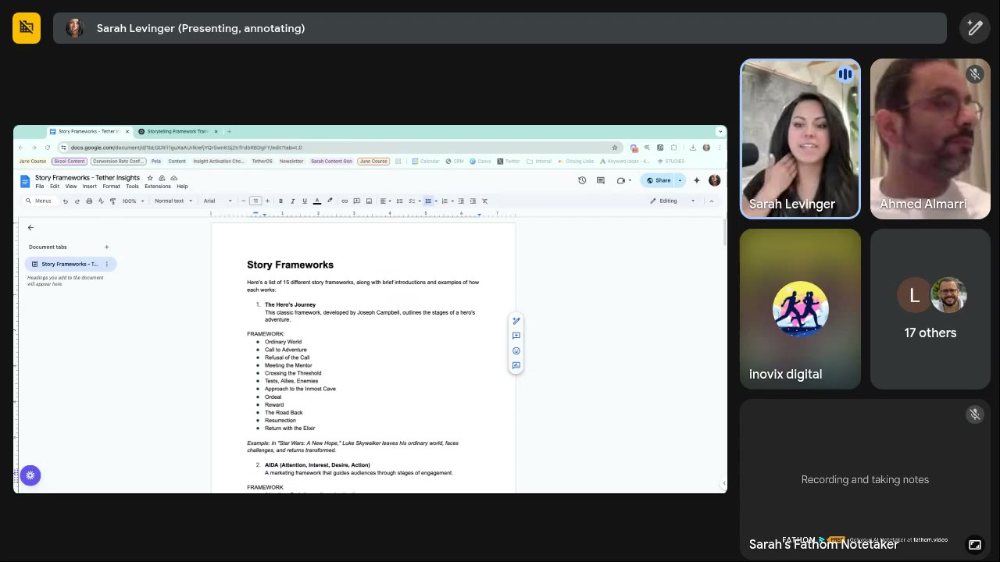
*The doc opens: "Here's a list of 15 different story frameworks, along with brief introductions and examples of how each works." #1 The Hero's Journey (Joseph Campbell) with its 12 stages. [0:03:30]*

| # | Framework | Steps (from the doc) | Doc example | Sarah's take for ads | Source |
|---|---|---|---|---|---|
| 1 | **The Hero's Journey** (Joseph Campbell) | Ordinary World → Call to Adventure → Refusal of the Call → Meeting the Mentor → Crossing the Threshold → Tests, Allies, Enemies → Approach to the Inmost Cave → Ordeal → Reward → The Road Back → Resurrection → Return with the Elixir | *Star Wars: A New Hope* | Classic. Easy to build a full arc, but used so much that ChatGPT can make it bland. | [0:04:05–0:04:56; 0:55:00] |
| 2 | **AIDA** (Attention, Interest, Desire, Action) | Attention: grab attention → Interest: generate interest → Desire: create desire → Action: prompt action | A car commercial (sleek visuals, lifestyle, limited-time offer) | "I don't love [it]… I see this way too often in ads", but it still works for a specific funnel spot (bottom/evaluation). | [0:04:56–0:05:10; 0:13:41] |
| 3 | **Freytag's Pyramid** (five-act dramatic structure) | Exposition → Rising Action → Climax → Falling Action → Denouement (Resolution) | *Romeo and Juliet* | "I freaking love" it. A simplified Hero's Journey, "everywhere" in organic content. One slow arc up and down. | [0:05:10–0:05:50] |
| 4 | **Three-Act Structure** | Setup → Confrontation → Resolution | *The Matrix* (Neo) | "I actually really like using this one for ads… really simple… gives chat a little bit more context." | [0:05:50–0:06:20] |
| 5 | **The Pixar Story Framework** (six sentences) | Once upon a time… → Every day… → One day… → Because of that… → Because of that… → Until finally… | *Finding Nemo* | "Probably my all-time favorite." Same structure every time, "fantastic for injecting emotion inside your ads". | [0:06:20–0:07:16] |
| 6 | **StoryBrand Framework** (seven steps. ChatGPT's list: "Donald Miller's model puts the customer at the center") | Doc: A Character → Has a Problem → And Meets a Guide → Who Gives Them a Plan → And Calls Them to Action… (rest off-screen). ChatGPT list: A Character → Has a Problem → Meets a Guide → Gets a Plan → Takes Action → Avoids Failure → Finds Success | Fitness brand as the guide ("from stuck → strong") | Like Hero's Journey but the guide helps them **avoid failure**. Seen "everywhere in marketing", rarely in movies. | [0:07:16–0:07:57] |
| 7 | **Problem-Agitate-Solve (PAS)** | Identify the Problem → Agitate the Problem → Provide a Solution | Skincare ad agitates acne's social impact | Very marketing-focused. "I kind of steer away from this unless I'm really trying to sell hard at the bottom of the funnel." | [0:07:57–0:08:16] |
| 8 | **Situation-Complication-Question-Answer (SCQA)** | Situation: current state → Complication: problem/challenge → Question: about addressing it → Answer | A business proposal. ChatGPT's list: "Perfect for founders, proposals, or B2B… 'We were scaling fast (situation)…but churn spiked (complication)…so we asked: how do we fix it? (question)…and found retention audits worked (answer).'" | Poses a question in the middle. "Perfect for **switching behavior**." Example: greasy hair → "one day my hairstylist asked me, are you sure that it's your shampoo…?" | [0:08:16–0:09:00] |
| 9 | **The Monomyth** | Departure → Initiation → Return | *Lord of the Rings* (Frodo) | Very similar to Three-Act and Hero's Journey, so ChatGPT tends to blend them (see live build 2). | [0:09:00–0:09:25] |
| 10 | **In Medias Res** | Start in the middle of the action → Flashback to explain how we got here → Return to the present and resolve | *The Usual Suspects* | Her #2 favourite. Drops viewers mid-story, an [open loop](../../../concepts/heuristics/open-loop.md). Faux-podcast example below. | [0:09:25–0:10:18] |
| 11 | **The Fichtean Curve** | Rising Action (multiple crises) → Climax → Denouement | *Game of Thrones* | Multiple crises and storylines. Viewers attach to the character "most like you or… the person you want to be". For ads: several characters, each arc resolved quickly. | [0:10:18–0:11:05] |
| 13* | **The Seven Basic Plots** (Christopher Booker) | Overcoming the Monster · Rags to Riches · The Quest · Voyage and Return · Comedy · Tragedy · Rebirth | *Jaws*, *Cinderella*, *The Odyssey* | Overlaps Hero's Journey. "I need to test it more." | [0:11:05–0:11:35] |
| 14 | **The Story Spine** (Kenn Adams) | Once upon a time… → Every day… → But one day… → Because of that… → Because of that… → Until finally… → (ChatGPT list adds) And ever since then… | "Great for 'transformation' before/after reels" (ChatGPT list) | Like Pixar but adds the back end ("**ever since then**, people have been asking me how do I get my hair to look like yours"). | [0:11:35–0:12:00] |
| 15 | **The Dramatic Arc** | Exposition → Rising Action → Climax → Falling Action → Resolution | *The Great Gatsby* | ChatGPT makes it "really intense", building tension "crazy quickly", not a slow curve. | [0:12:00–0:12:27] |

*\*The doc's numbering jumps from 11 to 13 (no #12 on screen), so it shows 14 named frameworks. ChatGPT's "Storytelling Loadout" makes 15 with the Founder's Post bonus. See Source problems.*

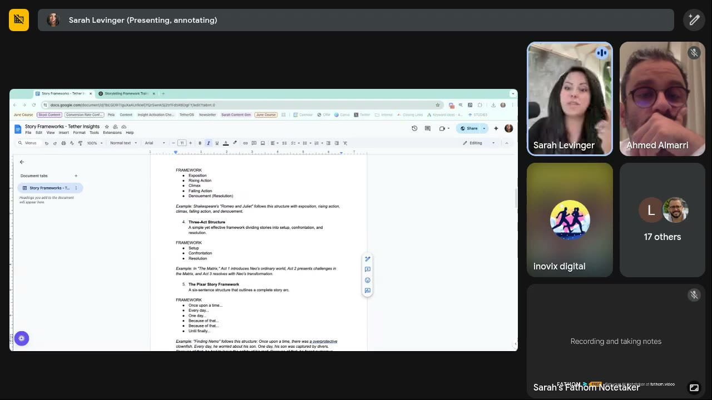
*Freytag's Pyramid (Romeo and Juliet), Three-Act Structure (The Matrix) and the Pixar Story Framework's six lines. [0:06:15]*

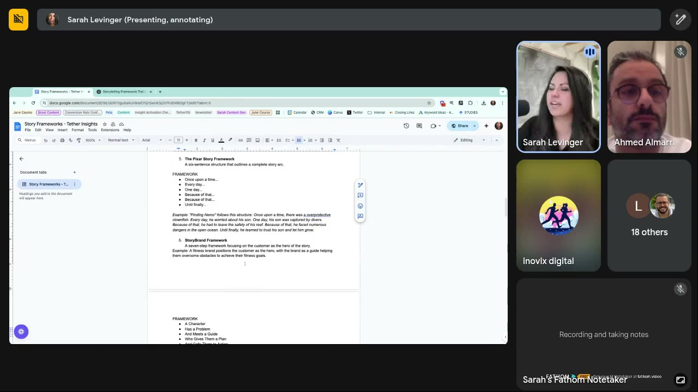
*The Finding Nemo example in Pixar form, and StoryBrand ("a seven-step framework focusing on the customer as the hero of the story… A Character / Has a Problem / And Meets a Guide / Who Gives Them a Plan…"). [0:07:20]*

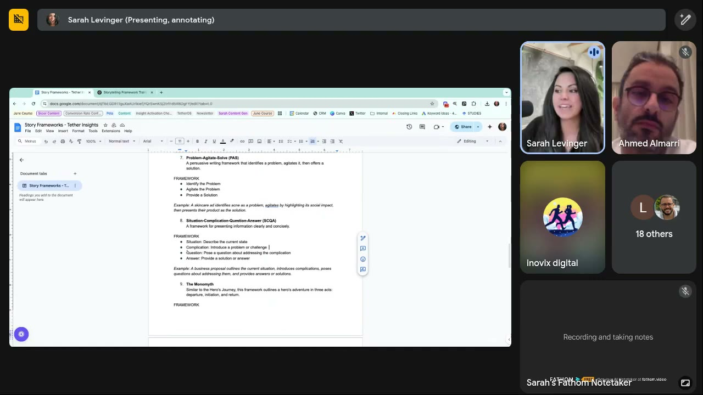
*PAS (skincare acne example), SCQA (Situation, Complication, Question, Answer) and the Monomyth intro. [0:08:20]*

*Monomyth (Departure, Initiation, Return; Lord of the Rings) and In Medias Res ("Start in the middle of the action / Flashback to explain how we got here"). [0:09:20]*

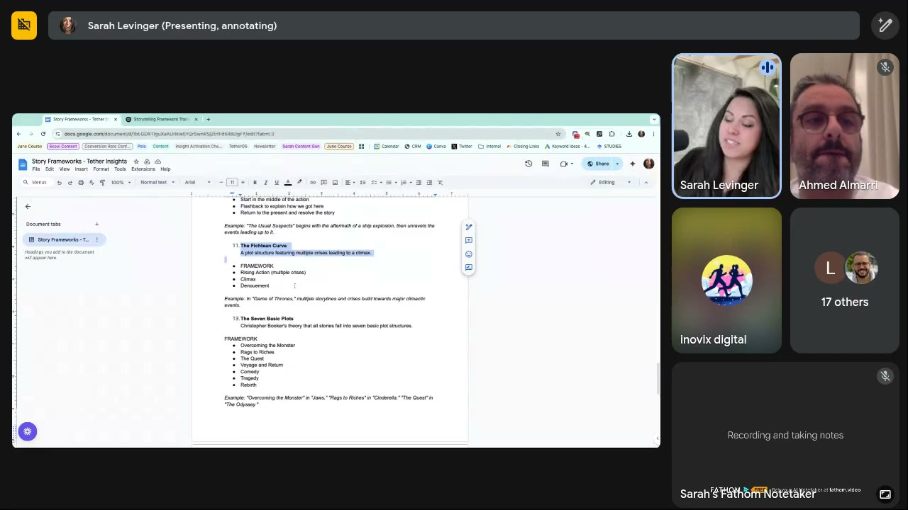
*Fichtean Curve (Game of Thrones) and Christopher Booker's Seven Basic Plots. Note the numbering jumps from 11 to 13. [0:10:25]*

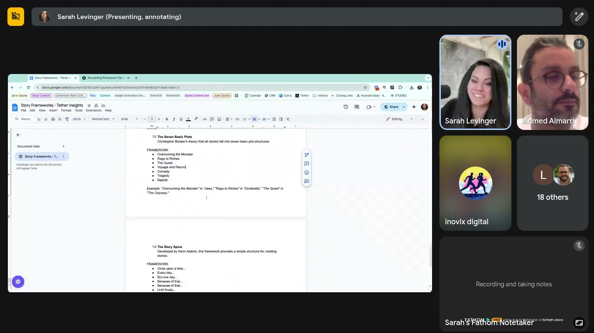
*Seven Basic Plots examples and #14 The Story Spine ("Developed by Kenn Adams… Once upon a time… Every day… But one day… Because of that… Until finally…"). [0:11:30]*

## The Storytelling Loadout: which framework for which job
ChatGPT tab "Storytelling Framework Trai…", headed **"The Storytelling Loadout: 15 Proven Frameworks — and When to Use Them"**: "You don't need all 15 story frameworks at once. You need the *right* one for the *right* job. We've grouped these into **three strategic batches**, so whether you're writing a VSL, email, founder post, or landing page — you'll know exactly which 'weapon' to reach for." [0:12:27–0:12:50]

| Batch | Use for (screen + Sarah) | Frameworks (ChatGPT list order) | Sarah's notes | Source |
|---|---|---|---|---|
| **1. Big Emotional Arcs** | "Use these when you need a full transformation journey. Ideal for: founder stories, customer origin stories, VSLs, big brand narratives." Sarah: "she dropped 150 pounds in the course of two years… here's her full transformation." | 1 Hero's Journey · 2 Monomyth · 3 Freytag's Pyramid · 4 Dramatic Arc · 5 Three-Act Structure | Hero's Journey is the easiest to build. Dramatic Arc raises emotion "very quickly". | [0:12:27–0:13:41] |
| **2. Marketing & Sales** | "Use these for clarity, conversion, and persuasion. Ideal for: landing pages, sales emails, retargeting ads, explainer content." Sarah: bottom of funnel / evaluation phase, "we just want people to dip out and purchase". | 6 AIDA · 7 PAS · 8 SCQA · 9 StoryBrand · 10 In Medias Res | "I don't think we should just dump AIDA entirely, I just don't think we should use it for everything." In Medias Res is "so so good for… getting them motivated to actually purchase". | [0:13:41–0:14:31] |
| **3. Quick Stories & Creative Content** | "Use these for short-form hooks, UGC, social, and punchy storytelling. Ideal for: carousels, IG captions, TikToks, memes, ad copy." | 11 Pixar ("a 6-line setup for emotional mini-stories… Finding Nemo condensed into a scroll-stopper") · 12 Story Spine · 13 Fichtean Curve · 14 Seven Basic Plots | "If you're like *we just cannot get anything to hit in the ad account this week*, let's use the Pixar story framework." Story Spine gives more context. Fichtean adds multiple crises. | [0:14:31–0:15:15] |
| **Bonus: 15. The Founder's Post** | "Want a simple structure for your own story?" | Before I started [brand/job], I was struggling with… → I tried [unsuccessful method]. → Then I realized… → That's when I created [solution]. → And since then, we've helped [others] do the same. | "If you guys are looking for more just founder-based stuff." The screen also shows a "Cheat Sheet Challenge: Pick one framework. Use it this week… share it in Skool for feedback." | [0:15:00–0:15:31] |

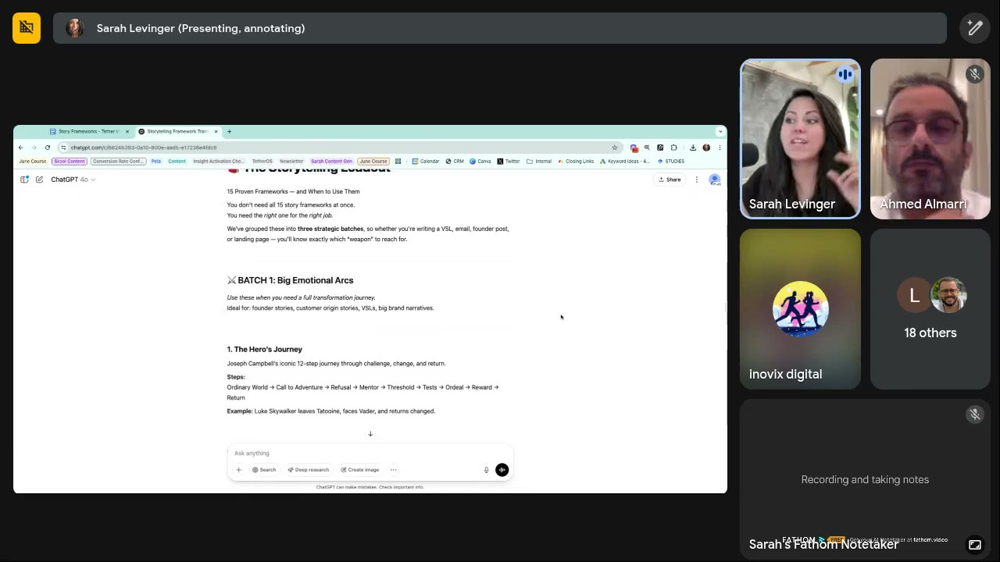
*ChatGPT's "Storytelling Loadout" header and Batch 1: Big Emotional Arcs (founder stories, customer origin stories, VSLs, big brand narratives). [0:12:30]*

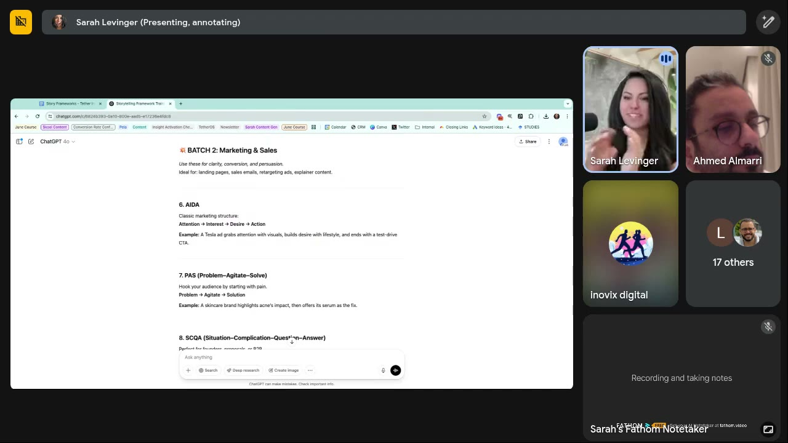
*Batch 2: Marketing & Sales (landing pages, sales emails, retargeting ads, explainer content): AIDA, PAS, SCQA… [0:14:05]*

*Batch 3: Quick Stories & Creative Content (carousels, IG captions, TikToks, memes, ad copy), led by the Pixar Story Framework. [0:14:50]*

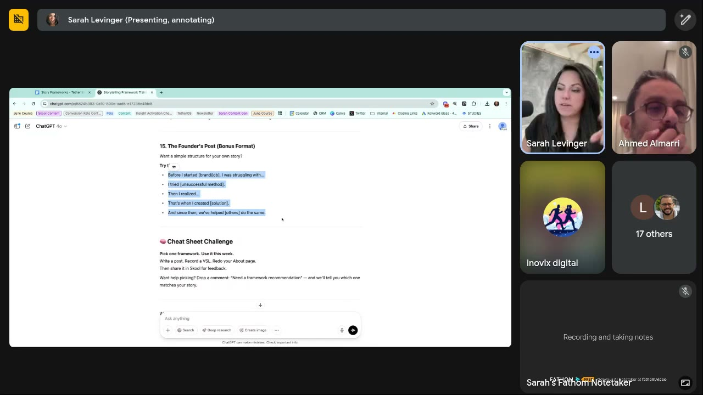
*Bonus #15, The Founder's Post template, plus the "Cheat Sheet Challenge". [0:15:15]*

## Q&A

### How do you prompt these? [0:15:31–0:16:17]
- Attendees voted for Pixar. "You don't actually have to give chat a whole lot of context because most of these are pretty well known… tell chat *please use the Pixar story framework to build this script for me*. If it comes back with something that's like *that doesn't seem like it knew what that was*, this is the reason why I included the actual framework." The doc also has examples to give ChatGPT context. [0:15:36–0:16:17]

### Script showcase: three Maelove scripts (one angle, three frameworks) [0:16:17–0:22:22]
Maelove (skincare). Core angle: the customer has **too many bottles on her countertop**, with "a little bit of humor". Sarah's prompt, paraphrased: here's my concept (people have too many bottles on their countertop), here's my avatar (female, loves skincare, struggling to figure out which one is for her), use the Pixar story model, write me a script. She didn't specify the hook. [0:16:17–0:18:29] Full teardowns are below in [Ad teardowns](#ad-teardowns).
- **Pixar model → UGC script.** The beats segment cleanly: once upon a time → every day → until one day → because of that → because of that → until finally → CTA. "This has a whole lot more emotion in it than if [you] just say write me a UGC script." [0:16:38–0:18:29]
- **Hero's Journey → influencer script.** Most marketers would add proof after the solution ("now we need social proof, testimonials"). This framework "actually backed out of that": she got a solution, then went backwards ("I didn't think this was going to work"). "If we have a framework that will help us figure out when to bring in our solution, you have a better chance of actually hitting the brain in the right spot… humans are… really sensitive to how stories progress." [0:18:29–0:19:45]
- **The two-thirds rule:** "It's very important that we spend more time setting up the actual story than we do presenting the solution… this whole piece is just setting up the story. This last like three or four scenes are the solution and the call to action." Comedians and stage speakers "spend two-thirds of their story just setting up… and just like a little little bitty time on the punchline. The punchline is not the point. The point is I've set you up to get invested." [0:19:45–0:20:41]
- **In Medias Res → fake podcast.** It starts mid-rant ("explain to me why every skincare brand thinks I'm gullible…"), where most brands start at the top ("I found the perfect thing"). Host 2 validates ("where is your Maelove serum right now?"), then it flashes back. "Super super subtle storytelling but [an] amazing way to get people to understand where we are in the process of buying." [0:20:41–0:22:22]

### Q: Do you typically use voiceovers for these narratives? [0:22:33–0:23:20]
- Yes, especially with UGC creators: hand them the script ("we've used a Pixar storytelling framework, here's your script") and say "try and say it in the way you would say it… I really try really hard to make sure that UGC creators do not just repeat the script, because it's not the way that they would say it, it's the way Sarah would say it." [0:22:33–0:23:05]
- Without creators: voiceovers. "Voiceovers are fantastic. They convey emotion a whole lot better than just straight music and text would." [0:23:05–0:23:20]

### Q: Which frameworks for low-budget brands? [0:23:20–0:25:06]
- Any of them. Prompt pattern: "Chat, here's my problem, here's my customer, here's the framework I want you to use to tell the story, give me some ideas." [0:23:20–0:23:34]
- **ElevenLabs** ("I think it's like five bucks a month"): any country or accent, male/female/gender-neutral voices, drag-and-drop the script. "A lot of those voices too sound very very real." [0:23:34–0:24:00]
- Natural voices over robot voices: robots "pull out the emotion. You can't hear the inflection." [0:24:00–0:24:30]
- It gets around creative-asset limits ("I can't afford a $500 [creator]"). Sarah did UGC production herself for a year: "it takes a lot of effort to get good ads from a UGC creator". She offered tips on training creators. [0:24:30–0:25:06]

### Q (David Abramovici, chat): Can you only apply this to UGC ads? Can it be applied to statics or GIFs? [0:25:06–0:26:08]
- "It can be applied to basically everything." Go backwards: "create the Pixar story like script first, and then drop that script into chat and say *chat, from this story pull out the deepest emotion and the core message… and then give us headlines for that*." Asking for Pixar headlines directly confuses it, "because it just doesn't have enough context". [0:25:11–0:25:43]
- Chat (Darian James): "ElevenLabs is sick, you can clone the creator voices too!" Sarah hadn't heard of it. [0:25:43–0:26:08]

### Q (Leonardo Larocca, chat): What do you think of AI UGC like Icon or creatify.ai? [0:26:08–0:29:05]
- "Humans are master pattern recognizers when it comes to faces and voices." This is built in from birth to know whom to trust. [0:26:17–0:26:39]
- Why some see success: cheap, and **novelty**: "you can kind of tell… they're not quite real… the brain goes *that's interesting, I should pay attention*." [0:26:39–0:26:56]
- **Avoid it for brand affinity:** "If you're trying to create any sort of brand affinity… I really want people to trust us… attach their identity to the brand, I would refrain from using any AI UGC… over time you're going to teach them that this is not trustworthy, because they're using people who are not real." *(Whisper: "press worthy", read as trustworthy.)* [0:26:56–0:27:15]
- **Consumers aren't using AI yet** (Sarah's view): outside marketing and tech, "general everyday consumers do not use AI… it takes about 10, 20 years before things get everywhere." The brain "can detect it… it'll just feel slightly not real." [0:27:15–0:28:21]
- ElevenLabs is fast: ~**30 seconds** to render a short script. She exports the audio and cuts it into video in Premiere (or whatever editor). [0:28:42–0:29:05]
- Later chat (~0:30:53): you can **rip audio from your own content into a custom voice** and type new scripts ("bonkers"). Attendees **tested Creatify and none of the videos converted**. Sarah: "Some audiences find them really interesting and some really hate them." Her anecdotal observation: people succeeding with AI creators **build an organic following for the AI creator first**, then run ads with them. "People connect to people… you can't quite just post it in an ad and hope it works." [0:30:53–0:31:50]

### Q: What if you have limited data on your customers? [0:29:05–0:30:53]
- A bigger avatar/ICP training is coming ("large and in charge"). [0:29:05–0:29:22]
- Own bias is the risk: "If Sarah's marketing towards my husband… I know everything about that guy… [but] he morphs and he changes." [0:29:22–0:29:57]
- "**Avoid chat as a generator for ICPs**, because chat is training you. It's going to take your internal bias that it's been chatting with for the last six, eight months and… spit out something that seems like it's pretty close to your customer." True ICP work = real-time data from **pictorial surveys, metaphorical surveys** or live customer feedback. *(Compare May 7, where she suggests ChatGPT for a candidate list that must then be verified on Reddit.)* [0:29:57–0:30:53]
- Docs (frameworks + selection structure) go into the Skool classroom resources. [0:31:50–0:32:13]

### Q (Lesley Cramer): I work for pet brands. Tell the owner's story or the pet's? [0:32:34–0:34:21]
- "Yes yes yes… I would love to see a Pixar story of the pet." [0:32:40–0:33:17]
- "You can do it for any character that's involved with your customer": the pet owner, the vet, "the downstairs neighbor who's secretly in love with this dog", pet grandparents, pet sitters, kids down the street. "It doesn't have to be from the customer's point of view or from the founder's." [0:33:17–0:34:21]

### Live build 1: dog dental chews, Freytag's Pyramid, the vet as main character [0:34:21–0:42:59]
Lesley's brand sells chews, treats and toys. Sarah narrowed it to dental. She skipped Hero's Journey ("we already saw that one"), considered Dramatic Arc, and an attendee picked Freytag. "You always have to tell it kind of what we want to resolve with": main character + final CTA. Optional extras: "I want five characters", "we want it to be really intense", or no context at all. [0:34:21–0:36:21]

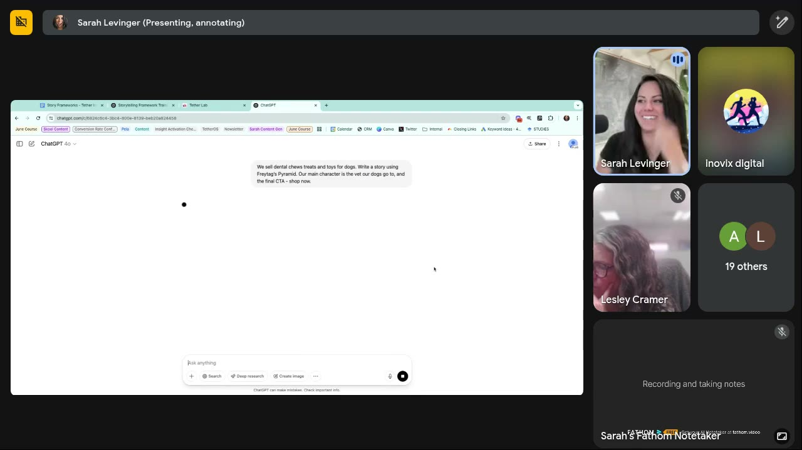
*The exact prompt: "We sell dental chews treats and toys for dogs. Write a story using Freytag's Pyramid. Our main character is the vet our dogs go to, and the final CTA - shop now." [0:36:30]*

Output: **"The Vet Who Knew Too Much (About Tartar)"**, stated as "positioning the vet as the trusted authority and emotional bridge". Teardown below. Sarah's commentary while reading:
- **Named, relatable character** ("Dr. Riley"): "somebody that we can emotionally connect to". The vet dreads dental checkups as much as pet parents do, a "connection between the person as a vet and the person as a pet parent". It's "different than what we typically see, which is like *my dog's breath was terrible, I went to the vet and they told me to try this*… AIDA really gets boring." [0:36:54–0:37:48]
- **Insight ChatGPT surfaced: "Chew time? Long enough to actually scrape tartar."** Lesley: even a collagen stick or bully stick cleans gums by rubbing. Sarah: "This is a call out that I probably would not have thought about as a marketer… maybe our consumers don't know that you actually have to have a longer chew time." So you could use it to sell longer chews, even a non-dental MVP product like bully sticks. [0:38:27–0:39:32]
- **Acquisition vs profit product:** bucket products by "which one is going to last the longest" vs "which one gets them in the door the fastest… We can afford to lose a little money on the front end of the acquisition if they then upgrade into a bully stick and get it on subscription." [0:39:32–0:40:09]
- **Characters as avatar research (Lesley):** this one uses the vet, the next a trainer, so every ad talks to a different person. Sarah: "Especially if you're struggling to know your avatar, this is a great way to do it." Why she defaults to stories: UGC/AIDA scripts "get so bland after a while… like eating oatmeal every day with nothing on it." [0:40:09–0:40:52]
- **Realism:** "She was skeptical. But intrigued. So she started recommending them. Cautiously at first." "Realism in story is incredibly important… stop saying *this is amazing, it transformed everybody overnight… we've never had a negative review*… customers know that there's nuance to everything." [0:41:04–0:41:54]
- **Emotion found: "She no longer had to play the 'bad guy' in the dental chair."** "You're going to activate this really interesting emotion in consumers that's like *I really like my vet and I just want her to be happy… maybe I should buy this just so that I can make my vet proud*." [0:42:00–0:42:30]
- CTA: "Want your vet to be pleasantly surprised at your dog's next checkup? [Shop Now] and start the routine that even your vet will notice." "This is why I love Freytag too… very simple." [0:42:30–0:42:59]

### Q: A new story video doesn't convert. Was it the visuals or the story? [0:42:59–0:45:41]
- "When it comes to video we have such little control over what converts people… it could literally be like the plants in the background." [0:43:09–0:43:30]
- "**The faster you go through a story the more difficult it is for people to attach emotionally to it.**" Standard: clips "no longer than like two to three seconds… four seconds is the longest I've ever seen. But as we've seen from YouTube… **longer videos actually convert better** than shorter ones because they give more context… story and emotion… allow the brain to create the dopamine it needs to stay in the video." [0:43:30–0:44:06]
- Slowing down and **pausing at the parts you want heard** captures attention. [0:44:06–0:44:50]
- **Diagnosis order:** "It's almost always the speed that's the issue… I always test speed at the very first A/B test (if we slow this down, what does it do?). Second… always the hook… then I'll go to story next… then go in and change visuals and creators." If a creator isn't hitting it, change the story to what feels natural to them. [0:44:50–0:45:41]

### Q: This script would be ~5 minutes. Too long? [0:45:41–0:46:50]
- Test as-is as a 2–3-minute video. Then "Chat, we need to cut this down to 30 seconds". Test avatars at the same length. Then 30 s, then 15 s. "If… my customer type just hates long videos, just have chat cut it down." [0:45:41–0:46:50]
- Chat: long videos do better than short ones, "yes, right now especially". Kewin Novelli (chat): "Rate of speech + tone of voice." [0:46:50]

### Q: Expanding on slowing down as the first split test [0:46:50–0:48:12]
- "Expand out your cuts. Instead of cutting it every two to three seconds, cut it every four." Going past 4 s "tends to make the brain a little less attentive", except that some of the best YouTube channels are one talking head for 30 minutes: "it's not [that] we don't have enough attention, it's more… the story is too boring." [0:47:13–0:47:45]
- Better: **have UGC creators or voiceovers slow their voice down**. That "provides more context for why you should pay attention". [0:47:45–0:48:12]

### Q: Could these be used as advertorials? [0:48:12–0:49:22]
- "If you find a good script in an ad and it's crushing, go get an advertorial… somebody go make a landing page." These stories "blend super well throughout the entire ecosystem". People "want to see what happens to Dr. Riley". [0:48:12–0:48:35]
- **Fluency mechanism (Sarah's term):** "Fluency mechanisms for brands basically means I have someone to attach to something that makes it easy for me to recall… the brand… If Dr. Riley hits, please keep using Dr. Riley." (See [processing fluency](../../../concepts/heuristics/processing-fluency.md) and mascots in the [June 4 call](2025-06-04-live-with-sarah.md).) [0:48:35–0:48:52]
- ElevenLabs can slow speech, but "the slower you get… the more it sounds a little robotic". Find the sweet spot. [0:48:52–0:49:10]

### Live build 2: healthy low-sugar, diabetic-friendly ice cream, Monomyth [0:49:22–0:55:36]
- An attendee suggested the brand. Sarah picked the **Monomyth with no context** "so you guys can see". She always adds the CTA (shop now). [0:49:22–0:50:38]
- **Failure mode, live:** the output was headed "THE STORY (The Monomyth: Hero's Journey)" and followed the 12 hero's-journey stages ("Meet Rachel. A self-proclaimed dessert lover, spreadsheet warrior, and recently diagnosed Type 2 diabetic…"). "It's pulling hero's journey and monomyth at the same time… chat is sometimes real dumb." Sarah misread the name as "Emily" while summarising. On screen it's Rachel. [0:50:44–0:51:22; 0:52:32]
- **Fix:** copy the framework text from the doc into the prompt as context, and **delete the "Similar to the Hero's Journey" line** "so it doesn't try and use the hero's journey and the monomyth at the same time". Her ChatGPT is her personal one, "not really trained on anything… the more you use these the more it's going to get trained on it". [0:51:22–0:52:19]
- New output: **"The Scoop That Changed Everything."** Sarah: "notice… how much time we're taking to set up the actual story itself. We haven't introduced any sort of solution yet." Highlights: "ice cream that loves your body back" ("chat's pretty good about coming up with good catchphrases"), realism ("bracing for disappointment"), "she didn't just eat dessert, she *enjoyed* it", and the return ("she's the one showing up to game night with pints… living proof that health doesn't have to mean sacrifice… sometimes all it takes is a better scoop"). "It's not deep, it's not crazy… this is happening to a lot of us." [0:52:19–0:54:40]
- **Rule:** "If you see chat say *I'm using the monomyth and hero's journey*, go back, copy the actual framework… and basically force it… otherwise you'll get kind of weird stories, or with hero's journey particularly… very bland stories." Use the output for UGC, a voiceover, or "making headlines for statics… this idea of ice cream that loves your body back". [0:54:40–0:55:36]

### Close [0:55:36–0:56:48]
- Ask in the community "which story should I use for this one?" and Sarah will recommend one. "Half the reason I got into this job was because I wanted to make stories." [0:55:36–0:56:41]

## Ad teardowns
*All "ads" here are scripts shown on screen (none were said to have run, except that Maelove is Sarah's client). Zone and self tags are wiki interpretation.*

### Maelove: UGC script, Pixar model

*"UGC Script for Maelove – Pixar Model" from the "Maelove-Scripts-TEMPLATE" doc. Scene directions in bold, lines in italics. [0:17:40]*

Script (verbatim from screen):
1. **Hook** (Scene: person scrolling on their phone, sighing dramatically): "You ever buy a skincare product just knowing it's not gonna work… but you do it anyway? Yeah. That was me with Maelove." (Pauses, smirks) "Unfortunately, now I have to admit I was wrong."
2. **Once Upon a Time…** (Cut to person standing in front of a bathroom mirror, frustrated): "Once upon a time, I was an optimist about skincare. A bright-eyed, dewy-skinned believer."
3. **And Every Day…** (Montage of a cluttered bathroom counter, full of half-used serums and creams): "And every day, I got sucked into some new 'miracle' product. Vitamin C that oxidized in a week. Serums that felt like expensive water. 'Clinically proven'…to disappoint me."
4. **Until One Day…** (Zoom in on a Maelove serum bottle in her hand): "Until one day, I found Maelove. Science-backed. Straightforward. No marketing B.S. Just results."
5. **And Because of That…** (Applying serum, then checking the mirror): "Because of that, I gave it a shot. Totally thought it was going to be just another bottle on my counter. But these guys were different. They really do obsess over their ingredients—plus dermatologists actually recommend it…and use it."
6. **And Because of That…** (Side-by-side of 'before' and 'after' clips, skin looking visibly brighter): "Because of that, my skin decided to have an 'I Told You So' moment, and now I can get rid of all those half-used bottles on my countertop because I finally found ONE thing that actually works."
7. **Until Finally…** (Holding up the bottle, nodding in approval): "I can stop treating my bathroom counter like a product graveyard. Maelove gets a permanent spot."
8. **CTA** (Pointing at the screen, playfully serious): "If you've been burned by skincare before—trust me, I get it. But this? Worth it."

| Brand / product (niche) | Format | Hook / opening | What works | What fails | Fix suggested | Principle | Source |
|---|---|---|---|---|---|---|---|
| Maelove (DTC skincare serum) | UGC script, Pixar Story Framework | "You ever buy a skincare product just knowing it's not gonna work… but you do it anyway? …now I have to admit I was wrong." | Confession hook. The "product graveyard" counter (the May 7 insight). Humour. Clean beat segmentation. Dermatologist mention as light authority. Sarah: far more emotion than "write me a UGC script". | Not stated | n/a | Story framework > generic UGC prompt. Wiki tags: [Contrast](../../../concepts/heuristics/contrast.md) (optimist → burned → found one), [authority](../../../concepts/heuristics/authority-bias.md); Zone 3 → Zone 1; [Actual self](../../../concepts/actual-self.md) (burned skincare veteran). | [0:16:17–0:18:29] |

### Maelove: influencer script, Hero's Journey model

*"Influencer Script for Maelove – The Hero's Journey Model". Each scene is a stage of skepticism → trial → weekly check-ins → replacing old products. [0:18:45]*

Script (verbatim from screen, as far as visible): Hook (person holding a random skincare bottle, unimpressed): "I'm gonna be honest… I did not want to like this." (Pauses, smirks) "And now I have to make a public apology to my skin." → (mirror, scrolling, visibly skeptical) "I've tried so many skincare products. Expensive ones. Cheap ones. 'Game-changer' ones. And somehow, my skin was still like… nope." → (unboxing, reading the label aloud) "Then I saw this—Maelove. Science-backed, dermatologist-approved, and apparently, people swear by it. But I've heard that before." → (side-eyeing the serum, dramatic sigh) "I was not buying the hype. At this point, I assumed all skincare marketing was just creative fiction." → (scrolling through reviews, nodding) "But then I saw the reviews. The testimonials. The actual science behind it. And I thought… alright, let's see if this stuff can prove me wrong." → (first application) "So I tried it. No expectations. Just me, my skin, and this serum that had one chance to impress me." → (montage of daily check-ins) "First week? Skin felt good. No irritation. Second week? My skin actually looked… happier? Third week? Now I'm side-eyeing my past self for not trying this sooner." → (holding an old bottle of another brand) "The real test? Seeing if it actually replaced my old 'go-to' products. And… yeah. Yeah, it did." → (before/after) "Okay, fine. I'll say it. Maelove actually works. And I don't say that lightly." → (cleaning the bathroom counter, tossing old products in a bin…) *(cut off on screen)*

| Brand / product (niche) | Format | Hook / opening | What works | What fails | Fix suggested | Principle | Source |
|---|---|---|---|---|---|---|---|
| Maelove (DTC skincare serum) | Influencer script, Hero's Journey | "I'm gonna be honest… I did not want to like this. And now I have to make a public apology to my skin." | Reluctant-convert arc. Proof (reviews, science) is woven into the story, and the story "backed out" of the usual proof dump. Week-by-week realism. Ends on clearing the counter. | Not stated | n/a | Let the framework decide when the solution enters. Wiki tags: reluctant testimonial (skepticism → [social proof](../../../concepts/heuristics/social-proof.md)), Zone 3 → Zone 1, [Actual self](../../../concepts/actual-self.md). | [0:18:29–0:19:45] |

### Maelove: fake podcast ad, In Medias Res

*"Fake Podcast-Style Ad for Maelove – In Medias Res Model": hosts mid-conversation, one ranting. Sarah highlights Host 1's opening line. [0:21:30]*

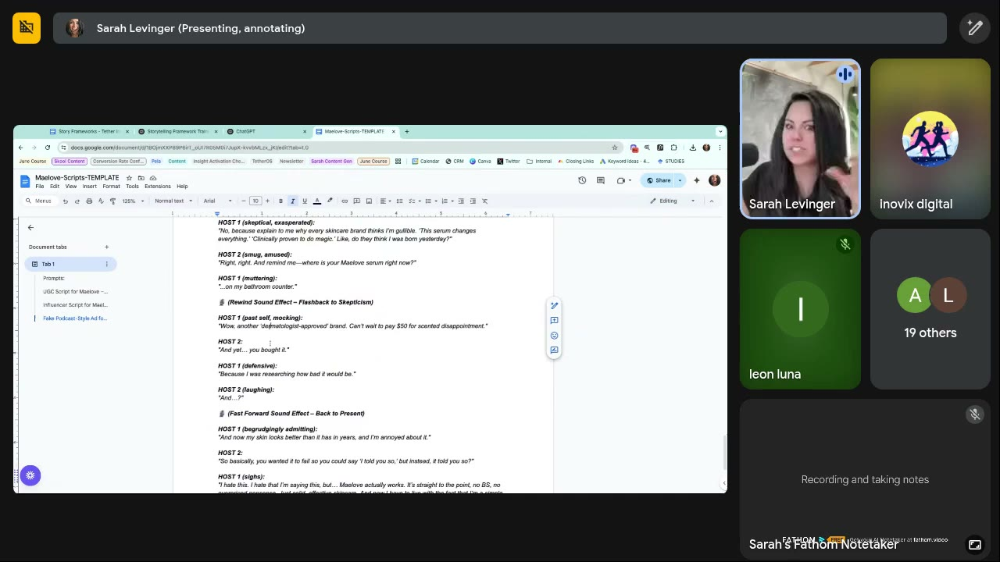
*The rewind/fast-forward sound-effect beats that carry the flashback structure. [0:22:00]*

Script (verbatim from screen): (In Medias Res: podcast hosts mid-conversation, one clearly ranting) **HOST 1** (skeptical, exasperated): "No, because explain to me why every skincare brand thinks I'm gullible. 'This serum changes everything.' 'Clinically proven to do magic.' Like, do they think I was born yesterday?" **HOST 2** (smug, amused): "Right, right. And remind me—where is your Maelove serum right now?" **HOST 1** (muttering): "…on my bathroom counter." (Rewind sound effect – flashback to skepticism) **HOST 1** (past self, mocking): "Wow, another 'dermatologist-approved' brand. Can't wait to pay $50 for scented disappointment." **HOST 2**: "And yet… you bought it." **HOST 1** (defensive): "Because I was researching how bad it would be." **HOST 2** (laughing): "And…?" (Fast-forward sound effect – back to present) **HOST 1** (begrudgingly admitting): "And now my skin looks better than it has in years, and I'm annoyed about it." **HOST 2**: "So basically, you wanted it to fail so you could say 'I told you so', but instead, it told you so?" **HOST 1** (sighs): "I hate this. I hate that I'm saying this, but… Maelove actually works. It's straight to the point, no BS, no overpriced nonsense—just solid, effective skincare. And now I have to live with the fact that I'm a simple…" *(cut off)*

| Brand / product (niche) | Format | Hook / opening | What works | What fails | Fix suggested | Principle | Source |
|---|---|---|---|---|---|---|---|
| Maelove (DTC skincare serum) | Fake podcast / two-host conversation, In Medias Res | "No, because explain to me why every skincare brand thinks I'm gullible… do they think I was born yesterday?" | Starts mid-rant ([open loop](../../../concepts/heuristics/open-loop.md)). Validates skepticism of skincare marketing. Second host as validator. Rewind/fast-forward SFX. "Annoyed" convert = realism. | "A little bit more difficult to notice… super subtle" | n/a | Drop viewers into the middle, then rewind. Wiki tags: anti-marketing in-group, Zone 3 (irritation) → Zone 1, [Actual self](../../../concepts/actual-self.md) (skeptic). | [0:20:41–0:22:22] |

### Dog dental chews (Lesley Cramer's pet brand, generic "[YOUR BRAND]"): vet story, Freytag's Pyramid
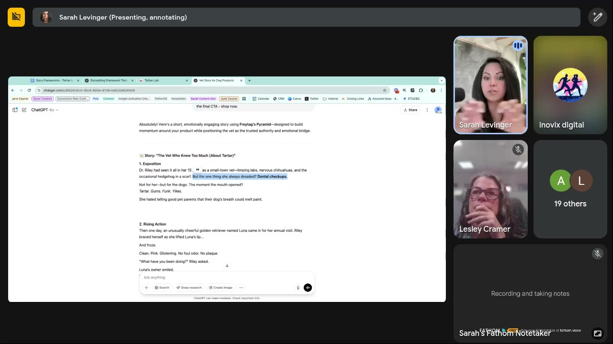
*ChatGPT: "Here's a short, emotionally engaging story using Freytag's Pyramid—designed to build momentum around your product while positioning the vet as the trusted authority and emotional bridge." Exposition and Rising Action. [0:37:20]*

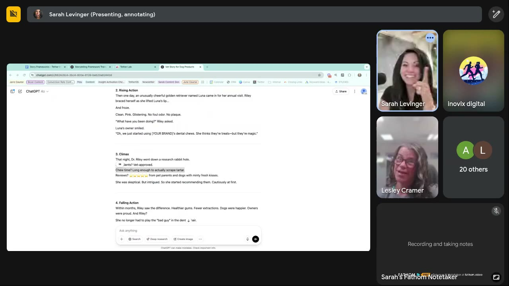
*Climax: "Ingredients? Vet-approved. Chew time? Long enough to actually scrape tartar. Reviews? ⭐⭐⭐⭐⭐…" Sarah highlights the chew-time line as a new use case. [0:39:30]*

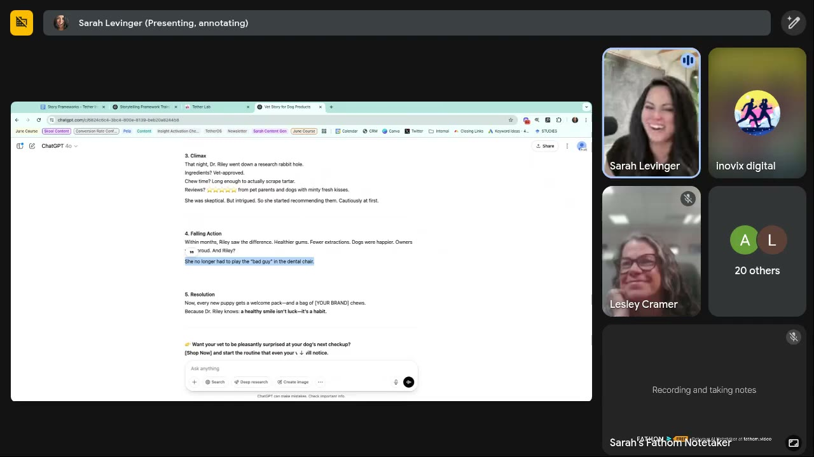
*Falling action ("She no longer had to play the 'bad guy' in the dental chair", highlighted), resolution and CTA. [0:42:20]*

Script (verbatim from screen): **"The Vet Who Knew Too Much (About Tartar)"**. **1. Exposition:** Dr. Riley had seen it all in her 15 [years] as a small-town vet—limping labs, nervous chihuahuas, and the occasional hedgehog in a scarf. But the one thing she always dreaded? Dental checkups. Not for her—but for the dogs. The moment the mouth opened? *Tartar. Gums. Funk. Yikes.* She hated telling good pet parents that their dog's breath could melt paint. **2. Rising Action:** Then one day, an unusually cheerful golden retriever named Luna came in for her annual visit. Riley braced herself as she lifted Luna's lip… And froze. Clean. Pink. Glistening. No foul odor. No plaque. "What have you been doing?" Riley asked. Luna's owner smiled. "Oh, we just started using [YOUR BRAND]'s dental chews. She thinks they're treats—but they're magic." **3. Climax:** That night, Dr. Riley went down a research rabbit hole. Ingredients? Vet-approved. Chew time? Long enough to actually scrape tartar. Reviews? ⭐⭐⭐⭐⭐ from pet parents and dogs with minty fresh kisses. She was skeptical. But intrigued. So she started recommending them. Cautiously at first. **4. Falling Action:** Within months, Riley saw the difference. Healthier gums. Fewer extractions. Dogs were happier. Owners were proud. And Riley? She no longer had to play the "bad guy" in the dental chair. **5. Resolution:** Now, every new puppy gets a welcome pack—and a bag of [YOUR BRAND] chews. Because Dr. Riley knows: **a healthy smile isn't luck—it's a habit.** 👉 *Want your vet to be pleasantly surprised at your dog's next checkup?* [Shop Now] and start the routine that even your vet will notice.

| Brand / product (niche) | Format | Hook / opening | What works | What fails | Fix suggested | Principle | Source |
|---|---|---|---|---|---|---|---|
| Lesley Cramer's pet brand: dental chews (DTC pet) | Story script (UGC / voiceover / advertorial), Freytag's Pyramid, vet as narrator | "Dr. Riley had seen it all… But the one thing she always dreaded? Dental checkups. Not for her—but for the dogs." | Named, relatable third-party character. Vet = authority + "emotional bridge". New mechanism: chew time scrapes tartar. Realism ("cautiously at first"). Fresh emotion: help the vet stop being the bad guy. Fresh vs "my dog's breath was terrible" AIDA. | Long (would need cutting). Not tested. | Spin up a series by character (trainer, sitter…). Use chew time to sell bully sticks / longer chews. Make an advertorial if it wins. Keep Dr. Riley as a recurring fluency mechanism. | Third-party character story. [Authority](../../../concepts/heuristics/authority-bias.md) as a person, not a badge. Wiki tags: Zone 3 → Zone 1, [Ought self](../../../concepts/ought-self.md) (good pet parent, make the vet proud). | [0:34:21–0:42:59; 0:48:29–0:48:52] |

### Healthy low-sugar diabetic-friendly ice cream: Monomyth (two attempts)
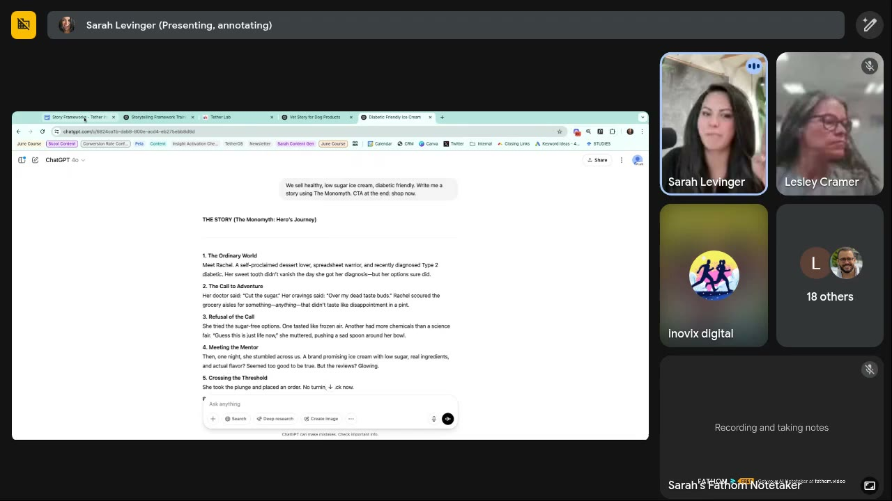
*V1 with no context. The prompt "We sell healthy, low sugar ice cream, diabetic friendly. Write me a story using The Monomyth. CTA at the end: shop now." returned "THE STORY (The Monomyth: Hero's Journey)" in hero's-journey stages ("Meet Rachel…"). [0:51:20]*

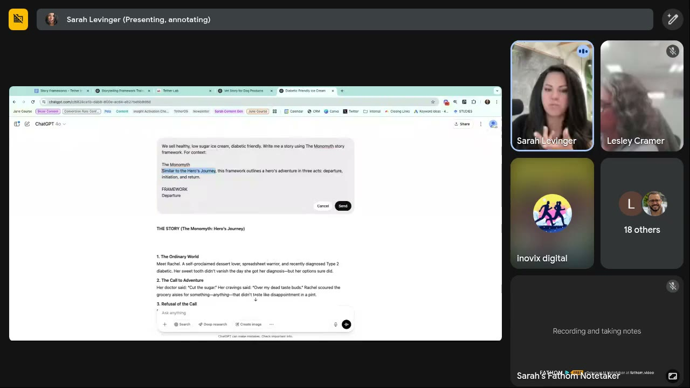
*The fix: re-prompt with "For context: The Monomyth… departure, initiation, and return. FRAMEWORK…" pasted from the doc, with "Similar to the Hero's Journey" highlighted for deletion. [0:51:50]*

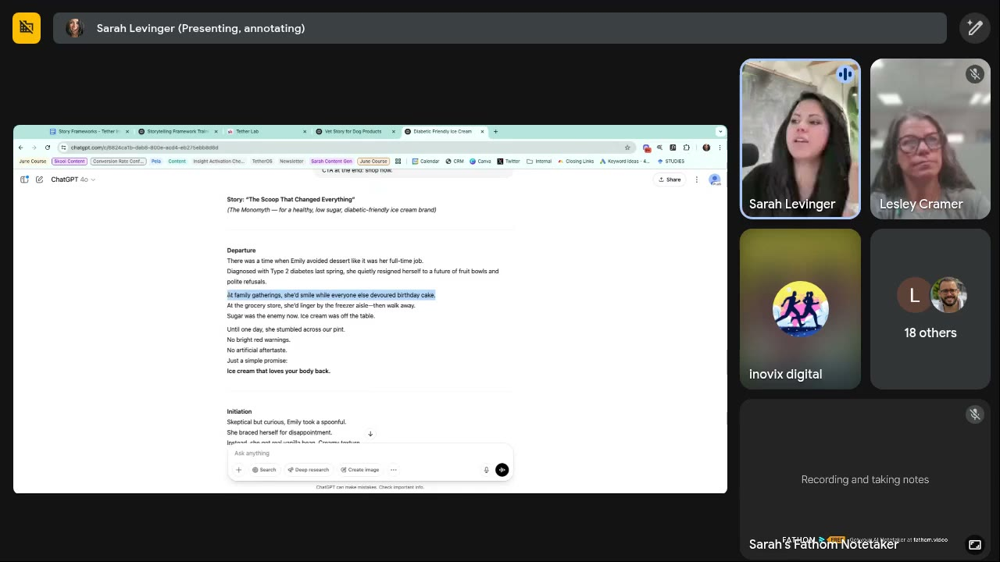
*V2 "The Scoop That Changed Everything", Departure: "At family gatherings, she'd smile while everyone else devoured birthday cake" (highlighted) → "Ice cream that loves your body back." [0:53:20]*

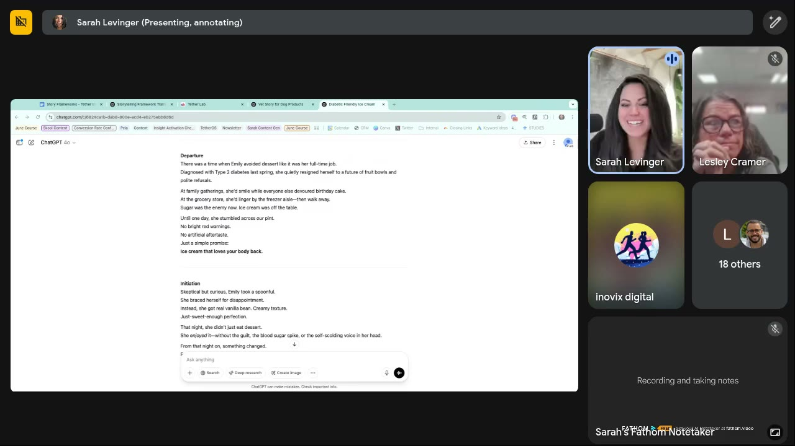
*Initiation: "She braced herself for disappointment… That night, she didn't just eat dessert. She enjoyed it—without the guilt, the blood sugar spike, or the self-scolding voice in her head." [0:54:50]*

V2 script (verbatim from screen, Return paraphrased from Sarah's reading): **Departure:** There was a time when Emily avoided dessert like it was her full-time job. Diagnosed with Type 2 diabetes last spring, she quietly resigned herself to a future of fruit bowls and polite refusals. At family gatherings, she'd smile while everyone else devoured birthday cake. At the grocery store, she'd linger by the freezer aisle—then walk away. Sugar was the enemy now. Ice cream was off the table. Until one day, she stumbled across our pint. No bright red warnings. No artificial aftertaste. Just a simple promise: **Ice cream that loves your body back.** **Initiation:** Skeptical but curious, Emily took a spoonful. She braced herself for disappointment. Instead, she got real vanilla bean. Creamy texture. Just-sweet-enough perfection. That night, she didn't just eat dessert. She *enjoyed* it—without the guilt, the blood sugar spike, or the self-scolding voice in her head. From that night on, something changed… (dessert became a joy again; control didn't mean deprivation; cravings handled). **Return** (read aloud): she's the one showing up to game night with pints, the friend who says "you have to try this", "living proof that health doesn't have to mean sacrifice"… "sometimes all it takes is a better scoop." [0:52:19–0:54:35]

| Brand / product (niche) | Format | Hook / opening | What works | What fails | Fix suggested | Principle | Source |
|---|---|---|---|---|---|---|---|
| Healthy low-sugar ice cream, V1 (DTC food, diabetic) | Story script, Monomyth requested | "Meet Rachel. A self-proclaimed dessert lover, spreadsheet warrior, and recently diagnosed Type 2 diabetic." | Some good lines ("Over my dead taste buds", "more chemicals than a science fair") | Blended Monomyth + Hero's Journey; "very storytelling, very ad-like" | Paste the framework, delete the "similar to Hero's Journey" line, force one framework | ChatGPT blends similar frameworks without context | [0:50:38–0:52:19] |
| Healthy low-sugar ice cream, V2 | Story script, Monomyth (forced) | "There was a time when Emily avoided dessert like it was her full-time job." | Long setup with no solution yet. Lived moments (birthday cake, freezer aisle). Catchphrase "Ice cream that loves your body back". Realism. Emotional payoff (enjoyed it, no guilt). Social return (game night). | Not stated | Pull the catchphrase into static headlines | Setup-heavy story + catchphrase → static headline. Wiki tags: Zone 3 (resigned sadness) → Zone 1 (joy without guilt), [Actual self](../../../concepts/actual-self.md) + [Ideal self](../../../concepts/ideal-self.md) (in control without deprivation). | [0:52:19–0:55:36] |

### Described examples (not shown)
| Brand / product (niche) | Format | Hook / opening | What works | What fails | Fix suggested | Principle | Source |
|---|---|---|---|---|---|---|---|
| Faux-podcast ads (unnamed brands) | Podcast-style video, In Medias Res | "I told her never to say this to me ever in my life, and then she turned around and said it to me on my birthday. Can you guess what she said?" | Dropped mid-story = open loop. "Your brain kind of gets excited." | n/a | n/a | [Open loop](../../../concepts/heuristics/open-loop.md) / [curiosity gap](../../../concepts/heuristics/curiosity-gap.md) | [0:09:30–0:10:18] |
| Shampoo (hypothetical) | UGC, SCQA | "My hair is always dirty… super greasy… then one day my hairstylist asked me, are you sure it's your shampoo…?" | Question in the middle reframes the cause | n/a | n/a | SCQA for switching behaviour | [0:08:16–0:09:00] |
| Weight loss (hypothetical) | Founder/customer origin story | "She dropped 150 pounds in the course of two years… here's her full transformation." | Big arc for VSLs, founder stories | n/a | n/a | Batch 1 frameworks | [0:12:27–0:13:06] |
| AI UGC (Creatify, attendees) | AI-generated UGC ads | n/a | Cheap, novel | "None of the videos converted" (chat) | Build an organic following for the AI creator first. Avoid for trust brands. | Faces/voices pattern recognition | [0:30:53–0:31:50] |

### Session summary teardown table
| Brand / product (niche) | Format | Hook / opening | What works | What fails | Fix suggested | Principle | Source |
|---|---|---|---|---|---|---|---|
| Maelove | UGC script, Pixar | "…now I have to admit I was wrong." | Emotion, humour, counter graveyard | n/a | n/a | Story > generic UGC prompt | [0:16:17] |
| Maelove | Influencer script, Hero's Journey | "…a public apology to my skin." | Proof woven into story | n/a | n/a | Framework sets solution timing | [0:18:29] |
| Maelove | Fake podcast, In Medias Res | "…every skincare brand thinks I'm gullible" | Open loop, validation | Subtle | n/a | Start mid-story | [0:20:41] |
| Pet dental chews | Story script, Freytag | "Dr. Riley… dreaded dental checkups" | Vet authority, chew-time insight, realism, bad-guy emotion | Long | Character series, advertorial | Third-party narrator | [0:36:30] |
| Diabetic ice cream V1 | Story script | "Meet Rachel…" | Lines | Blended frameworks | Paste framework | Force one framework | [0:50:44] |
| Diabetic ice cream V2 | Story script, Monomyth | "Emily avoided dessert like it was her full-time job" | Setup, catchphrase | n/a | Headlines for statics | Two-thirds setup | [0:52:19] |
| Faux-podcast ads | Video | "Can you guess what she said?" | Open loop | n/a | n/a | In Medias Res | [0:09:30] |
| AI UGC (Creatify) | Video | n/a | Novelty | Didn't convert | Organic-first | Trust | [0:30:53] |

## Hooks
*Heuristic, zone and self tags are wiki interpretation unless stated.*

| Hook (verbatim or near) | Heuristic(s) | Emotion / zone | Self targeted | Why it works | Source |
|---|---|---|---|---|---|
| "You ever buy a skincare product just knowing it's not gonna work… but you do it anyway? …Unfortunately, now I have to admit I was wrong." | Confession, [curiosity gap](../../../concepts/heuristics/curiosity-gap.md), self-recognition | Wry frustration, Zone 3 | Actual | Names a shared guilty habit, then promises a reversal | [0:17:07] |
| "I'm gonna be honest… I did not want to like this. And now I have to make a public apology to my skin." | Reluctant testimonial, curiosity | Playful skepticism, Zone 3 → 1 | Actual | Skeptic-converted framing pre-empts distrust | [0:18:43] |
| "No, because explain to me why every skincare brand thinks I'm gullible… do they think I was born yesterday?" | [Open loop](../../../concepts/heuristics/open-loop.md), in-group (fellow skeptics) | Irritation, Zone 3–4 | Actual | Starts mid-rant and validates the viewer's cynicism | [0:20:56] |
| "I told her never to say this to me… then she said it to me on my birthday. Can you guess what she said?" | Open loop | Intrigue, Zone 2 | Actual | Mid-story drop. The brain wants the resolution. | [0:09:30] |
| "Are you sure it's your shampoo that's actually doing this?" (hairstylist's question) | SCQA question, authority (stylist) | Doubt, Zone 3 | Actual | Reframes the cause and prompts switching | [0:08:16] |
| "Dr. Riley had seen it all… But the one thing she always dreaded? Dental checkups. Not for her—but for the dogs." | Third-party [authority](../../../concepts/heuristics/authority-bias.md), surprise | Empathy/humour, Zone 3 | Ought (good pet parent) | Fresh narrator and an unexpected shared dread | [0:36:36] |
| "She hated telling good pet parents that their dog's breath could melt paint." | Humour, [salience](../../../concepts/heuristics/salience-bias.md) | Embarrassment, Zone 3 | Ought | Vivid, funny image of the problem | [0:36:42] |
| "Want your vet to be pleasantly surprised at your dog's next checkup?" (CTA) | Social approval, [goal-gradient](../../../concepts/heuristics/goal-gradient-effect.md)-ish future moment | Pride, Zone 1–2 | Ought | Ties the purchase to approval from a trusted person | [0:42:30] |
| "There was a time when Emily avoided dessert like it was her full-time job." | Micro-story, contrast | Resigned sadness, Zone 3 | Actual | Lived restriction, set up before any solution | [0:52:41] |
| "Ice cream that loves your body back." | [Processing fluency](../../../concepts/heuristics/processing-fluency.md), reframe | Warmth, Zone 1 | Actual + Ideal | Flips the "sugar is the enemy" belief in five words. Static-headline ready. | [0:53:34] |
| "A healthy smile isn't luck—it's a habit." | Fluency, habit framing | Calm confidence, Zone 1 | Ought | Turns the product into a routine | [0:42:20] |
| Founder's Post: "Before I started [brand], I was struggling with… I tried [method]. Then I realized… That's when I created [solution]. And since then, we've helped [others] do the same." | [Authority](../../../concepts/heuristics/authority-bias.md) (lived), [social proof](../../../concepts/heuristics/social-proof.md) | Empathy → hope | Actual | Fill-in founder template | [0:15:15] |

## Angles
| Angle | Core desire / pain | Heuristic(s) | Best format | Example line | Source |
|---|---|---|---|---|---|
| Reluctant convert / "I have to admit I was wrong" | Distrust of hype after many failed products | Social proof via a skeptic, contrast | UGC, influencer, podcast | "Now I have to make a public apology to my skin." | [0:17:07; 0:18:43] |
| Product graveyard → one thing that works | Clutter and sunk cost of half-used products | Loss aversion relief | UGC (Pixar) | "I can stop treating my bathroom counter like a product graveyard." | [0:17:42] |
| Anti-marketing skeptic | "Brands think I'm gullible" | In-group, open loop | Fake podcast | "Do they think I was born yesterday?" | [0:20:56] |
| Third-party authority character | Trust a professional who sees it daily | Authority, story | Voiceover/UGC/advertorial series | Dr. Riley the vet | [0:36:30] |
| Make your vet proud / stop the vet being the bad guy | Approval from a trusted person | Social approval, ought self | Story ads | "She no longer had to play the 'bad guy' in the dental chair." | [0:42:00] |
| Hidden mechanism the buyer doesn't know | Chew time cleans teeth | Curiosity, fluency | Story or explainer | "Chew time? Long enough to actually scrape tartar." | [0:38:27] |
| Health without sacrifice | Diabetics missing dessert, guilt | Reframe, contrast | Story → static headline | "Ice cream that loves your body back." | [0:53:34] |
| Characters around the customer | Each surrounding person = a new avatar/arc | Story variety | Series of story ads | Vet, trainer, neighbour, pet sitter, the pet | [0:33:17–0:34:00; 0:40:09] |

## Rewrites (before → after)
| Before | After | What changed (verb / visual / promise / self / intensity) | Source |
|---|---|---|---|
| "Write me a UGC script" | "Here's my concept (too many bottles on the countertop), here's my avatar, use the Pixar story model, write me a script" | Generic → named framework + concept + avatar. Much more emotion. | [0:17:42–0:18:29] |
| "My dog's breath was terrible, I went to the vet and they told me to try this" (AIDA-style) | "Dr. Riley… dreaded dental checkups. Not for her—but for the dogs." | Customer testimonial → third-party narrator. Predictable → surprising. | [0:37:30–0:37:48] |
| "This is amazing, it transformed everybody overnight, we've never had a negative review" | "She was skeptical. But intrigued. So she started recommending them. Cautiously at first." | Hype → realism | [0:41:08–0:41:54] |
| Story + proof dump (social proof, testimonials after the solution) | Hero's Journey: solution, then back out into "I didn't think this was going to work" | Proof stacking → story progression | [0:18:54–0:19:38] |
| "Write me a story using the Monomyth" (output blends Hero's Journey) | Same prompt + pasted Monomyth steps, "Similar to the Hero's Journey" removed | No context → forced single framework | [0:51:22–0:52:41] |
| "Use the Pixar framework to write headlines" | Script first → "from this story pull out the deepest emotion and the core message, then give us headlines" | Direct headline ask → script-derived headlines | [0:25:16–0:25:43] |
| Cuts every 2–3 s, fast delivery | Cuts every ~4 s, slower voice, pauses on key lines | Speed → emotional attachment | [0:47:13–0:48:12] |

## Rules of thumb
- **DO** pick the framework by job: Batch 1 for transformation (founder, origin, VSL), Batch 2 for conversion (landing pages, emails, retargeting), Batch 3 for short-form (UGC, TikTok, memes). [0:12:27–0:15:15]
- **IF** nothing is hitting in the account this week **THEN** try a Pixar-framework script. [0:14:43]
- **IF** selling a switch from a competitor/habit **THEN** use SCQA (a question in the middle). [0:08:16–0:09:00]
- **DO** use In Medias Res to open on a mid-conversation line (podcast format). [0:09:25–0:10:18; 0:20:41]
- **DO** spend ~2/3 of the runtime on setup (problem + lived experience) before the solution. [0:19:45–0:20:41]
- **DO** always tell ChatGPT the main character and the final CTA. [0:35:15]
- **IF** ChatGPT says "Monomyth: Hero's Journey" or the story is bland **THEN** paste the steps and forbid the other framework. [0:50:44; 0:54:40]
- **DON'T** have creators read scripts verbatim. Ask them to say it their way. [0:22:44–0:23:05]
- **DO** prefer natural voiceovers (ElevenLabs) to robot voices. Watch that over-slowed TTS sounds robotic. [0:24:00; 0:48:52]
- **DON'T** use ChatGPT to invent ICPs with no data. It mirrors your bias. **DO** use pictorial/metaphorical surveys or live feedback. [0:29:57–0:30:53]
- **DON'T** run AI UGC for brands that rely on trust. **IF** testing it **THEN** build the AI creator organically first. [0:26:56–0:27:15; 0:31:16–0:31:50]
- **IF** a story video flops **THEN** A/B test speed first, then hook, then story, then visuals/creator. [0:44:50–0:45:41]
- **DO** test length in steps: long (2–3 min) → 30 s → 15 s, keeping the avatar test at constant length. [0:45:41–0:46:50]
- **DO** extend cuts to ~4 s and slow the voice rather than speeding up. [0:47:13–0:48:12]
- **IF** a story script wins **THEN** make an advertorial landing page from it and keep the character recurring (fluency mechanism). [0:48:12–0:48:52]
- **DO** separate the acquisition product (gets them in fastest) from the profit product (subscription/upsell) when choosing what the story sells. [0:39:32–0:40:09]
- **DO** inject realism (skepticism, limited first recommendation, imperfect results). [0:41:08–0:41:54]

## Prompts (verbatim where shown)
| Prompt | Use | Source |
|---|---|---|
| "Please use the Pixar story framework to build this script for me." | Basic framework call | [0:15:49] |
| Concept + avatar + framework (paraphrased): "Here's my concept: people have too many bottles on their countertop. Here's my avatar: she's a female, she loves skincare, she's having a hard time figuring out which one's for her. Use the Pixar story model, write me a script." | Maelove UGC script | [0:17:42–0:18:13] |
| "Chat, here's my problem, here's my customer, here's the framework I want you to use to tell the story, give me some ideas." | Low-budget script generation | [0:23:20] |
| "Chat, from this story pull out the deepest emotion and the core message… and then give us headlines for that." | Script → static headlines | [0:25:16–0:25:34] |
| "We sell dental chews treats and toys for dogs. Write a story using Freytag's Pyramid. Our main character is the vet our dogs go to, and the final CTA - shop now." | Live build 1 (screen) | [0:36:30] |
| Optional modifiers: "I want five characters" · "we want it to be really intense" · or no context at all | Steering | [0:35:57–0:36:21] |
| "Chat, we need to cut this down to 30 seconds." (then 15 seconds) | Length tests | [0:46:05–0:46:20] |
| "We sell healthy, low sugar ice cream, diabetic friendly. Write me a story using The Monomyth. CTA at the end: shop now." | Live build 2, V1 (screen) | [0:51:20] |
| "We sell healthy, low sugar ice cream, diabetic friendly. Write me a story using The Monomyth story framework. For context: The Monomyth – [this framework outlines a hero's adventure in three acts: departure, initiation, and return.] FRAMEWORK: Departure / Initiation / Return…" | Live build 2, V2 (forced framework) | [0:51:31–0:52:19] |

## Tools, resources and metrics
| Item | Type | What was said | Source |
|---|---|---|---|
| "Story Frameworks – Tether Insights" doc (15 frameworks with steps + examples) | Resource (to be posted in the Skool classroom resources) | Paste into ChatGPT as context | [0:03:30; 0:31:50–0:32:13] |
| "The Storytelling Loadout" (ChatGPT output grouping frameworks into 3 batches + Founder's Post) | Resource | Which framework for which job | [0:12:27] |
| "Maelove-Scripts-TEMPLATE" doc (tabs: Prompts, UGC Script – Pixar, Influencer Script – Hero's Journey, Fake Podcast-Style Ad – In Medias Res) | Client script examples | Shown as a model | [0:16:17–0:22:22] |
| ChatGPT (4o, Sarah's personal account) | Tool | Writes the scripts. Blends frameworks without context. | [0:34:21; 0:51:52] |
| ElevenLabs | Tool | ~$5/month, accents, genders, ~30 s per short script, voice cloning (per chat), can slow speech but gets robotic | [0:23:34–0:24:05; 0:25:43; 0:28:42; 0:30:53; 0:48:52] |
| Premiere (or any editor) | Tool | Cut ElevenLabs audio into video | [0:28:49–0:29:05] |
| AI UGC tools: Creatify (creatify.ai), "Icon" (named in chat) | Tools | Creatify tested by attendees, no conversions | [0:26:08; 0:31:05] |
| Upcoming: avatar/ICP generation training | Training | "Large and in charge" | [0:29:05–0:29:22] |
| Joseph Campbell (Hero's Journey), Christopher Booker (*The Seven Basic Plots*), Kenn Adams (Story Spine), Donald Miller (StoryBrand, per ChatGPT list) | People / sources | Framework originators named on screen | [0:04:05; 0:11:05; 0:11:35; 0:14:20] |

**Metrics and benchmarks:** clip-cut standard **2–3 s**, longest seen **4 s**; going past 4 s can reduce attention unless the story is strong [0:43:47; 0:47:13]. Longer videos "currently" convert better than shorter [0:43:47; 0:46:50]. Setup ≈ **two-thirds** of the story [0:20:19]. ElevenLabs ≈ **$5/month**, ≈ **30 s** per short script [0:23:39; 0:28:49]. Length ladder: **2–3 min → 30 s → 15 s** [0:45:41–0:46:20]. Sarah's study: **5–10 h/month** through 2024 [0:02:53]. Cultural adoption of tech: **10–20 years** (Sarah's view) [0:28:08].

## Notable quotes
- "Humans are incredibly sensitive to stories, but not just any story. They're really sensitive to how stories progress." [0:19:38]
- "The punchline is not the point. The point is I've set you up to get invested in the story." [0:20:30]
- "It's like eating oatmeal every day with nothing on it." (on AIDA and default UGC scripts) [0:40:40]
- "Realism in story is incredibly important." [0:41:18]
- "The faster you go through a story the more difficult it is for people to attach emotionally to it." [0:43:35]
- "In my opinion it's almost always the speed that's the issue." [0:44:50]
- "Chat is sometimes real dumb." [0:51:10]

## How to apply
- [ ] For each competitor story ad you tear down, name its framework (Pixar, In Medias Res, Freytag…) and remix our product into a **different** framework.
- [ ] For one angle, write three scripts: Pixar (UGC), Hero's Journey (influencer), In Medias Res (two-host podcast).
- [ ] Generate one story per character around the customer (expert, family member, neighbour, the pet) and treat each as an avatar test.
- [ ] Check every script: is ≥ 2/3 setup? Is there a realism beat? Is the CTA tied to a person's approval or a habit?
- [ ] Ask ChatGPT for the deepest emotion + core message from the winning script, then 5–10 static headlines.
- [ ] Brief creators to say the script in their own words, or produce a natural-voice ElevenLabs voiceover.
- [ ] If the video underperforms: slower delivery/longer cuts → new hook → new story → new visuals/creator. Then the length ladder.

## Related
- Brand case files: [Maelove](../../../brands/maelove.md) · [all brands by niche](../../../brands/README.md)
- Tool pages: [ElevenLabs](../../../tools/elevenlabs.md) · [AI UGC tools](../../../tools/ai-ugc-tools.md)
- [Micro-story](../../../concepts/heuristics/micro-story.md) · [Open loop](../../../concepts/heuristics/open-loop.md) · [Curiosity gap](../../../concepts/heuristics/curiosity-gap.md) · [Suspense](../../../concepts/heuristics/suspense.md) · [Contrast](../../../concepts/heuristics/contrast.md) · [Authority bias](../../../concepts/heuristics/authority-bias.md) · [Social proof](../../../concepts/heuristics/social-proof.md) · [Processing fluency](../../../concepts/heuristics/processing-fluency.md) · [Transformation shortcut](../../../concepts/heuristics/transformation-shortcut.md)
- [Emotional zones](../../../concepts/emotional-zones.md) · [Three selves](../../../concepts/three-selves.md) · [Ought self](../../../concepts/ought-self.md) · [Actual self](../../../concepts/actual-self.md)
- Frameworks: [Valence-intensity diagnostic](../../../frameworks/valence-intensity-diagnostic.md) · [Rewriting ads for new selves](../../../frameworks/rewriting-ads-for-new-selves.md)
- Related pages: [Story frameworks for ad scripts](../../../frameworks/story-frameworks-for-ads.md) · [ElevenLabs](../../../tools/elevenlabs.md) · [ChatGPT](../../../tools/chatgpt.md) · [Fluency mechanism](../../../concepts/fluency-mechanism.md) · [AI UGC tools](../../../tools/ai-ugc-tools.md) · [Messenger effect](../../../concepts/heuristics/messenger-effect.md)
- Other live calls: [May 7, 2025](2025-05-07-live-with-sarah.md) (the Maelove "40 bottles" insight, identity-first) · [May 21, 2025](2025-05-21-live-with-sarah.md) (TEEP; the "mirror effect" story fix for a pet brand) · [June 4, 2025](2025-06-04-live-with-sarah.md) (fluency mechanisms/mascots, Maelove static)
- [Sarah Levinger](../../../people/sarah-levinger.md)

## Sources
- Transcript: [4.Live With Sarah!.txt](../../../../raw/tether-lab/_transcripts/5.%20Recordings/May%202025/4.Live%20With%20Sarah!.txt) · [.srt](../../../../raw/tether-lab/_transcripts/5.%20Recordings/May%202025/4.Live%20With%20Sarah!.srt)
- Session page text: [4_Live_With_Sarah!_May_14,_2025_Recordings_·_Tether_Lab.md](../../../../raw/tether-lab/_extracted/5.%20Recordings/May%202025/4_Live_With_Sarah!_May_14,_2025_Recordings_%C2%B7_Tether_Lab.md) (title and length only)
- Raw HTML: [4_Live_With_Sarah!_May_14,_2025_Recordings_·_Tether_Lab.html](../../../../raw/tether-lab/5.%20Recordings/May%202025/4_Live_With_Sarah!_May_14,_2025_Recordings_%C2%B7_Tether_Lab.html)
- Screenshots: Sarah's screen share of the Story Frameworks doc (3:30–11:30), the ChatGPT Storytelling Loadout (12:30–15:15), the Maelove-Scripts-TEMPLATE doc (17:40–22:00) and two live ChatGPT chats (36:30–42:20, 51:20–54:50). Frames grabbed at exact moments with the frame tool.
- Whisper fixes: "freight tag / fray tag / free tag" → Freytag; "ada" → AIDA; "story right" → StoryBrand; "seqa / sqa" → SCQA; "monomus / monomath" → Monomyth; "immediate res / intermediate res / medias res" → In Medias Res; "pitching curve / fitchy and curve" → Fichtean Curve; "may love" → Maelove; "11 labs" → ElevenLabs; "choose treats spooks" → chews, treats, [toys]; "dr red / reilly" → Dr. Riley; "bsl" → VSL; "press worthy" → trustworthy (likely); "diabetic room" → diabetic-friendly.
