# Roast My Ads #1, May 28, 2025: Canvas Gelato, VITUS Vegan Multi, FireClub and The Only Bean
> Tether Lab's first monthly "Roast My Ads". Sarah roasts four members' ads: Ahmad Almarri (Canvas Gelato), Yana Zhurovich (VITUS Vegan Multi), Gavin S (FireClub Activity Club, Gen Z) and Sofia Tataurova (The Only Bean edamame snacks). She also walks through her own High Camp Flasks statics as a design reference. The lessons: make the image say what the text says, "show don't tell" with ingredients ("sight smell"), use half-headlines as open loops, keep headlines to 4–7 words and 3 lines, design by **visual weight**, communicate **one core emotion** per ad, ditch "Shop Now", mine reviews for hidden motivators, and, in Sofia's account, notice that the all-time winner is the only ad that frames the product as a **gain** ("feed" your cravings) instead of a loss.

## 🤖 Agent use
- **Use when:** tearing down a competitor static (image ↔ text match, visual weight, headline length, emotion count); writing static copy for food/supplement/experience brands; picking a CTA; briefing a designer; diagnosing why one ad in an account wins (look for the one word that's different); turning reviews into angles.
- **Inputs → outputs:** an ad (or a set from one account) + product facts + reviews → a teardown row per ad, a fix list (image, headline ≤7 words, one emotion, weighted hierarchy, CTA), and new hooks (open-loop half-headlines, contrarian lines, gain-framed swaps).
- **Rules:**
  - DO make the image show what the headline promises. "POV: your friends are coming" needs friends in the frame, not product bowls. [0:04:13]
  - DON'T expect "the product to sell itself". It sells only when it's presented so the viewer connects with it emotionally. [0:05:01]
  - DO name the specific, ownable details (flavour names, process, source) instead of claims any competitor can make ("real ingredients", "made fresh"). [0:05:15–0:06:19; 0:08:26]
  - DO show the ingredients so people can "smell it through the screen" (**sight smell**). For food, show the ingredients more than the product. [0:06:53–0:07:22]
  - DO "show, don't tell": an unusual combo on screen says "unique" without the word. [0:07:22–0:07:43]
  - DO write copy around what people already do ("the meal wasn't great, but we had gelato"), not around behaviour you wish they had. [0:07:43–0:08:26]
  - DO use **contrarian** headlines ("Most people think X… but…") and give only half the message on the creative to open a **loop**. Put the rest in the primary text. [0:09:27–0:11:31]
  - DO add a literal visual for every metaphor (OFF→ON = a light switch on the bottle, switched ON). Weird pairings make people look. [0:12:35–0:15:00; 0:32:15–0:33:21]
  - DO keep headlines **4–7 words** and snip testimonials down to their core line. You have ~0.48 s to matter (Sarah's figure). [0:15:00–0:16:53; 0:31:14]
  - DO design by **visual weight**: the eye goes heaviest → next heaviest, not in a Z. Make the important things the heaviest. Then A/B test removing elements. [0:19:55–0:23:01]
  - DO use a background **pattern** built from objects the buyer already knows (a mandala for wellness, baby bottles for moms). The background must support the text. [0:23:01–0:25:34]
  - DO check that metaphors are logically consistent ("blind spots" → "uncover", not "cover"). [0:25:34–0:26:52]
  - DON'T use "Shop Now" / "Learn More" style CTAs if you can avoid it: they invite browsing. Use definitive ones ("See how it works", add to cart, buy). [0:26:52–0:29:09]
  - DO stack copy in a straight, left-aligned 1-2-3 column on a grid. Max **3 lines** per headline, 2 per subhead, 3 per call-out with the top line bolded. [0:34:26; 0:36:37–0:38:39]
  - DO communicate **one core emotion** per ad. Supporting elements (stars, reviews, badges, bullets, call-outs) only back it up. The headline is "everything" on a static. [0:41:46–0:43:52]
  - DO find the real experience behind the purchase by listening for keywords in reviews and customer calls. Ask ChatGPT for the "hidden motivators" in reviews (~80 decent-length reviews are enough). [0:44:59–0:48:07]
  - DO use rounded shapes for text boxes and buttons. [0:48:07–0:51:22]
  - IF the buyer is premium/high-end THEN use more white space, fewer elements and higher-level language. [0:51:22–0:53:28]
  - IF one ad in an account wins far longer than the rest THEN compare hooks word by word. Here the winner was the only **gain-framed** hook among loss-framed ones. Test more of the gain frame. [0:54:32–0:58:42]
- **See also:** [Processing fluency](../../../concepts/heuristics/processing-fluency.md) · [Cognitive load](../../../concepts/heuristics/cognitive-load.md) · [Framing effect](../../../concepts/heuristics/framing-effect.md) · [Loss aversion](../../../concepts/heuristics/loss-aversion.md) · [Salience bias](../../../concepts/heuristics/salience-bias.md) · [Social proof](../../../concepts/heuristics/social-proof.md) · [Valence](../../../concepts/valence.md) · [Intensity](../../../concepts/intensity.md) · [Emotional zones](../../../concepts/emotional-zones.md) · [Roast My Ads #2](2025-06-25-roast-my-ads-2.md) · [Roast My Ads #3](2025-07-23-roast-my-ads-3.md)

Skool page text: title and video length only. The Skool recordings post (Sarah, May 28) says: "Huge thanks to our special guests @Sofia Tataurova @Yana Zhurovich @Gavin S and @Ahmad Almarri… We'll be doing these sessions once a month."

**Participants (from on-screen tiles, chat, the Google Doc "Roast #1 – May 28th" tabs and the Skool post):** Sarah Levinger (host). Roasted: **Ahmad Almarri** (Canvas Gelato; Zoom tile spells it "Ahmed"), **Yana Zhurovich** (VITUS Vegan Multi), **Gavin S** (FireClub Activity Club), **Sofia Tataurova** (The Only Bean; joined late or not at all). Also present: Sanket Patel, Satya Twena, Walker LeVan, Gev In, Brian West, Lee Kemp, Khalid Alameri, Gabriela Núñez, Darian James (end).

## TL;DR
- **The image must say what the text says.** Canvas Gelato's "POV: your friends are coming and you order gelato" shows three bowls, no friends. Show the people, and show the ingredients (beef-tallow caramel, candied bacon) so viewers can "smell it through the screen". [0:03:09–0:07:22]
- **Half-headlines open loops.** "Most people think ice cream has real vanilla in it…" stops the scroll because the brain goes looking for the other half. Contrarian framing + open loop. [0:09:27–0:11:31]
- **Design is weighting.** Eyes jump to the heaviest element, then the next heaviest, so make the important stuff heavy. Use 3-line maximums, a 1-2-3 stack, a bold top line, rounded boxes and buttons, and backgrounds/patterns that support the message. [0:19:55–0:25:34; 0:34:26–0:40:44; 0:48:07–0:51:22]
- **One ad = one core emotion.** FireClub's ad carried two emotional headlines ("Remember chasing thrills…" and "Your heart was made to race…"). Cut to one headline and one CTA. Badges, stars and call-outs are supporting characters. [0:41:46–0:43:52]
- **Find the real experience.** Is the Gen Z buyer upset about networking, mourning a lost childhood, or wanting to be free for a minute? Listen for keywords in reviews and calls. "I wasn't allowed to as a kid" → the message is deprivation, not "have fun". [0:43:52–0:47:07]
- **Gain beats loss here.** The Only Bean's year-long winner, "My secret to feed junk food cravings", is the only hook in the account that lets you *keep* something. All the others are about losing weight. "No human on the planet wants to stop eating potato chips." [0:54:32–0:58:42]

## Session map
| Time | Segment |
|---|---|
| [0:00:00] | Letting people in; Wednesday weekly call. |
| [0:01:04] | Roasts will be monthly (others are trainings or Q&A). Roster: Ahmad, Yana, Sofia; "roast kindly". |
| [0:03:09] | **Ahmad, Canvas Gelato.** Why do they buy from *you*? POV ad: the image doesn't match the text. |
| [0:05:15] | Specific, ownable call-outs; unique flavours; **sight smell** (+13.6% likability). |
| [0:07:22] | Q: call out the combos or say "unique"? Show don't tell. "Your guests will remember dessert" → behavioural truth. |
| [0:08:26] | Proprietary flavour names; "made with care, not with chemicals"; fake vanilla; **contrarian headline**. |
| [0:10:28] | Q: does all of it go in the ad? No: half in the headline, rest in the copy. **Open loops.** |
| [0:11:31] | Mix-up over whose ads are next (Sofia vs Yana). |
| [0:12:35] | **Yana, VITUS Vegan Multi.** "OFF to feeling ON" metaphor → add a light switch; Alpha Lion example (not found). |
| [0:14:42] | Headlines 4–7 words; snip quotes; ~0.48 s attention. Five stars desensitising; "You notice the difference when you don't have it" = loss. Blurred reviews. |
| [0:18:54] | Comparison ad: cognitive load, visual weight vs Z-pattern. Homework: audit your ads for what's heaviest. |
| [0:22:01] | Q: the top-right headline? A/B test removing elements. |
| [0:23:01] | Mandala pattern ad: patterns, images "60,000× faster", "cover" → "uncover". |
| [0:26:52] | Q (Lee): a CTA other than Shop Now? Definitive CTAs; add-to-cart ≠ purchase intent. |
| [0:29:09] | **Gavin S, FireClub Activity Club** (Gen Z, low valence / low intensity). Shorten "Remember when moments like this were productive enough?" |
| [0:31:14] | 4–7 words; all-text ads; sticky notes, odd objects; distinction ("Von Restorff"). |
| [0:33:21] | Us-vs-them A/B; personality lines; grid and 1-2-3 stack; "Remember chasing thrills, not gains". |
| [0:36:37] | **Sarah's own High Camp Flasks statics**: weighting, 3-line rule, value stacking, "backwards weight". |
| [0:40:44] | Gavin's emotional-bridge variant: **too many emotions**, one core emotion, supporting elements. |
| [0:43:52] | Q: headline without saying what it is? Connect to the real experience (Satya's breastfeeding example). |
| [0:45:30] | Q: how do you find which experience? Listening, keywords, NLP on reviews, "hidden motivators". |
| [0:47:07] | Q: how many reviews? ~80 good ones; quality over quantity. |
| [0:48:07] | Q (chat): change the shapes? **Rounded** shapes and buttons; Canva tip; design mini-course offer. |
| [0:51:22] | Q (Sanket): target $15K/month service clients? Premium = white space, fewer elements, higher-level language. |
| [0:54:32] | **Sofia, The Only Bean**: the winner is the only gain-framed hook ("feed"). Loss-aversion question. |
| [0:59:45] | Wrap: DM roasts for the rest, Tether 100 Challenge, "super secret course" next week. |

## Key ideas

### 1. Why do they buy from *you*? Make the image carry the emotional promise [0:03:09–0:05:15]
- "What exactly are our customers buying our products for?… Most of the time we would just go basically **one level deep**… specifically why are they buying from you?" Gelato is "a very specific type of dessert". [0:03:09–0:04:13]
- The POV text says "share this with friends… create community", but "the image itself is just… product options". "I want to see some people in it." [0:04:13]
- "People really want to default to like hopefully **the product will sell itself**… it's not true. The only way the product sells itself is if we present the product in a way that you can connect with it emotionally." [0:04:13–0:05:15]

### 2. Specific beats generic; show the ingredients ("sight smell") [0:05:15–0:08:26]
- "Real ingredients, made fresh, fun flavors" are features "our competitors can probably claim too". Instead: "How long was this churned… are you using milk from cows that get [massages] every Sunday?" Call out what's unique to you. [0:05:15]
- Ahmad: unique flavour combos are what they're known for (e.g. **beef-tallow caramel** and **candied bacon**). Sarah: put the ingredients on one side of the image and the gelato on the other. [0:05:15–0:06:19]
- **Sight smell:** "in advertising sight smell means I need to be able to smell it through the screen… look at the ingredients… smell each one of those in my brain". She cites a study she'd posted on Twitter that day: "you can increase likability of your ads by I think it was **13.6%**". (Not cited further.) [0:06:19–0:07:22]
- Ben & Jerry's names (Chunky Monkey) show the power of **proprietary flavour names**. "Naming is incredibly important for every brand on the planet." [0:06:19; 0:08:26]
- **Show don't tell:** "If you show me beef tallow caramel and bacon in an image, I'm gonna know automatically that that's a very unique flavor. You don't even need to say it." [0:07:22]

### 3. Write to existing behaviour [0:07:43–0:08:26]
- "Your guests will remember dessert (Make sure it's better than the meal)" brings the meal into it, but "everybody's trying to get to dessert anyway, that's a natural behavior". Better: "**It's okay if the meal wasn't great, because you have dessert**." "Talk about the things that are already happening behaviorally." [0:07:43–0:08:26]

### 4. Contrarian headlines and open loops [0:08:26–0:11:31]
- "Gelato made with care, not with chemicals" talks to sensitive buyers (stigma, lactose, cream). Make it concrete: many vanilla ice creams contain no real vanilla. [0:08:26–0:09:27]
- **Contrarian:** "Take what people think is the norm and flip it upside down… 'Most marketers think XYZ, but that's not the truth.'" → "Most people think gelato is made with real vanilla, but it's actually just synthetic flavor. Ours is made with actual real vanilla." [0:09:27]
- Put most of that in the primary text. On the creative: "Most people think ice cream has real vanilla in it… and leave it at that." "You don't have to give all the information in your creative, and I don't think you should." [0:10:28]
- **Open loop:** "Giving the brain half the information… causes the brain to go search for the rest of it… the brain will automatically move forward with clicks or with engagement." Works for services too: "Most people think agencies are doing their best to grow your business, but…" [0:10:28–0:11:31]

### 5. Metaphors need a literal visual [0:12:35–0:15:00; 0:32:15–0:33:21]
- VITUS: "One scoop a day is all it takes to go from feeling OFF to feeling ON." The transcript has Sarah calling this **"alliteration"**, defined as "compare it to something that people already know". The device she describes is a metaphor/analogy (the on/off switch); see Source notes. [0:12:35–0:13:39]
- "Show people… a **light switch**… add the light switch onto the bottle, and specifically make the light switch facing up, whatever the on position is." Otherwise "they're reading the text but they can't see it in their mind". Different cultures have different switches, so match the market. [0:13:39–0:15:00]
- Reference she couldn't find live: an ad she made for **Alpha Lion** (supplements) using this technique. [0:13:39–0:14:42]
- Weirdness is the point: "Nobody would add a light switch to a bottle, but just having that strangeness added on to your product will help people understand what it's for… more clicks, more buys, just because it's odd." [0:32:15–0:33:21]

### 6. Short headlines, short quotes, attention in half a second [0:14:42–0:16:53; 0:30:11–0:32:15]
- "Usually… headlines… somewhere between **four and seven words** long maximum", based on a study "I think this was email headlines… four to eight words… they'll get opened more" because the brain gets the message faster. Still test long ones. [0:14:42–0:15:46]
- "Take a snippet of the quote… we have less than a second to matter… it's not three [seconds] anymore… the last time I read the stat it was like **0.48 seconds**." [0:15:46]
- The VITUS testimonial ("I've been taking this for years in my morning smoothie and it gets me through rough PMS…") → "Gets me through rough PMS" / "I know if I have this, I'm set up for the day". [0:15:46–0:16:53]
- Gavin's "Remember when moments like this were productive enough?" is hard to read. Cut to "**Do you remember when this was productivity?**" Valence/intensity work still has to be "as clear as possible". [0:30:11–0:31:14]
- Exception: one client's **all-text statics** (colour or pattern background, plain text) "did so well", because they don't look like ads. Same reason **sticky-note ads** keep working. Also notepads, dry-erase boards, chalkboards, writing on a hand, cardboard signs, a full-body poster. [0:31:14–0:32:15]
- These are "pattern disrupts": "anything that's odd the brain is going to look at". She says "very Von Restorff… or not Von Restorff… distinction… distinction bias". (The isolation effect she's describing is the Von Restorff effect, wiki note.) [0:32:15–0:33:21] → [Von Restorff effect](../../../concepts/heuristics/von-restorff-effect.md)

### 7. Social proof and loss lines on statics [0:16:53–0:18:54]
- Five stars are fine, "although five stars are becoming less and less effective… people are getting desensitized to them". [0:16:53]
- "**You notice the difference when you don't have it**" is great emotional copy: it calls out a loss if you don't act. Transfer to Gavin: "You'll notice the disconnection when you don't come to these style of parties anymore." [0:16:53–0:17:54] → [Loss aversion](../../../concepts/heuristics/loss-aversion.md)
- **Blurred reviews** + "Click to see what people are saying about our products". Send the click to the **product page** (where the reviews are), not the home page. "Blurred anything in ads is actually pretty good", but don't deceive. [0:17:54–0:18:54]

### 8. Cognitive load and visual weight (not the Z-pattern) [0:18:54–0:23:01]
- Busy us-vs-them / before-after ads risk **cognitive load**: "make sure it's not so intense that the brain doesn't know what to do with it and it will skip out". [0:18:54] → [Cognitive load](../../../concepts/heuristics/cognitive-load.md)
- But stuffing is OK if there's "a natural progression for the eyes". The Z-pattern comes from reading top-left to bottom-right (in English; other scripts differ). In practice the eye goes "from the heaviest thing to the heaviest thing… down an arrow". Light text gets skipped, and "that doesn't bother me as long as everything that's heavy inside your ad gets seen". [0:19:55–0:21:57]
- "When we develop ads from a psychology standpoint I want every single thing that's most important to be **heavy visually** on the page." [0:20:57]
- **Homework:** audit your ads and identify which pieces will actually be seen because they're visually heaviest. [0:21:57]
- To learn what an element does, A/B test the same ad with that element removed. [0:22:01–0:23:01]

### 9. Patterns and backgrounds that support the message [0:23:01–0:26:52]
- "I don't think people realize how intense **patterns** are for the brain." The VITUS background is made of lemons, avocados and leaves. The subconscious registers them, but what lands is "a **mandala**… yogi kind of a level of a pattern". [0:23:01–0:24:01]
- "Choose a pattern that's going to resonate with something else that person already knows." For moms: baby bottles or diapers. For coffee: coffee cups in a circle. **Test:** put a repeating-item pattern in the background this week. "The brain can't get enough of… items in repetition." [0:24:01–0:25:02]
- "Whatever your background image says, the text has to support, because the images are going to get processed **60,000 times faster** than the text." (Popular stat, no source given.) [0:25:02]
- **Metaphor logic:** "Even a balanced diet has blind spots. Vegan multi is the best way to cover them." → "**uncover** them". "The brain is going to… make a very quick judgment call as to whether or not those two concepts make sense together, and if they don't… skip on out." [0:25:34–0:26:52]

### 10. CTAs: ditch "Shop Now" [0:26:52–0:29:09]
- "I hate Shop Now CTAs… Shop Now encourages browsing behavior… View More, Learn More… people just sort of browse around and leave." Meta restricts the button options, so write a **definitive** CTA in the description: "See how it works", "Let us show you why this is going to be better for you". [0:26:52–0:28:09]
- On landing pages: "Use a CTA that encourages people to do what you want them to do, which is add something to cart, buy it. Never ever ever use Shop Now… it teaches people to come back." [0:28:09]
- "Add to cart… is literally just a save-for-later button. It's not actually purchase intent." For a sign-up offer (Gavin), "Sign up" is fine. [0:28:09–0:29:09]

### 11. Design 101 for statics: grid, stack, 3 lines, weighting [0:34:26–0:40:44]
- "Everything exists basically on a **grid**." Instead of scattered blocks, "have everything stacked 1, 2, 3, straight line… we want the brain to go 'oh I get it'". [0:34:26]
- FireClub call-out blocks "visually all take up the same amount of space", so the brain doesn't know which to read first. Prioritise 1-2-3, or cut. [0:35:31–0:36:37]
- **Sarah's own High Camp Flasks statics** (her Canva file "HighCampFlasks-NLP-Ads-0225", pages named like "HCF-Competence-Details", "HCF-Competence-YouBrought", "HCF-Esteem-Moments"): [0:36:37–0:40:44]
  - The heaviest element is looked at first: the headline in white space, then the image. [0:36:37]
  - "I don't go past **three lines**… once you get to four lines then it's a paragraph, the brain will ignore it." Headlines max 3 lines, subheads 2. [0:36:37–0:37:38]
  - Call-outs: no more than 3 lines each, **top line bolded** so it reads first. That's **value stacking**: "here's something valuable, here's something valuable, here's something valuable" (100% stainless steel / no-drip lip / no-funnel fill). [0:37:38–0:38:39]
  - Gavin's value stack should be about the event, or about the real promise: "learn to be a kid again", "never got a campfire? Experience that". [0:38:39–0:39:40]
  - **Backwards weight:** "He put up the tent, but **you brought the flask**." The second half is weighted heavier because that's the message: "he might do literally all the work, but you bring the fun". [0:39:40]
  - "Design is everything… the way you design an ad is going to teach them what they should believe about your message." [0:39:40–0:40:44]

### 12. One core emotion per ad [0:40:44–0:43:52]
- Gavin's variant has two emotional messages: "Remember chasing thrills, not workout plans?" and "Your heart was made to race, not be told 'keep pace'". "They're two totally different emotional reasons." Remove the middle one: **one headline, one CTA**. [0:41:46]
- "Communicating **one core emotion** at a time and supporting that core emotion with other things that are going to back it up." "The brain gets a little tired when it's asked to process so much emotion, and all we're trying to do is **raise dopamine one time**." [0:41:46–0:42:48]
- "Marketers love to over-communicate." Supporting elements (five stars, reviews, badges, buttons, bullet lists, call-outs, "DTC best practices") are not the player. "The headline is key, especially for statics… that communicates the core of the value." [0:42:48–0:43:52]

### 13. Find the real experience (listening, keywords, hidden motivators) [0:43:52–0:48:07]
- You don't have to say "we're an activity club for Gen Z": "If they resonate with the headline they're gonna click. All we're trying to get them to do is feel something." [0:43:52]
- **Satya's example:** a breastfeeding mom "feels awkward". "Most of the time it's not that she feels awkward, it's that other people feel awkward around her." Copy: "It's not you, but there's a way to help other people feel more comfortable, and you can feel more comfortable too." [0:43:52–0:44:59] → [Situational specificity](../../../concepts/heuristics/specificity.md)
- For FireClub: is it networking, "I never got to be a kid… I'm not going to be able to afford a house… society is all messed up", or "I just want to have fun and be myself for a minute"? "Ask yourself what are they actually experiencing, and is it what I think it is?" [0:44:59–0:45:30]
- **How to find out:** marketers over-test "because they don't know and they don't want to take the time to know". Listen: call a past attendee, "can you explain why you came", listen for keywords. [0:45:30–0:46:04]
  - "I've never done this before… I wasn't allowed to as a kid" → restricted/deprived → message: "you were deprived of this experience as a child, here's the experience for you".
  - "It was so fun, I just got to be free for a minute" → message: **be free**. [0:46:04]
- "That's why I do **NLP work** a lot with reviews." Prompt: ask ChatGPT "**what are the hidden motivators inside all of our reviews?**" [0:46:04–0:47:07]
- **How many reviews?** "In my experience **80** is like the statistically significant benchmark that I try and hit", as long as they're a good paragraph each. "As long as they're good reviews you can use 50." Focus groups have only ~10 people: quality over quantity. [0:47:07–0:48:07]

### 14. Rounded shapes [0:48:07–0:51:22]
- "Instead of doing angled things, do bubbles… they have a scientific study that talks about rounded shapes actually gets more conversions because it feels less scary." Rounded rectangles / pill boxes. In Canva, a text box's background-colour effect does it. (Study not cited.) [0:48:07–0:49:14]
- Her example: High Camp "For Wine Lovers Who Know… / You Already Bring the Good Stuff" with rounded bubbles. "Probably one of the best CRO hacks I can give you: just change your buttons to circle buttons, like rounded." Facebook's own buttons are now rounded. [0:49:14–0:51:22]
- Design resource request: she's never seen a course on ad design for paid; offers a mini-course. "There's maybe like **12 different designs** that people just rinse and repeat." [0:49:46–0:50:17]

### 15. Premium positioning: white space and the right language level [0:51:22–0:54:32]
- "Your ad communicates what they're about to experience." For high-end clients: minimal text, as much **white space** as possible ("clean… minimalist… upscale"), very few extra elements. "Anybody that's going to buy a Ferrari… they don't want to see like a 'TikTok made me buy it'." [0:51:22–0:52:26] → [Luxury positioning](../../../concepts/luxury-positioning.md)
- Then elevate the **speech**: Gen Z → "glow up"; a PhD-level buyer who needs a mentor → "college level language". Instead of "increase your ROAS", use terms like bottom line vs top-line revenue. "The more educated the customer, the higher level the language." [0:52:26–0:53:28]
- Satya's customers (pregnant/new moms) are "pretty well educated women… don't think that just because you have a… utilitarian product that your customers need simple language". [0:53:28]

### 16. The Only Bean: the winner is the only gain-framed hook [0:54:32–0:59:45]
- Sofia's top spender "for almost a year" is a **video**. "If you're doing video be very careful how you test, because sometimes… the reason something is winning will be elusive." [0:11:31; 0:54:32]
- Hooks compared: winner "**My secret to feed junk food cravings**" vs "The crunchy way to lose weight", "(POV:) You never have to think about protein again", "This protein hack should be illegal" and a static "People with diabetes are loving this salty, crunchy edamame snack. Low in carbs and rich in fiber." The others are all "a secret to **losing** something". [0:55:37–0:56:40]
- "This is the only ad that talks about something you **gain**. You're **feeding** something… this one specific word is driving a huge chunk of the performance." The hook says "I'm not trying to kick my food craving, I'm actually feeding it with this specific product." [0:56:40]
- Attendee: doesn't that go against loss aversion? "It does, but… for this customer type… there's nothing to solve. You should keep your food cravings and just swap it with something else… no human on the planet wants to stop eating potato chips." [0:56:53–0:58:42] → [Loss aversion](../../../concepts/heuristics/loss-aversion.md) · [Framing effect](../../../concepts/heuristics/framing-effect.md)
- Rule for everyone in weight-loss or loss-aversion-heavy niches: "**Flip it upside down**… you don't need to get rid of anything. Keep your potato chip craving, just switch out the chip." [0:58:42]
- Self-diagnosis: roasts show whether you're strongest at message, images or design. Post in Skool what you want to work on. [0:58:42–0:59:45]

## Q&A
**Q1 (Ahmad). Should we call out the actual combos, or highlight that they're unique, given some combos are unique and some generic? [0:07:22]**
- "You don't need to say it's unique. If you show me beef tallow caramel and bacon in an image, I'm gonna know." Show don't tell, especially for food. [0:07:22–0:07:43]

**Q2 (chat, "Leslie" in the transcript; possibly Lee Kemp). Would all that [the vanilla story] need to be in the ad, or could it be in the copy? [0:10:28]**
- Most goes in the primary text. Make the creative headline "Most people think ice cream has real vanilla in it…" and stop. Half the information = open loop = scroll stop. [0:10:28–0:11:31]

**Q3 (attendee, likely Yana). What about the headline at the top right of the comparison ad? [0:22:01]**
- It may get seen, but the brain won't read both. The eye goes to the biggest element first, then the next heaviest. Test by removing elements one at a time. [0:22:01–0:23:01]

**Q4 (Lee Kemp, chat). Is there a CTA other than Shop Now? [0:26:52]**
- Meta limits button options, so write a definitive CTA in the description ("See how it works"). On landing pages use add-to-cart/buy, never "Shop Now". For a sign-up, "Sign up". Add-to-cart isn't purchase intent. [0:26:52–0:29:09]

**Q5 (Gavin). So 4–7 words maximum? [0:31:14]**
- Yes, the sweet spot. The only exception she's seen: all-text ads, which crushed because they don't look like ads. [0:31:14–0:32:15]

**Comment (Gavin). People also write it on cardboard and stand with it. [0:32:15]**
- Yes: cardboard, paper, a full-body poster. Odd carriers of a message are pattern disrupts. [0:32:15]

**Q6 (Gavin). For mine it's not about meeting people, it's about bringing back fun. What goes in the value stack? [0:38:39]**
- Then stack the fun: "learn to be a kid again", things people didn't get as kids (Nerf guns, a campfire). Make it specific to what you sell. [0:38:39–0:39:40]

**Q7 (Gavin). What about my variant with an emotional bridge instead of a value stack ("Your heart was made to race, not be told to keep pace")? [0:40:44]**
- Good messaging, but two emotional messages at once. Remove one: one headline, one CTA, one emotion. [0:41:46–0:42:48]

**Q8 (Gavin). Do I even need the call-outs? [0:42:48]**
- "Honestly I don't even know that you need it, because this communicates a lot of value." One line. [0:42:48]

**Q9 (Gavin). If I only have the headline and CTA, I don't say what we are (an activities club for Gen Z)? [0:43:52]**
- If they resonate with the headline they'll click. The job is to make them feel something by naming their real-world experience. [0:43:52–0:45:30]

**Q10 (attendee). How do you find out which experience it is? It could be so many. [0:45:30]**
- Listen. Reviews, phone calls with past customers, keywords. Run reviews through ChatGPT for "hidden motivators". [0:45:30–0:47:07]

**Q11 (attendee). Is there a minimum number of reviews for the ChatGPT analysis? Are 15 enough? [0:47:07]**
- ~80 is her benchmark if the reviews are paragraph-length. 50 good ones can work. Quality over quantity. [0:47:07–0:48:07]

**Q12 (chat). What about changing the shape of the coloured blocks (the angled ones)? [0:48:07]**
- Use rounded bubbles or pill shapes: a study says rounded shapes convert better because they feel less scary. Gavin: "I just surround my text in a box." Sarah: yes, rounded. Canva's text-background effect does it. [0:48:07–0:49:46]

**Q13 (attendee). Is there a source to learn product ad design, not to make it but to give feedback and brief designers? [0:49:46]**
- She hasn't seen one for paid. Offers a "design for paid advertising" mini-course. ~12 layouts get rinsed and repeated. [0:49:46–0:50:51]

**Q14 (Satya Twena, chat). Does rounded apply to buttons too? [0:50:51]**
- Yes. Facebook's buttons are rounded now. [0:50:51–0:51:22]

**Q15 (Sanket Patel, chat). I run a service business. How do I target people with ~$15K monthly revenue in the creative? [0:51:22]**
- Premium feel: white space, minimal elements, then elevate the language to the buyer's education level (bottom line vs revenue, not "increase your ROAS"). [0:51:22–0:54:32]

**Q16 (attendee). Doesn't the Only Bean winner go against loss aversion? [0:56:53]**
- It does. For this buyer, keeping the craving and swapping the snack beats "kick the craving". Test more gain-framed hooks. [0:56:53–0:58:42]

**Deferred:** Brian West posted "winning ads from a test flow I'd love to have roasted" (chat, ~0:24:45). Sarah will roast remaining submissions in DMs. Ahmad's newer ads were never reviewed. [0:54:32; 0:59:45]

## Ad teardowns
Zone labels follow the course map: Zone 1 = high valence/low intensity, Zone 2 = high/high, Zone 3 = low/low, Zone 4 = low/high. Heuristic, zone and self tags are the wiki's unless a timestamp shows Sarah (or the member's own label) said it.

### Canvas Gelato: "POV: your friends are coming and you order gelato" (Ahmad Almarri)
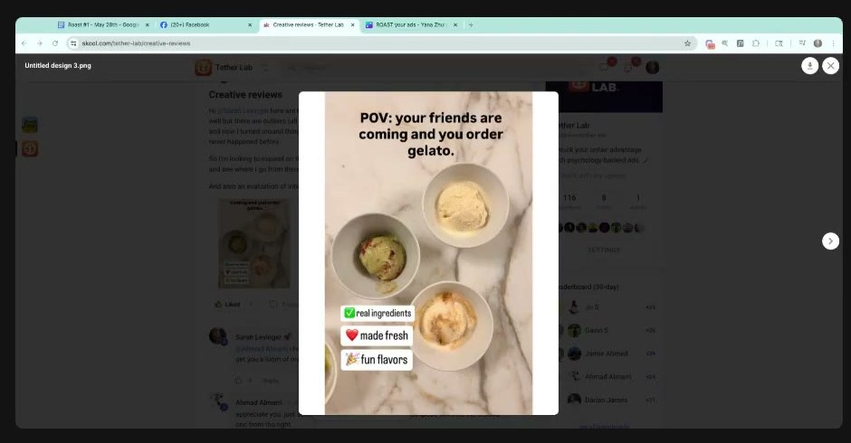
*Posted in Skool "Creative reviews". The text sells a social moment; the image only shows product. [0:04:30]*

| Brand / product (niche) | Format | Hook / opening | What works | What fails | Fix suggested | Principle | Source |
|---|---|---|---|---|---|---|---|
| Canvas Gelato, artisan gelato with unusual flavours (food / dessert) | Static, POV headline over a product flat-lay, emoji call-out chips | "POV: your friends are coming and you order gelato." | Right idea: sharing, community (Zone 1, Ideal self as host, wiki tags) | Image shows product options, not friends. Call-outs (real ingredients, made fresh, fun flavors) are generic claims. | Put friends in the image. Replace call-outs with ownable specifics (named flavours, churn time, milk source). Show ingredients beside the gelato (sight smell). | Image must carry the text's emotional promise. The product doesn't sell itself. | [0:03:09–0:07:22] |

### Canvas Gelato: "Your guests will remember dessert"
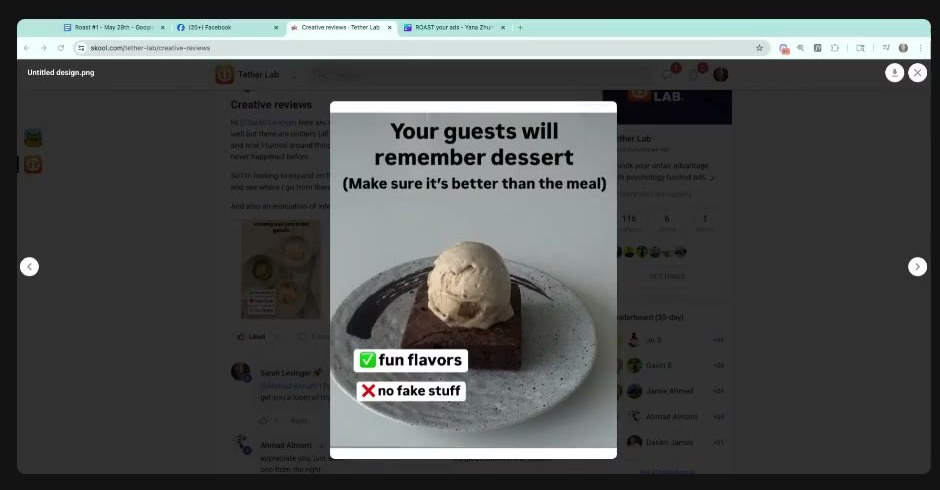
*Sarah: don't bring the meal into it; everyone skips to dessert anyway. [0:09:00]*

| Brand / product (niche) | Format | Hook / opening | What works | What fails | Fix suggested | Principle | Source |
|---|---|---|---|---|---|---|---|
| Canvas Gelato (food) | Static, headline + product shot + 2 chips | "Your guests will remember dessert (Make sure it's better than the meal)" | "Really close": connects to the host wanting a memorable meal ([Ideal self](../../../concepts/ideal-self.md), wiki tag) | Makes the meal part of the conversation. "Fun flavors / no fake stuff" are vague. | "It's okay if the meal wasn't great, because you have dessert." List real flavour names; create proprietary blend names. | Write to existing behaviour. Specificity. | [0:07:43–0:08:26] |

### Canvas Gelato: "Gelato made with care, not chemicals"
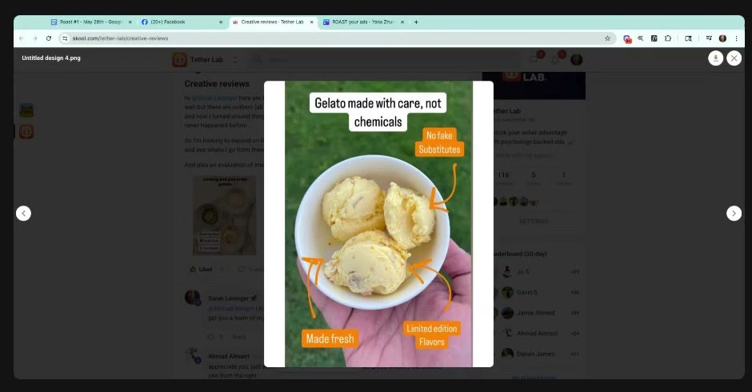
*Speaks to ingredient-sensitive buyers. Sarah wants it made concrete (real vanilla) and contrarian. [0:10:30]*

| Brand / product (niche) | Format | Hook / opening | What works | What fails | Fix suggested | Principle | Source |
|---|---|---|---|---|---|---|---|
| Canvas Gelato (food) | Static, in-hand UGC-style photo + arrow call-outs | "Gelato made with care, not chemicals" | Talks to sensitive buyers (stigma around cream, lactose). Contrast framing. Hand-held = real. | "Chemicals" / "no fake substitutes" is abstract | Contrarian open loop: "Most people think ice cream has real vanilla in it…" on the creative; the "ours uses real vanilla" payoff in primary text | [Framing](../../../concepts/heuristics/framing-effect.md): flip the norm. Open loops pull the click. | [0:08:26–0:11:31] |

### VITUS Vegan Multi: "One scoop a day…" testimonial and "You notice the difference…" comments (Yana Zhurovich)
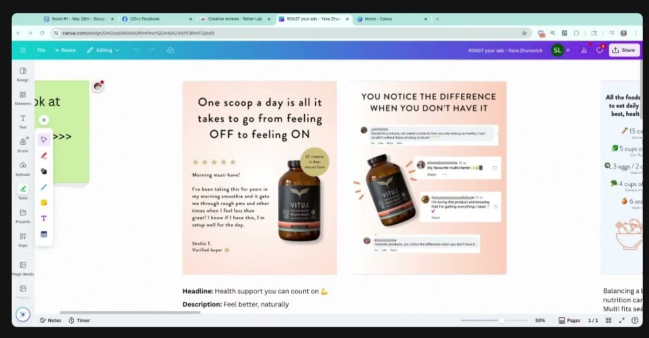
*Yana's Canva board "ROAST your ads – Yana Zhurovich". Headline field: "Health support you can count on 💪"; description: "Feel better, naturally". [0:18:00]*

| Brand / product (niche) | Format | Hook / opening | What works | What fails | Fix suggested | Principle | Source |
|---|---|---|---|---|---|---|---|
| VITUS Vegan Multi, whole-food plant multivitamin powder, vituswholefoods.com (supplements) | Static, headline + 5 stars + long testimonial + bottle + "22 vitamins in their natural form" seal | "One scoop a day is all it takes to go from feeling OFF to feeling ON" | Good DTC practice. OFF→ON metaphor. Use case (morning smoothie). Natural-form badge. [Social proof](../../../concepts/heuristics/social-proof.md). | Headline too long. Metaphor not visualised. Long quote. Five stars losing power. | Add a **light switch** on the bottle in the ON position. Cut the headline to 4–7 words. Snip quote to "Gets me through rough PMS". | Metaphors need a literal visual. Weird = attention. Short = fluent. | [0:12:35–0:16:53] |
| VITUS (supplements) | Static, comment screenshots around bottle | "YOU NOTICE THE DIFFERENCE WHEN YOU DON'T HAVE IT" | "Freaking love this emotional copy": [loss](../../../concepts/heuristics/loss-aversion.md) if you stop (Zone 3, [Actual self](../../../concepts/actual-self.md), wiki tags). Comments = social proof. | Not stated | Optional: blur the reviews + "Click to see what people are saying", linking to the product page | Name what they'll miss. Blur creates curiosity. | [0:16:53–0:18:54] |

### VITUS: "All the foods you'd need to eat daily…" comparison

*Left: the cognitive-load / visual-weight example. Middle: the mandala-pattern ad. Right: an ad shown but not discussed. [0:22:30]*

| Brand / product (niche) | Format | Hook / opening | What works | What fails | Fix suggested | Principle | Source |
|---|---|---|---|---|---|---|---|
| VITUS (supplements) | Static, us-vs-them split: food list vs one scoop, arrow, pill button | "All the foods you'd need to eat daily to be your best, healthiest self:" | Busy but has a natural eye path heaviest → heaviest down the arrow. Weight sits on the key pieces. Concrete food list = quantified comparison. "Keep it and test it." | High [cognitive load](../../../concepts/heuristics/cognitive-load.md). Small lines get skipped. Unclear whether the top-right headline gets read. | Keep it, test it. A/B test removing elements one at a time. | Design by visual weight, not the Z-pattern. Everything important must be heavy. | [0:18:54–0:23:01] |

### VITUS: "Even a balanced diet has blind spots" (mandala pattern)

*Sarah zoomed in to show the food pattern. The subconscious reads "mandala / yoga / balance". [0:23:32]*

| Brand / product (niche) | Format | Hook / opening | What works | What fails | Fix suggested | Principle | Source |
|---|---|---|---|---|---|---|---|
| VITUS (supplements) | Static, product on a repeating food mandala; Meta headline "Vitamins from plants, not labs"; CTA Shop now | "Even a balanced diet has blind spots." | "Freaking amazing" pattern: wellness-coded mandala that visualises **balance**. Background supports the text. Simple message. Contrast "plants, not labs". | "Cover them" breaks the blind-spot metaphor. "Shop now" CTA invites browsing. | "…the best way to **uncover** them". Definitive CTA in the copy ("See how it works"). | Patterns of known objects. Metaphor consistency. [Processing fluency](../../../concepts/heuristics/processing-fluency.md). | [0:23:01–0:29:09] |

| Brand / product (niche) | Format | Hook / opening | What works | What fails | Fix suggested | Principle | Source |
|---|---|---|---|---|---|---|---|
| VITUS: "This one ingredient could change how you choose multivitamins." (folate vs folic acid ✓/✗ comparison; primary text "It's the little details that make the biggest difference…") | Static, education + check/cross list | "This one ingredient could change how you choose multivitamins." | Shown on screen, **not discussed**. Wiki read: curiosity hook + comparison. | not discussed | not discussed | (none given) | [0:22:30] |

### FireClub Activity Club: "Remember when moments like this were productive enough?" (Gavin S)
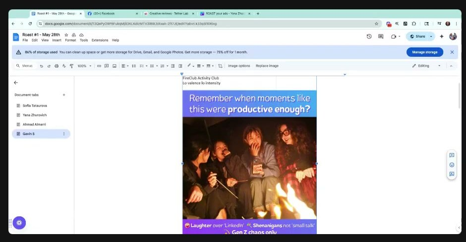
*Gavin tagged his own concepts by valence and intensity in the roast doc. [0:31:30]*

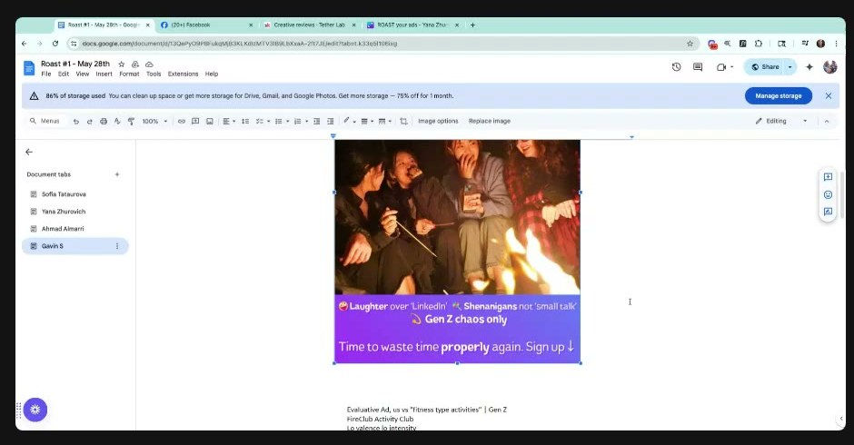
*Sarah loves the personality lines but wants them stacked 1-2-3 on a grid. [0:34:30]*

| Brand / product (niche) | Format | Hook / opening | What works | What fails | Fix suggested | Principle | Source |
|---|---|---|---|---|---|---|---|
| FireClub Activity Club, social activity events for Gen Z (Nerf battles, campfires) (events / experiences) | Static, candid campfire photo, gradient banners, emoji call-outs, "Sign up ↓" | "Remember when moments like this were productive enough?" | Uses course tools: low valence/low intensity (Gavin's tag; Zone 3). Nostalgia. Strong personality: "Laughter over LinkedIn", "Shenanigans not small talk", "Time to waste time properly again". | Headline hard to read. Call-outs scattered, equal weight, not stacked. | "Do you remember when this was productivity?" (≤7 words). Stack call-outs 1-2-3 on a grid. A/B test vs an us-vs-them version ("normal networking vs ours"). | Clarity first, even in emotional work. Show don't tell. Grid = fluency. | [0:30:11–0:36:37] |

### FireClub: "Remember chasing thrills, not workout plans?" (value-stack version)
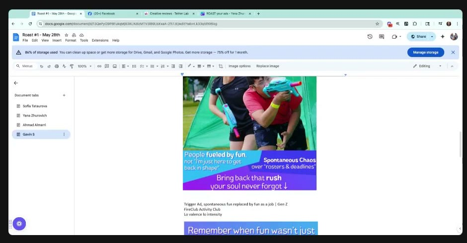
*Under Gavin's label "Evaluative Ad, us vs 'fitness type activities'". The headline is cropped out of this frame. [0:36:00]*

| Brand / product (niche) | Format | Hook / opening | What works | What fails | Fix suggested | Principle | Source |
|---|---|---|---|---|---|---|---|
| FireClub (events) | Static, action photo, value-stack call-outs | "Remember chasing thrills, not workout plans?" (Gavin: evaluative, us vs fitness activities, low/low) | Right message, cultural contrast (fun vs fitness/"rosters & deadlines") | Three equal-weight blocks; longer than needed | "Remember chasing thrills, not gains" ("use more culture"). Run new lines through ChatGPT: "what's a simple way to say this?" Value stack should be the event's real promise (be a kid again, a campfire you never got). | Simplify. Value stacking with a bold top line. | [0:34:26–0:39:40] |

### FireClub: "Remember when fun wasn't just another 'thing' to schedule?"
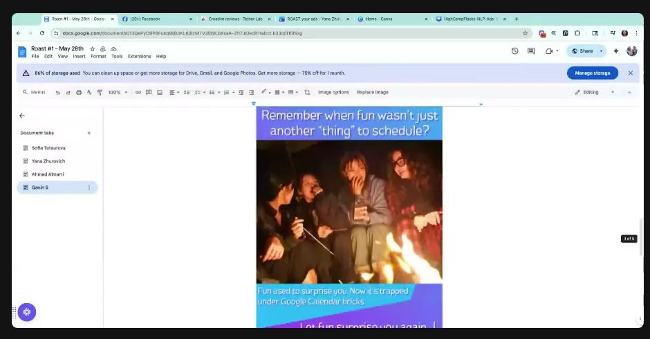
*Gavin's "Trigger Ad, spontaneous fun replaced by fun as a job". Scrolled past while finding the variant; not critiqued. [0:41:28]*

| Brand / product (niche) | Format | Hook / opening | What works | What fails | Fix suggested | Principle | Source |
|---|---|---|---|---|---|---|---|
| FireClub (events) | Static, campfire photo | "Remember when fun wasn't just another 'thing' to schedule?" | Not discussed. Gavin's tag: trigger-phase ad (see [TEEP model](../../../frameworks/teep-journey.md)), low/low. | not discussed | (wiki) Apply the same 4–7-word rule: "When did fun become a meeting?" is the kind of cut she asks for. Wiki suggestion, not Sarah's. | (none given) | [0:40:44–0:41:46] |

### FireClub: emotional-bridge version ("Your heart was made to race…")
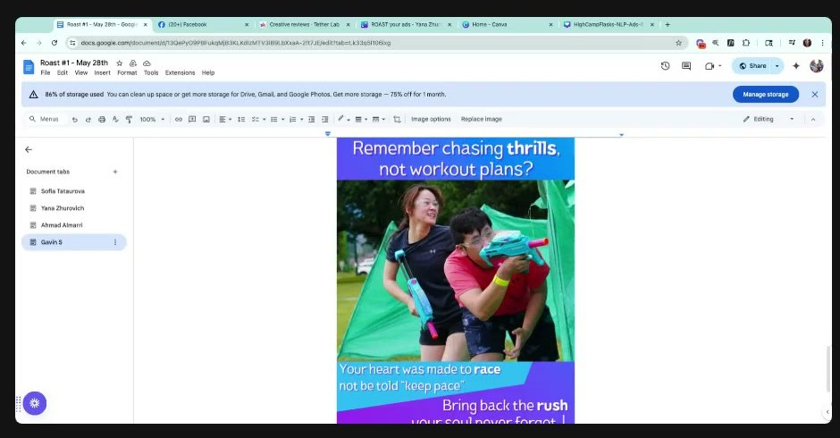
*Two emotional headlines in one ad. Sarah: cut the middle one. [0:42:00]*

| Brand / product (niche) | Format | Hook / opening | What works | What fails | Fix suggested | Principle | Source |
|---|---|---|---|---|---|---|---|
| FireClub (events) | Static, same photo, "emotional bridge" instead of value stack | "Remember chasing thrills, not workout plans?" + "Your heart was made to race, not be told 'keep pace'" | "Really good job with messaging" | Two different emotional reasons at once; over-communicates | One headline + one CTA. Drop the middle line. Maybe drop the call-outs entirely. | **One core emotion per ad**. Raise dopamine once. Supporting elements only support. | [0:40:44–0:43:52] |

### Sarah's reference designs: High Camp Flasks (her own work)

*Page "HCF-Competence-Details": heaviest element first (headline in white space), 3-line maximum, bolded top line on each call-out = value stack. [0:37:26]*

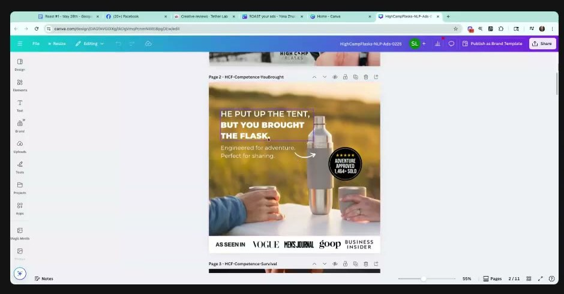
*Page "HCF-Competence-YouBrought": the "backwards weight" example. [0:39:42]*

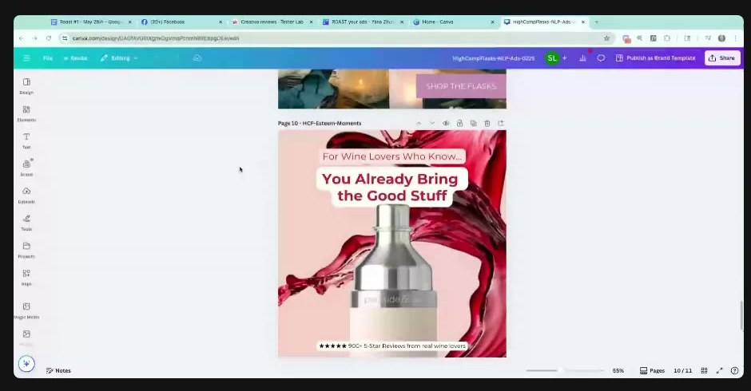
*Page "HCF-Esteem-Moments": rounded text bubbles, her "best CRO hack". [0:49:30]*

| Brand / product (niche) | Format | Hook / opening | What works | What fails | Fix suggested | Principle | Source |
|---|---|---|---|---|---|---|---|
| High Camp Flasks, premium stainless flasks (outdoor / drinkware). Sarah's own design, used as a model. | Static, headline in white space + product-in-use photo + 3 feature call-outs + sold-count seal | "Because details matter, even outdoors" | Weighting order: headline → image → call-outs. ≤3 lines each. Bold top line. Value stack of 3 product-specific features. [Social proof](../../../concepts/heuristics/social-proof.md) seal (1,464+ sold). Need tag in the file name: **Competence**. | Image "a little bit complicated, but this is what we had to use for the brand" | n/a | Graphic design 101: weighting tells people what to believe | [0:36:37–0:38:39] |
| High Camp Flasks | Static, lifestyle sunset photo, press bar | "He put up the tent, but you brought the flask." | **Backwards weight**: the second clause is heavier, so the takeaway is "you bring the fun, you still contribute" (Ideal self, wiki tag). [Authority](../../../concepts/heuristics/authority-bias.md) bar (Vogue, goop…). | n/a | n/a | Weight the part of the sentence that is the message | [0:39:40–0:40:44] |
| High Camp Flasks | Static, product + wine splash, rounded bubbles | "For Wine Lovers Who Know… You Already Bring the Good Stuff" | Rounded shapes "feel less scary". Esteem tag (file name). 900+ 5-star reviews. | n/a | n/a | Rounded shapes and buttons convert better (her claim) | [0:48:07–0:51:22] |

### The Only Bean: "My secret to feed junk food cravings" (Sofia Tataurova), the year-long winner
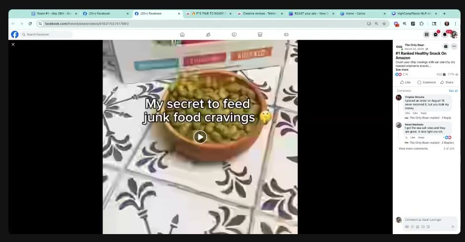
*Top spender for almost a year. The only hook in the account framed as a gain. [0:55:40]*

| Brand / product (niche) | Format | Hook / opening | What works | What fails | Fix suggested | Principle | Source |
|---|---|---|---|---|---|---|---|
| The Only Bean, crunchy dry-roasted edamame, high protein, low carb, "#1 Ranked Healthy Snack on Amazon" (snacks / better-for-you) | Short video, close-up of product in a bowl, text-overlay hook | "My secret to feed junk food cravings 🤫" | **Gain framing**: you keep the craving and swap the chip. "Feed" is the one different word. Secret = curiosity. Zone 2 (indulgence without guilt) and [Actual self](../../../concepts/actual-self.md) (wiki tags). | Why it won was "elusive" because hooks weren't varied carefully | Test more "feed your craving with something healthy" hooks instead of "kick the craving" | [Framing](../../../concepts/heuristics/framing-effect.md): gain over loss for craving-driven buyers. Compare winner vs losers word by word. | [0:54:32–0:58:42] |

### The Only Bean: loss-framed comparisons
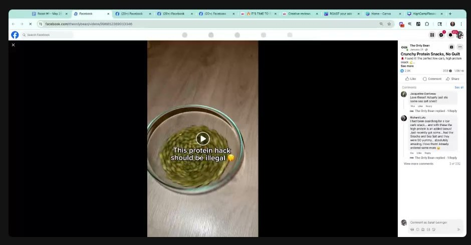
*[0:56:00]*

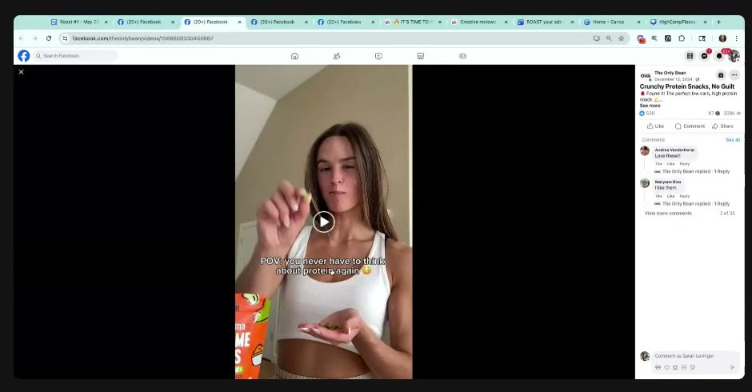
*[0:56:15]*

*"They're loving this salty crunchy snack… but we're still talking about losing something." [0:57:00]*

| Brand / product (niche) | Format | Hook / opening | What works | What fails | Fix suggested | Principle | Source |
|---|---|---|---|---|---|---|---|
| The Only Bean (snacks) | Video, product close-up | "The crunchy way to lose weight" (no clear frame captured) | Clear benefit | Loss frame like everyone in the niche | Reframe as gain/keep | Loss frames are the category default | [0:55:37–0:56:40] |
| The Only Bean | Video, product in bowl | "This protein hack should be illegal 🤫" | Curiosity/"forbidden" hook | Still a "secret to losing" frame (Sarah) | Gain frame | same | [0:55:37–0:56:40] |
| The Only Bean | UGC creator video | "POV: you never have to think about protein again" | Creator + POV, effort removal | Not the winner. "Never have to think about" = removing a problem. | Gain frame | same | [0:55:37–0:56:40] |
| The Only Bean | Static post with viral badge and creator inset | "People with diabetes are loving this salty, crunchy edamame snack. Low in carbs and rich in fiber." | [Social proof](../../../concepts/heuristics/social-proof.md) + audience call-out | "Still talking about losing something" | Gain frame | same | [0:56:40] |

### Mentioned, not shown: Alpha Lion light-switch ad (Sarah's work)
| Brand / product (niche) | Format | Hook / opening | What works | What fails | Fix suggested | Principle | Source |
|---|---|---|---|---|---|---|---|
| Alpha Lion (supplements), an ad Sarah made "like a year ago" | Static (couldn't find it live) | On/off metaphor with a visual | Showed the comparison as a picture | n/a | n/a | Visualise the metaphor | [0:13:39–0:14:42] |

### Session summary teardown table
| Brand / product (niche) | Format | Hook / opening | What works | What fails | Fix suggested | Principle | Source |
|---|---|---|---|---|---|---|---|
| Canvas Gelato POV | Static | "POV: your friends are coming and you order gelato." | Social idea | No friends shown; generic call-outs | Show friends + named ingredients | Image ↔ text match; sight smell | [0:03:09–0:07:22] |
| Canvas Gelato dessert | Static | "Your guests will remember dessert" | Close | Drags the meal in | "It's okay if the meal wasn't great…" | Write to existing behaviour | [0:07:43–0:08:26] |
| Canvas Gelato care | Static | "Gelato made with care, not chemicals" | Sensitive buyer | Abstract | Contrarian open loop (real vanilla) | Half the info on the creative | [0:08:26–0:11:31] |
| VITUS one scoop | Static testimonial | "…feeling OFF to feeling ON" | Metaphor, use case | Long; no visual | Light switch on bottle; ≤7 words; snip quote | Visualise metaphors | [0:12:35–0:16:53] |
| VITUS notice difference | Static comments | "You notice the difference when you don't have it" | Loss line, social proof | n/a | Blur reviews → PDP | Name what they'll miss | [0:16:53–0:18:54] |
| VITUS food list | Comparison static | "All the foods you'd need to eat daily…" | Weighted eye path | Heavy load | Keep, test, remove elements one by one | Visual weight > Z-pattern | [0:18:54–0:23:01] |
| VITUS mandala | Pattern static | "Even a balanced diet has blind spots." | Pattern = balance | "Cover" breaks the metaphor; Shop now | "Uncover"; definitive CTA | Background supports text | [0:23:01–0:29:09] |
| FireClub productive | Static | "Remember when moments like this were productive enough?" | Low/low nostalgia; personality | Hard to read; scattered blocks | "Do you remember when this was productivity?"; stack 1-2-3 | Clarity; grid | [0:30:11–0:36:37] |
| FireClub thrills (stack) | Static | "Remember chasing thrills, not workout plans?" | Cultural contrast | Equal-weight blocks | "…not gains"; event-specific value stack | Value stack, bold top line | [0:34:26–0:39:40] |
| FireClub thrills (bridge) | Static | + "Your heart was made to race…" | Messaging | Two emotions | One headline, one CTA | One core emotion | [0:40:44–0:43:52] |
| High Camp ×3 (Sarah's) | Statics | "Because details matter…", "He put up the tent, but you brought the flask.", "You Already Bring the Good Stuff" | Weighting, 3-line rule, backwards weight, rounded bubbles | n/a | n/a | Design teaches belief | [0:36:37–0:40:44; 0:49:14] |
| The Only Bean winner | Video | "My secret to feed junk food cravings" | Gain frame ("feed") | n/a | More gain-framed tests | Flip loss to gain | [0:54:32–0:58:42] |
| The Only Bean others | Video/static | "The crunchy way to lose weight", "This protein hack should be illegal", "POV: you never have to think about protein again", diabetes static | Curiosity, POV, social proof | All loss-framed | Gain frame | Compare winner vs losers word by word | [0:55:37–0:56:40] |

## Structured units

### Hooks
| Hook (verbatim or near) | Heuristic(s) | Emotion / zone | Self targeted | Why it works | Source |
|---|---|---|---|---|---|
| "POV: your friends are coming and you order gelato." | Social framing, POV | Warmth, Zone 1 (wiki) | Ideal (host) | Right promise; needs friends in the frame | [0:03:09–0:04:13] |
| "It's okay if the meal wasn't great, because you have dessert." (Sarah's rewrite) | Framing on existing behaviour, permission | Relief, Zone 1 | Actual | Matches what people already do (skip to dessert) | [0:07:43–0:08:26] |
| "Most people think ice cream has real vanilla in it…" | Contrarian framing, open loop (curiosity) | Surprise, mild Zone 4 (wiki) | Actual | Half a statement makes the brain hunt for the rest | [0:09:27–0:11:31] |
| "Most people think agencies are doing their best to grow your business, but…" | Contrarian, open loop | Suspicion | Actual | Same structure for services | [0:10:28] |
| "One scoop a day is all it takes to go from feeling OFF to feeling ON" | Metaphor, ease ([goal-gradient](../../../concepts/heuristics/goal-gradient-effect.md)-ish, wiki) | Zone 3 → 1 | Actual | Before/after in one line; needs a light-switch visual | [0:12:35–0:15:00] |
| "Gets me through rough PMS." (snipped quote) | Social proof, specificity | Relief | Actual | Short, situational | [0:15:46–0:16:53] |
| "You notice the difference when you don't have it." | [Loss aversion](../../../concepts/heuristics/loss-aversion.md) | Zone 3 | Actual | Names the loss of stopping | [0:16:53–0:17:54] |
| "Click to see what people are saying about our products" (over blurred reviews) | Curiosity, social proof | Curiosity | not specified | Blurred anything stops the scroll | [0:17:54–0:18:54] |
| "Even a balanced diet has blind spots. Vegan multi is the best way to uncover them." | Metaphor + pattern, fluency | Mild concern, Zone 3 | Ought (wiki) | Metaphor now consistent; mandala reinforces "balance" | [0:23:01–0:26:52] |
| "Do you remember when this was productivity?" | Nostalgia, contrast | Low valence/low intensity, Zone 3 (Gavin's tag) | Actual (Gen Z) | Shortened for clarity | [0:30:11–0:31:14] |
| "Remember chasing thrills, not gains." | Cultural contrast | Zone 3 nostalgia | Ideal (wiki) | Gen Z gym-culture shorthand ("use more culture") | [0:34:26–0:35:31] |
| "Laughter over LinkedIn." / "Shenanigans, not small talk." / "Time to waste time properly again." | Contrast, personality | Playful, Zone 1–2 | Ideal | Personality that matches the brand | [0:33:21–0:34:26] |
| "You'll notice the disconnection when you don't come to these parties anymore." (Sarah's transfer) | Loss aversion | Zone 3 | Actual | VITUS loss line moved to events | [0:16:53–0:17:54] |
| "He put up the tent, but you brought the flask." | Backwards weight, identity | Pride, Zone 2 | Ideal | You still contribute: you bring the fun | [0:39:40] |
| "Because details matter, even outdoors." | Competence framing | Confidence, Zone 1 | Actual | Leads into a 3-feature value stack | [0:36:37–0:38:39] |
| "For wine lovers who know… you already bring the good stuff." | Esteem/identity | Pride, Zone 2 | Ideal | Flatters taste; rounded bubbles | [0:49:14] |
| "It's not you, but there's a way to help other people feel more comfortable, and you can feel more comfortable too." (breastfeeding) | Reframe (externalise blame), empathy | Zone 3 → 1 | Actual | Names the real experience: others feel awkward | [0:43:52–0:44:59] |
| "You were deprived of this experience as a child; here's the experience for you." / "Be free." | Review-keyword-derived message | Zone 3 / Zone 1 | Actual / Ideal | Message matches the motivator customers actually voice | [0:46:04] |
| "My secret to feed junk food cravings 🤫" | Gain [framing](../../../concepts/heuristics/framing-effect.md), curiosity (secret) | Indulgence without guilt, Zone 2 (wiki) | Actual | Lets you keep the craving: nothing to give up | [0:55:37–0:58:42] |
| "Keep your potato chip craving, just switch out the chip." (Sarah's flip) | Gain framing, swap | Zone 1–2 | Actual | Same mechanism made explicit | [0:58:42] |

### Angles
| Angle | Core desire / pain | Heuristic(s) | Best format | Example line | Source |
|---|---|---|---|---|---|
| Sight smell / ingredient-led food | Craving; wanting something unique | Salience, show-don't-tell | Split static: raw ingredients vs finished product | (image) beef-tallow caramel + candied bacon beside the scoop | [0:06:19–0:07:43] |
| Dessert rescues dinner | Host anxiety about a so-so meal | Permission framing | Static / UGC dinner-party POV | "It's okay if the meal wasn't great, because you have dessert." | [0:07:43–0:08:26] |
| Real vs fake ingredients (contrarian) | Distrust of synthetic food | Contrarian framing, open loop | Static headline, payoff in primary text | "Most people think ice cream has real vanilla in it…" | [0:09:27–0:11:31] |
| OFF → ON (supplement) | Feeling off, low energy | Metaphor, visual oddity | Static with a light switch on the bottle | "One scoop: OFF to ON" | [0:12:35–0:15:00] |
| You'll miss it when it's gone | Fear of losing a benefit | Loss aversion | Comment-screenshot static | "You notice the difference when you don't have it." | [0:16:53] |
| Diet blind spots | Doing everything right but still missing something | Metaphor + pattern | Product on a balance-coded pattern | "Even a balanced diet has blind spots…" | [0:23:01–0:26:52] |
| Reclaim the childhood you missed (Gen Z) | Deprived of play; adulthood is stress | Nostalgia, contrast | Candid event photo + ≤7-word headline | "Learn to be a kid again." | [0:38:39; 0:46:04] |
| Fun over fitness / productivity | Even fun has become a job | Cultural contrast | Static or UGC event clip | "Remember chasing thrills, not gains." | [0:34:26–0:35:31] |
| It's not you, it's them (breastfeeding) | Feeling judged in public | Reframe, empathy | UGC testimonial | "It's not you…" | [0:43:52–0:44:59] |
| Feed the craving, swap the snack | Wants junk food, doesn't want the guilt | Gain framing | UGC/close-up video, secret hook | "My secret to feed junk food cravings" | [0:55:37–0:58:42] |
| Premium = calm | High-end buyer wants an elevated experience | Luxury cues, language level | Minimal static, lots of white space | (no line) | [0:51:22–0:53:28] |

### Rewrites (before → after)
| Before | After | What changed (verb / visual / promise / self / intensity) | Source |
|---|---|---|---|
| POV image of three gelato bowls | Same POV line with friends in the frame | Visual now matches the promise | [0:04:13] |
| "real ingredients / made fresh / fun flavors" | Named flavours ("beef-tallow caramel", "candied bacon") + ingredient imagery | Generic → specific and ownable | [0:05:15–0:06:19] |
| "Your guests will remember dessert (Make sure it's better than the meal)" | "It's okay if the meal wasn't great, because you have dessert." | Promise rebuilt on existing behaviour | [0:07:43–0:08:26] |
| "Gelato made with care, not chemicals" | "Most people think ice cream has real vanilla in it…" (payoff in copy) | Abstract → contrarian open loop | [0:09:27–0:10:28] |
| OFF→ON headline with a plain bottle | Same idea + light switch on the bottle, set to ON | Metaphor visualised | [0:13:39–0:15:00] |
| "I've been taking this for years in my morning smoothie and it gets me through rough PMS and other times…" | "Gets me through rough PMS." / "If I have this, I'm set up for the day." | Quote snipped to the core | [0:15:46–0:16:53] |
| "…Vegan multi is the best way to cover them." | "…the best way to uncover them." | Verb fixed to match the blind-spot metaphor | [0:25:34–0:26:52] |
| CTA "Shop now" | "See how it works" / "Let us show you why…" (copy); add-to-cart/buy on LP | Browse CTA → definitive CTA | [0:26:52–0:28:09] |
| "Remember when moments like this were productive enough?" | "Do you remember when this was productivity?" | Shorter, clearer | [0:30:11–0:31:14] |
| "Remember chasing thrills, not workout plans?" | "Remember chasing thrills, not gains." | Shorter; culture word | [0:35:31] |
| Scattered call-out blocks of equal weight | 1-2-3 left-aligned stack on a grid, bold top lines, rounded boxes | Visual hierarchy | [0:34:26; 0:37:38; 0:48:07] |
| Two emotional headlines (thrills + "heart made to race") | One headline + one CTA | One emotion | [0:41:46–0:42:48] |
| "Breastfeeding feels awkward" | "It's not you, but there's a way to help other people feel more comfortable…" | Self → reframed blame; real experience | [0:44:43] |
| "Increase your ROAS" (premium service) | Higher-level terms (bottom line vs top-line revenue) | Language level up | [0:52:26–0:53:28] |
| "The crunchy way to lose weight" / "kick the craving" | "My secret to feed junk food cravings" / "Keep your potato chip craving, just switch out the chip." | Loss → gain frame | [0:55:37–0:58:42] |

### Rules of thumb
- **DO** ask "why buy from *me*?" and go past one level deep (not just "it's delicious"). [0:03:09]
- **DO** check that the image shows what the headline says. [0:04:13]
- **DON'T** rely on the product selling itself. [0:05:01]
- **DO** replace claims competitors could make with specifics only you can claim. [0:05:15]
- **DO** show ingredients for food and drink ("sight smell"). [0:06:53]
- **DO** give products proprietary names (flavours, blends). [0:08:26]
- **DO** write to existing behaviour. [0:08:26]
- **DO** use contrarian lines and put only half the message on the creative. [0:09:27–0:11:31]
- **DO** visualise every metaphor, the odder the better. [0:14:20; 0:33:21]
- **DO** keep headlines to 4–7 words and quotes to one core line. [0:15:00; 0:31:14]
- **DON'T** lean on five-star rows as the persuasion: people are desensitised. [0:16:59]
- **IF** you blur reviews **THEN** send the click to the product page where they're visible. Don't deceive. [0:18:04]
- **DO** make every important element visually heavy; assume light elements get skipped. [0:20:57]
- **DO** test one element's removal at a time to learn what it does. [0:22:01]
- **DO** use repeating-object patterns the audience recognises; the background must support the text. [0:24:01–0:25:34]
- **DO** check metaphors for logic (cover vs uncover). [0:26:02]
- **DON'T** use "Shop Now", "Learn More", "View More"; prefer definitive CTAs. [0:26:58]
- **DON'T** treat add-to-cart as purchase intent. [0:29:00]
- **DO** try all-text statics and "objects that don't belong on a screen" (sticky notes, whiteboards, hand-written, cardboard signs). [0:31:25–0:32:15]
- **DO** stack text 1-2-3 on a grid; ≤3 lines per headline, ≤2 per subhead, ≤3 per call-out with a bold top line. [0:34:35; 0:37:06]
- **DO** weight the part of the sentence that carries the message ("backwards weight"). [0:39:51]
- **DO** communicate one core emotion per ad; one headline, one CTA. [0:41:55]
- **DON'T** promote supporting elements (stars, badges, bullets) to the main message. [0:43:41]
- **DO** find the real experience by listening for customer keywords; run reviews through ChatGPT for hidden motivators. ~80 paragraph-length reviews is enough. [0:46:04–0:47:56]
- **DO** use rounded text boxes and buttons. [0:48:42; 0:50:51]
- **IF** premium buyer **THEN** white space, few elements, elevated language; no "TikTok made me buy it". [0:51:50–0:53:28]
- **DO** match language level to the buyer's education, not to how simple the product is. [0:53:28]
- **IF** you test video **THEN** vary hooks deliberately so the reason a winner wins is visible. [0:54:32]
- **IF** a niche defaults to loss framing (weight loss, cravings) **THEN** test the gain flip ("keep it, swap it"). [0:58:42]

## Prompts, tools, studies and benchmarks mentioned
- **ChatGPT prompts (spoken):** "What's a simple way to say [this]?" (shorten every new line) [0:35:31]. "What are the hidden motivators inside all of our reviews?" (paste reviews; she calls this NLP work) [0:46:04–0:47:07].
- **Canva**: Yana's board "ROAST your ads – Yana Zhurovich"; Sarah's "HighCampFlasks-NLP-Ads-0225". Rounded text backgrounds via the text "background" effect. [0:12:35; 0:49:14] **Google Docs**: "Roast #1 – May 28th" with a tab per member. **Facebook**: The Only Bean ads viewed on its page. **Skool**: "Creative reviews" posts.
- **Studies/claims (all uncited in the session):** sight smell lifts ad likability **13.6%** (posted on her Twitter that day) [0:07:07]; 4–8-word (email) headlines get opened more → she uses **4–7 words** [0:15:35]; attention window **~0.48 s** [0:16:20]; images processed **60,000×** faster than text [0:25:34]; rounded shapes get more conversions ("feels less scary") [0:48:42].
- **Benchmarks:** ~**80** reviews (paragraph-length) for a stable analysis; 50 good ones can work [0:47:39–0:48:07]. Headline ≤3 lines, subhead ≤2 [0:37:06]. ~**12** static layouts get rinsed and repeated [0:50:17]. Roasts happen **once a month** [0:01:04].
- **Brand references:** Ben & Jerry's (Chunky Monkey naming) [0:06:19]; Alpha Lion (Sarah's past light-switch ad) [0:13:58]; Ferrari (premium) [0:52:20]; Facebook's rounded buttons [0:51:06].
- **Community:** Tether 100 Challenge (submissions; winners picked; prizes) [1:00:15]; a "super secret course coming out next week" [1:00:45]; a possible "design for paid advertising" mini-course [0:50:17].

## Notable quotes
- "The product is not going to sell itself." [0:05:01]
- "Show don't tell, especially when it comes to digestible products." [0:07:43]
- "You don't have to give all the information in your creative, and I don't think you should." [0:10:28]
- "Nobody would add a light switch to a bottle… just because it's odd." [0:33:21]
- "Design is everything… it can teach people what to believe." [0:39:51]
- "All we're trying to do is raise dopamine one time." [0:42:54]
- "That headline is everything, because that communicates the core of the value." [0:43:52]
- "No human on the planet wants to stop eating potato chips." [0:58:36]
- "Psychology can fix a whole lot in the ad account with just very little effort… just flip it upside down." [0:58:42]

## How to apply
- [ ] For each competitor static: does the image show the headline's promise? Which element is heaviest? How many emotions does it carry?
- [ ] Replace every generic call-out with a specific, ownable fact; for food, plan an ingredient (sight-smell) shot.
- [ ] Draft 3 contrarian half-headlines ("Most people think… but…") and put the payoff in the primary text.
- [ ] For every metaphor in a script, brief a literal visual (light switch, etc.).
- [ ] Cut headlines to 4–7 words and ≤3 lines; snip testimonials to one line.
- [ ] Stack copy 1-2-3 on a grid with bold top lines and rounded boxes; one headline, one CTA, one emotion.
- [ ] Replace "Shop Now" with a definitive CTA in the copy.
- [ ] Paste ≥50–80 reviews into ChatGPT for hidden motivators; turn the top keywords into angles.
- [ ] In any account, line up the winner's hook against the losers' word by word; if the category is loss-framed, test a gain flip.

## Related
- Brand case files: [Canvas Gelato](../../../brands/canvas-gelato.md) · [VITUS](../../../brands/vitus.md) · [FireClub](../../../brands/fireclub.md) · [The Only Bean](../../../brands/the-only-bean.md) · [High Camp Flasks](../../../brands/high-camp-flasks.md) · [all brands by niche](../../../brands/README.md)
- Tool pages: [Canva](../../../tools/canva.md)
- Concepts: [Valence](../../../concepts/valence.md) · [Intensity](../../../concepts/intensity.md) · [Emotional zones](../../../concepts/emotional-zones.md) · [Three selves](../../../concepts/three-selves.md) · [Actual self](../../../concepts/actual-self.md) · [Ideal self](../../../concepts/ideal-self.md) · [Ought self](../../../concepts/ought-self.md) · [Subconscious vs conscious mind](../../../concepts/subconscious-vs-conscious-mind.md) · [Heuristic stacking](../../../concepts/heuristic-stacking.md) · [Emotional promise](../../../concepts/emotional-promise.md)
- Heuristics: [Framing effect](../../../concepts/heuristics/framing-effect.md) · [Social proof](../../../concepts/heuristics/social-proof.md) · [Processing fluency](../../../concepts/heuristics/processing-fluency.md) · [Salience bias](../../../concepts/heuristics/salience-bias.md) · [Authority bias](../../../concepts/heuristics/authority-bias.md) · [Goal-gradient effect](../../../concepts/heuristics/goal-gradient-effect.md)
- Related pages: [Loss aversion](../../../concepts/heuristics/loss-aversion.md) · [Cognitive load](../../../concepts/heuristics/cognitive-load.md) · [Von Restorff effect](../../../concepts/heuristics/von-restorff-effect.md) · [Open loops](../../../concepts/heuristics/open-loop.md) · [Sight smell](../../../concepts/sight-smell.md) · [Visual weight hierarchy](../../../frameworks/visual-weight-hierarchy.md) · [Review mining for hidden motivators](../../../frameworks/customer-research-stack.md) · [Luxury positioning](../../../concepts/luxury-positioning.md) · [Situational specificity](../../../concepts/heuristics/specificity.md) · [TEEP model](../../../frameworks/teep-journey.md) · [ChatGPT](../../../tools/chatgpt.md)
- Other sessions: [Guest Session 01: Joanna Wallace (May 23)](2025-05-23-guest-session-01-joanna-wallace.md) · [Live With Sarah, June 4](2025-06-04-live-with-sarah.md) (Ahmad's gelato meme ad follow-up) · [Roast My Ads #2](2025-06-25-roast-my-ads-2.md) · [Roast My Ads #3](2025-07-23-roast-my-ads-3.md)
- [Sarah Levinger](../../../people/sarah-levinger.md)

## Sources
- Transcript: [2. Roast my Ads #1.txt](../../../../raw/tether-lab/_transcripts/5.%20Recordings/May%202025/2.%20Roast%20my%20Ads%20%231.txt) · [.srt](../../../../raw/tether-lab/_transcripts/5.%20Recordings/May%202025/2.%20Roast%20my%20Ads%20%231.srt)
- Session page text: [2_Roast_My_Ads_#1_May_28,_2025_Recordings_·_Tether_Lab.md](../../../../raw/tether-lab/_extracted/5.%20Recordings/May%202025/2_Roast_My_Ads_%231_May_28,_2025_Recordings_%C2%B7_Tether_Lab.md) (title + length only). The raw HTML also contains the Skool recordings post that names the four roastees.
- Screenshots: video frames at the cited times, cropped to the shared Chrome/Canva/Docs/Facebook window.
- **Source notes / name fixes:** "Ahmed" (Zoom tile) vs "Ahmad Almarri" (Skool post); brand **Canvas Gelato** from his chat link (instagram.com/canvas.gelato, in the Joanna session). Sarah confused Yana's and Sofia's submissions at [0:11:31]; the board name "ROAST your ads – Yana Zhurovich" confirms VITUS is Yana's. Whisper "gavit/gavin" → Gavin S; brand FireClub from the doc labels. "satya" → Satya Twena; "lee's question" → Lee Kemp (chat tile); "Leslie's question" unresolved (Lee Kemp or Lesley). "alliteration" is how the transcript renders Sarah's term for the on/off comparison; what she describes is a metaphor/analogy. "very von restorf… distinction bias" = the Von Restorff (isolation) effect; "distinction bias" is a different bias. "Crunchy way to lose weight" ad: no clean keyframe captured. Sofia's attendance is unclear; Sarah notes she may "watch the recording".
