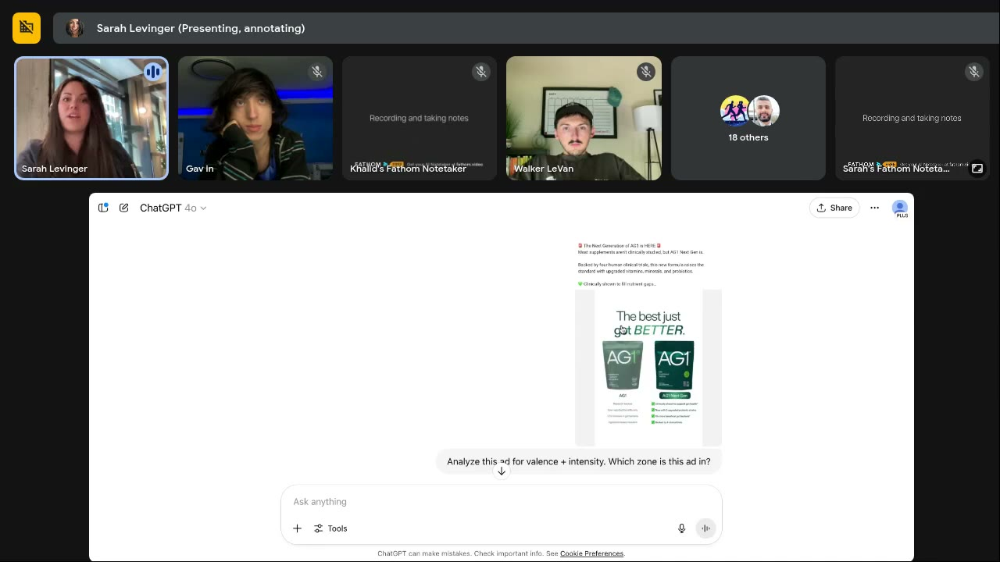
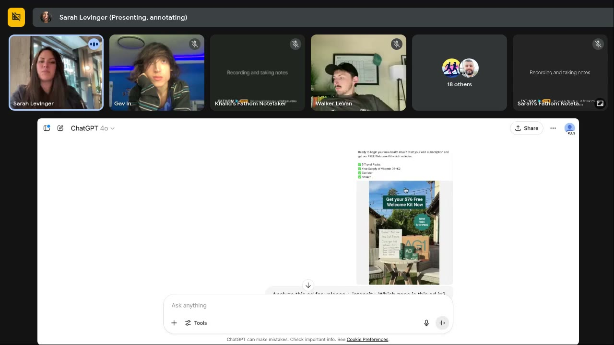

# Live With Sarah! (June 11, 2025)
> Q&A call that opens with Khalid's question "what's the #1 overlooked ingredient that kills a good ad?". Sarah runs three AG1 ads through her valence-intensity GPT, shows they all sit in the same zone (Zone 1: high valence, low intensity), and names the silent killer: **emotional stagnation**, a whole account stuck in one zone. The rest covers testing all four zones at once, high intensity without being spammy, competitor research (copy nothing, go the opposite way), launching a new supplement with statics, how she analyses ads (emotion → intensity → self), the TEEP model for new businesses, and two static design tips (fuchsia pink, break the square).

## 🤖 Agent use
- **Use when:** tearing down a competitor's ad library (tag every ad by zone and self, then look for the zone they *never* use); planning a test batch that covers all four [emotional zones](../../../concepts/emotional-zones.md); writing hooks for supplement/ingestible products; deciding the campaign/ad-set structure for a test; briefing statics.
- **Inputs → outputs:** a competitor's 10–20 ads (statics as images, videos transcribed) → a table of emotion · intensity · zone · self · core message per ad + the dominant zone + an "opposite" positioning (message, color, size, tone) + 4-zone hook set for our product.
- **Rules:**
  - DO tag every competitor ad by zone. If the whole library sits in one zone, that's the gap: write our ads in the zones they ignore. [0:07:22–0:09:27]
  - DO test all four zones at the same time and keep testing the losing zones after a winner appears. Zones stop working when seasons, life, customers or the market change. [0:18:05–0:19:08]
  - DO go negative by calling out a true **industry** belief and praising the viewer for noticing ("you're smart for noticing"). DON'T trigger a negative sense of *self*. [0:20:12–0:21:13]
  - DON'T copy competitors. Find their core message, color and tone, then go the opposite way (they go big → you go small; green → red; loud → soft). [0:42:22–0:44:31]
  - DO, for anything ingestible, answer: what's in it, how many others have tried it, how it differs from what I've tried. Call out the unpleasant truth (greens taste bad) and how you handle it. [0:24:32–0:26:35]
  - DON'T treat "running for 195 days" in an ad library as proof the ad wins. Big brands leave ads on. [0:24:32]
  - DO keep the core message constant and vary the **format** (static, GIF, carousel, video): e.g. 5 messages × 4 formats = 20 ads. One-variable static tests (same image, new headline) are too slow for today's algorithm. [0:51:49–0:52:52]
  - DO try a fuchsia/"flower pink" static and break the 1080×1080 square (bite out of a corner, object running off the edge). [0:54:59–0:56:04]
  - DO structure campaigns around **one learning goal at a time** (emotion, generation, TEEP stage), not every model mashed together. [0:48:40–0:50:47]
- **See also:** [Valence-intensity diagnostic](../../../frameworks/valence-intensity-diagnostic.md) · [Tone-shifting](../../../frameworks/tone-shifting.md) · [Three-selves diagnostic](../../../frameworks/three-selves-diagnostic.md) · [Valence-intensity prompts](../../../resources/valence-intensity-prompts.md) · [Angle rut](../../../concepts/angle-rut.md) · [TEEP model](../../../frameworks/teep-journey.md) (expected page) · [June 4 session](2025-06-04-live-with-sarah.md) · [June 18 session](2025-06-18-live-with-sarah.md)

Skool page text: title and video length only (no description or links).

## TL;DR
- **The #1 ad killer isn't a missing heuristic, it's emotional stagnation.** "If you forget to add social proof it's not going to make or break your ad… what will tank the account… is getting stagnant with your emotions." [0:08:23]
- **AG1 proof:** three very different AG1 ads (self before/after, UGC welcome-kit offer, vs-competitors chart) all score **high valence / low intensity (Zone 1)**. Sarah analysed 15–20 of their ads (videos transcribed): "every single one is like the same exact zone." "The larger you get as a brand the more you get stuck in one specific emotional zone." [0:03:10–0:08:23]
- **Zones belong to people, not brands.** A Zone 1-only brand only recruits people who are "real happy but not very intense about their happiness" and misses e.g. the person who has "tried every supplement on the planet and all of them upset my stomach" (Zone 3). Run all zones at the same time. [0:17:00–0:19:08]
- **Competitor research = analyse, then do the opposite.** Feed their ads to ChatGPT for emotion, intensity, self and core message. Then go the other direction ([attentional bias](../../../concepts/heuristics/von-restorff-effect.md), "differentiation effect"). AG1 says "activate your health" (vague, big) → say "boost your mitochondria" (medical, small). [0:40:14–0:44:31]
- **How Sarah reads performance:** emotion first, then intensity, then self, all via ChatGPT, logged in a spreadsheet with CPA/CTR/CVR and heat maps. Patterns she has seen: the word "confidence" reliably activates the [ought self](../../../concepts/ought-self.md); putting a price on an ad makes the [ideal self](../../../concepts/ideal-self.md) "crush". [0:36:06–0:39:12]
- **Static tips:** fuchsia pink "runs well for any brand in any industry I have ever worked for on Meta"; "break the walls of the square". Faraz's account: static CPMs ~$30–40 vs video ~$160. [0:52:52–0:56:04]

## Session map
| Time | Segment |
|---|---|
| [0:00:01] | Intro. Sarah is in a hotel in Germany (husband's family). Weekly Wednesday Q&A format. |
| [0:01:05] | Khalid's question from the Skool question bar: "What's the number one overlooked ingredient in a great ad?" |
| [0:03:10] | Screen share: AG1 ads analysed in ChatGPT (her custom valence-intensity GPT). Ad 1: AG1 vs AG1 Next Gen. |
| [0:05:19] | Valence/intensity refresher. Ad 2: UGC-style $76 Welcome Kit. |
| [0:07:22] | Ad 3: "AG1 is #1 for a Reason" vs other supplements. All three Zone 1. Big brands get stuck in one zone. |
| [0:08:23] | Answer: emotional stagnation. Dopamine = motivation, not reward. |
| [0:10:29] | Lee Kemp: 3-2-2 method on print-on-demand T-shirts, erratic spend. |
| [0:17:00] | Gavin: is there one correct zone for a brand? |
| [0:19:08] | Bren Harper: won't high intensity get spammy (AG1, Bobbie formula)? |
| [0:21:13] | Gavin: how to structure zones in campaigns / ad sets. |
| [0:22:19] | Yana: AG1 looks like it's doing well; will single-zone hurt them later? |
| [0:26:35] | Faraz Khan: launching an anti-gray supplement; how to split 10–15 headlines by valence-intensity. |
| [0:32:53] | Faraz follow-up: copy competitor video scripts? TikTok format reverse-engineering; "66 videos, then the 67th hit 5M views". |
| [0:36:06] | Walker LeVan: analyse emotion/intensity or self first? Then: plan it upfront or retroactively? |
| [0:40:14] | Chat: what to learn from competitor ads. Do the opposite. |
| [0:44:31] | Leonardo: praise for the Zone 4 podcast episode with Nate. Chat: where's the script template? |
| [0:45:32] | Chat: new business, which ads first? The TEEP model. |
| [0:47:37] | Chat: rewriting winners from Zone 1 to Zones 2–4; request for Sarah's podcast list. |
| [0:48:40] | Gavin: test every combination of TEEP × valence-intensity × identities? |
| [0:50:47] | Faraz: for headline tests, keep everything else in the static identical? |
| [0:52:52] | Faraz: video wins in his account and in competitors' libraries. |
| [0:54:59] | Static pro tips: fuchsia pink; break the square. |
| [0:56:04] | Request for a text dump of Sarah's Twitter tips. Wrap: July crash course + two-day intensive. |

## Key ideas

### 1. The silent killer: emotional stagnation [0:03:10–0:10:29]
- Question (Khalid, posted in Skool): "what's the number one overlooked ingredient in a great ad… what's the most common thing that you see that just kills a good ad?" Context: building Meta ads with emotional motivators, heuristics, tone, valence and intensity. [0:02:09]
- Sarah answers by showing three AG1 ad analyses from "my particular GPT [that] is actually trained on this valence and intensity model". [0:04:14] (See teardowns below.)
- Finding: "As we go through all of these there's something interesting that happens in big accounts. I've noticed **the larger you get as a brand the more you get stuck in one specific emotional zone and you never branch out**." She analysed "a good 15 to 20 of their ads, including some of the videos" (transcribed into ChatGPT): "every single one is like the same exact zone." [0:07:22–0:08:23]
- Verdict: "There's no one psychology thing that's going to make or break it… What will tank the account, and what will stunt the growth overall, is **getting stagnant with your emotions**. If you stay in Zone 1 and the whole brand is in Zone 1… you're never going to push motivation into your customers because you're just stuck emotionally." [0:08:23]
- **Dopamine is motivation, not reward:** "Dopamine is not a reward transmitter. It has nothing to do with gaining something. It's just the motivational one." Scrolling works because "the brain goes, there might be something else behind the next one". Ads must create the spike *and* real motivation: "grab them, capture them and bring them in." [0:08:23–0:09:27]
- Rule: "Don't pick one zone and stay with it. Test all four. Test them as often as you can." [0:09:27]
- Relation to existing pages: this is the account-level version of the [angle rut](../../../concepts/angle-rut.md) (same angle forever) applied to [emotional zones](../../../concepts/emotional-zones.md). *(Wiki link, not Sarah's wording.)*

### 2. Zones are attributes of people, so run all four at once [0:17:00–0:22:19]
- "The zones aren't technically attributed to the brand, they're attributed to the person… I don't think any brand should stay in one zone." AG1 "is currently trying to draw in one specific type of person: only people who are real happy but not very intense about their happiness." [0:17:00–0:18:05]
- Missing customer: "I have tried every supplement on the planet and all of them upset my stomach, I'm so sick of trying supplements". "That's a lower valence, that's a negative feeling, and that is actually how you grow brands: you've got to **open up the emotional set** that you're working with, because some people feel negative a lot and some people don't feel negative almost ever." [0:18:05]
- Gavin: "So I'd use it for targeting more than anything, and qualification." Sarah: run them "all at the same time… you're going to find one that's like, zone three is just cranking for us, but I never ever ever want to stop testing other zones, because as soon as that one stops working, which usually happens as soon as the seasons change or as soon as life changes, as soon as the customer base changes, the market changes… then you're scrambling." [0:18:05–0:19:08]

### 3. High intensity without being spammy: target beliefs, not the self [0:19:08–0:21:13]
- Bren Harper: AG1-style ads "can get so spammy so quickly. You can get really high click-through rate but over time it's going to dilute the brand… Bobbie formula would be another one. How inflammatory can you get?" [0:19:08]
- Sarah: "We're not trying to just trigger people all the time… You want to get to the point where you have a good sense of what causes people to shift." That means finding the **belief** you're triggering. [0:19:08–0:20:12]
- Example: if the belief is "all [greens powders] have chemicals in them", shift to negative zones and "call out the fact that a lot of [them] do actually have some sort of negative stuff in them, **and you are a smart shopper for identifying that**." [0:20:12] *(Whisper says "athletic greens" for the category; she means greens powders in general.)*
- "I'm calling out something negative, but… I don't want to trigger a negative sense of self. All I'm trying to do is trigger 'you're smart for noticing this about this industry' and then walk through and help them be motivated." [0:20:12–0:21:13]
- Summary rule: "test all four zones… don't trigger the person's internal negativeness about themselves, possibly call out [things] about the industry that they already believe are true, and then go from there." [0:21:13]
- Sarah references an example "we did with [a brand, transcribed 'original rain']" and her own GPT ("different from straight [Chat]GPT… specific [to] how I write"). *(Brand name unclear in the audio.)* [0:19:08]

### 4. Campaign structure = the one thing you want to learn this month [0:21:13–0:23:27; 0:48:40–0:50:47]
- "I build my campaign based upon what I want to test." Learning generational response → campaigns by generation (boomers / Gen X / millennials). Learning emotions → **campaign = emotion, ad sets = zones**. [0:21:13]
- "I don't set campaigns up very statically. I try and figure out what do we need to learn this month and set them up at the top level by that." Gavin: one emotion per campaign, four ad sets, each ad set one zone. Sarah: "exactly". [0:22:19]
- Reading results: e.g. four Zone 1 ads, one okay; two Zone 2 ads "just crushed" → shift to Zone 2 for purchases and keep testing Zone 1. [0:22:19–0:23:27]
- Gavin (later): test every combination of TEEP × valence-intensity × identities? → "Every time you run ads you're running a mini study. You guys are scientists." Decide your hypothesis: Gen Z data → structure by demographic; customer-cycle data → TEEP; best emotions now → valence-intensity. "I usually use them one at a time because I'm trying very carefully not to blend all this data together… you've got so many things running in here there's no freaking way you can tell what's going on." [0:48:40–0:49:43]
- If you don't know your customer yet, start with customer work; "we're still in paid advertising, you still gotta get sales, so start there and then branch out." [0:50:47]

### 5. Supplements and anything ingestible [0:24:32–0:26:35]
- "Supplements are ingestible, so humans are very careful about not poisoning themselves." Help people understand **what's in it**, **that many others are trying it**, and **how it's different** from what they tried before. [0:24:32–0:25:35]
- Call out the industry ("there used to be a lot of crappy stuff in there, but we've gone to great lengths to make sure there's nothing in ours that's going to hurt you or upset your stomach") or, better, the **situational experience**: greens "taste nasty… so if you have a brand where it's like, we've put a lot of work into making sure that green taste doesn't stay with you. Yeah, it's probably not going to taste super great, but it's going to dissipate quicker than everybody else." [0:25:35]
- "Just call out what's actually true, because people are so tired of being sold… it literally just means they're tired of not hearing the truth." Then: "this is a real thing, but you're smart and you're going to make a different choice. You're going to choose us because of XYZ." [0:25:35–0:26:35]

### 6. Launching a new product with statics; research from reviews [0:26:35–0:36:06]
- Faraz is launching a product sold in-store but never advertised on Facebook, using "the CTC method where you dump everything into one, like up to 50 ads in one campaign". He can make 30–40 statics and ~10 videos himself because he is the target customer. *("CTC" as said. Likely Common Thread Collective's consolidated-campaign approach. Wiki interpretation.)* [0:26:35–0:27:40]
- **Mine context from reviews:** pull reviews, post-purchase surveys, quizzes into ChatGPT and "ask chat to read between the lines". By default ChatGPT reads word for word ("she said she liked the color blue") and misses context ("because my mother likes the color blue"). Customer interviews are even better. [0:27:40–0:28:44]
- **Founder bias:** being the target customer "might actually make your job a little harder because you're going to assume, bias-wise, I know what to say". Double-check yourself with the reviews first. [0:28:44–0:29:47]
- **Find the belief:** anti-gray supplement, buyers 30–50 (works better early in graying). "People don't take action until they're actually seeing grays." Core belief: "I don't have control over this, but I might be able to slow it down… that rock is going to roll down that hill no matter what… but I could slow it down if I put enough roadblocks in the way." The behavior is **optimistic** (high valence) even though the trigger is negative: "a negative trigger but a positive behavior." Use both. [0:29:47–0:31:50]
- Statics: "everybody should be testing statics… dirt cheap to run and dirt cheap to make." Batch of **10 statics** at one belief. For Faraz: start with the **high-valence zones**, then test negative ones if those don't work. [0:31:50–0:32:53]
- **Video scripts:** don't copy competitors' scripts first. Take the core message that won in statics and have ChatGPT write a script around it (humorous, serious, long story, founder…). Once you know which message hits, reuse a proven format: "we had a script a while ago… UGC of some guy in his bathroom… let's take the core concept that worked in the static and just duplicate the format." [0:32:53–0:33:57]
- **TikTok format reverse-engineering (organic):** dissect viral posts' "format structure": the hook, the scene, lighting, clothes, the kind of cat. Some formats are "naturally good story-type" formats you can default to. [0:33:57–0:35:00]
- Faraz's story: 66 TikTok videos flopped (~200 views each, transcribed "200 reviews"); for the 67th he copied a viral creator's whole script "my way": **5 million views**. Sarah plans to try it. [0:35:00–0:36:06]

### 7. How Sarah analyses ad performance (emotion → intensity → self) [0:36:06–0:40:14]
- Order: "Which emotion hit first and how intense that emotion was, and then… which self were we activating." She never does it alone ("I've been doing this for like 10 years now and I can't always identify it"); she asks ChatGPT. [0:37:08–0:38:09]
- Patterns that show up once you log enough ads: "**ought self gets activated every single time we run an ad with the word 'confidence' in it**… ought self in particular is real sensitive"; "**ideal self really responds well if we put prices in it**… if we put a price on there ideal self just crushes." *(Account-specific observations, not universal laws.)* [0:38:09]
- Tracking sheet: column 1 ad, then self, emotion, intensity; plus CPA, CTR, conversion rate over time. With Google Sheets heat maps "you can tell pretty quickly that this specific self is really cheap to get in the door, so I'm going to chunk some cash over there." [0:38:09–0:39:12]
- Upfront vs retro: valence-intensity and self are part of her **pre-launch** planning. "If you can get those two knocked out of the way before you actually run the ad, then you don't have to do the analysis after, because the ad is labeled." She spent 2–3 years on emotions alone; adding intensity and self gives "a pretty strong trifecta… emotional work and mental work at the same time." [0:39:12–0:40:14]
- Fireflies notetaker summary on screen (chat): "…performance by tracking the actual self, ideal self, emotion, and intensity for each ad." [~0:53:15]

### 8. Competitor research: analyse, then go the opposite way [0:40:14–0:44:31]
- Remind yourself the competitor is its own entity; "we have no idea how much they're spending or how much they're making… no brand wants to exude failing." [0:41:18]
- Process: collect as many of their ads as possible, transcribe videos, put statics in ChatGPT: "tell me which emotions are in here, how intense they are, which selves they're currently targeting, and… what the core message is". ChatGPT finds "here's what they're saying consistently over and over". [0:41:18–0:42:22]
- If AG1's core word is "activate" → "I don't want to do anything that they're doing… It is a hundred percent important that you don't copy your competitors. In fact, if **Liquid Death** is any indicator… we actually go crazy wild the opposite direction." [0:42:22]
- Why: "**attentional bias**… we can only kind of concentrate on anything that's like our world view and we can't always pull our attention away from things that are just drastically different"; and the "**differentiation effect**": "if there's something in the space that's just a completely different color or shape or size, we immediately get drawn to it." *(Wiki note: the latter is usually called the Von Restorff / isolation effect.)* [0:42:22–0:43:27]
- Examples: industry all "pinks and pastels and grays" → be black and green. Industry says "activate your health" → "medicalize… **boost your mitochondria** because they're the powerhouse of the body"; go small and specific where they're vague. "If they go big you go small, if they're green you go red, if they're stupid wild and loud you go very soft and subtle." [0:43:27–0:44:31]

### 9. TEEP for a brand-new business [0:45:32–0:47:37]
- "When starting a campaign for a new business, which ads should we run?" → the **TEEP model**: "I can't take credit… taken off of a giant Google study they did on consumer journeys." Four zones people "morph in and out of": [0:45:32]
  1. **Trigger event**: where marketers usually stay and where angles come from ("a mom who wants to lose 30 pounds", "a family that just bought a house", "a marketer struggling with ads").
  2. **Exploration**: "helping people understand what's in the industry… introducing yourself… here's the reason why we're better than everybody else" (Liquid Death: "everybody else is a plastic water bottle… we actually have skulls and crossbones").
  3. **Evaluation**: *(named, not described in this call; see [June 4](2025-06-04-live-with-sarah.md))*.
  4. **Purchase**: "almost always offer-focused: the discount, here's a bundle, we're running a sale."
- Budget rule: run all four if you can. If not, "stay closer to the purchase than… the trigger side": exploration, evaluation and purchase ads. Triggers are endless and very specific ("I'm getting to the point where it's uncomfortable to wear a seat belt"): "you could never ever run enough ads to hit them all… triggers are great for big budgets." [0:46:34–0:47:37]
- She offers a list of ad types per stage ("use a before and after here or use a testimonial"). *(Chat on screen ~0:53:15: "a list of usable before and after ads and testimonials".)* [0:45:32–0:46:34]
- *(Outside context: the Google study is most likely "Decoding Decisions: Making Sense of the Messy Middle" (Google / The Behavioural Architects, 2020), which describes triggers, exploration, evaluation and purchase. Sarah does not name it.)*

### 10. Formats, video vs statics, and static design tips [0:50:47–0:56:04]
- One-variable static tests ("five different images each with one different headline", 2015 style) no longer work well: "the algorithm is like, all of these ads are the same… I don't know who to send this to." Instead: keep the core message, diversify formats (GIF, carousel, static, video). "**One message with four formats, then test five messages: 5 × 4 = 20 ads.**" [0:51:49–0:52:52]
- Faraz: video wins in his account even at high cost, and ~95% of competitors' library ads are video. Sarah: "the algorithm is just a wall… a veil between us and the consumers, and their behavior is telling that wall how high or low it should go". Video-heavy accounts usually mean "the marketers don't quite know how to communicate in a static." When video production or performance stalls, "it's time to upgrade your skills" (statics, GIFs). Faraz: static CPMs "like 30 or 40 bucks versus videos like 160". [0:52:52–0:54:59]
- **Pro tip 1, fuchsia:** "Pink… a fuchsia color, so don't think baby pink, think flower pink. That runs well for any brand in any industry I have ever worked for on Meta. I don't know why." [0:54:59]
- **Pro tip 2, break the square:** "We're 1080 by 1080… I usually take all of my images and break those walls out." Take "a bite out of the corner of the ad", shove the image to one side, let half an object sit off the frame "so it looks like the rest of that object should be outside of the square… you're just telling the brain, stop on this, because this looks weird." "Statics are just all about breaking the grid." She also mentions choosing patterns that work for your customer type, and that **Yana** is "amazing at this". [0:54:59–0:56:04]

## Q&A
1. **Khalid Alameri (posted in Skool): What's the #1 overlooked ingredient in a great ad, the thing that most often kills a good ad?** [0:01:05–0:10:29] → Emotional stagnation: big accounts get stuck in one zone (AG1 example, all Zone 1). No single heuristic makes or breaks an ad. Test all four zones as often as you can. Dopamine drives motivation, not reward. (Key idea 1.)
2. **Lee Kemp: Feedback on his campaign (10–12 days) using the 3-2-2 method: three ad sets, each targeting particular zones/"quadrants" and heuristics (variations written with ChatGPT). Spend is erratic. Print-on-demand T-shirts; each ad set = one design, ~12 variations rotating primary text and headline; a cost-per-result target; AOV close to $100 (orders of 3–6 shirts); raising the CPR target for a day pushed spend from ~$7–25 to ~$120. Is it the creative?** [0:10:29–0:17:00] → Hard to say without the account; Sarah will review it (DM, call or a Roast My Ads). The 3-2-2 gives Facebook "a lot more range of freedom", but "it's going to be whatever's on the shirt that's driving the majority of the results". If a shirt spends but customers are too expensive, change its **framing** (what's behind it) or the message on it. **Home goods and fashion** are "the only two industries I've ever seen where the functionality almost comes before the emotional side… people are attracted to the image, but they don't put a whole lot of themselves into the shirt until they get it home." Pinterest users pin near-identical shirts that differ only by pants, background or model. Advice: "pulse your 3-2-2 with **different backgrounds**, because it shows people different use cases for the shirt", which also shows which backgrounds stabilize spend. Lee already has one background per ad set (four ad sets). Sarah suspects background changes could reveal a lot but won't prescribe until she sees the account.
3. **Gavin: So there isn't one correct zone for a brand?** [0:17:00–0:19:08] → Right. Zones belong to the person, not the brand. AG1 only recruits mildly happy people. Run all zones at the same time and never stop testing the others. (Key idea 2.)
4. **Bren Harper: With high intensity, won't it get spammy? AG1 and Bobbie formula can get high CTR but dilute the brand. How inflammatory can you get?** [0:19:08–0:21:13] → Don't trigger people constantly. Find the belief that makes people shift. Call out what's negative about the *industry* and praise the viewer for noticing it. Never attack their sense of self. (Key idea 3.)
5. **Gavin: Run the zones in one ad set, or duplicate the ad set four times?** [0:21:13–0:23:27] → Depends on what you want to learn. For emotions: campaign = emotion, ad sets = zones. For generations: campaigns by generation. Shift budget toward the zone that wins and keep testing the others. (Key idea 4.)
6. **Yana Zhurovich: She runs ads in the same space and has AG1 ads screenshotted. They also look single-zone, but the messaging is smart and they seem to be growing. Will single-zone hurt them later?** [0:22:19–0:26:35] → "You can never tell who's doing well and who's just saying 'oh, that's right'." Ad-library longevity ("running for 195 days" in Atria / "Four Point", likely Foreplay) isn't proof of a winner: big brands can afford to leave ads on or test with volume. For supplements: explain what's in it, social proof, difference; call out industry truths and the situational experience (taste). Then move into other zones with proofs your customers are sensitive to. (Key idea 5.)
7. **Faraz Khan: Launching a never-advertised product with the CTC method (up to 50 ads in one campaign); can make 30–40 statics and ~10 videos as the target customer. How to come up with 10–15 headlines and split them by valence-intensity to learn fast which angles hit?** [0:26:35–0:32:53] → Run reviews/surveys/quizzes through ChatGPT and ask it to read between the lines. Beware your own bias. Find the deep belief (anti-gray: "I can slow it down" = negative trigger, positive behavior). Ask ChatGPT what to say to that person. Batch 10 statics, start with high-valence zones, then negative. (Key idea 6.)
8. **Faraz follow-up: Competitors have long-running video ads. Copy their scripts first, or build from my own learnings and Sarah's story frameworks?** [0:32:53–0:36:06] → Take the core message that won in statics and have ChatGPT build a script. Test slowly with new concepts. Once you know which message hits, duplicate a proven format. On TikTok, reverse-engineer viral posts' format structure. Faraz: 66 flops, then a copied script → 5M views.
9. **Walker LeVan (chat): When analysing ad performance, start with emotional intensity or self-targeting?** [0:36:06–0:39:12] → Emotion, then intensity, then self, via ChatGPT. Log in a spreadsheet with performance metrics and heat maps. (Key idea 7.)
10. **Walker follow-up: Is intensity/self part of planning, or retroactive?** [0:39:12–0:40:14] → Both, but ideally planned before launch so the ad is pre-labeled. Coming in the July crash course (Sarah and Walker previously did a full training on market research and industry health).
11. **Chat: What should we learn from competitors' working ads? Run the valence-intensity test or 3-selves diagnostic on them?** [0:40:14–0:44:31] → Yes, analyse emotion, intensity, self and core message with ChatGPT, then go the opposite direction. (Key idea 8.)
12. **Leonardo Larocca (chat): "Lovely episode with Nate in which you talk about Zone 4."** [0:44:31] → Not a question. Sarah did a Zone 4 example "with [a brand] and Nate on my podcast" and will post it in Skool.
13. **Chat: Where's the script template shared on the very first call?** [0:44:31–0:45:32] → Probably in the Classroom. Prompts are attached to the class they belong to; videos are on YouTube and in Skool. Ping Sarah if missing.
14. **Chat: Starting a campaign for a new business: what approach and what ad types?** [0:45:32–0:47:37] → TEEP. Small budgets: exploration, evaluation and purchase ads before trigger ads. (Key idea 9.)
15. **Chat: "Currently rewriting some of my winner headlines from Zone 1 to Zone 2, 3, 4."** [0:47:37] → Sarah loves it (comment).
16. **Chat: Would love a list of podcast episodes to listen to.** [0:47:37–0:48:40] → She'll share it. She listens to few marketing podcasts on purpose ("trying to educate myself outside of it"): lots of behavioral science, "a ton of **Rory Sutherland**", many audiobooks.
17. **Gavin: With TEEP, valence-intensity and identities, do you test every combination in Ads Manager?** [0:48:40–0:50:47] → No. Ads are mini studies; pick a hypothesis and one model per campaign; start with customer work if you don't know your customers. (Key idea 4.)
18. **Faraz: When testing headlines/messaging for the new product, keep everything else in the static (background, colors) the same and only change the message?** [0:50:47–0:52:52] → No. That 2015-era structure is too slow now. Keep the message, vary formats: 5 messages × 4 formats ≈ 20 ads. (Key idea 10.) He also asked for a recorded "here's how Sarah does this" training.
19. **Faraz: Meta asks for creative diversity, but video wins in his account and ~95% of competitors' ads are video. Why?** [0:52:52–0:54:59] → Video-heavy usually means marketers can't communicate in a static. Fine if video is your strength, but when video stalls, build static/GIF skills. He wants to: it differentiates from all-video competitors, and static CPMs ~$30–40 vs ~$160 for video. → Then the fuchsia and break-the-square tips. (Key idea 10.)
20. **Attendee: Please dump all the Twitter tips as a running text thread in the course (not a PDF).** [0:56:04–0:57:05] → Sarah will compile "a giant cute cheat sheet of all the stuff that you should test based on science".
21. **Attendee: Could the crash course be bigger than "the smallest format"?** [0:57:05–0:58:07] → She'll do both: a short July crash course and a **two-day intensive** (three hours Thursday + three hours Friday, with one-to-one feedback).

## Ad teardowns
*Shown as Sarah's ChatGPT conversation with the prompt **"Analyze this ad for valence + intensity. Which zone is this ad in?"** (verbatim on screen). Zone numbers per the course map: Zone 1 = high valence / low intensity. "Self" tags are wiki tags; Sarah did not classify selves for these ads.*

### AG1 #1: "The best just got BETTER." (AG1 vs AG1 Next Gen)

*AG1's self-comparison ad. Primary text: "The Next Generation of AG1 is HERE. Most supplements aren't clinically studied, but AG1 Next Gen is. Backed by four human clinical trials, this new formula raises the standard with upgraded vitamins, minerals, and probiotics. Clinically shown to fill nutrient gaps…" [0:04:30]*

*The GPT's read: **Valence High, Intensity Low**, "relies on logical reassurance and emotional ease — perfect for a preventative product." Final zone: High Valence / Low Intensity. [0:04:55]*

| Brand / product (niche) | Format | Hook / opening | What works | What fails | Fix suggested | Principle | Source |
|---|---|---|---|---|---|---|---|
| AG1 Next Gen (greens powder / supplement) | Static, side-by-side self before/after + checklist | "The best just got BETTER." | Unusual move: a before/after against **their own old product** instead of a competitor ("we used to be this, now we've upgraded to this"). [Authority](../../../concepts/heuristics/authority-bias.md) ("four human clinical trials"), clean [fluency](../../../concepts/heuristics/processing-fluency.md). | Zone 1 (calm, reassuring), like every other AG1 ad: no urgency, threat or tension. | Account-level: add Zone 2–4 ads. Call out true industry beliefs ("most greens have junk in them, you're smart for noticing"). | Emotional stagnation; zones belong to people | [0:03:10–0:05:19] |

### AG1 #2: "Get your $76 Free Welcome Kit Now" (UGC-style offer)

*UGC-style bundle/offer ad. Primary text: "Ready to begin your new health ritual? Start your AG1 subscription and get our FREE Welcome Kit which includes: 5 Travel Packs, Year Supply of Vitamin D3+K2, Canister, Shaker…" [0:06:40]*

*Same zone again. Sarah highlighted "no urgency, fear, or adrenaline-driving language". Note the GPT spotted a gentle "Bloated?" problem line. [0:07:05]*

| Brand / product (niche) | Format | Hook / opening | What works | What fails | Fix suggested | Principle | Source |
|---|---|---|---|---|---|---|---|
| AG1 (greens powder / supplement) | UGC-style static, offer / bundle | "Get your $76 Free Welcome Kit Now" / "Ready to begin your new health ritual?" | Different format and angle from #1: full bundle, gifts framing (free canister, shaker), free shipping, sunny lifestyle scene. Self (wiki tag): [actual](../../../concepts/actual-self.md) / habit ("new health ritual"). | "Between the two of them, we basically have the same exact emotion being triggered": high valence, low intensity. Even the pain point ("Bloated?") is whispered. | Same: diversify zones. A real Zone 3 version would dramatize the bloating/stomach-upset experience (wiki example). | A new format ≠ a new emotion | [0:05:19–0:07:22] |

### AG1 #3: "AG1 is #1 for a Reason" (vs other supplements)

*Competitor-comparison before/after. Primary text: "Introducing AG1 Next Gen — a once-a-day scoop backed by four clinical trials and optimized to support gut health, energy, and daily nutrient needs." [0:07:36]*

*Third ad, third Zone 1 verdict: "persuasive without pressure". [0:07:56]*

| Brand / product (niche) | Format | Hook / opening | What works | What fails | Fix suggested | Principle | Source |
|---|---|---|---|---|---|---|---|
| AG1 Next Gen (greens powder / supplement) | Static, us-vs-them comparison chart | "AG1 is #1 for a Reason" | Before/after vs competitors ("pills, other options"). Lists the objections people have about supplements (backing, absorption, pill count, hidden ingredients). [Social proof](../../../concepts/heuristics/social-proof.md)/leader framing ("#1"). | Calm, factual comparison, still Zone 1. Sarah found 15–20 AG1 ads (incl. videos) in the same zone: "this is so scary". | Use the chart's own objections as **Zone 3/4 hooks**: "I've tried every supplement and they all upset my stomach." Industry call-out + "you're smart for noticing". | Big brands get stuck in one zone | [0:07:22–0:09:27] |

### Session summary teardown table
| Brand / product (niche) | Format | Hook / opening | What works | What fails | Fix suggested | Principle | Source |
|---|---|---|---|---|---|---|---|
| AG1 Next Gen | Static, self before/after | "The best just got BETTER." | Self-comparison; clinical proof | Zone 1 | Add Zones 2–4; industry call-outs | Emotional stagnation | [0:04:14] |
| AG1 | UGC-style offer static | "Get your $76 Free Welcome Kit Now" | Gift framing, lifestyle scene | Zone 1; pain point whispered | Dramatize the pain in a Zone 3 version | New format ≠ new emotion | [0:06:21] |
| AG1 Next Gen | Comparison chart | "AG1 is #1 for a Reason" | Objection list vs pills | Zone 1 | Turn objections into negative-zone hooks | Zones belong to people | [0:07:22] |
| Lee's print-on-demand T-shirts (not shown) | 3-2-2 statics | Shirt design + rotating text | AOV ~$100 | Erratic spend; shirt design drives results | Pulse the 3-2-2 with different backgrounds (use cases) | Fashion/home: function before emotion | [0:10:29–0:17:00] |

## Structured units

### Hooks
*Heuristic, zone and self tags are wiki tags unless the citation says Sarah stated them.*

| Hook (verbatim or near) | Heuristic(s) | Emotion / zone | Self targeted | Why it works | Source |
|---|---|---|---|---|---|
| "I've tried every supplement on the planet and all of them upset my stomach. I'm so sick of trying supplements." | Situational call-out | Frustration, fatigue: Zone 3 (Sarah: "lower valence, negative feeling") | Actual | Recruits the customer a Zone 1-only brand never reaches | [0:18:05] |
| "A lot of [greens] have nasty stuff in them, and you're a smart shopper for noticing." | Industry belief call-out + flattery | Zone 3/4 about the industry, positive about the self | Actual → Ideal ("smart shopper") | Goes negative without attacking the viewer's self | [0:20:12] |
| "Yeah, it's probably not going to taste super great, but it dissipates quicker than everybody else." | Honesty / pratfall-style admission (wiki tag) | Relief, Zone 1→3 | Actual | "People are so tired of not hearing the truth" | [0:25:35] |
| "Boost your mitochondria" (vs the category's "activate your health") | Differentiation (Sarah's "differentiation effect"), [authority](../../../concepts/heuristics/authority-bias.md) via medical specificity | Curiosity, Zone 2 | Ideal | Go small and medical where competitors are big and vague | [0:43:27] |
| "I'm getting to the point where it's uncomfortable to wear a seat belt" (trigger-event example) | Situational specificity | Embarrassment, Zone 3 | Actual | A hyper-specific trigger; cheap to reach but endless in number | [0:47:37] |
| "You can't stop it, but you can slow it down" (anti-gray, wiki phrasing of Sarah's belief) | [Framing](../../../concepts/heuristics/framing-effect.md), perceived control | Optimism (Sarah: "pretty high valence"), Zone 1/2 | Actual | Matches the real belief: a negative trigger with a positive behavior | [0:30:48–0:31:50] |

### Angles
| Angle | Core desire / pain | Heuristic(s) | Best format | Example line | Source |
|---|---|---|---|---|---|
| Industry truth-telling | "Tired of being sold" = tired of not hearing the truth | Authority, honesty | UGC talking head, static | "There used to be a lot of crappy stuff in there, but we've gone to great lengths to make sure nothing in ours will hurt you or upset your stomach." | [0:25:35] |
| Smart-shopper validation | Wants to feel savvy, not duped | Flattery / identity | Static headline, UGC opener | "You're smart for noticing this about this industry." | [0:20:12–0:21:13] |
| Slow the inevitable (aging/graying) | Loss of control over aging | Framing, control | Static batch of 10 | "It's starting. You can't stop it, but you can slow it down." (wiki example) | [0:29:47–0:31:50] |
| Opposite-of-category positioning | Attention in a sea of sameness | Attentional bias, differentiation | Any; color/size/tone flip | AG1 "activate your health" → "boost your mitochondria"; pastels → black and green | [0:42:22–0:44:31] |
| Same shirt, new use case (fashion / POD) | "Where would I wear this?" | Fluency, imagery | Static variations with different backgrounds/models | Same design shown in several settings | [0:14:51–0:15:54] |

### Rewrites (before → after)
| Before | After | What changed (verb / visual / promise / self / intensity) | Source |
|---|---|---|---|
| "Activate your health" (category language) | "Boost your mitochondria, the powerhouse of the body" | Promise: vague/big → specific/medical (differentiation) | [0:43:27] |
| Industry palette: pinks, pastels, grays | Black and green | Visual: color flip for salience | [0:43:27] |
| Loud, wild category tone | Very soft and subtle | Intensity flipped against the category | [0:44:31] |
| Zone 1-only ad library (AG1) | Same product in Zones 2, 3, 4 (e.g. "tried every supplement, all upset my stomach") | Valence/intensity diversified | [0:18:05] |
| Same static, five headlines (2015 one-variable test) | Same message × static / GIF / carousel / video | Format diversity instead of headline-only variants | [0:51:49–0:52:52] |

### Rules of thumb
- **DO** tag every ad in a competitor's library (or your own account) by zone; if ≥80% share one zone, that's a stagnation signal and an opening. [0:07:22–0:08:23] *(Threshold is a wiki heuristic; Sarah said "every single one".)*
- **DO** run all four zones simultaneously; **DON'T** stop testing the other zones once one wins. [0:18:05–0:19:08]
- **IF** you go negative **THEN** aim it at an industry belief the customer already holds, and flatter the customer for seeing it. [0:20:12–0:21:13]
- **DON'T** trigger a negative sense of self. [0:21:13]
- **IF** the product is ingestible **THEN** cover ingredients, social proof and difference, and say the uncomfortable truth (taste, side effects) plus how you handle it. [0:24:32–0:26:35]
- **DON'T** read ad-library longevity as a win signal for big brands. [0:24:32]
- **DO** ask ChatGPT to "read between the lines" of reviews; it reads literally by default. [0:27:40–0:28:44]
- **IF** you are your own target customer **THEN** check your assumptions against reviews before writing. [0:28:44]
- **DO** find the belief under the behavior; note when the trigger is negative but the behavior is optimistic, and test both. [0:30:48–0:31:50]
- **DO** test a new concept in a batch of ~10 statics before spending on video; build the video script from the winning static's core message. [0:31:50–0:33:57]
- **DO** analyse every ad in this order: emotion → intensity → self; log it next to CPA/CTR/CVR. [0:37:08–0:39:12]
- **DON'T** copy competitors; analyse their core message and go the opposite way. [0:42:22–0:44:31]
- **IF** budget is small **THEN** favor exploration, evaluation and purchase ads over trigger-event ads. [0:46:34–0:47:37]
- **DO** use one model per campaign (one learning goal). **DON'T** mash every framework into one campaign. [0:49:43]
- **DO** vary format, not just headline: ~5 messages × 4 formats. [0:52:52]
- **IF** the brand only runs video **THEN** treat it as a skills gap and build statics/GIFs (cheaper CPMs). [0:53:57]
- **DO** test a fuchsia static and break the 1080×1080 square. [0:54:59–0:56:04]
- **IF** selling fashion or home goods **THEN** lead with the product image/use case; emotion attaches after purchase. [0:14:51]

## Prompts, tools, books, people, metrics
- **Prompt (verbatim, on screen):** "Analyze this ad for valence + intensity. Which zone is this ad in?" Run in her custom GPT (ChatGPT 4o) trained on the valence-intensity model. [0:04:30] → see [Valence-intensity prompts](../../../resources/valence-intensity-prompts.md).
- **Competitor-library prompt (as said):** "Tell me which emotions are in here, how intense they are, which selves they're currently targeting, and… what the core message is." [0:41:18–0:42:22]
- **Ad-performance prompt (as said):** "Three things I want you to look for: which emotion was this, how intense was the emotion, and then which self was this activating." [0:37:08–0:38:09]
- **Review-mining prompt (as said):** "Chat, what are you seeing here that's between the lines? Show me some stuff that's not obvious." [0:28:44–0:29:47]
- **Belief prompt (as said):** "If we have a person who's negatively triggered by gray hairs but they're optimistic that they can slow the process down, what do we need to say to get them to understand that this product is what will get them that result?" [0:31:50]
- **Tracking sheet:** columns = ad · self · emotion · intensity · CPA · CTR · conversion rate; Google Sheets heat maps to find the cheapest self. [0:38:09–0:39:12]
- **Tools:** [ChatGPT](../../../tools/chatgpt.md) (custom GPT); **Atria** and "Four Point" (likely **Foreplay**) as ad-inspiration / ad-library tools; Pinterest (fashion pin behavior); TikTok (format reverse-engineering); Google Sheets. [0:24:32; 0:14:51; 0:34:00]
- **Media buying terms:** **3-2-2 method** (Lee's version: one creative per ad set with rotating primary text/headlines, ~12 variations); **CTC method** (up to 50 ads in one campaign); cost-per-result target; dynamic creative. [0:10:29–0:14:51; 0:26:35]
- **Models:** [Valence × intensity / 4 zones](../../../concepts/emotional-zones.md); [three selves](../../../concepts/three-selves.md) / self-discrepancy theory; **TEEP** (trigger, exploration, evaluation, purchase; from a Google consumer-journey study); attentional bias; "differentiation effect". [0:36:06; 0:42:22; 0:45:32]
- **People:** **Rory Sutherland** (Sarah listens to "a ton"); **Nate** (co-guest on a Zone 4 podcast episode); members Khalid Alameri, Lee Kemp, Gavin, Bren Harper, Yana Zhurovich, Faraz Khan, Walker LeVan, Leonardo Larocca, Darian.
- **Brands named:** AG1 (Athletic Greens), Bobbie (infant formula), Liquid Death.
- **Metrics:** AG1: 15–20 ads analysed, all one zone. Faraz: static CPM ~$30–40 vs video ~$160; ~95% of competitor library ads are video; 66 TikToks flopped, the 67th (copied script) got **5M views**. Lee: AOV ~$100; daily spend $7–25, jumping to ~$120 after raising the cost-per-result target. Example ad-library age: "running for 195 days". [0:13:45; 0:24:32; 0:35:00; 0:52:52]
- **Programs announced:** July **crash course** (everything Sarah does before creating ads, "hopefully not more than an hour"); **two-day intensive** (3 h Thursday + 3 h Friday, one-to-one feedback); a **cheat sheet** of her Twitter tips; podcast list. [0:39:12; 0:57:05–0:58:07]

## Notable quotes
- "What will tank the account… is getting stagnant with your emotions." [0:08:23]
- "The larger you get as a brand the more you get stuck in one specific emotional zone and you never branch out." [0:07:22]
- "Dopamine is not a reward transmitter… it's just the motivational one." [0:08:23]
- "The zones aren't technically attributed to the brand, they're attributed to the person." [0:17:00]
- "That is actually how you grow brands: you've got to open up the emotional set that you're working with." [0:18:05]
- "They're tired of being sold… it literally just means they're tired of not hearing the truth." [0:26:35]
- "It is a hundred percent important that you don't copy your competitors." [0:42:22]
- "If they go big you go small, if they're green you go red." [0:44:31]
- "Every time you run ads you're running a mini study. You guys are scientists." [0:48:40]
- "Statics are just all about breaking the grid." [0:56:04]

## How to apply
- [ ] Pull 15–20 of the competitor's live ads (transcribe the videos). Run the valence-intensity prompt + the self question on each. Build a table: emotion · intensity · zone · self · core message.
- [ ] Name the dominant zone and core word. Write our concepts in the **missing** zones and with the **opposite** message/color/size/tone.
- [ ] For each negative-zone hook, check it targets an industry belief or situation, not the viewer's self-worth.
- [ ] For supplements/food: add one ingredient-transparency beat, one "others like you" beat, one "how we're different" beat, and one honest admission.
- [ ] Brief a batch of ~10 statics on one belief (include one fuchsia, one that breaks the square). Promote the winning message to GIF/carousel, then to a UGC script.
- [ ] Set up the tracking sheet (ad, self, emotion, intensity, CPA, CTR, CVR) and heat-map it weekly.
- [ ] Structure the test around one learning goal (e.g. campaign = emotion, ad sets = 4 zones).

## Related
- Brand case files: [AG1](../../../brands/ag1.md) · [Liquid Death](../../../brands/liquid-death.md) · [all brands by niche](../../../brands/README.md)
- Tool pages: [Meta ads algorithm (Andromeda)](../../../tools/meta-andromeda.md)
- [Emotional zones](../../../concepts/emotional-zones.md) · [Valence](../../../concepts/valence.md) · [Intensity](../../../concepts/intensity.md) · [Valence-intensity diagnostic](../../../frameworks/valence-intensity-diagnostic.md) · [Tone-shifting](../../../frameworks/tone-shifting.md) · [Angle rut](../../../concepts/angle-rut.md)
- [Three selves](../../../concepts/three-selves.md) · [Actual self](../../../concepts/actual-self.md) · [Ideal self](../../../concepts/ideal-self.md) · [Ought self](../../../concepts/ought-self.md) · [Three-selves diagnostic](../../../frameworks/three-selves-diagnostic.md) · [Testing ads by self type](../../../frameworks/testing-ads-by-self-type.md)
- [Authority bias](../../../concepts/heuristics/authority-bias.md) · [Social proof](../../../concepts/heuristics/social-proof.md) · [Processing fluency](../../../concepts/heuristics/processing-fluency.md) · [Salience bias](../../../concepts/heuristics/salience-bias.md) · [Framing effect](../../../concepts/heuristics/framing-effect.md)
- Related pages (some still to be written): [TEEP model](../../../frameworks/teep-journey.md) · [Von Restorff / differentiation effect (incl. attentional bias)](../../../concepts/heuristics/von-restorff-effect.md) · [Emotional stagnation](../../../concepts/emotional-stagnation.md) · [Competitor ad analysis playbook](../../../playbooks/competitor-ad-teardown.md) · [ChatGPT](../../../tools/chatgpt.md) · [Foreplay](../../../tools/README.md#ad-libraries-and-inspiration) · [Atria](../../../tools/README.md#ad-libraries-and-inspiration) · [Rory Sutherland](../../../people/README.md#mentioned-without-their-own-page)
- [Sarah Levinger](../../../people/sarah-levinger.md) · [CreativeOS](../../../tools/creativeos.md)
- Other June 2025 sessions: [Live With Sarah (Jun 4)](2025-06-04-live-with-sarah.md) · [Live With Sarah (Jun 18)](2025-06-18-live-with-sarah.md) · [Roast My Ads #2 (Jun 25)](2025-06-25-roast-my-ads-2.md)

## Sources
- Transcript: [4.Live With Sarah! - June 11, 2025 - Recordings.txt](../../../../raw/tether-lab/_transcripts/5.%20Recordings/June%202025/4.Live%20With%20Sarah!%20-%20June%2011,%202025%20-%20Recordings.txt) · [.srt](../../../../raw/tether-lab/_transcripts/5.%20Recordings/June%202025/4.Live%20With%20Sarah!%20-%20June%2011,%202025%20-%20Recordings.srt)
- Session page text: [4_Live_With_Sarah!_June_11,_2025_Recordings_·_Tether_La.md](../../../../raw/tether-lab/_extracted/5.%20Recordings/June%202025/4_Live_With_Sarah!_June_11,_2025_Recordings_%C2%B7_Tether_La.md) (title + length 59:11 only; date confirmed)
- Screenshots: candidate frames + exact-moment grabs (4:30–7:56) of the ChatGPT screen share.
- Name fixes from on-screen participant tiles and context: "ag1 / athletic greens" (on screen: AG1); "lee" = Lee Kemp; "gavin / kevin" = Gav in; Bren Harper ("also hybrid" = "oh hi Bren"); "faraz" = Faraz Khan; "walker" = Walker LeVan; "leonardo" = Leonardo Larocca; "darren" = Darian; "bobby formula" → Bobbie (formula brand); "brewery sutherland" → Rory Sutherland; "teeth / teep / peak" → TEEP; "atria or four point" → Atria / Foreplay (likely); "dbt" → GPT; "a theme"/"surveillance and intensity" → valence and intensity.
