# Roast My Ads #2 (June 25, 2025): Landing-Page Roast
> Every submission was a landing page, so this "Roast My Ads" became "Roast My Landing Page". Sarah audits three member pages through three lenses in fixed order, **1) cognitive load, 2) message, 3) CTA**: **ANATATI** (Natasha's women's fashion brand), the **Illusion Nursing Dress** lander (Satya's maternity/nursing brand) and **Clickmatix** (an Australian marketing agency's lead-gen lander). Her core rules: the brain conserves energy, so make pages easy to process. Write "you" messages instead of "us" messages, and pick specific emotions over generic ones ("boardroom-level confidence"). CTAs should be buying verbs ("get", "grab", "order yours now"), never "browse", "shop" or "add to cart".

## 🤖 Agent use
- **Use when:** auditing the landing page a competitor ad sends traffic to; writing the landing page or advertorial for our own UGC ads; writing CTA, headline and overlay copy for statics and video end cards; briefing hero images and creator scenes (props, background, facial expression); deciding how much copy a page needs for a product category.
- **Inputs → outputs:** a page (URL or screenshots), product category and price → a three-pass audit table (**Cognitive load · Message · CTA**) + the top 3 fixes + rewritten headlines and CTAs + a recommended section order.
- **Rules:**
  - DO audit in this order: **cognitive load → message → CTA**. [0:03:42; 0:11:51; 0:19:19]
  - DO make the hero image carry the feeling for the whole page. The text overlay must **match the model's facial expression and body language**, because the brain compares the two. [0:06:27; 0:16:49; 0:23:57]
  - DO keep navigation to about 3 items. "Choice overload is one of the biggest drivers of bounce rates I've ever seen." [0:07:14–0:07:41]
  - DO keep each image inside one screen. Don't make people scroll to see one picture. [0:08:29; 0:10:31]
  - DO show fabric in motion (video) for fashion: it proves quality, weight, drape and color. [0:09:33; 0:29:42]
  - DO check every background prop. Visitors read the scene through their own life (basketball → "boy mom"). [0:25:26–0:27:32]
  - DO write bullets as **3–5 items, max 2 lines each**. Over 5 → paragraph; 3–4 lines → listicle. [0:29:29–0:30:05]
  - DO use icons, symbols, large numbers and arrows instead of text blocks. [0:35:54; 0:55:46]
  - DO switch "us" copy to "you" copy ("Our latest collections" → "Your next favorite"). Keep "our" only for the USP (materials, manufacturing). [0:14:49–0:15:45]
  - DO name the specific emotion under the generic one: not "confidence" but "boardroom-level", "cheeky" or "self-acceptance" confidence. [0:17:58–0:18:30; 0:22:56]
  - DO use action words in CTAs: "Get", "Grab", "Select", "Order yours now", "Pre-order now". [0:13:41; 0:47:34; 0:49:14]
  - DON'T use "Browse", "Shop" or "Add to cart" on a true landing page. "The add-to-cart button is a save-for-later button." [0:12:15; 0:48:38]
  - DON'T put two moving or pulsing elements in competing colors above the fold. [0:51:07]
  - DON'T use fuzzy screenshots for testimonials. Sharper images signal quality, so recreate them in Canva. [0:54:48–0:55:31]
  - IF fashion at a normal price (dresses $80–200) THEN show, don't tell: add buy buttons early and cut the persuasion. [0:42:17–0:43:31]
  - IF info product or service (knowledge purchase) THEN long text is fine, but formatting has to do the work. [0:50:20–0:52:01]
- **See also:** [Processing fluency](../../../concepts/heuristics/processing-fluency.md) · [Salience bias](../../../concepts/heuristics/salience-bias.md) · [Social proof](../../../concepts/heuristics/social-proof.md) · [Authority bias](../../../concepts/heuristics/authority-bias.md) · [Framing effect](../../../concepts/heuristics/framing-effect.md) · [Valence](../../../concepts/valence.md) · [Intensity](../../../concepts/intensity.md) · [Three selves](../../../concepts/three-selves.md) · [Live With Sarah Jul 16 (Fogg model, PDP audits)](2025-07-16-live-with-sarah.md) · Related: [Landing-page psychology audit](../../../frameworks/landing-page-psychology-audit.md) · [Cognitive load](../../../concepts/heuristics/cognitive-load.md) · [Choice overload](../../../concepts/heuristics/choice-overload.md)

Skool page text: title, date (June 25, 2025) and video length only.

## TL;DR
- **Three lenses, in order:** **Cognitive load** (is the page easy for an energy-saving brain?), **Message** (what does it tell people to believe, and is it about *them*?), **CTA** (does every button push buying, not browsing?). [0:03:10–0:03:47; 0:11:51; 0:19:19]
- **Brain economics:** the brain is about a 3-lb organ, mostly water and fat, and uses about **20% of daily glucose**. On every page it decides whether to spend energy, so the page must be easy to process. [0:04:14–0:05:18]
- **Hero = the verdict.** Whatever is in the hero section "is what people are going to base the rest of their opinion on." Visitors see 1–2 carousel slides at most, so put the core message on the first one. [0:16:49–0:17:58; 0:23:57]
- **"You" over "us", specific over generic, active over passive.** "Your next favorite" beats "Our latest collections". "Boardroom-level confidence" beats "confidence". "Order yours now" beats "Add to cart". [0:14:49; 0:22:56; 0:49:14]
- **Context hijacks meaning:** a basketball next to a model in a nursing dress makes Sarah read "boy mom". Every prop is a message. [0:25:26–0:27:32]
- **Category matters:** fashion buyers decide on look, drape, color and price (show, don't tell). Info products and agencies can run long text if it's formatted well. [0:42:17–0:43:31; 0:50:20]

## Session map
| Time | Segment |
|---|---|
| [0:00:00] | Sarah back from a month in Germany (Munich, Cologne, Heidelberg) with her kids. All submissions are landing pages: "technically turning into a roast my landing page". Line-up: Natasha, Satya, Sanket ("socket"). |
| [0:02:08] | Natasha explains a broken hero carousel (5 images, text missing) and pastes the intended copy in the chat. |
| [0:03:10] | **Framework:** three lenses: cognitive load, message, CTA. Brain/glucose explanation. |
| [0:05:18] | **ANATATI: cognitive load.** Clean hero, text matches facial expressions, 3-item nav, oversized images, video for fabric. |
| [0:11:51] | **ANATATI: message.** Brand-focused "us" copy; "Browse by categories"; "Shop the look"; "Our latest collections"; natural fibers = keep (USP). Carousel copy: choose one core message; deepen "confidence". |
| [0:19:19] | **ANATATI: CTAs.** Few buttons (good); switch to buying verbs; use heat maps; "Shop our best sellers". |
| [0:22:16] | Fashion and home decor are "function forward"; emotional messaging rarely hits in fashion. **Jamie:** "boardroom-level confidence"? |
| [0:23:24] | **Illusion Nursing Dress lander (Satya): cognitive load.** Z/F reading pattern vs contrast; the black dress; **Leslie: the basketball**; white text on green. |
| [0:28:34] | "If you're done with…" section = an ad concept injected into the page. Bullet-list rules (3–5 items, ≤2 lines). |
| [0:29:36] | Video of the dress moving; split 2+2 bullets; the heavy "How it transforms your day" section. |
| [0:32:35] | **Leslie:** would it work as a carousel on mobile? → mobile view, different ball, the next-image "sliver". |
| [0:33:55] | "No list" (too many bullets → combine); icons and large numbers; comparison table (duplicated info); page fatigue; first buy button appears very late. |
| [0:37:41] | **Q: how do you choose and order the sections?** → objections + the retail-store walk-through. |
| [0:41:09] | Home page or custom lander? (custom lander). Buy box; Sarah may run a buy-box training. |
| [0:42:17] | **Satya:** won't early CTAs mean people don't learn enough? → fashion at $118: show, don't tell. |
| [0:43:19] | **Satya:** copy tweaks? more baby images / show nursing? → show the stretch; "hug"; innovation (stretchy compression); **Natasha:** "feed" is confusing → "nurse"; newborn props instead of a basketball. |
| [0:47:34] | CTA review: "Get your dress now" and "Pre-order" are good; **"add to cart" = save for later**; CRO-level tests. |
| [0:49:44] | **Clickmatix (Sanket's) agency lander: cognitive load.** Info products tolerate long text; competing pulsing red/green; ellipsis; highlight; delayed CTA pop-up. |
| [0:52:55] | Identical charts → color-code and add filter buttons; "Schedule a call" in every section; fuzzy testimonials; arrows + big numbers; authority logos; awards; risk reduction; long checklist. |
| [0:58:14] | Wrap-up and **homework**: step back and look at the page "like a mountain scene"; check messaging with valence-intensity and the 3 selves; switch CTAs to action words. Looms promised to Satya and Sanket. |

## Key ideas

### 1. The landing-page roast framework: Cognitive load → Message → CTA [0:03:10–0:05:18]
- Ads are simple: "we just want people to click through… engagement and clicks." Landing pages differ: "what is this doing to the brain to help people understand what they're supposed to do next." [0:02:08–0:03:10]
- **Lens 1: Cognitive load.** "It helps the brain understand whether or not it wants to exert energy on what it's currently looking at." The brain is "about a three-pound organ… mostly made up of water and fat" and "takes about **20 percent of the glucose** that you take in on a daily basis." Its only job is to keep the body alive, so "it will make a judgment call: do I want to exert energy on this?… Whatever we put on this page [must be] well suited to a brain that wants to **conserve energy**, meaning it has to be easy to process." [0:03:42–0:05:18] → [Processing fluency](../../../concepts/heuristics/processing-fluency.md); expected [Cognitive load](../../../concepts/heuristics/cognitive-load.md).
- **Lens 2: Message.** "Messaging is incredibly important because it **tells people what to believe about your product**." It's "communicated a lot through imagery but backed up by the text." [0:11:51–0:12:19]
- **Lens 3: CTA.** Count the clickable places. Keep buttons few ("we're trying to chunk down cognitive load"), and make every one "encourage that shopping behavior". [0:19:19–0:20:04]
- **Closing homework (the same three lenses):** (1) "Step back and look at it almost as if you were looking at a **mountain scene**… is there anything that's difficult for the brain to look at because there's too much going on?" (2) Messaging "comes down to a little bit of **valence-intensity** and a little bit of **three self**" ([Valence & Intensity module](../03-valence-intensity-model/README.md), [Self-targeting module](../04-self-targeting-system/README.md)). "Make sure your message fits the person you're actually trying to bring in." (3) "Change those CTAs: **action, action, action words**." [0:58:54–0:59:53]

### 2. Cognitive-load rules Sarah applied
| Rule | Detail (Sarah) | Source |
|---|---|---|
| Hero text ↔ facial expression | "Whenever you choose a piece of text to go over a hero image, make sure it matches whatever the **facial expression and body language** of your models is doing. The brain… will compare them: do these match? If yes, it will just keep scrolling." | [0:06:23–0:06:50] |
| Hero image sets the page's feeling | "Any image at the top has to tell people exactly what they should feel," on any lander: listicles, articles, category pages, PDPs. | [0:23:24–0:23:57] |
| Reading pattern vs contrast | English readers scan in a Z or F pattern from the left, "but if you have something heavy in color or specifically in **contrast**, the eyes will stop there first." The black dress pulls the eye first. | [0:24:27–0:25:08] → [Salience](../../../concepts/heuristics/salience-bias.md) |
| Props = context | Visitors interpret images "based upon their own experiences, their own situation, their own context." A basketball → "she's a mom", then "boy mom". "Be very careful about what's in the background, because that [gives] entirely all the context." | [0:25:31–0:27:32] |
| Few nav items | "Choice overload… too many things on a page makes people bounce immediately." Three nav items (Collections, Lookbook, About) = good. | [0:07:14–0:07:41] |
| Images fit the frame | The last ~10 years blew images and text up to page width ("design is cyclical"). "Whatever's inside the image [should fit] inside the frame." Making people scroll to see one image drains energy: "the more choices people have to make on the site, the more we're draining that energy." | [0:08:25–0:10:31] |
| Video for fabric | "People can't really tell the quality of the fabric unless they see it on a person… moving." Applies to "dresses, shoes, pants, socks. People love to watch people move in socks." | [0:09:29–0:10:31; 0:29:42–0:30:40] |
| Readable text | White text on a busy green background is hard to read. Keep it white and add a subtle **black fade** behind it. | [0:28:03–0:28:44] |
| Bullet lists | "Start with at least three bullet points, no more than five. Over five → make it a paragraph." "No more than **two lines** of text" per bullet; at 3–4 lines "it should probably be made into an actual listicle." Two-and-two split bullets are OK if they're one set. | [0:29:29–0:30:05; 0:30:40] |
| Limit heavy sections | One or two dense sections (many images, text, subtext) are fine. Don't duplicate them all down the page. | [0:30:40–0:31:46] |
| Combine bullets | 11 "no" items → merge related ones ("endless snaps, tiny buttons, zippers" → one idea). "Tiny CRO work." | [0:34:57–0:35:19] |
| Icons, symbols, big numbers | "Anytime you can communicate information using large numbers, icons or symbols, it's a great way to help the brain reduce that load… in the US people don't like to read that much." | [0:35:54–0:36:07] |
| Don't duplicate info | A table that repeats the "no list" ideas adds load; "I can guess that this section is probably getting skipped." Turn tables into graphics. | [0:36:00–0:36:28; 0:40:12] |
| Page fatigue | Long pages tire people: "the farther they scroll, the harder it is to click that purchase button." | [0:36:55; 0:41:15] |
| Mobile changes everything | The same page on mobile "changed a ton of the cognitive load" (different crop, a different ball, different text placement). Always review both. | [0:32:52–0:33:30] |
| The "sliver" | One image plus a sliver of the next tells the brain to swipe: "if you have anything that's just barely hidden on a site, people will naturally want to click it." (A Shopify design pattern from ~3–4 years ago.) | [0:33:45–0:33:55] |
| Formatting for long text | "Anything you want people to read first: make it big, make it bold… anything secondary: light, small." Dimmed logos sit in peripheral vision. | [0:51:51–0:52:22] |
| Ellipses | "Adding ellipses tells people… we're going to tell you what to do next. That's for ads, landing pages, emails, anything." | [0:51:32–0:51:45] |
| Highlight + delayed CTA | Highlighting the text you want read first "does something totally different to the brain"; a CTA can animate in after 1–2 seconds. | [0:52:32–0:52:55] |
| Differentiate repeated blocks | Identical-looking charts force cognitive work. Color-code by metric (transactions = yellow, organic traffic = green) and add category buttons to filter. | [0:52:55–0:54:01] |
| Sharpness = quality | "Sharper imagery actually communicates quality… fuzzy screenshots… people are going to assume it's not a high-quality product." Recreate testimonials in Canva. | [0:54:48–0:55:31] |
| Arrows | "Arrows are freaking amazing… they can increase conversion rates almost better than anything else." | [0:55:46–0:55:57] |
| Authority logos | "Anytime you can do logos of authority proof on sites… even if you've only had one authority-based person who has said nice things about you, put it on your site." | [0:56:55–0:57:13] → [Authority bias](../../../concepts/heuristics/authority-bias.md) |

### 3. Messaging rules [0:11:51–0:19:03; 0:43:19–0:47:34]
- **Push out, not in:** "All the language on any website needs to push **out** instead of in… when you shift somebody's focus away from other people and onto themselves, it typically helps the brain understand **ownership**: this brand is *my* brand, not just some brand." [0:14:49–0:15:23]
- **USP exception:** keep "our" for material, fiber or manufacturing claims, because that's the differentiator. Add a subhead like "this is how we're different… we would love for you to be part of the journey." [0:15:23–0:15:45]
- **Buying vs browsing language:** "Browse by categories" is fine for real category pages, but on a true landing page "I want to encourage **buying behavior**." Use "find your favorites, choose your size, select the look… grab it, get it… bring it towards the customer." "Anytime we say 'shop' it's difficult, because then we're just telling people: come back and get this later." [0:12:19–0:13:47]
- **Front-load the core message:** people "might watch one to two [carousel slides] and then start scrolling." Choose the image that shows versatility and the most product, and pair it with the one message that "dictates the rest of the page". [0:16:49–0:17:58]
- **Go deeper than the generic emotion:** "Style that speaks… speaks *what*?" "Confidence is great, but **what type of confidence**?… boss-babe confidence, cheeky confidence, self-confidence, self-acceptance. If we stay generalized… we're probably going to get people who are not as attached… the brand is being very neutral." [0:17:58–0:18:30] Jamie's suggestion "**boardroom-level confidence**" for businesswomen: "fantastic… a very specific situation… will draw one specific type of woman." [0:22:49–0:23:13] → [Intensity](../../../concepts/intensity.md), [Ideal self](../../../concepts/ideal-self.md).
- **Fashion caveat:** "Fashion and home decor are two of the only industries I've ever seen that are very **function forward**" *(as transcribed; she may mean "style forward")*. "I've tried very emotional messaging with so many different fashion brands and it usually doesn't hit. People are emotional about their clothes, but only **after they get them on themselves**." [0:22:16–0:22:35]
- **Use the customer's word:** moms say "nursing dress", not "feeding dress" ("they will say 'I need to go feed my baby' but… not 'I have a feeding dress'"). [0:46:20–0:46:32]
- **Sensory word for fabric:** for a supportive-but-stretchy knit that isn't about thinness, "I would use the word **hug**." [0:45:13]
- **Lead with the innovation paradox:** "It's stretchy compression, which is two opposite concepts… for moms: well, how does that work?" That's the page's story, and it appeared "pretty far down the page." [0:45:31–0:46:08]
- **Ad concepts work on pages:** "If you're done with…" is "an ad concept… injected into the landing page. I freaking love this." [0:28:34–0:28:57]

### 4. CTA rules [0:19:19–0:21:10; 0:47:34–0:49:44]
- Few CTAs = good ("basically three places they can click").
- "Action words in your CTAs: **get it, acquire it, grab it**. Better than just 'shop', because it's too vague for the brain, and the brain will categorize that as 'I can get to it later'." [0:47:34–0:48:38]
- "Sarah's got beef with add to carts… **the add-to-cart button is a save-for-later button**… mostly due to Amazon." "Pre-order" is fantastic; "**Order yours now**" beats "Add to cart". [0:48:38–0:49:14]
- "These are what we call **CRO-level tests**… changing your passive language over towards active language does amazing things for conversion rate." [0:49:14]
- Use heat maps: if the "Tops" page gets most clicks, the next CTA should be "Shop our best sellers" or "Get our best sellers", linking to Tops. [0:20:04–0:21:10]
- Put buy buttons where the visitor is convinced (after the first drape video: "did you like it? Let's choose your color"; after the fit section: "find your color, find your fit"). [0:38:05]
- Agency lander: "Schedule a call" in every section = very good, because there's only one action on the page. [0:53:57; 0:58:14]

### 5. How to order landing-page sections: the retail walk-through [0:37:41–0:41:09]
- The goal: get the visitor to "overcome their objections pretty quickly". [0:37:41]
- "How do we shop in retail?" You go to the right section, browse until a **color** catches you, then "pick up the item and turn it over in our hands… look at the pockets." Then "take that retail experience and drop it onto a site." [0:38:49–0:39:29]
- **Order Sarah proposes for the Illusion Dress lander:** (1) hero with a brand- or product-focused message that says why we're different and sets the feeling → (2) why they'd enjoy the product → (3) the drape/movement video ("how it folds") → (4) close-up detail sections ("turn the piece over in their hands") → (5) why this one beats everything else → (6) the "No list" → (7) comparison as a graphic, not another table. "First thing you need to do, though, is help them see the whole product, especially in fashion." [0:39:29–0:40:29]
- Sarah may run "a whole training specifically on buy boxes" later. [0:41:15]

## Q&A
1. **Natasha (Brkovic): the hero carousel is glitching; can she paste the intended text for its 5 images in the chat?** [0:02:08] → Yes. Copy: "Style that speaks", "Confidence that attracts", "Attitude that defines", "Bold. Chic. Ready for anything.", "American-made, European-inspired". Text is centered with a "Shop now"-type button per slide. [0:05:18–0:06:23]
2. **Natasha: how does the top carousel (5 photos, text missing) read?** [0:15:45] → Visitors watch 1–2 slides. Choose the one image that shows versatility and the most product, and put the single core message on it. [0:16:49–0:17:58]
3. **Natasha: "I thought 'Style that speaks' would be this picture."** [0:17:49] → Push harder: speaks *what*? Which kind of confidence? Pick one image and one phrase for "the deeper level of confidence you want these women to feel in these clothes". [0:17:58–0:19:03]
4. **Jamie (chat): "For businesswomen, would it be boardroom-level confidence?"** [0:22:49] → "Yes, that I love… very specific situation… will draw one specific type of woman." [0:22:56–0:23:13]
5. **Leslie (chat): "Can we talk about the basketball?"** [0:25:20] → First-time visitors interpret the scene through their own context; Sarah (a mom of boys) read "boy mom". Be careful with background elements. [0:25:31–0:27:32]
6. **Leslie/Lizzie (chat): if you're a girl mom the basketball may not fit.** [0:27:15] → "You'll still understand this is probably a mom." Lesley Cramer (chat, on mobile view): "I'm a soccer gal." [0:27:19; on screen ≈0:33:30]
7. **Leslie: "If they stack as a carousel on mobile, would that make it work?"** [0:32:35] → Sarah opens mobile: much lower load at the top, a different ball, different text placement, "a whole different feeling". The image-plus-sliver carousel is great. [0:32:52–0:33:55]
8. **Attendee: "How do you choose or think about organizing the sections?"** [0:37:41] → Objection-first, retail-style order (Key idea 5). [0:37:41–0:40:29]
9. **Attendee: is this a home page or a custom lander?** [0:41:09] → Custom lander (Satya confirms "Lander" in the chat), so it gets specific traffic. [0:41:09–0:41:15]
10. **Satya (Twena): if you put "buy your dress now" CTAs higher up, won't people be less invested because they haven't learned enough before the buy box?** [0:42:17] → "In fashion that's usually not the case." At $118 ("dresses range anywhere from $80 all the way to $200" in the US), she only needs to see how it looks and hangs and whether the color is right. "For fashion you don't need to do a ton of convincing… it's more about **show, don't tell**." Different for other products. [0:42:17–0:43:31]
11. **Satya: any copy tweaks? Should we add more baby images or show how it works for nursing?** [0:43:19] → Show nursing first, mainly the **stretch** ("look how far this thing stretches"). You don't technically need to show nursing; a mannequin or a real body works. [0:43:31–0:44:25]
12. **Satya: "We invented a new knit… super strong, a little compression… 'flattering your changing postpartum body' doesn't say it, but I don't want to say 'we'll make you look thinner'. It's not about thinness… postpartum you just feel spacious."** [0:44:25] → Use "**hug**", so people don't think it's actual compression. Shift more of the page to the **innovation** (stretchy compression). [0:45:13–0:46:08]
13. **Natasha (chat): "For me, the word Feed in the top pic was confusing, maybe add baby there?"** [0:46:20] → Say **nursing**: "Nurse and feel beautiful every day." [0:46:20–0:46:32]
14. **Attendee (chat): a newborn wouldn't have a basketball; use something that screams new baby?** [0:46:56] → "Yes and no." Keep a ball but make it a **baby** ball, or a blanket on the grass with a teether and a beautiful wooden play gym, "because we want to keep the brand elevated." Sarah promises Satya a Loom with full messaging notes. [0:46:56–0:47:34]
15. **Chat reactions:** Lesley Cramer: "I kind of want the dress & I don't even have a baby lol" (on screen ≈0:48:45). Farad Khan: "Sarah I got a landing page I would love feedback on" (on screen ≈0:23:15). Not addressed live; Sarah asks for pages in the community. [1:00:17]

## Ad / page teardowns
*All three are landing pages that ads send traffic to. Tags (zone, self, heuristics) are wiki tags based on the course vocabulary unless the citation says Sarah named them.*

### 1. ANATATI (Natasha Brkovic): women's fashion, "American-made, European-inspired"

*Hero slide with the overlay text missing (carousel glitch) and only three nav items. Sarah: low cognitive load, "doing great". [0:03:00]*

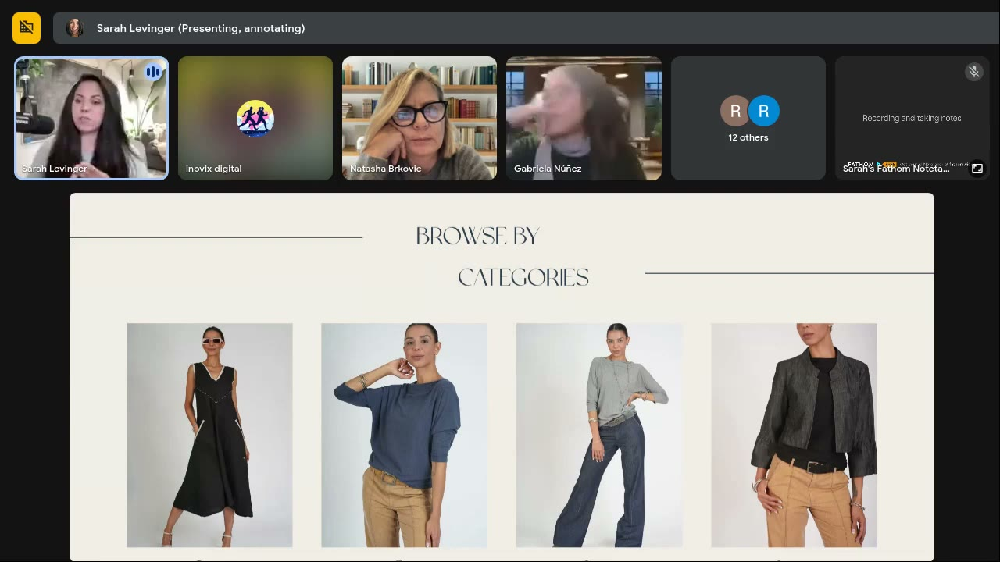
*"Browse by categories" invites browsing. On a true lander, use "Find your favorites / Select the look". [0:03:45; critique at 0:12:19]*

*The video section: fabric moving on a body proves quality ("I can already tell just by how it moves on her body"). [0:09:40]*

*An image too big to fit one screen, so the visitor has to scroll to see the whole look. Make it slightly smaller. [0:10:40]*

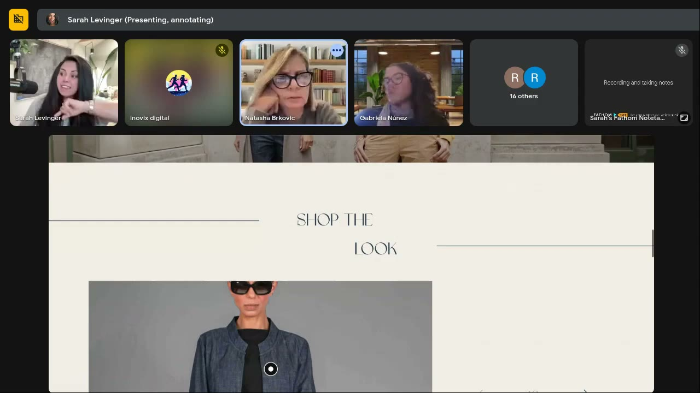
*"Shop the look" → "Get the look / Select the look / Buy this look". [0:14:15]*

*"Our latest collections" (highlighted) = us-focused. Rewrite as "Your next favorite". [0:15:00]*

*The one place to keep "our": a USP (natural fibers). Add a "this is how we're different" subhead. [0:15:45]*

| Brand / product (niche) | Format | Hook / opening | What works | What fails | Fix suggested | Principle | Source |
|---|---|---|---|---|---|---|---|
| ANATATI (women's fashion, natural fibers, American-made / European-inspired) | Brand landing / home page | Hero carousel: "Style that speaks" / "Confidence that attracts" / "Attitude that defines" / "Bold. Chic. Ready for anything." / "American-made, European-inspired" | Very low cognitive load; overlay copy **matches the models' expressions** ("chic… a little bit of attitude"); only 3 nav items; video shows fabric quality; clean, not stuffed; only ~3 CTAs; "less is more" | Messages are brand-focused ("Our latest collections"); browsing verbs ("Browse by categories", "Shop the look", "View all categories"); five rotating messages when visitors see 1–2; generic "confidence" (neutral → weak attachment); some images bigger than one screen | Pick one hero image (versatile, most product) + one core message; name the specific confidence (e.g. "boardroom-level"); "Our latest collections" → "Your next favorite"; "Browse by categories" → "Find your favorites"; "Shop the look" → "Get/Select the look"; "View all categories" → "Shop the looks / Shop our best sellers"; keep "Our commitment to natural fibers" + "how we're different" subhead; shrink images to fit the frame | [Processing fluency](../../../concepts/heuristics/processing-fluency.md), choice overload, ownership via "you" language; zone: positive, low-moderate intensity (Zone 1 edging toward Zone 2 if "confidence" is made specific); self: [Ideal](../../../concepts/ideal-self.md) (aspirational confidence) | [0:02:08–0:22:16] |

### 2. Illusion Nursing Dress lander (Satya Twena): maternity/nursing fashion, $118

*The high-contrast black dress pulls the eye before the text. The basketball makes Sarah read "boy mom", and "Feed" confuses (Natasha). White text on green is hard to read. [0:24:00]*

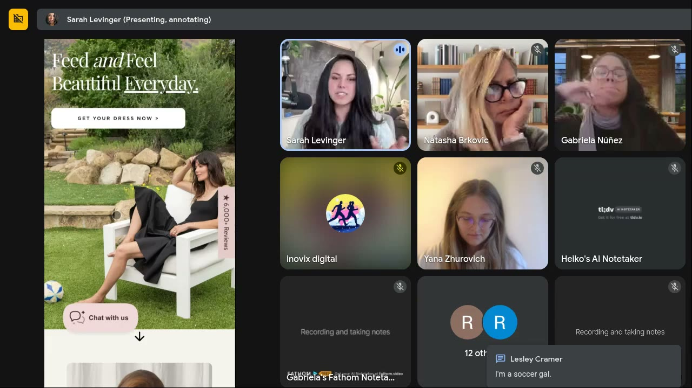
*Mobile crop: lower load, different ball, different text placement, "a whole different feeling". Chat: Lesley Cramer, "I'm a soccer gal." [0:33:30]*

*An ad concept injected into the lander: 3 bullets, ≤2 lines each. "I freaking love this." [0:29:15]*

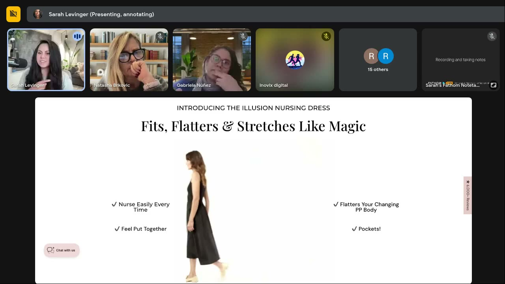
*Moving dress video (quality, color, weight). Bullets split 2+2: OK because they're one set. Sarah would put the first buy button here. [0:30:50]*

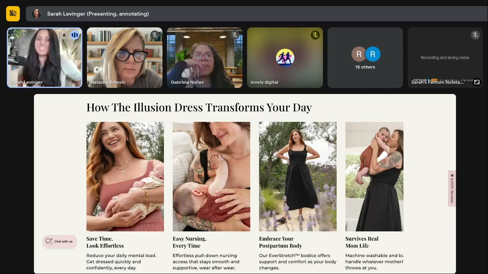
*The first cognitively heavy section (many images, text, subtext). One or two of these is OK; trim body copy to 2 lines. [0:31:30]*

*The "sliver" pattern on mobile: a partly hidden next card makes people swipe. [0:32:55]*

*Great USP framing ("why this dress exists"), but 11 bullets is too many. Combine snaps/buttons/zippers into one. [0:35:15]*

*Numbered callouts and large numbers: the low-load way to communicate ("89% of surveyed mamas say their nursing clothing isn't cutting it"). [0:36:10]*

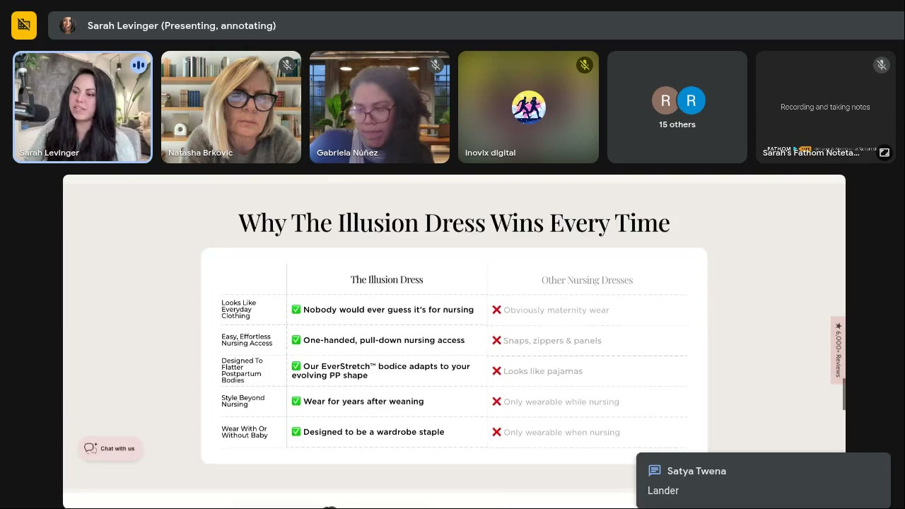
*Repeats the "No list" ideas. Sarah expects it gets skipped; turn it into a graphic. Chat: Satya confirms "Lander". [0:41:20]*

*The first place to buy appears far down the page. "Pre-order" is a strong action CTA; the sold-out note adds scarcity (wiki tag). [0:37:00]*

| Brand / product (niche) | Format | Hook / opening | What works | What fails | Fix suggested | Principle | Source |
|---|---|---|---|---|---|---|---|
| Illusion Nursing Dress (Satya Twena's brand; nursing/postpartum fashion, $118, "6,000+ reviews" tab) | Custom landing page for paid traffic | "Feed and Feel Beautiful Everyday." + "Get your dress now" over model in a black dress on a lawn | Strong contrast hero; "If you're done with…" pain bullets (ad concept on page); drape video; 2-line bullets; numbered callouts + 89% / 98% big numbers; "No list" explains why the dress exists (USP); mobile sliver carousel; "Get your dress now" / "Pre-order now" action CTAs; 30-day guarantee | Basketball and grass send mixed "older kids / boy mom" signals; "Feed" is not how moms talk; white text on green is hard to read; heavy sections; 11-item no list; duplicated info (table); long page → fatigue; **only one buy point, far down**; nursing function and the stretch innovation shown too late; too few baby images | Swap the basketball for newborn props (baby ball, blanket, teether, wooden play gym, kept elevated); "Feed" → "Nurse and feel beautiful every day"; add a black fade behind text; combine no-list bullets; make the table a graphic; add buy CTAs after the first video and the fit section ("Did you like it? Choose your color", "Find your color, find your fit"); lead with the **stretch** / stretchy compression; describe the knit as a "hug"; re-order sections retail-style | [Salience](../../../concepts/heuristics/salience-bias.md) (contrast), context priming, [processing fluency](../../../concepts/heuristics/processing-fluency.md), [framing](../../../concepts/heuristics/framing-effect.md) (No list / comparison), [social proof](../../../concepts/heuristics/social-proof.md) (89% mamas, 6,000+ reviews), [scarcity](../../../concepts/heuristics/scarcity-heuristic.md) (sold out → pre-order); zone: Zone 3 pain-point whisper ("If you're done with…") resolving into Zone 1 ("feel beautiful"); self: [Actual](../../../concepts/actual-self.md) (postpartum body now) + [Ideal](../../../concepts/ideal-self.md) (feel beautiful) | [0:23:24–0:49:44] |

### 3. Clickmatix (submitted by "socket", probably Sanket): Australian digital-marketing agency, lead-gen lander
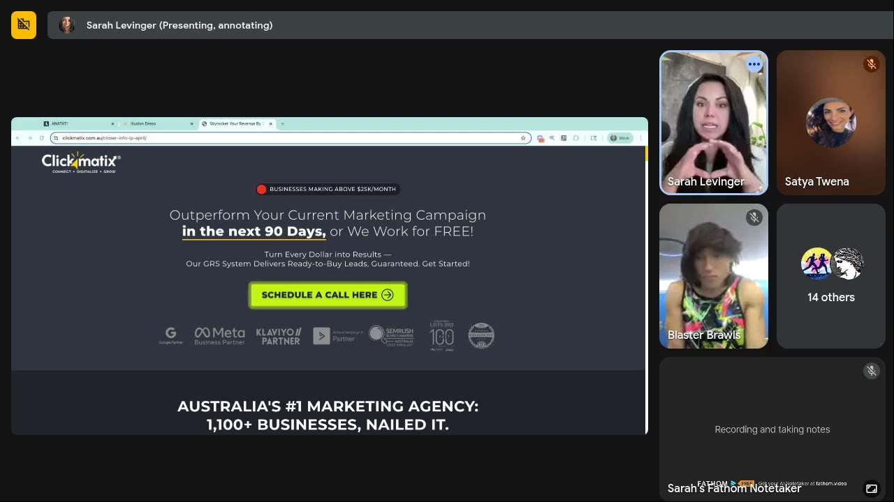
*Clear single action (schedule a call), but the pulsing red badge and the pulsing green button compete. Add an ellipsis after the qualifier. URL on screen: clickmatix.com.au/closer-info-lp-april/. [0:52:05]*

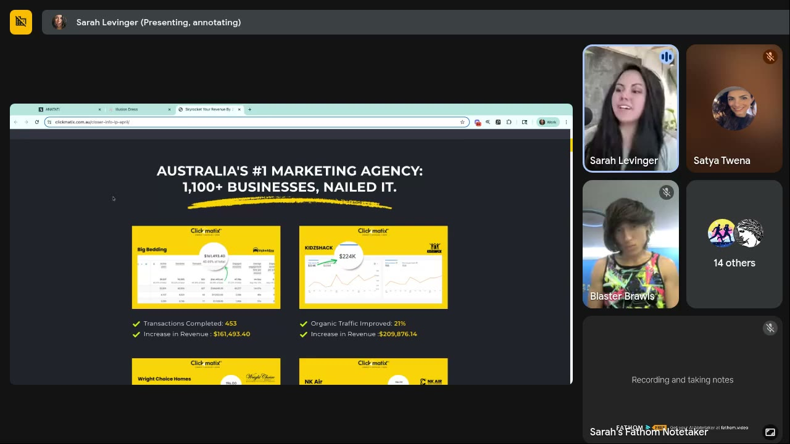
*"Charts on charts on charts": all yellow, all alike. Color-code by metric and add filter buttons (transactions / traffic / revenue). [0:53:10]*

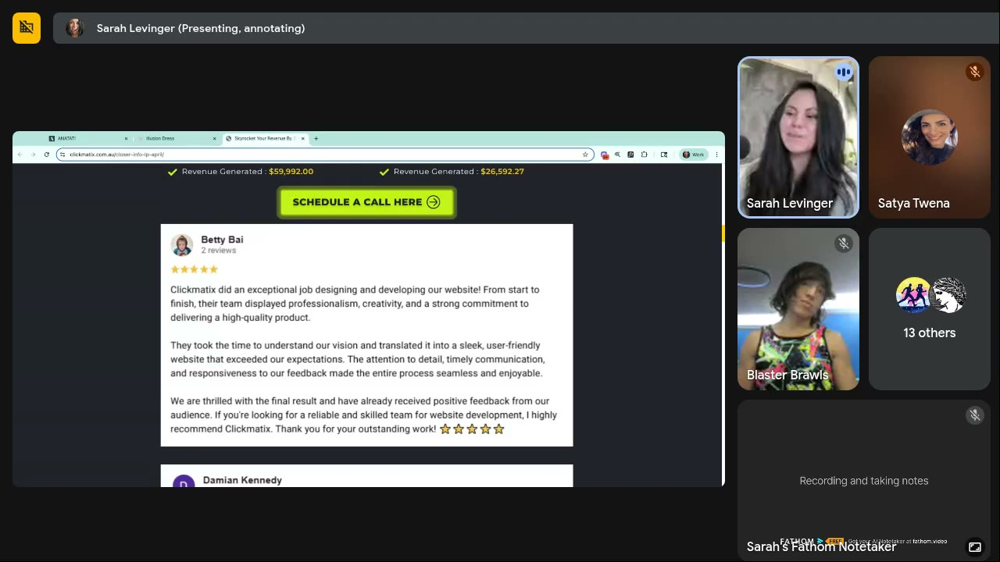
*Large, slightly fuzzy screenshot testimonials. Make them smaller and sharper, or retype them in Canva with photo, name and stars. [0:55:10]*

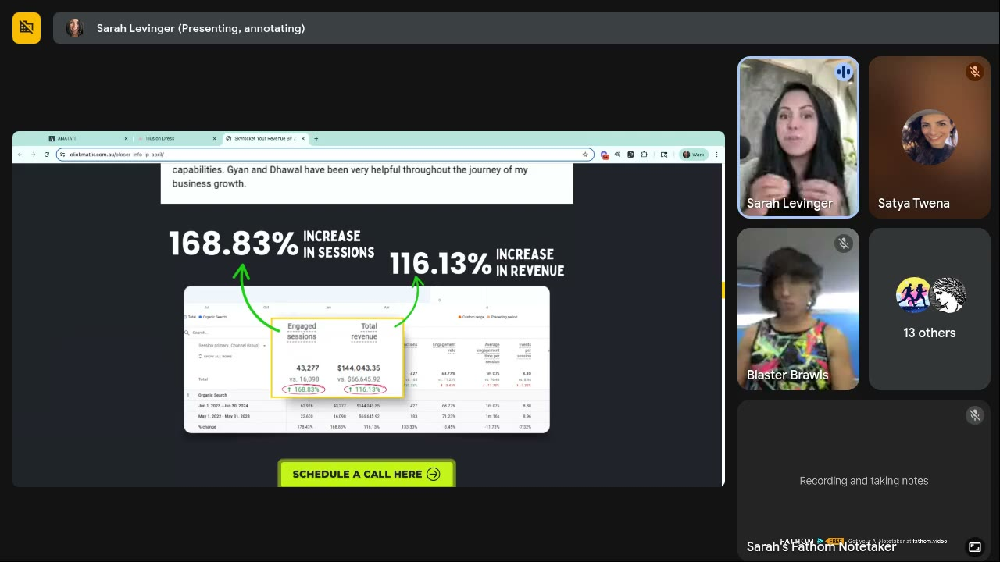
*Arrows plus very large numbers: "this is what I'm talking about… keep this where it is." [0:55:50]*

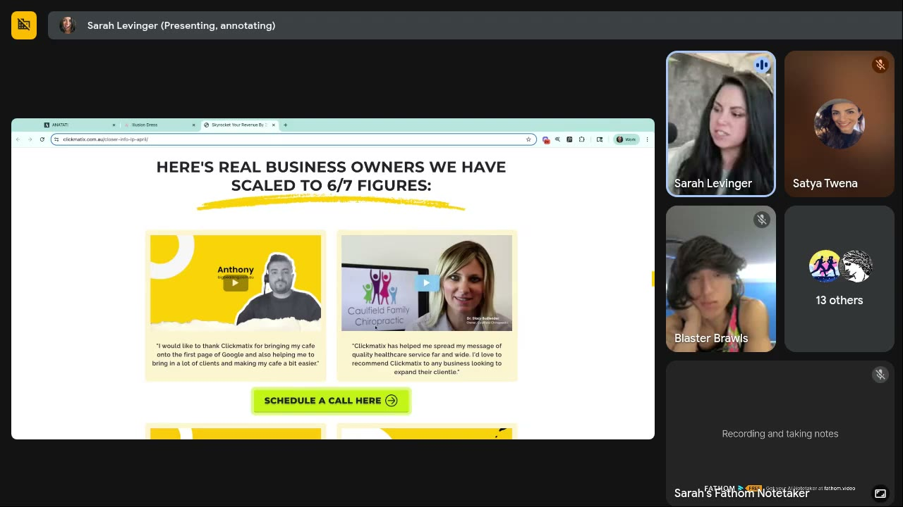
*All yellow, but different enough to read as different things, so no change needed. Repeated testimonials elsewhere look copy-pasted. [0:56:20]*

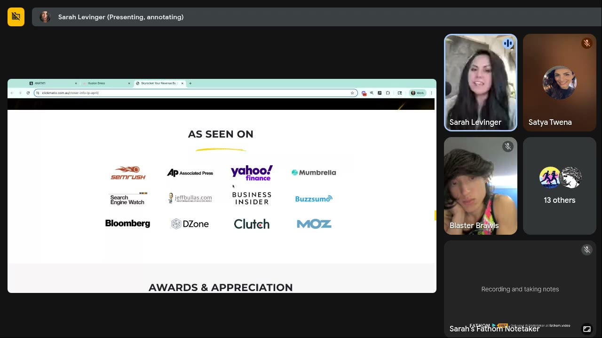
*Authority proof. "Even if you've only had one authority-based person who has said nice things about you, put it on your site." [0:57:00]*

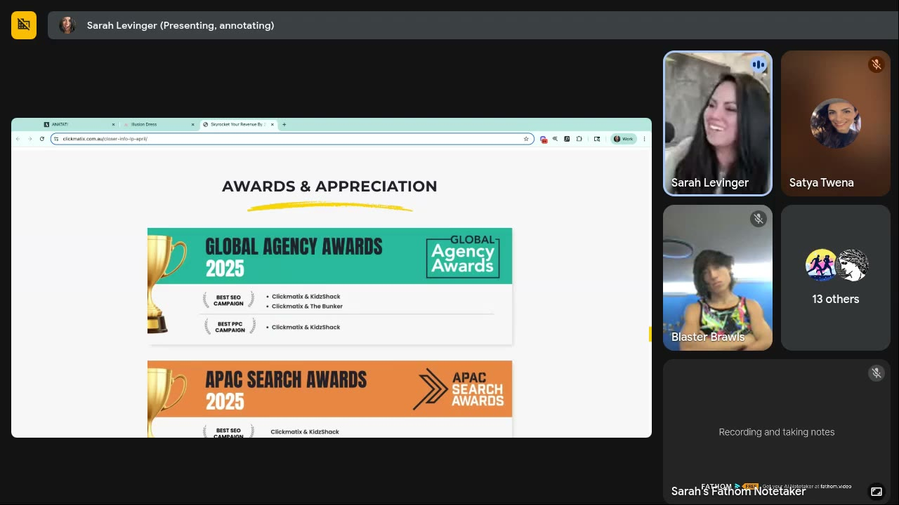
*Awards with year: a bit text-heavy but quick to scan. [0:57:20]*

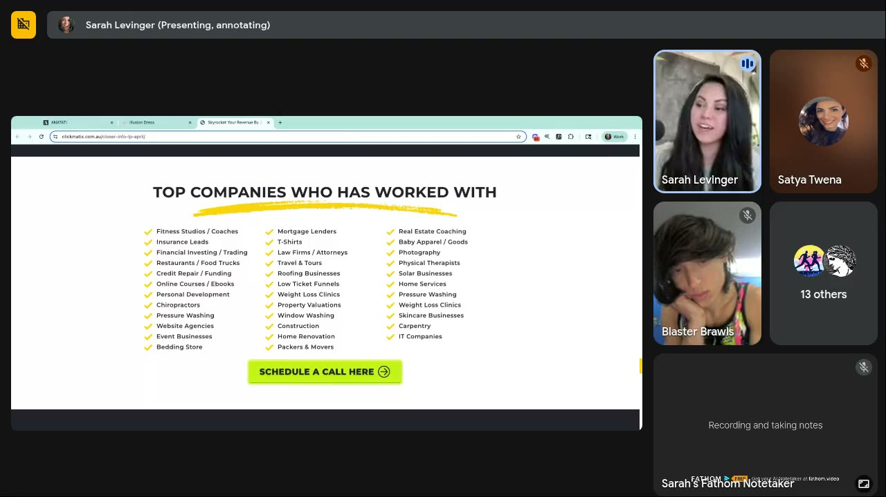
*Breaks the 3–5 bullet rule, but it works as a "chunked paragraph": nobody reads it all, the sheer volume sends the message. [0:57:45]*

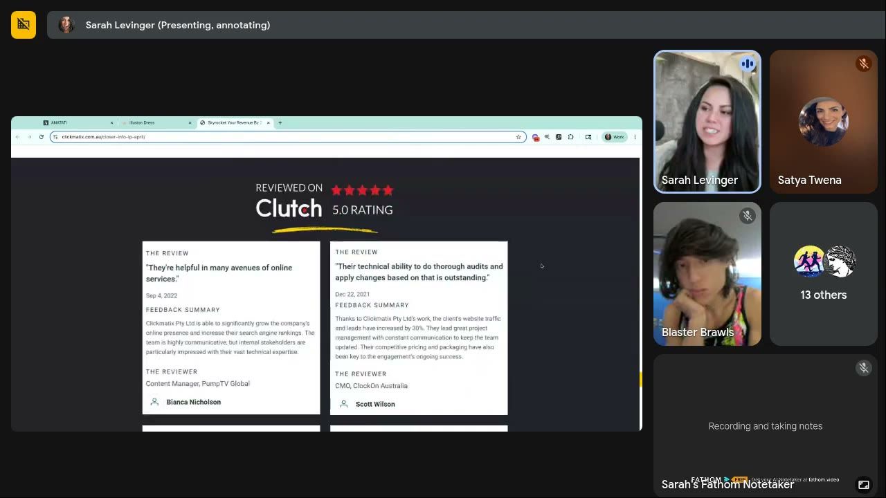
*More reviews and more authority proof near the end of a very long page. [0:58:20]*

| Brand / product (niche) | Format | Hook / opening | What works | What fails | Fix suggested | Principle | Source |
|---|---|---|---|---|---|---|---|
| Clickmatix (Australian digital-marketing agency; "Australia's #1 Marketing Agency: 1,100+ businesses") | Long-form lead-gen landing page (book a call) | "Businesses making above $25K/month" → "Outperform Your Current Marketing Campaign in the next 90 Days, or We Work for FREE!" + "Schedule a call here" | One action only ("Schedule a call" in every section); big headline shows the brain what to do; dimmed partner logos stay peripheral; arrows + very large numbers; "as seen on" authority logos; awards; risk reversal ("or we work for free"); long industry checklist signals breadth; good formatting overall; long text is fine for knowledge purchases | Two pulsing elements in competing colors (red badge vs green button); identical-looking charts force cognitive work; fuzzy, oversized screenshot testimonials (fuzzy = low quality); the same testimonials repeated; very long page | Drop the pulsing red dot, keep the qualifier and add "…" ("Businesses making over $25K a month…"); highlight the text to read first; animate "Schedule a call" in after 1–2 s; color-code charts by metric + add filter buttons; recreate testimonials sharp in Canva; use different testimonials per section; messaging Loom promised | [Processing fluency](../../../concepts/heuristics/processing-fluency.md) via formatting, [salience](../../../concepts/heuristics/salience-bias.md) (highlight, arrows, size), [authority](../../../concepts/heuristics/authority-bias.md), [social proof](../../../concepts/heuristics/social-proof.md), risk reversal; zone: Zone 2 (hype: "outperform", "scaled to 6/7 figures"); self: [Ideal](../../../concepts/ideal-self.md) (growth) with an [Actual](../../../concepts/actual-self.md) qualifier (already at $25K/month) | [0:49:44–0:58:54] |

### Session summary teardown table
| Brand / product (niche) | Format | Hook / opening | What works | What fails | Fix suggested | Principle | Source |
|---|---|---|---|---|---|---|---|
| ANATATI (women's fashion) | Brand landing / home page | "Style that speaks" carousel | Low load; copy matches expressions; 3 nav items; fabric video | "Us" copy; browse/shop verbs; 5 messages; generic "confidence"; oversized images | One hero + one specific message; "Your next favorite"; get/select/grab CTAs | Cognitive load; ownership language; specific emotion | [0:02:08] |
| Illusion Nursing Dress (nursing fashion, $118) | Custom lander | "Feed and Feel Beautiful Everyday." | Contrast hero; "If you're done with…"; video; big numbers; No list; pre-order CTA | Basketball context; "feed"; text on green; long, duplicated sections; one late buy point; innovation buried | Newborn props; "Nurse and…"; earlier CTAs; lead with stretch; "hug" | Context priming; show-don't-tell for fashion | [0:23:24] |
| Clickmatix (agency lead gen) | Long-form lander | "Outperform… in 90 days, or we work for free" | One CTA everywhere; arrows + numbers; authority logos; awards | Competing pulsing elements; same-looking charts; fuzzy testimonials; repeats | Ellipsis + highlight; color-coded charts; sharp Canva testimonials | Formatting carries long text; sharpness = quality | [0:49:44] |

## Structured units

### Hooks
| Hook (verbatim or near) | Heuristic(s) | Emotion / zone | Self targeted | Why it works | Source |
|---|---|---|---|---|---|
| "If you're done with… staring at your closet wishing you had something that works / wasting money on nursing clothes that don't flatter your postpartum body / struggling with snaps, buttons and complicated panels" | Pain framing, [processing fluency](../../../concepts/heuristics/processing-fluency.md) (3 short bullets) | Frustration, Zone 3 (wiki tag) | [Actual](../../../concepts/actual-self.md) | Sarah: an ad concept that works on a page; easy to process (3 bullets, ≤2 lines) | [0:28:57–0:29:53] |
| "Outperform your current marketing campaign in the next 90 days, or we work for free" | Risk reversal, specificity (90 days) | Ambition/hype, Zone 2 (wiki tag) | [Ideal](../../../concepts/ideal-self.md) | "Shows the brain what it's supposed to be doing on this page" (with the CTA) | [0:50:46] |
| "Businesses making over $25K a month…" (with ellipsis) | Qualifier / self-selection, [salience](../../../concepts/heuristics/salience-bias.md) | Recognition, Zone 1 (wiki tag) | Actual | The ellipsis says "this is the very next thing I need you to read" | [0:51:26–0:51:51] |
| "Boardroom-level confidence" (Jamie's proposal) | Specific emotion, identity | Pride, Zone 2 (wiki tag) | Ideal | "A very specific situation… will draw one specific type of woman" | [0:22:56] |
| "Nurse and feel beautiful every day" (rewrite) | [Processing fluency](../../../concepts/heuristics/processing-fluency.md) (customer's own word) | Reassurance, Zone 1 | Actual → Ideal | Uses the word moms actually use ("nursing dress", not "feeding dress") | [0:46:20–0:46:32] |
| "89% of surveyed mamas say their nursing clothing isn't cutting it" | [Social proof](../../../concepts/heuristics/social-proof.md), large number | Validation of a frustration, Zone 3 | Actual | Large numbers and icons reduce cognitive load | [0:35:54] (on screen ≈0:36:10) |

### Angles
| Angle | Core desire / pain | Heuristic(s) | Best format | Example line | Source |
|---|---|---|---|---|---|
| "Done with…" pain list → solution | Frustration with current nursing clothes (snaps, frumpy, wasted money) | Pain framing, fluency | UGC opener / lander section / static | "If you're done with struggling with snaps, buttons and complicated panels…" | [0:28:34–0:28:57] |
| The innovation paradox ("stretchy compression") | "How does that work?" curiosity + wanting support without "thinness" talk | Curiosity, [salience](../../../concepts/heuristics/salience-bias.md) | Demo video (stretch test), UGC | "It hugs where you need support and stretches where you need it" (wiki example built on Sarah's "hug") | [0:45:13–0:46:08] |
| The "No list" (why it exists) | Rejection of maternity-wear clichés | [Framing](../../../concepts/heuristics/framing-effect.md) (what it isn't) | Static list, UGC "things this dress doesn't have" | "No endless snaps. No 'maternity wear.' No 'nursing-only' vibes." | [0:34:28] |
| Specific confidence | Feeling a precise kind of confident in clothes | Identity, [intensity](../../../concepts/intensity.md) | Hero copy, static headline | "Boardroom-level confidence" | [0:17:58; 0:22:56] |
| Guaranteed outperformance (agency) | Fear of wasted marketing spend; growth | Risk reversal, [authority](../../../concepts/heuristics/authority-bias.md), [social proof](../../../concepts/heuristics/social-proof.md) | Long-form lander, VSL | "Outperform… in the next 90 days, or we work for free" | [0:50:46] |

### Rewrites (before → after)
| Before | After | What changed (verb / visual / promise / self / intensity) | Source |
|---|---|---|---|
| "Browse by categories" | "Find your favorites" / "Choose your size" / "Select the look" | Verb: browsing → selecting/owning | [0:12:52–0:13:41] |
| "Shop the look" | "Get the look" / "Select the look" / "Buy this look" | Verb: passive "shop" → active acquiring | [0:13:47] |
| "Our latest collections" | "Your next favorite" (also "Browse your new favorites") | Focus: us → you (ownership) | [0:14:49; 0:21:30] |
| "Our commitment to natural fibers" | Keep + subhead "This is how we're different" | Keep "our" for the USP; add a differentiator promise | [0:15:45] |
| "View all categories" | "Shop the looks" / "Shop our best sellers" / "Get our best sellers" | Verb + specificity (guided by heat maps) | [0:20:04–0:21:10] |
| "Confidence that attracts" (generic) | A specific confidence, e.g. "boardroom-level confidence", cheeky confidence, self-acceptance | Intensity/specificity up; self narrowed | [0:17:58–0:18:30; 0:22:56] |
| 5 rotating hero messages | 1 hero image (versatile, most product) + 1 core message | Visual and promise consolidated | [0:16:49–0:17:58] |
| "Feed and Feel Beautiful Everyday." | "Nurse and feel beautiful every day" | Customer vocabulary | [0:46:20] |
| Basketball on the lawn | Baby ball / blanket + teether + wooden play gym | Visual: context matches newborn stage, brand kept elevated | [0:46:56–0:47:34] |
| "Flattering your changing postpartum body" (and "compression") | Fabric that "hugs" | Sensory verb; avoids thinness and medical "compression" connotations | [0:44:57–0:45:13] |
| No-list bullets "Endless snaps / Tiny buttons / Zippers" | One combined bullet (e.g. "No fiddly closures"; wiki wording) | Fewer bullets, lower load | [0:35:12] |
| "Add to cart" | "Order yours now" (or "Pre-order now") | Verb: save-for-later → buy now | [0:48:38–0:49:14] |
| "Shop" CTAs | "Get it" / "Grab it" / "Acquire it" | Active action words | [0:47:34] |
| "Businesses making above $25K/month" (pulsing red dot) | "Businesses making over $25K a month…" (no pulsing dot, ellipsis, highlighted) | Visual: one focal point; ellipsis pulls the reader on | [0:51:07–0:52:42] |
| Identical yellow chart cards | Color by metric (transactions = yellow, organic traffic = green) + filter buttons | Visual differentiation → less cognitive work | [0:53:07–0:54:01] |
| Big fuzzy screenshot testimonials | Smaller, sharp, retyped in Canva with photo, name and stars | Visual: sharpness = quality | [0:54:48–0:55:31] |

### Rules of thumb
- **DO** run every page through cognitive load → message → CTA, in that order. [0:03:42; 0:11:51; 0:19:19]
- **DO** make the hero overlay copy describe what the model's face and body are doing. [0:06:27]
- **IF** the hero is a carousel **THEN** put the core message on slide 1. Most people see only 1–2 slides. [0:16:49]
- **DO** keep top navigation to about 3 items. [0:07:14–0:07:41]
- **DON'T** blow images up beyond one screen. [0:08:29; 0:10:31]
- **IF** selling apparel (dresses, shoes, pants, socks) **THEN** include video of it moving on a body. [0:09:33; 0:30:40]
- **DO** audit every prop and background object for the story it tells a first-time visitor. [0:27:32]
- **DO** put a dark fade behind light text on busy images. [0:28:44]
- **DO** use 3–5 bullets of ≤2 lines; **IF** more than 5 **THEN** paragraph; **IF** 3–4 lines each **THEN** listicle. [0:29:29–0:30:05]
- **DON'T** stack many heavy sections. One or two is OK. [0:31:46]
- **DO** replace text with icons, symbols, large numbers and arrows wherever possible. [0:35:54; 0:55:46]
- **DON'T** repeat the same information in another format (no-list + table; the same testimonials twice). [0:36:00; 0:56:33]
- **DO** review mobile separately. Crops change the meaning and the load. [0:32:52]
- **DO** use the half-visible "sliver" carousel on mobile to prompt swipes. [0:33:45]
- **DO** write "you" copy. Keep "our" only for USPs (materials, manufacturing, process). [0:14:49–0:15:45]
- **DO** go one level deeper than the generic emotion (what kind of confidence?). [0:17:58]
- **DO** use the customer's own words (nursing, not feeding). [0:46:20]
- **DO** use buying verbs (get, grab, select, order yours now, pre-order). **DON'T** use browse, shop or add to cart on a lander. [0:12:19–0:13:47; 0:47:34–0:49:14]
- **DO** add buy buttons wherever the visitor is likely convinced, not only at the bottom. [0:38:05; 0:41:15]
- **IF** fashion at a typical price **THEN** show, don't tell: shorter page, earlier CTA. [0:42:17–0:43:31]
- **DO** order sections like a retail visit: hero feeling → why you'll enjoy it → see it move → turn it over (details) → why it's better → objections. [0:38:49–0:40:29]
- **IF** info product or service **THEN** long copy is fine but must be formatted (big and bold first, light and small second). [0:50:20–0:52:01]
- **DON'T** animate two competing elements in different colors above the fold. [0:51:07]
- **DO** end key qualifiers or teasers with an ellipsis ("…") in ads, landers and emails. [0:51:32]
- **DO** use sharp images. Fuzzy screenshots read as low quality. [0:54:48]
- **DO** show any authority proof you have (logos, awards), even a single one. [0:56:55]
- **IF** a list is meant to signal volume (industries served) **THEN** a long list can stay. Nobody reads it, but it communicates breadth. [0:57:39–0:58:14]
- **DO** use heat maps to decide the next CTA (most-clicked category → "Shop our best sellers"). [0:21:05]

## Tools, metrics, people mentioned
- **Brain facts (Sarah):** ~3 lb, mostly water and fat, ~20% of daily glucose. [0:04:14]
- **Reading pattern:** Z or F pattern in English-speaking countries; contrast overrides it. [0:24:27]
- **Bullet rule:** 3–5 bullets, ≤2 lines each ("they've done a lot of studies on this"). [0:29:29]
- **Price context:** US dresses ~$80–$200; Illusion Dress $118. [0:42:58]
- **Illusion Dress page stats (on screen):** 89% of surveyed mamas say their nursing clothing isn't cutting it; 98% want better options that are stylish and nursing-friendly; "6,000+ Reviews" side tab.
- **Clickmatix page stats (on screen):** "1,100+ businesses"; case cards (e.g. Big Bedding: 453 transactions, +$161,493.40 revenue; Kidzshack: organic traffic +21%, +$209,876.14 revenue); 168.83% increase in sessions, 116.13% increase in revenue; Clutch 5.0 rating; Global Agency Awards 2025, APAC Search Awards 2025.
- **Tools:** heat maps [0:21:05; 0:36:28]; **Canva** for recreating testimonials [0:55:21]; **Loom** for Sarah's async feedback [0:47:38; 0:58:54]; Shopify (origin of the sliver carousel pattern) [0:33:55]; Amazon (blamed for "add to cart") [0:48:55].
- **Sarah's Twitter:** she has posted about arrows lifting conversion. [0:55:46]
- **Courses referenced:** Valence & Intensity and 3 Selves ("super short… like 30 minutes"). [0:59:31]
- **Upcoming:** possible dedicated buy-box training. [0:41:15]
- **People:** Natasha Brkovic (ANATATI), Satya Twena (Illusion Dress), Sanket ("socket", Clickmatix lander), Jamie, Leslie/Lizzie (chat), Lesley Cramer, Gabriela Núñez (nods at the mobile view [0:32:57]), Farad Khan (chat).

## Notable quotes
- "Make sure whatever we put on this page is well suited to a brain that wants to conserve energy." [0:04:49]
- "Choice overload is like one of the biggest drivers of bounce rates I've ever seen." [0:07:35]
- "Messaging… tells people what to believe about your product." [0:11:57]
- "Anytime we say 'shop' it's difficult, because then we're just telling people: come back and get this later." [0:13:47]
- "All the language on any website needs to push out instead of in." [0:14:57]
- "Whatever you have in that hero section is what people are going to base the rest of their opinion on." [0:17:30]
- "Confidence is great, but what type of confidence?" [0:18:05]
- "People are emotional about their clothes, but only after they get them on themselves." [0:22:35]
- "For fashion you don't need to do a ton of convincing… it's more about show, don't tell." [0:43:31]
- "The add-to-cart button is a save-for-later button. That's all it is." [0:48:44]
- "Sharper imagery actually communicates quality." [0:54:56]
- "Arrows are freaking amazing." [0:55:53]

## How to apply
- [ ] When tearing down a competitor ad, screenshot its landing page and fill a 3-row table: Cognitive load / Message / CTA.
- [ ] Write the UGC script's on-screen text to match the creator's facial expression in that shot (excited face → excited line).
- [ ] In creator briefs, specify props and background that fit the target customer's life stage (newborn props, not older-kid toys).
- [ ] Replace every "shop", "browse" or "add to cart" in our end cards, captions and landing pages with a buying verb.
- [ ] Rewrite any generic emotion word in a hook ("confidence", "beautiful") into a specific situation ("boardroom-level confidence").
- [ ] Turn a working "If you're done with…" UGC opener into a landing-page section, and vice versa.
- [ ] Use ellipses and highlights to guide reading order in static ads and advertorials.

## Related
- Brand case files: [ANATATI](../../../brands/anatati.md) · [Illusion Nursing Dress](../../../brands/illusion-nursing-dress.md) · [Clickmatix](../../../brands/clickmatix.md) · [all brands by niche](../../../brands/README.md)
- Tool pages: [Canva](../../../tools/canva.md)
- [Processing fluency](../../../concepts/heuristics/processing-fluency.md) · [Salience bias](../../../concepts/heuristics/salience-bias.md) · [Social proof](../../../concepts/heuristics/social-proof.md) · [Authority bias](../../../concepts/heuristics/authority-bias.md) · [Framing effect](../../../concepts/heuristics/framing-effect.md) · [Scarcity](../../../concepts/heuristics/scarcity-heuristic.md)
- [Valence](../../../concepts/valence.md) · [Intensity](../../../concepts/intensity.md) · [Emotional zones](../../../concepts/emotional-zones.md) · [Three selves](../../../concepts/three-selves.md) · [Actual self](../../../concepts/actual-self.md) · [Ideal self](../../../concepts/ideal-self.md) · [Tone-shifting](../../../frameworks/tone-shifting.md)
- Related pages: [Landing-page psychology audit](../../../frameworks/landing-page-psychology-audit.md) · [Cognitive load](../../../concepts/heuristics/cognitive-load.md) · [Choice overload](../../../concepts/heuristics/choice-overload.md) · [Active CTA language](../../../concepts/active-cta-language.md)
- Related sessions: [Live With Sarah, Jul 16 (Fogg model; PDP audits; cognitive load)](2025-07-16-live-with-sarah.md) · [Guest Session 02, Chase Mohseni (June 2025)](2025-06-guest-session-02-chase-mohseni.md) · [Roast My Ads #3 (Jul 23)](2025-07-23-roast-my-ads-3.md)
- [Sarah Levinger](../../../people/sarah-levinger.md)

## Sources
- Transcript: [2. Roast My Ads #2 - June 25,2025 - Recordings.txt](../../../../raw/tether-lab/_transcripts/5.%20Recordings/June%202025/2.%20Roast%20My%20Ads%20%232%20-%20June%2025%2C2025%20-%20Recordings.txt) · [.srt](../../../../raw/tether-lab/_transcripts/5.%20Recordings/June%202025/2.%20Roast%20My%20Ads%20%232%20-%20June%2025%2C2025%20-%20Recordings.srt)
- Session page text: [2_Roast_My_Ads_#2_June_25,_2025_Recordings_·_Tether_Lab.md](../../../../raw/tether-lab/_extracted/5.%20Recordings/June%202025/2_Roast_My_Ads_%232_June_25%2C_2025_Recordings_%C2%B7_Tether_Lab.md) (title + length only)
- Timestamps: .srt-refined (paragraph times in the .txt run up to ~30 s earlier).
- Name fixes from on-screen text and context: "natasha" → Natasha Brkovic (brand **ANATATI** on screen); "satya" → Satya Twena; "socket" → probably Sanket (unconfirmed; the page shown is **Clickmatix**, URL clickmatix.com.au); "a poor video" → a [pure/full] video section (unclear); "sparta part of the page" → "this particular part of the page"; "leslie / lizzie" = chat names as heard (on-screen chat shows "Lesley Cramer"); "gabriella" → Gabriela Núñez (on screen).
