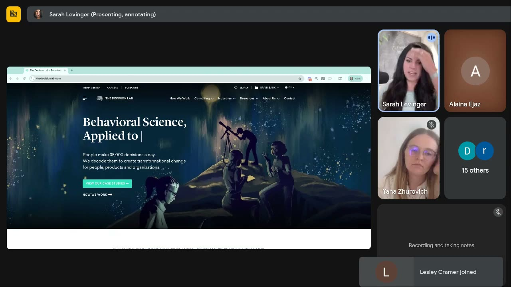
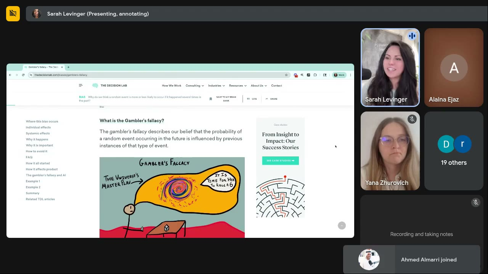
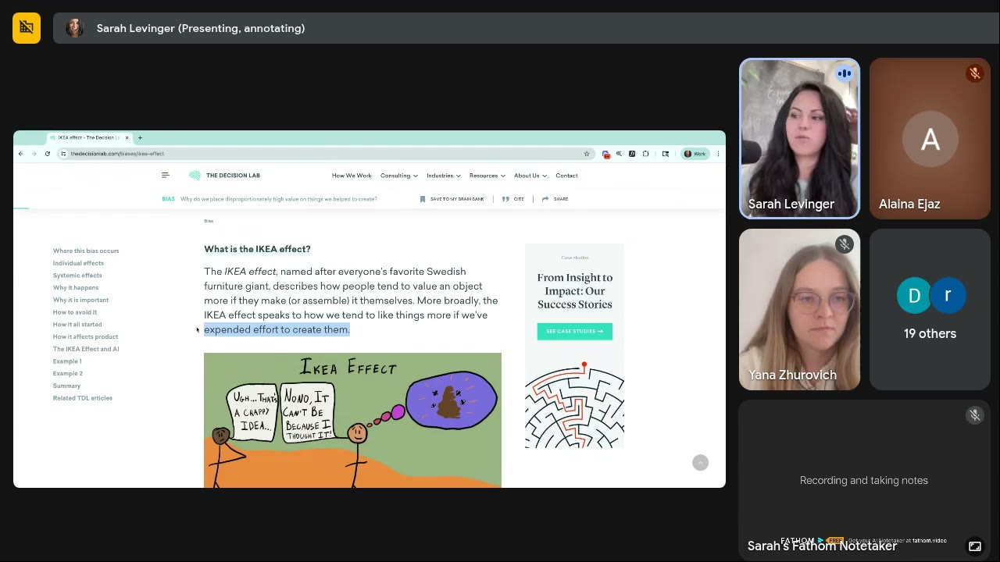
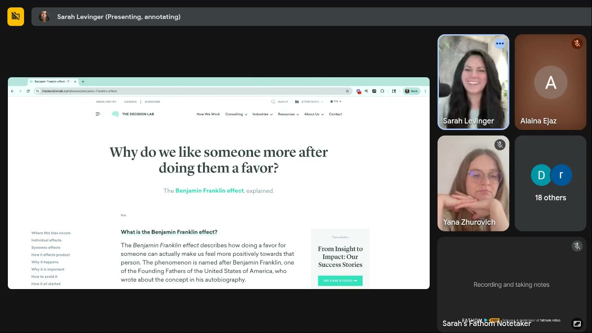
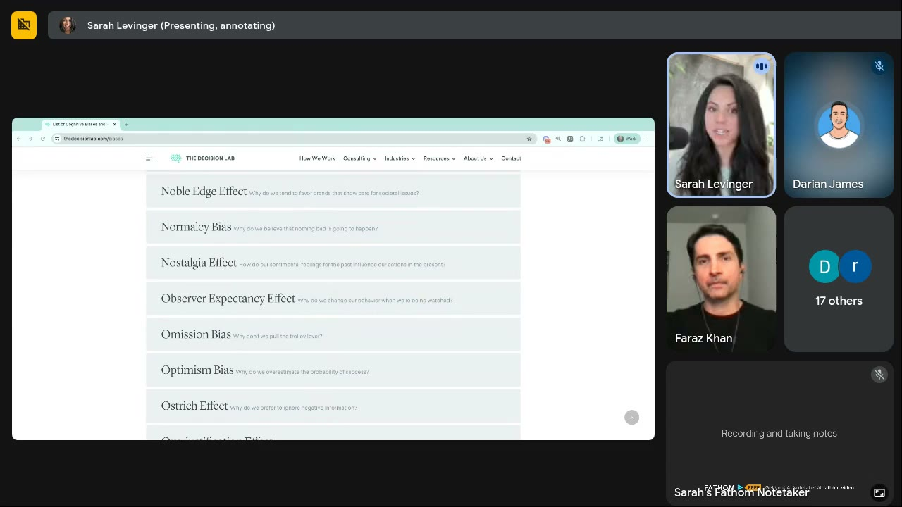

# Live With Sarah! — July 02, 2025
> A mini-training that tours The Decision Lab's cognitive-bias list (gambler's fallacy, IKEA effect, Ben Franklin effect and reciprocity, observer expectancy effect), followed by a long Q&A on the **psychology of bundling, pack sizes, time framing and subscriptions**. Main lesson: pick heuristics and offer numbers that match the customer's real beliefs and usage, and always give the brain a **frame of reference**.

## 🤖 Agent use
- **Use when:** (a) picking an extra heuristic for a hook or script beyond the usual social proof and authority; (b) writing offer, bundle or PDP copy that runs alongside a UGC ad (bundle badges, pack names, subscription wording, guarantee wording); (c) checking whether a competitor's authority proof fits *our* audience; (d) writing UGC lines that use reciprocity, co-creation (IKEA) or "being watched".
- **Inputs → outputs:** product + usage rate (days or uses per unit) + customer beliefs/avatar + current bundle numbers → heuristic picks with reasons, bundle sizes, frame-of-reference badge copy, time framing (days vs weeks vs months), subscription label, and a set of A/B tests.
- **Rules:**
  - DO choose the heuristic from the customer's **belief system**, not a generic list. Authority still works, but the *type* of authority has to be one this audience trusts (functional health practitioners, acupuncturists or naturopaths for women 50+ who were brushed off by doctors). [0:13:34–0:15:40]
  - DO call out what buyers have failed at many times before (gambler's fallacy) to clear the "it won't work for me either" objection. [0:06:31–0:08:20]
  - DO bring the viewer into the creation (IKEA effect): "swipe to choose your shirt" carousels, build-your-bundle with **two pre-picked items plus one add-on**. [0:08:25–0:11:27]
  - DO write kindness and reciprocity lines: "We wish we could give this away for free, but…". [0:11:27–0:13:34]
  - DO size bundles to **real consumption**. They should last just past the point where results show (e.g. 1/2/5 packs, or buckets of 2 such as 2/4/8), never so big that you create your own churn. [0:24:05–0:26:12; 0:35:38–0:36:39]
  - DO add a frame-of-reference badge: "Most customers buy X", "Lasts 180 days / 15 washes", "Buy a 36 pack, make 100 dinners". [0:37:45; 0:41:53; 0:56:36]
  - DON'T claim more than the product does (low-carb pasta ≠ weight loss). Frame by the **behavioural use case** (dinners), not the USP, to avoid cognitive dissonance. [0:38:47–0:40:48]
  - DON'T lie in "most customers buy" badges. Use transparency modelling ("most buy 12, but 36 gets you 100 dinners a year"). [0:43:59–0:45:03]
  - IF the buyer wants **fast** results THEN use the smaller-sounding number ("30 days", not "one month"). IF they want **high-quality** results THEN use the unit that sounds substantial ("six weeks", not "45 days"). [0:32:40–0:34:34]
  - DON'T say "subscription". Say "stock and save" or "auto ship and save", and express cadence in **days or uses**. [0:53:21–0:55:33]
  - DO give ChatGPT/Claude a detailed persona doc plus the list of heuristics to choose from. Generic "which heuristic works for X" prompts only return basics. [0:19:48–0:20:56; 0:31:29]
- **See also:** [Heuristics](../../../concepts/heuristics.md) · [Heuristic stacking](../../../concepts/heuristic-stacking.md) · [Authority bias](../../../concepts/heuristics/authority-bias.md) · [Social proof](../../../concepts/heuristics/social-proof.md) · [Framing effect](../../../concepts/heuristics/framing-effect.md) · [Goal-gradient effect](../../../concepts/heuristics/goal-gradient-effect.md) · [Three selves](../../../concepts/three-selves.md) · [Heuristics 101 module](../02-heuristics-101/README.md)

Skool page text: no description, title and video length (58:31) only.

## TL;DR
- Sarah's main heuristic source is **The Decision Lab's list of cognitive biases** (thedecisionlab.com/biases), which is alphabetical and not ranked. She keeps private per-industry rankings. **Goal-gradient effect** is her "underused, works every time" pick. [0:02:46–0:06:14]
- New heuristics, each with an ad use: **gambler's fallacy** (call out repeated past failures), **IKEA effect** (co-creation carousels, guided bundle building), **Ben Franklin effect / reciprocity** (KFC "$1 fries we wish were free"), **observer expectancy effect** ("Did you take your creatine today?" said straight to camera). [0:06:14–0:23:03]
- **Authority bias depends on the audience:** for women 50+ who have been let down by doctors, swap MDs for functional practitioners or naturopaths. [0:13:34–0:15:40]
- **Bundling rules:** bundles need a point (logical pairings, not flavours). Use odd numbers, which feel deliberately chosen. Size to consumption so customers run out just as results show. Add a **"Most customers buy X"** badge (bandwagon on top of decoy). [0:15:40–0:45:03]
- **Time framing:** "30 days" feels shorter than "one month". "Six weeks" feels more substantial than "45 days". Return periods: longer means fewer returns, so say "one month". [0:32:40–0:34:34; 0:49:11–0:50:14]
- **Subscriptions:** ~4% take rate is already high. Rename to "stock and save" / "auto ship and save". Choose cadence by days or uses ("30 days of use"), not months or "subscription". [0:51:55–0:56:36]

## Session map
| Time | Segment |
|---|---|
| [0:00:00] | Welcome, new members |
| [0:00:55] | Announcement: **two-day intensive, July 17–18** (3 hours/day), the full creative-strategy process Sarah uses with 8- and 9-figure brands. "Only two spots left." |
| [0:01:58] | Mini-training intro: "where do I find all of my stuff?" leads to **The Decision Lab** |
| [0:03:03] | Cognitive-bias list. What heuristics are. Social norms/social proof (US tipping). Authority bias |
| [0:05:11] | Q: Are the biases ranked by effectiveness? |
| [0:06:14] | **Gambler's fallacy** |
| [0:08:20] | **IKEA effect** (requested by Jamie Ahmed) |
| [0:09:55] | Q: IKEA effect via bundle building? leads to **cognitive load** |
| [0:11:27] | **Ben Franklin effect** + reciprocity (KFC TikTok example) |
| [0:13:34] | Q: Is authority less trusted by women over 50? |
| [0:15:40] | Q: Bundling gelato flavours and toppings (decoy effect, odd numbers) |
| [0:19:33] | Comment: medical studies done mostly on men |
| [0:19:48] | Q: Can ChatGPT pick top heuristics for a customer type? |
| [0:21:00] | **Observer expectancy effect** + cart-abandonment idea |
| [0:22:39] | Q: Retention vs new acquisition? |
| [0:23:03] | Sarah's custom GPT |
| [0:23:45] | Q: 1/3/6 pack with free gifts. Why those numbers? (bundle sizing vs churn) |
| [0:26:50] | Q: Meta CPA pressure vs customer needs (two behavioural sets, antibiotic study) |
| [0:30:50] | Comment: Claude vs ChatGPT. Persona docs. Obvi's $400 12-month upsell |
| [0:32:40] | Q: "45 days" or "six weeks"? (time framing) |
| [0:34:50] | Q: Low-carb pasta 3/6/12/36 bundles (Darian James). "Most customers buy" badge, dinners framing |
| [0:42:58] | Gabriela: "enjoy your favourite dinner without the guilt" |
| [0:43:59] | Q: Will "most buy" on the biggest bundle look fake? (transparency modelling) |
| [0:45:20] | Q: 90 days vs 3 months; 180 days vs 6 months; 45/90/120 days vs 6/8 weeks |
| [0:47:10] | Q: Subscription cadence every 2/4/6 weeks (dog food) |
| [0:49:11] | Q: "One month" or "30-day" return period? |
| [0:50:50] | Attendee idea: t-shirt carousel that goes to WhatsApp |
| [0:51:55] | Q: Raising subscription take rate on the first order (stock and save / auto ship and save) |
| [0:55:05] | Q: Two selectors on the PDP: too much? |
| [0:55:50] | Wrap-up: make the decision easy, give a frame of reference |
| [0:57:05] | Q: Wording for subscribe & save (Sarah will post a list) |

## Key ideas

### The Decision Lab bias list [0:01:58–0:06:14]
- Most common question: "Sarah, where do I go to find resources on behavior science, on psychology, on applying emotion?" Her answer: **The Decision Lab**, "basically a consultancy… based on behavior science… with brands that are I think in B2B", with "a lot of really good resources on their page". [0:02:01–0:03:03]
- "This one is their list of cognitive biases or heuristics. So if you've ever seen Sarah post anything about heuristics, **this is the list that I'm pulling from**." [0:03:03]
- Definition: heuristics are "mental shortcuts… every single person on the planet has" them, "the brain's way of making a quick decision based upon things that it's seen a lot or experienced a lot". That's why she uses them in marketing: "every human is sensitive to them". [0:03:03–0:04:05]
- Familiar ones: **social norms / social proof** (testimonials, quotes; in the US, tipping is a social norm "for basically everything now") and **authority bias** ("we always trust people who are in positions of authority even though sometimes they might be wrong"). [0:04:05–0:05:06]
- Each bias page has an article plus illustrations ("I need to do more work on my site to match theirs"). [0:06:14]

*The Decision Lab, Sarah's go-to reference for heuristics. [0:03:00]*

*"Cognitive Biases: A list of the most relevant biases in behavioral economics" (thedecisionlab.com/biases). Alphabetical, starting with Action Bias and Affect Heuristic. [0:03:45]*

### Gambler's fallacy → objection clearing [0:06:14–0:08:20]
- Definition (on screen): "The gambler's fallacy describes our belief that the probability of a random event occurring in the future is influenced by previous instances of that type of event." [0:06:31]
- In ads: weight loss. "I've tried a lot of times to lose weight and it's never worked for me", so the buyer judges their odds of success as low. [0:06:49–0:07:17]
- **How to use:** "We need to identify what have people experienced a lot… in my particular industry or with their problem so that I can **call it out**, because they're gonna think that it's gonna happen again." When the pattern changes, "the link breaks". [0:07:17–0:08:20]

*The Decision Lab's gambler's fallacy page ("It is time for her to roll a 6"). [0:06:45]*

### IKEA effect → co-creation [0:08:20–0:09:55]
- "People kind of value objects more if they either make, assemble it, or… do something to plan it." [0:08:29]
- Works mainly for **customisable or personalisable products**. Non-custom products can still use it by walking people through a process: a **carousel**, "swipe to see what the story is" or "swipe to choose your best shirt". "The only thing they can do is swipe… but by just telling them 'what shirt do you want to create'… allowing them… a process of being involved in… the idea creation, that's how we use IKEA effect. Incredibly powerful." [0:08:52–0:09:55]

*"The IKEA effect… describes how people tend to value an object more if they make (or assemble) it themselves." Jamie Ahmed in chat: "IKEA effect has always been fascinating to me too". [0:09:00]*

### Ben Franklin effect and reciprocity [0:11:27–0:13:34]
- "Doing a favor for someone can make you feel more positively to them." Reciprocity is close: "if you do something for me… I will want to do something for you". [0:11:34; 0:12:21]
- **KFC example** (from Sarah's own TikTok post): KFC lifted sales of a flagship $1 fries package "by I think it was like 56 [%]… something wild… by basically injecting psychology into their ads". The message: "we want to give these fries to you for free but we can't, so we'll give them to you for a dollar." [0:11:51–0:12:27; 0:12:37–0:13:00]
- "You can use this directly in your ads just by **being kind**." Template: "We really wish that we could give this serum away for free, but it's so powerful for wrinkles that… we have to make sure that we don't sell out so that everybody can get access to it. So we'll give it to you for X amount of dollars and we'll throw in Y… just because we want to make sure that you get good results." [0:13:00–0:13:34]

*"Why do we like someone more after doing them a favor?" [0:13:30]*

### Observer expectancy effect → "being watched" creative [0:21:00–0:23:03]
- On screen: "Observer Expectancy Effect: Why do we change our behavior when we're being watched?" [0:21:29]
- Ad idea: "have somebody staring at the screen being like '**did you take your creatine today?**'… just being watched changes your behavior and you can do it for anything." Gelato version: "did you buy gelato today? No, you have not treated yourself enough. Go buy yourself some gelato." [0:21:41–0:22:00]
- Cart abandonment (attendee idea). Sarah: she recently saw followers' names on abandoned carts, DMed them "why don't you check out", they replied "wow, we feel seen", and they checked out. "Humans are busy… sometimes it's hard to remember that I have gelato in a cart." [0:22:00–0:22:39]

*More of the list. Observer Expectancy Effect: "Why do we change our behavior when we're being watched?" [0:25:00]*

### The psychology of bundling: the core model [0:23:45–0:30:29; 0:40:48]
Sarah's framework, collected from several answers (the structure is a wiki synthesis, the content is hers):
1. **Why these numbers?** Most brands pick bundle sizes arbitrarily ("they feel good", or copied from competitors). [0:23:51–0:24:05; 0:35:38]
2. **Behaviour on site:** the buyer is in their **actual self** "making a guesstimate… if I'm a new customer three seems like a lot". They default to the cheapest option, which hurts AOV. [0:27:15–0:28:17]
3. **Behaviour at home:** "I'll take it for probably the first five days and then I'll forget… three weeks down the road, oh crap, I find it behind the bananas." Customers often quit halfway through a 30-day supply. [0:28:17; 0:25:09]
4. **Education level:** do they know how long "90 days" of shampoo is? [0:46:05]
5. **Size to consumption:** "create a package size that's enough to find a good set of results but not enough to get them… for the rest of the year", unless AOV/LTV justifies it. Too much product means "you're going to create your own churn… betting against your own company". [0:24:05–0:25:09]
6. **Frame of reference:** badge what most people buy, how long it lasts, and what it yields. [0:56:36]
- Through the whole process buyers are "actively morphing through actual self, ideal self and ought self". [0:40:48] → [Three selves](../../../concepts/three-selves.md)
- **Antibiotic study** (from memory: "I need to go look at the study"): a 30-day course split into 15 white pills and 15 blue pills, with "take the white first, then the blue", raised completion "by like 85 percent". Application: split a formula into "first 15 days / second 15 days", which means two bottles, higher AOV and LTV, and better results. [0:28:17–0:29:24]
- Ethics: "I want to be empathetic and I don't want to sell unethically, but I also need to make sure that it works for the business." [0:30:29]

### Time framing and frame of reference [0:32:40–0:34:34; 0:45:20–0:47:08]
- Sarah posted a study on Twitter: "specific numbers of things tend to help people convert better and purchase more". [0:32:40]
- "**One month sounds longer** even though the number is smaller… 30 days sounds like, oh, that's a short amount of time." The brain is bad at judging time. [0:33:32–0:34:00]
- Choose by the outcome the buyer wants: **fast** (weight loss before a wedding in six weeks) → short-sounding framing. **High quality** → longer-sounding framing: "45 days doesn't sound long enough for me to achieve anything important, but six weeks, now that I put some effort into". [0:33:32–0:34:34]
- Longer month counts are harder to picture. "90 days" works for weight loss because the industry has repeated "lose 12 pounds in 90 days" so often. For shampoo, "I don't know how long 90 days is… how many shampoos is that?" [0:45:20–0:46:05]

*Decoy Effect: "Why do we feel more strongly about one option after a third one is added?" Sarah scrolled to it while explaining why "Most customers buy 36" works. [0:38:50]*

### Subscriptions [0:51:55–0:56:36]
- A subscription doesn't register as "better value" in the brain. Netflix = "I want to be able to watch whatever I want… in perpetuity… get the product immediately". An e-com subscription is the opposite: product arrives at intervals, not when needed. [0:52:20–0:53:21]
- People cancel when bottles stack up ("I have like three bottles stacked up"). [0:53:21]
- Rename: "I typically don't even call it a subscription… **stock and save**". An attendee suggested "**auto ship and save**". Sarah: "that's even better because it tells them what they're actually getting… it'll come right when I need it." [0:53:44–0:54:43]
- Ideal (no tool known): the customer picks the interval and the brand ships "only when they need it". Amazon's in-home "easy button" (paper towels) was an attempt at this "because subscriptions are hard". *(Context, not from course: this is the Amazon Dash Button.)* [0:53:51; 0:54:43]

## Q&A

**Q1. Are the biases ranked by effectiveness? [0:05:11]**
No. The Decision Lab lists them alphabetically. Sarah keeps her own lists "that I know work really well for specific industries", including ones for DTC/e-com, and some are in the [Heuristics 101 course](../02-heuristics-101/README.md). "**Goal gradient effect** is one that we don't use basically anywhere, and… every time I use that thing it works incredibly well." It depends on the industry, so she offered to DM the asker an industry list. [0:05:11–0:06:14]

**Q2 (Jamie Ahmed). Can you cover the IKEA effect? [0:08:20]**
See Key ideas › "IKEA effect → co-creation". Customisation and personalisation, or a guided process such as a carousel ("swipe to choose your best shirt"). [0:08:20–0:09:55]

**Q3 (Lesley Cramer). Would the IKEA effect work by letting people build bundles? [0:09:55]**
Yes, if **cognitive load** stays low. Cognitive load: "every time I have too many options I get overwhelmed and I quit." Don't make shoppers pick from the whole catalogue. "**Select two products that are already well mapped together and have them add a third.** That's the easiest way… to reduce the cognitive load for bundles and it helps them still sort of create an IKEA effect." Organise bundles logically: small-dog, medium-dog and large-dog teeth bundles, then "what do you want to add on to the medium dog bundle?" [0:09:55–0:11:27]

**Q4. Is authority getting less trusted by women over 50? They've been let down by doctors, especially during menopause. [0:13:34]**
Yes, "very good call out." Authority bias "doesn't necessarily work well specifically for the medical industry and specifically for women" aged 50 to 90. They have spent years in doctors' offices hearing "we can't find anything… maybe it's just menopause… it's possible it's anxiety or stress". ("Pro tip: don't tell somebody who's anxious that they're anxious.") "Whatever heuristic you use [must be] aligned with the **belief systems** of the customers… it's not that authority bias won't work, it just means **what type of authority** do we need to use. Maybe it's not doctors, maybe it's functional health practitioners… acupuncturists… a naturopath." These are the practitioners those women are now going to for answers. "What type of doctor you use, though: critical." [0:13:34–0:15:40]
- Follow-up comment (attendee): many medical studies are done on men. Sarah: there's "a little bit of a gender bias in medicine". That's why women are sensitive to authority, but "as long as the authority is correctly chosen you should do pretty well with that heuristic." [0:19:33–0:19:48]

**Q5 (Ahmed Almarri). How would you bundle gelato: flavours, toppings? [0:15:40]**
- Dessert is usually a self-treat. The main lever is the **decoy effect**: "three different options but one of them is the one we want them to pick." [0:15:40–0:16:21]
- "**Don't bundle flavours** together", because taste is subjective. Bundle **sizes or quantities** (quarts): "a bundle of two, a bundle of three, a bundle of seven." [0:16:21–0:16:51]
- Use **odd numbers**: "odd numbers seem like they were specifically chosen… somebody spent a lot of time making sure that this number was correct and they chose seven." [0:16:51–0:17:12]
- Follow-up: what about pairings, e.g. peanut-butter gelato plus a blueberry-bacon jam? Yes. With intentionally chosen flavours, "pair something that seems like peanut butter and jelly… vanilla and chocolate, something that makes conceptual sense." Frame it as "works best with this topping": yes. Toppings and granola are natural upsells. "If you're gonna bundle it's got to have a point." Don't add cat toys to a dog-chew bundle. [0:17:12–0:19:33]

**Q6 (Darian James). Would ChatGPT know the top heuristics for a specific customer type? [0:19:48]**
"Yes and no." It pulls from the internet and will give "the basics" (e.g. "authority is going to work well for your customer type") but "it won't be able to tell you **what type of authority** because it doesn't have context." Next step: "give it giant context." Example context: "Our customer's a 50 to 75 year old woman. She's experienced a lot of… negativity around this type of authority in a medical setting. Which heuristics would you choose for her?" "Make sure that your avatar is crazy dialed in", then test it in an ad. [0:19:48–0:20:56]
- Later Darian proposed "Chat plus a persona doc with all the info". Sarah: "that's about the only way… here's the background information on who we're trying to go after, here's this list of heuristics that I want you to choose from, pick one based on context." [0:31:29–0:31:50]

**Q7 (Lesley Cramer). Does the observer expectancy effect work better for retention or new acquisition? [0:22:39]**
Both: "these are heuristics, they work for every human on the planet… online in the brain all the time, 24/7." For ideas, prompt: "Chat, I want to use the observer expectancy effect in my retention emails… how should I use this?" [0:22:39–0:23:03]

**Q8. Will you share your GPT? [0:23:03]**
Sarah has trained her own GPT "since chat was a thing" (2022/23). She's thought about sharing it but is "a little scared, that's my brain in there". Maybe someday. [0:23:03–0:23:45]

**Q9 (Faraz Khan). We bundle 1/3/6 packs with free gifts on our landing page. Thoughts? [0:23:45]**
- Why 1/3/6? Faraz: copied from affiliate marketers. The 1-pack is the lowest price, the 3-pack matches "90 days to see results", and the 6-pack was arbitrary. [0:24:05–0:24:36]
- Sarah: oversupplying creates churn. With supplements she often sees 30/90/180-day options picked for no reason. The data usually shows customers stop halfway through a 30-day supply (results seen, busy, lazy, forgot it in the cupboard). [0:24:36–0:25:09]
- Recommendation: "a **one pack, a two pack and a five pack**. That sounds weird… but by month two I'm starting to see results… I'm going to do like a five month pack and then by the time I get to month five I'm kind of running out but I don't have enough to get to month six… now I need to go back and buy more." The 1-pack works as a tester. The 3-pack risks lasting too long if they stop by month two. [0:25:09–0:26:12]
- Homework: "Everybody go check your products… how long does it take somebody to consume the product, and then can we make it so that they can make it **just barely to the end of what they want to see**." [0:26:12]

*Faraz Khan's bundle question in chat, plus Juan Ecom: "from experience, Claude works better than chat gpt, specially when researching". [0:21:05]*

**Q10. Meta effectively charges a CPA, so we want to max AOV. Doesn't that ignore customer needs? [0:26:50]**
Two behavioural sets apply. (1) **On site** (actual self): a guess based on past experience, so new customers default to the 1-pack, which hurts AOV. (2) **At home**: they forget after a few days. Then the **antibiotic study**: 15 white pills, then 15 blue, raised completion ~85%. Apply it by splitting a regimen into two sequenced products ("apply this one for 15 days, apply this one for 15 days, and then tell us what your results are"), which raises AOV and LTV and improves results. Pick a bundle size so customers have to come back "right when they're starting to see good results". [0:26:50–0:30:29]

**Comment (Juan Ecom). Claude works better than ChatGPT, especially for research. [0:30:29]**
Agreed: "Claude is really interesting because it's a very **empathetic** AI." Sarah mostly uses ChatGPT "because that one's the most trained for me". When ChatGPT can't write good headlines or apply heuristics well, she goes to Claude: "Claude, do this better." "Claude is much better at explaining things." [0:30:29–0:31:29]

**Aside: Obvi's 12-month upsell. [0:31:50]**
Sarah's longtime collaborator Ash (Obvi) tweeted that a **12-month supply upsell for ~$400** "was crushing". Obvi "do a lot of psychology-based tests" and sell weight-loss and fat-burner supplements. It works because "humans… don't have a frame of reference for how much do I actually need to see results". Women "probably only need maybe like 30 to 60 days". *(Context, not from course: Obvi's co-founder is Ash Melwani.)* [0:31:50–0:32:40]

**Q11. Should we say "45 days" or "six weeks"? [0:32:40]**
"It always depends on what your customers want: do they want to get results quick or… the best results?" People commit to longer periods "if the end result is going to be higher quality". For quick wins, "I would rather you say 30 days than one month, because one month sounds longer." For high-quality results, "six weeks… instead of 45 days". "Choose a frame around your numbers that aligns with what people want from your product." [0:32:40–0:34:34]

**Q12 (Darian James). Low-carb pasta client has 3/6/12/36-pack bundles. How do we lift AOV? [0:34:50]**
- US pasta behaviour: people either stock up (4–6 boxes) or run out and buy one. Low-carb buyers are trying to lose weight, which takes consistency, so "**consistency bias** is already there… big bundles are probably going to work incredibly well." [0:34:50–0:35:38]
- "Why three, why six, why 12 and why 36?… we choose these numbers because they feel good." Research consumption with a survey or quiz: "if they're only consuming maybe two packs a month… let's go upwards of **buckets of two: two, four, eight**, not three, six, twelve." [0:35:38–0:36:39]
- Darian: when the page defaulted to the single pack, AOV dropped. They switched the default back to 12 (≈$44–50, the most-bought). They need more for CPA/profitability. His idea: outcome-named packs such as a "summer shred spaghetti pack". [0:36:39–0:37:45]
- **Test 1:** add a small badge above the bundles: "**Most customers buy 36.**" That's the **bandwagon effect** on top of the **decoy effect** already built into a 3/6/12/36 ladder: "the brain is going to automatically say I should buy 36 too because most people do." [0:37:45–0:38:47]
- Darian: should it mention weight loss ("most people buy this and hit their goals")? Sarah: "**Weight loss is your USP but it is not the use case**… you don't lose weight with pasta." Saying "three months of weight loss" creates **cognitive dissonance**, because "people already believe that pasta is not good for you". Say instead: "you can make up to 15 dinners that are… more suited to your goal of losing weight." Talk about dinners. Darian had reached the same core-belief challenge with the "**first principles thinking prompt**". [0:38:47–0:40:48]
- **Test 2 (frame of reference):** a box has 3–4 servings, so a 36-pack is about 100 dinners. Badge: "**Buy a 36 pack, make 100 dinners.**" Pasta twice a week covers almost half a year. [0:40:48–0:41:53]

**Comment (Gabriela Nuñez). "Still enjoy your favourite dinner without feeling so guilty." [0:41:53]**
She recalled an earlier discussion of a snack brand pushing "don't feel guilty", where the message that actually worked was "enjoy the things that you like". Sarah: "As marketers we just have to notice things… typically what we want is the more simple way to market. It's not necessarily about… getting a six pack. Sometimes it's just 'I just want to enjoy losing weight while I get to eat pasta'." (Gabriela also typed "chunking a task" in chat about the antibiotic example.) [0:41:53–0:43:59]

**Q13 (Darian James). Will "most people buy" on the *biggest* bundle make people sceptical? [0:43:59]**
The badge should go on the bundle that actually sells most, which is the 12 (~$44). Run an A/B test with "**transparency modelling**": A "Most people buy the 12 pack"; B "Most people buy the 12 pack, but the 36 pack will get you 100 dinners a year". That adds value framing, "we don't want to lie on our sites," and "it doesn't usually turn people off because it's just another marker… another data point for the brain." [0:43:59–0:45:20]

**Q14. "90 days" vs "3 months", "180 days" vs "6 months"? [0:45:20]**
"The larger you go in months the harder it is sometimes for people to see that far out." 90 days is clear for weight loss but not for hair care ("how many shampoos is that?"). After on-site and at-home behaviour, check "their current **education level** for the industry". [0:45:20–0:46:05]

**Q15 (attendee "D"). 45/90/120 days vs 6/8 weeks? [0:46:05]**
Same answer: "how much frame of reference do they already have." Weight-loss buyers know what 90 days looks like. "Results in 90 days" for a business reorg or ad management is vague. [0:46:05–0:47:08]

**Q16. Subscriptions every 2, 4 or 6 weeks? [0:47:10]**
"Use days." Dog-food buyers are consistent because they measure cups daily, but the amount is set by manufacturers and "no human on the planet knows what to feed their dog". Sarah wants a Shopify app that sets cadence by *my* usage. Meanwhile: survey your email list ("how fast does your specific family go through a bag?"), average the answers, then put on site: "**Most people go through this bag in three months, so you're going to want the four-month pack**." It reads as the brand doing the customer a favour. [0:47:10–0:49:11]

**Q17 (attendee, transcribed "yada", possibly Yana Zhurovich). "One-month" or "30-day" return period? [0:49:11]**
She cited a study (no reference given): "**the longer your return periods the less people return stuff**". A sweatshirt with a year-long return window was hardly ever returned: "if it doesn't fit I can just return it in a year." 30 days is arbitrary ("the marketers were just like 30, that sounds good. Dumb, don't do that"). (1) Lengthen it: 45, 60, 180 days. (2) Say "**one month**", not "30 days", because it sounds longer and "you want people to feel like I have time." [0:49:11–0:50:50]

**Attendee idea. T-shirt carousel that goes to WhatsApp. [0:50:50]**
Carousel of t-shirts: "choose the one you want, comment the reason and get a discount". The product click opens WhatsApp, where they say why they like it. Sarah: "WhatsApp is underutilized… we're not going to sell you on it, we're just going to have a conversation… creates a lot of good connectivity between two humans… everybody go test that." (This is IKEA effect plus participation, per the earlier carousel idea.) [0:50:50–0:51:38]

**Comment. Shampoo depends on washes per week. [0:51:38]**
Yes. Sarah washes twice a week, others daily. "Product use is big when it comes to bundling." [0:51:38–0:51:55]

**Q18. How do we incentivise subscriptions on the first order? We're at a 4% take rate. [0:51:55]**
"Four percent take rate on subscriptions is high; usually people do not default to just subscriptions until they really really love the brand." See Key ideas › "Subscriptions": frame around use case and timing, drop the word "subscription", use "stock and save" or (attendee's suggestion, which Sarah preferred) "auto ship and save". [0:51:55–0:55:05]

**Q19. Our PDP has two selectors: 1/3/6 at the top, subscription vs one-time at the bottom. Too much? [0:55:05]**
"I would honestly change it to **washes, not months**." For a hair serum: "do you want 30 days of use… 90 days of use", so they understand how long it lasts. Then let them pre-select. [0:55:05–0:55:50]

**Wrap-up. [0:55:50]**
"All of this comes down to making the decision easier… how long am I going to use it, how long is it going to last, do I need more than I'm actually purchasing… can I use this for like 800 dinners or am I going to get 20." "Add those little badges that give a frame of reference: **most customers buy this specific bundle**, or this product will **last you 180 days, 15 washes, 5,000 dinners**." [0:55:50–0:57:05]

**Q20. Working with a CRO company on a new PDP: good ways to word subscribe & save / auto ship & save? [0:57:05]**
Sarah will post a list of alternative wordings for "subscribe" in the community to test. Members should post test results in Skool. [0:57:05–0:58:31]

## Ad teardowns
No ad creative was put on screen this session. The screen share stayed on The Decision Lab website. The rows below cover **offers, landing pages and campaigns discussed verbally**, so there are no screenshots, except the chat message for Faraz Khan's bundle (above).

### KFC: "$1 fries we wish were free" (as described from Sarah's TikTok post)
No screenshot (Sarah searched for her post but didn't display it).
| Brand / product (niche) | Format | Hook / opening | What works | What fails | Fix suggested | Principle | Source |
|---|---|---|---|---|---|---|---|
| KFC, $1 fries package (QSR) | Ad campaign (described only) | "We want to give these fries to you for free but we can't, so we'll give them to you for a dollar." | Kindness signals trigger the **Ben Franklin effect / reciprocity**. Reported sales lift "like 56 [%]… something wild" (Sarah's recollection). Zone 1 warmth (wiki tag). | (none stated) | Transfer: "We wish we could give this serum away for free…" + bonus item | Be kind in ads: favour → reciprocity | [0:11:51–0:13:34] |

### Faraz Khan's brand: 1/3/6 pack + free gifts landing page
Screenshot of the chat question: see Q9.
| Brand / product (niche) | Format | Hook / opening | What works | What fails | Fix suggested | Principle | Source |
|---|---|---|---|---|---|---|---|
| Faraz Khan's brand (consumable, "90 days to see results"; niche not stated) | Landing-page bundle offer | 1-pack / 3-pack / 6-pack with free gifts | 1-pack works as a low-price tester. 3-pack matches the 90-day results window. | Numbers copied from affiliate marketers. 6-pack arbitrary. Oversupply → churn. 3-pack may outlast motivation. | **1 / 2 / 5 packs** sized so they run out just as results show. Check consumption data. | Size bundles to real consumption. Odd numbers feel chosen. | [0:23:45–0:26:12] |

### Darian James's client: low-carb pasta bundles
| Brand / product (niche) | Format | Hook / opening | What works | What fails | Fix suggested | Principle | Source |
|---|---|---|---|---|---|---|---|
| Low-carb pasta brand (food / diet) | PDP bundle ladder 3 / 6 / 12 / 36, default 12 | (bundle selector) | Big-bundle intent fits **consistency bias** of dieters. Decoy ladder exists. 12-pack default restored AOV. | Arbitrary numbers. Weight-loss framing clashes with the belief "pasta isn't healthy" (**cognitive dissonance**). Single-pack default dropped AOV. | (1) Badge "Most customers buy 36" (**bandwagon**), or honest version via **transparency modelling**. (2) Frame in dinners: "Buy a 36 pack, make 100 dinners". (3) Research usage, test buckets of 2 (2/4/8). | Frame by behavioural use case, not USP. Give a frame of reference. | [0:34:50–0:45:03] |

### Obvi: 12-month supply upsell
| Brand / product (niche) | Format | Hook / opening | What works | What fails | Fix suggested | Principle | Source |
|---|---|---|---|---|---|---|---|
| Obvi (weight-loss / fat-burner supplements) | Post-purchase / checkout upsell (described) | 12-month supply for ~$400 | "Crushing." Buyers have no frame of reference for how much they need. Brand runs many psychology-based tests. | Sarah notes women probably need only 30–60 days (implied over-supply). | (none; cited as a surprising win) | Absence of frame of reference → buyers accept large quantities | [0:31:50–0:32:40] |

### Ahmed Almarri: gelato bundles
| Brand / product (niche) | Format | Hook / opening | What works | What fails | Fix suggested | Principle | Source |
|---|---|---|---|---|---|---|---|
| Ahmed Almarri's gelato brand (dessert) | Bundle / cross-sell plan | Bundling flavours and toppings | Intentional pairings ("peanut-butter gelato + blueberry-bacon jam") with a point | Random flavour bundles (taste is subjective). Even-number bundles. | Bundle quantities/sizes (2, 3, 7). Use a **decoy** option. Pair conceptually ("works best with…"). Upsell toppings/granola. | Bundles need logic. Odd numbers feel deliberate. | [0:15:40–0:19:33] |

### Hair-care brand (attendee): PDP selectors and time framing
| Brand / product (niche) | Format | Hook / opening | What works | What fails | Fix suggested | Principle | Source |
|---|---|---|---|---|---|---|---|
| Hair serum / shampoo brand (hair care) | PDP: 1/3/6 selector + subscription/one-time selector; "90 days" framing | (selectors) | (none stated) | Months and "90 days" mean nothing for hair care. Two selections add load. | Express in **uses/washes**: "30 days of use / 90 days of use". Rename subscription to "auto ship and save". Pre-select. | Frame of reference in the buyer's usage units | [0:45:20–0:46:05; 0:54:43–0:55:50] |

### Dog-food brand (attendee): subscription cadence
| Brand / product (niche) | Format | Hook / opening | What works | What fails | Fix suggested | Principle | Source |
|---|---|---|---|---|---|---|---|
| Dog food (pet) | Subscription selector every 2/4/6 weeks | (selector) | Customers are consistent (measured cups) | Nobody knows how much their dog should eat. Weeks are an arbitrary cadence. | Survey list on bag duration. "Most people go through this bag in three months, so you're going to want the four-month pack." Use days. | Social-norm frame of reference. Recommendation feels like a favour. | [0:47:10–0:49:11] |

### Attendee concept: t-shirt carousel → WhatsApp
| Brand / product (niche) | Format | Hook / opening | What works | What fails | Fix suggested | Principle | Source |
|---|---|---|---|---|---|---|---|
| T-shirt brand (apparel), attendee idea | Carousel ad → WhatsApp chat | "Choose the one you want to purchase, comment the reason, get a discount" | Participation (**IKEA effect**), human 1:1 conversation, underused channel | (untested) | "Everybody go test that" | Involve the buyer in choosing. Conversation before sale. | [0:50:50–0:51:38] |

### Session summary teardown table
| Brand / product (niche) | Format | Hook / opening | What works | What fails | Fix suggested | Principle | Source |
|---|---|---|---|---|---|---|---|
| KFC $1 fries (QSR) | Ad (described) | "We'd give them free, but we can't, so $1" | Reciprocity / Ben Franklin, ~56% lift (recalled) | — | Transfer to "we wish it were free" scripts | Kindness → reciprocity | [0:11:51] |
| Faraz Khan's brand (consumable) | LP bundles 1/3/6 + gifts | — | Tester + 90-day pack | Arbitrary 6, churn risk | 1/2/5 packs | Size to consumption | [0:23:45] |
| Low-carb pasta (Darian James's client) | PDP bundles 3/6/12/36 | — | Dieters stock up (consistency) | Weight-loss claim = dissonance | "Most customers buy…", "36 pack = 100 dinners", buckets of 2 | Use case > USP. Frame of reference. | [0:34:50] |
| Obvi (supplements) | 12-month upsell ~$400 | — | Crushing, no frame of reference | — | — | Quantity anchoring | [0:31:50] |
| Gelato (Ahmed Almarri) | Bundles / cross-sell | — | Conceptual pairings | Flavour bundles, even numbers | Odd quantity bundles, decoy, "works best with" | Bundles need a point | [0:15:40] |
| Hair serum (attendee) | PDP selectors | — | — | Months/days meaningless | "30 days of use", washes, auto ship & save | Usage-unit framing | [0:55:05] |
| Dog food (attendee) | Subscription cadence | — | Consistent usage | Arbitrary weeks | "Most people… 3 months → 4-month pack" | Frame of reference as favour | [0:47:10] |
| T-shirts (attendee) | Carousel → WhatsApp | Choose + comment reason | Participation, conversation | — | Test it | IKEA effect | [0:50:50] |

## Structured units

### Hooks
*Heuristic tags come from Sarah. Zone and Self columns are wiki interpretation unless cited.*

| Hook (verbatim or near) | Heuristic(s) | Emotion / zone | Self targeted | Why it works | Source |
|---|---|---|---|---|---|
| (creator staring into camera) "Did you take your creatine today?" | Observer expectancy effect | Mild accountability. Zone 3 (wiki) | [Ought](../../../concepts/ought-self.md) (wiki) | "Just being watched changes your behavior" | [0:21:41] |
| "Did you buy gelato today? No, you have not treated yourself enough. Go buy yourself some gelato." | Observer expectancy effect | Playful. Zone 2 (wiki) | [Actual](../../../concepts/actual-self.md), self-treat (wiki) | Being watched + permission to indulge | [0:21:48] |
| "We really wish that we could give this serum away for free, but it's so powerful for wrinkles that we have to make sure that we don't sell out… so we'll give it to you for $X and throw in Y" | Ben Franklin effect, reciprocity (+ scarcity, wiki) | Warm. Zone 1 (wiki) | Actual (wiki) | Kindness prompts reciprocation | [0:13:00–0:13:34] |
| "We want to give these fries to you for free but we can't, so we'll give them to you for a dollar." (KFC) | Ben Franklin effect, reciprocity | Warm. Zone 1 (wiki) | Actual (wiki) | Brand does a "favour" | [0:12:37] |
| "Swipe to choose your best shirt" / "What shirt do you want to create?" | IKEA effect | Curious, playful. Zone 2 (wiki) | Ideal (wiki) | Involvement in idea creation builds ownership | [0:09:00–0:09:21] |
| "Still enjoy your favourite dinner without feeling so guilty" (Gabriela, endorsed in spirit) | Affect / permission (wiki) | Relief. Zone 1 (wiki) | Actual (wiki) | Have-your-cake-and-eat-it simplicity beats "lose weight" | [0:41:53–0:43:11] |

### Angles
| Angle | Core desire / pain | Heuristic(s) | Best format | Example line | Source |
|---|---|---|---|---|---|
| Call out the repeated past failure | "I've tried many times and it never worked" | Gambler's fallacy | UGC testimonial / static callout | (wiki example) "You've tried 10 diets. Here's why this time is different." | [0:06:49–0:08:20] |
| Brand kindness / "we wish it were free" | Feel looked-after | Ben Franklin effect, reciprocity | UGC founder-to-camera, static | "We wish we could give this away for free…" | [0:11:27–0:13:34] |
| Co-create / choose your own | Ownership, fun | IKEA effect, low cognitive load | Carousel, quiz, WhatsApp chat | "Swipe to choose your best shirt" | [0:08:52–0:09:55; 0:50:50] |
| "I see you" accountability | Forgetting, procrastinating | Observer expectancy effect | Direct-to-camera UGC, retention email, DM | "Did you take your creatine today?" | [0:21:00–0:23:03] |
| Enjoyment, not restriction (diet foods) | Want to eat what I love and still hit goals | Avoid cognitive dissonance, affect | Static badge, UGC | "Make up to 15 dinners more suited to your goal" / "Buy a 36 pack, make 100 dinners" | [0:38:47–0:43:59] |
| Right-type authority | Distrust of dismissive doctors | Authority bias (re-targeted) | UGC with naturopath / functional practitioner | (wiki example) "My functional-medicine practitioner finally explained…" | [0:13:34–0:15:40] |

### Rewrites (before → after)
| Before | After | What changed (verb / visual / promise / self / intensity) | Source |
|---|---|---|---|
| 3 / 6 / 12 / 36 pack | Badge "Most customers buy 36" (or honest: "Most people buy the 12 pack, but the 36 pack will get you 100 dinners a year") | Adds bandwagon + value frame of reference | [0:37:45; 0:44:21] |
| "Three months of weight loss" | "You can make up to 15 dinners… more suited to your goal of losing weight" / "Buy a 36 pack, make 100 dinners" | Promise moves from USP to behavioural use case. Removes dissonance. | [0:39:48; 0:41:53] |
| 1 / 3 / 6 pack | 1 / 2 / 5 pack | Sized so they run out just after results appear | [0:26:12] |
| 3 / 6 / 12 | 2 / 4 / 8 (if usage ≈ 2 packs/month) | Numbers mapped to consumption | [0:36:39] |
| "One-month supply" (fast-results buyer) | "30-day supply" | Shorter-sounding time unit | [0:33:32] |
| "45 days" (quality-results buyer) | "Six weeks" | Unit that sounds substantial | [0:34:00] |
| "30-day return period" | "One-month return period" (and lengthen to 45/60/180 days) | Longer-sounding window. Fewer returns. | [0:50:14] |
| "Subscribe & save" / "subscription" | "Stock and save" → "Auto ship and save" | Says what they get (arrives when needed) | [0:53:44–0:54:43] |
| 1 / 3 / 6 months (hair serum) | "30 days of use / 90 days of use" (or washes) | Usage units instead of calendar units | [0:55:33] |
| Subscription every 2 / 4 / 6 weeks | "Most people go through this bag in three months, so you're going to want the four-month pack" | Social-norm frame of reference. Reads as a favour. | [0:48:10] |
| "We'll give it to you for $X" | "We wish we could give it free, but… so $X, and we'll throw in Y" | Adds kindness/reciprocity | [0:13:00] |
| Build-your-own bundle from the whole catalogue | Two pre-matched products + "add a third" | Lower cognitive load, keeps IKEA effect | [0:10:24] |

### Rules of thumb
- **DO** use The Decision Lab bias list to find heuristics beyond social proof and authority, then filter by industry. [0:03:03; 0:05:11]
- **DO** test the **goal-gradient effect**: "every time I use that thing it works incredibly well." [0:05:30]
- **IF** the audience distrusts conventional experts **THEN** keep authority but switch to the experts they *do* trust. [0:14:39–0:15:40]
- **DO** identify what buyers have experienced over and over (failed attempts) and call it out directly. [0:07:17]
- **DO** involve viewers in choosing or building (carousels, add-a-third bundles, WhatsApp chats). [0:09:00; 0:10:24; 0:50:50]
- **DON'T** offer many open-ended bundle choices: cognitive load makes people quit. [0:10:24]
- **DON'T** bundle subjective things (flavours). **DO** bundle quantities or logical pairings. Every bundle needs a point. [0:16:21; 0:18:52]
- **DO** prefer odd bundle numbers ("seven"), which feel deliberately chosen. [0:16:51]
- **DO** size packs so customers run out just as results arrive. **DON'T** oversupply and create your own churn (unless AOV/LTV justifies it). [0:24:05–0:26:12]
- **DO** split long regimens into sequenced parts ("first 15 days / second 15 days"). This raises completion, AOV and LTV. [0:29:24]
- **DO** add a "Most customers buy X" badge. **IF** the honest best-seller isn't the target bundle **THEN** use transparency modelling. [0:37:45; 0:44:21]
- **DO** frame quantity in the buyer's own use units (dinners, washes, days of use). [0:41:53; 0:55:33; 0:56:36]
- **IF** buyers want speed **THEN** "30 days". **IF** buyers want quality **THEN** "six weeks". [0:33:32–0:34:34]
- **DO** check how familiar the industry's time frame is ("90 days" is fine for weight loss, vague for shampoo). [0:45:20–0:46:05]
- **DO** lengthen return windows and say "one month" rather than "30 days". [0:49:23–0:50:14]
- **DON'T** call it a subscription. Say "auto ship and save". [0:54:24–0:54:43]
- **DO** give AI tools a full persona doc and a heuristic list to choose from. **DON'T** trust generic "which heuristic" answers. [0:19:48; 0:31:29]

## Prompts, tools, studies and metrics mentioned
- **Prompt (observer expectancy, retention):** "Chat, I want to use the observer expectancy effect in my retention emails [or whatever it is], how should I use this?" [0:22:58]
- **Context prompt pattern (heuristic selection):** "Our customer's a 50 to 75 year old woman. She's experienced a lot of negativity around this type of authority in a medical setting. Which heuristics would you choose for her?" [0:19:53–0:20:20]
- **Persona-doc pattern:** "Here's the background information on who we're trying to go after, here's this list of heuristics that I want you to choose from, pick one based on context." [0:31:35]
- **First principles thinking prompt:** mentioned by Darian as how he found the "pasta isn't a weight-loss food" core belief (prompt text not shown). [0:40:13]
- **Tools/resources:** [The Decision Lab](https://thedecisionlab.com/biases) bias list [0:02:46] · [ChatGPT](../../../tools/chatgpt.md) (Sarah's custom GPT) [0:23:10] · [Claude](../../../tools/claude-ai.md) ("very empathetic AI", better at explaining) [0:30:29] · Shopify (wished-for usage-based subscription app) [0:48:10] · WhatsApp [0:51:09] · TikTok and Twitter (Sarah's posts on KFC and specific numbers) [0:11:51; 0:32:40] · Fathom / tl;dv AI notetakers visible in the call.
- **Studies (recalled, no citations given):** KFC psychology-injected ads lifted $1 fries sales "~56%" [0:11:55]; antibiotic split-pack (15 white + 15 blue) completion "+~85%" [0:28:46–0:29:28]; longer return periods → fewer returns (year-long sweatshirt guarantee) [0:49:23]; specific numbers convert better [0:32:40].
- **Metrics/benchmarks:** subscription take rate of **4% on first order = "pretty high"** [0:52:10]; customers often quit halfway through a 30-day supply [0:25:09]; pasta box ≈ 3–4 servings, so 36-pack ≈ 100 dinners [0:40:48–0:41:30]; 12-pack ≈ $44 [0:44:21]; Obvi 12-month upsell ≈ $400 [0:31:50].
- **Program:** Tether Lab **two-day intensive, July 17–18, 2025**, 3 hours/day, full creative-strategy process. [0:00:55–0:01:58] (See [Roast My Ads #3](2025-07-23-roast-my-ads-3.md), where participants reference it afterwards.)

## Notable quotes
- "If you've ever seen Sarah post anything about heuristics, this is the list that I'm pulling from." [0:03:03]
- "It's not that authority bias won't work, it just means what type of authority do we need to use." [0:15:05]
- "If you're gonna bundle, it's got to have a point." [0:18:18]
- "If you give your customers too much product… you're going to create your own churn. You're basically betting against your own company." [0:24:36]
- "Weight loss is your USP but it is not the use case." [0:38:47]
- "One month sounds longer even though the number is smaller." [0:33:50]
- "All of these heuristics come down to make it easier for the brain to say yes." [0:56:36]

## How to apply
- [ ] When writing a script, open The Decision Lab list and shortlist 2–3 heuristics that match the avatar's beliefs. Write why each fits.
- [ ] Audit a competitor's authority proof: does this audience trust *that* kind of expert? If not, swap the expert type in our UGC brief.
- [ ] Draft one "we wish it were free" reciprocity line and one "did you ___ today?" observer-expectancy opener for the product.
- [ ] For the landing page or PDP paired with the ad: get the usage rate → resize bundles → add a "Most customers buy X" badge and a use-unit badge (dinners, washes, days of use).
- [ ] Choose time framing by buyer goal (speed vs quality). Rename the subscription to "auto ship and save".
- [ ] A/B test: badge vs no badge. Honest best-seller vs transparency-modelling copy.

## Related
- Brand case files: [KFC](../../../brands/kfc.md) · [Obvi](../../../brands/obvi.md) · [Canvas Gelato](../../../brands/canvas-gelato.md) · [all brands by niche](../../../brands/README.md)
- Tool pages: [The Decision Lab](../../../tools/the-decision-lab.md) · [Claude](../../../tools/claude-ai.md)
- Concepts (existing): [Heuristics](../../../concepts/heuristics.md) · [Social proof](../../../concepts/heuristics/social-proof.md) · [Authority bias](../../../concepts/heuristics/authority-bias.md) · [Goal-gradient effect](../../../concepts/heuristics/goal-gradient-effect.md) · [Framing effect](../../../concepts/heuristics/framing-effect.md) · [Scarcity](../../../concepts/heuristics/scarcity-heuristic.md) · [Heuristic stacking](../../../concepts/heuristic-stacking.md) · [Three selves](../../../concepts/three-selves.md) · [Actual self](../../../concepts/actual-self.md)
- Heuristic pages: [Gambler's fallacy](../../../concepts/heuristics/gamblers-fallacy.md) · [IKEA effect](../../../concepts/heuristics/ikea-effect.md) · [Cognitive load](../../../concepts/heuristics/cognitive-load.md) · [Reciprocity and the Ben Franklin effect](../../../concepts/heuristics/reciprocity.md) · [Decoy effect](../../../concepts/heuristics/decoy-effect.md) · [Bandwagon effect](../../../concepts/heuristics/bandwagon-effect.md) · [Observer expectancy effect](../../../concepts/heuristics/observer-expectancy-effect.md) · [Commitment and consistency](../../../concepts/heuristics/commitment-and-consistency.md) · [Cognitive dissonance](../../../concepts/heuristics/cognitive-dissonance.md)
- Course: [Heuristics 101](../02-heuristics-101/README.md) · Person: [Sarah Levinger](../../../people/sarah-levinger.md)
- Other July 2025 sessions: [July 9](2025-07-09-live-with-sarah.md) · [July 16](2025-07-16-live-with-sarah.md) · [Roast My Ads #3 (July 23)](2025-07-23-roast-my-ads-3.md). Darian James's low-carb pasta brand comes up again there ("you're on a diet, start acting like it").

## Sources
- Transcript: [4. Live With Sarah! - July 02, 2025 - Recordings.txt](../../../../raw/tether-lab/_transcripts/5.%20Recordings/July%202025/4.%20Live%20With%20Sarah!%20-%20July%2002,%202025%20-%20Recordings.txt) · [.srt](../../../../raw/tether-lab/_transcripts/5.%20Recordings/July%202025/4.%20Live%20With%20Sarah!%20-%20July%2002,%202025%20-%20Recordings.srt)
- Skool page text (title + length only): [4_Live_With_Sarah!_July_02,_2025_Recordings….md](../../../../raw/tether-lab/_extracted/5.%20Recordings/July%202025/4_Live_With_Sarah!_July_02,_2025_Recordings_%C2%B7_Tether_La.md)
- Screenshots: video frames at the cited times. Names were corrected from on-screen tiles and chat (Faraz Khan, Darian James, Lesley Cramer, Jamie Ahmed, Ahmed Almarri, Gabriela Nuñez, Juan Ecom, Yana Zhurovich).
