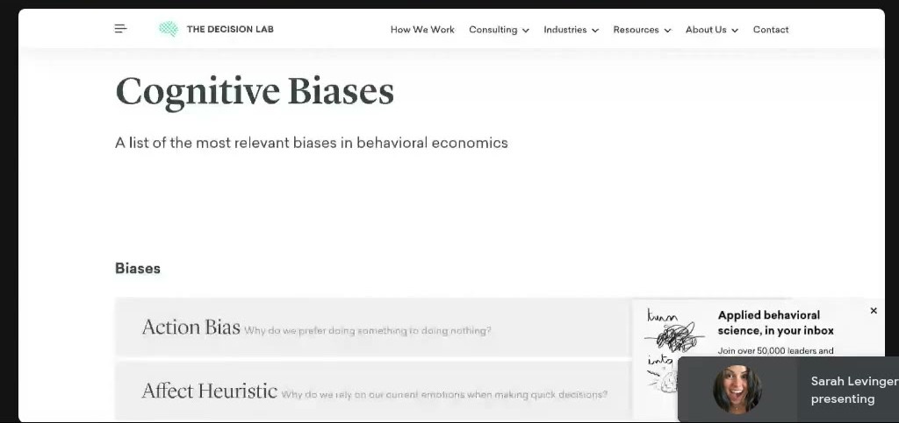
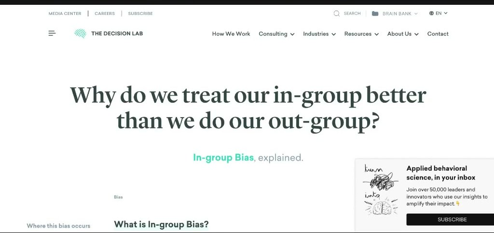

# Live With Sarah! (July 9, 2025)
> All-Q&A live call: a member's 5-heuristic chai ad test (scarcity won), handwritten vs system fonts, readable font sizes and PDP icons, Sarah's top-3 psychology books, B2B/free-trial psychology, "pay for access" framing, how to lower founder-video CPA with hyper-specific situations, real vs manufactured scarcity, and how to put heuristics into video hooks.

## 🤖 Agent use
- **Use when:** planning a heuristic test on an existing winner; writing UGC/founder hooks that need a sharper audience call-out; picking fonts and badge copy for statics; writing scarcity, "most customers buy this" or "not for everyone" copy; turning a heuristic name into a scripted hook.
- **Inputs → outputs:** a winning ad (or script) + product type (hedonic vs utilitarian) + customer's specific lived situation → headline/badge variants, one heuristic each, plus situational hooks for founder/UGC scripts and a test plan.
- **Rules:**
  - DO test heuristics by **iterating on the winning ad**: keep image, format and claims, change only the headline or badge, one heuristic per variant. [0:24:56–0:26:27; 0:29:12–0:30:15]
  - DO write scarcity as **evidence, not urgency**: "The golden milk that keeps selling out" beat social proof, authority, fluency and choice variants on ROAS and scaled. [0:26:20–0:26:46; 0:28:09–0:28:31]
  - DO use **handwritten fonts for hedonic (fun) products** and **structured/system fonts for utilitarian, problem-solving products**. Exception: handwritten fonts work when paired with a cartoon character or a personal-brand solopreneur. [0:06:08–0:09:10]
  - DO call out **one hyper-specific situation** in the first seconds of founder/UGC videos ("hair clogging the drain", "more hair in my shower than on my brush"). Generic call-outs make Meta chase the cheapest buyer *for Meta* and push CPA up. [0:38:37–0:41:44; 0:42:23]
  - DO **show, don't tell**: put the evidence of the problem on screen (a drain full of hair). [0:39:38–0:40:40]
  - DO use precise, odd stock numbers ("53 left", "57 left"), not round ones. [0:47:00–0:48:04]
  - DO manufacture scarcity with **limited, never-restocked drops** (curated sets, rotate pieces). DON'T run fake "closing down" or perpetual countdown sales. Customers know the next sale is coming. [0:43:49–0:47:00]
  - DO frame a costly ask (upfront payment, application) as **paying for access / getting to the front of the line**, and add "this isn't for everybody" language to build competition and scarcity. [0:33:23–0:37:31]
  - DO write "$0 trial" instead of "free trial". Find the snag where trial users "break" the product and fix it before they hit it. [0:21:49–0:23:53]
  - DO put heuristics mostly into **hooks** in video scripts (ostrich effect, in-group bias). [0:52:12–0:53:55]
  - DO use belief-changers that make the viewer second-guess a held belief ("It's not just genetics. You can reverse it."). [0:54:19–0:55:24]
  - DON'T let website body text drop below ~17px on mobile. ~20 is easiest to read. [0:10:14–0:11:19]
  - DON'T add USP icons to PDP images for luxury/elevated brands. DO test them for everyday products. [0:11:19–0:13:23]
- **See also:** [Heuristics](../../../concepts/heuristics.md) · [Heuristic stacking](../../../concepts/heuristic-stacking.md) · [Scarcity](../../../concepts/heuristics/scarcity-heuristic.md) · [Social proof](../../../concepts/heuristics/social-proof.md) · [Authority bias](../../../concepts/heuristics/authority-bias.md) · [Processing fluency](../../../concepts/heuristics/processing-fluency.md) · [Framing effect](../../../concepts/heuristics/framing-effect.md) · [Subconscious vs conscious mind](../../../concepts/subconscious-vs-conscious-mind.md) · [Heuristics 101 module](../02-heuristics-101/README.md)

*Skool page: title and video length only (57:40). No description or links.*

## TL;DR
- **Aazar Shad's chai test:** five headline variants on one winning static (social proof, scarcity, authority, fluency, binary choice). **Scarcity ("The Golden Milk That Keeps Selling Out") won** on ROAS and was the one that scaled. His lesson: "scarcity doesn't need urgency. It needs evidence." [0:24:56–0:29:12]
- **Fonts:** a study Sarah shared says customers are **5.43× more likely to buy hedonic products paired with handwritten fonts**. For utilitarian products the effect flips, so use structured fonts. A tax-debt client's handwritten-font versions "all bombed". [0:06:08–0:08:10]
- **Founder video with high CPA → too generic an audience.** Call out a very specific situation only your buyer would recognise (pilot "left the gas cap off" analogy). [0:38:37–0:41:44]
- **Real scarcity beats fake scarcity.** A lamp store's "closing" sale drew crowds who also bought full-price items (commitment bias / sunk cost). Manufacture it ethically with limited never-restocked drops and **precise odd numbers**. [0:43:49–0:48:04]
- **Books:** *Marketing to Mindstates* (Will Leach), *Predictably Irrational* (Dan Ariely), *The Elements of Choice* (Eric J. Johnson). Bonus: *The Biology of Belief*. [0:13:23–0:16:33; 0:55:24]
- **Heuristic lookup:** The Decision Lab's cognitive-bias list. Sarah offered to build a GPT that matches heuristics to a brand or industry. [0:49:06–0:51:11]

## Session map
| Time | Segment |
|---|---|
| [0:00:00] | Intro. Economy: "usually Sarah tells you do not run discounts… bundle." This year, because of tariffs, "do what you got to do". Consumers "just aren't into buying right now". |
| [0:01:58] | Format: all Q&A. Last week's call covered heuristics → bundle psychology ([July 2](2025-07-02-live-with-sarah.md)). Upcoming two-day intensive (10–12 people) and this month's free course, "Psychology 101". |
| [0:04:59] | Follow-up: did anyone test the "most customers bought this bundle" message? Put it on ads too. |
| [0:06:08] | Study: handwritten fonts × hedonic products (5.43×). |
| [0:07:08] | Darian: tax-debt client font test (clean Poppins won, handwritten bombed, Bart Simpson chalkboard works). |
| [0:09:10] | Faraz rapid-fire: shrinking website fonts, PDP icons vs clean images, top 2–3 psychology books. |
| [0:16:33] | Hidden book list in the community. Conversion Wise (CRO agency) tip. |
| [0:17:56] | Media buyers paid on contribution margin? (Sarah will make an intro.) |
| [0:18:40] | Chat: "most people buy this" briefed to clients. B2B SaaS VR app for elderly care, hospitals and schools. Free trials and demos. |
| [0:24:24] | Aazar Shad shares his 5-heuristic chai ad test (screen share). |
| [0:30:15] | Ahmed asks Aazar how much he iterated. Aazar shows the control ads. |
| [0:32:21] | Ahmed: getting cafés and restaurants to pay upfront for wholesale ice cream (vs net 30/60). |
| [0:37:31] | Faraz: founder video is a top performer but CPA is high. How to script new ones. |
| [0:41:44] | Yana: Reddit hair-loss line. Then her friends' lamp store and its "closing" sale. Chat: "only N copies". |
| [0:48:04] | Joe Hides: founder stories per pain point. Asks for a deeper heuristic list → The Decision Lab, GPT idea. |
| [0:51:59] | Follow-up: how to put heuristics into video scripts (ostrich effect, in-group bias demo). |
| [0:53:55] | "96% of behavior is subconscious". Changing beliefs. *The Biology of Belief*. |
| [0:56:27] | Prime Day was flat for many brands. Close. |

## Key ideas and Q&A

### Opening: market conditions and announcements [0:00:00–0:06:08]
- Sarah was asked whether brands should be more price-focused, with discounts and bundles. "100% yes. Usually Sarah tells you do not run discounts… bundle your products if you can. If you have to, this is the first year, just because of **tariffs** and where we are at economically… at this point do what you got to do." [0:00:57–0:01:14]
- She tracks a **DTC consumer index** (name garbled in audio) and the national consumer index: "people just aren't into buying right now." [0:01:02–0:01:58]
- Upcoming: a **two-day intensive** next week, capped at ~10–12 people, and a **free monthly course**. This month's is **"Psychology 101"**: a map of the psychology model categories and **when and where to apply each in marketing**, so that "if you come across a heuristic that you've never heard about… you have kind of a map of… how can I test this." Background: she has studied this for about 16–17 years, since her early 20s, from "weird 1980s textbooks" and college courses. [0:02:03–0:04:59]
- **Bundle follow-up:** test the CRO message "most customers buy this [bundle]" and **also put it on ads as a badge**. "I've seen that work incredibly well… a lot of different brands just saying *most customers buy this product* on an ad." In Faraz's setup it "did something very different than I thought". Details weren't given. [0:04:59–0:06:08]

### Study: handwritten fonts and hedonic products [0:06:08–0:07:08]
- From a study Sarah posted on Twitter/X: "customers are **5.43 times more likely to [buy] hedonic products**, like products that are just for fun, if they're paired with **handwritten fonts**." Examples of hedonic products: chocolate, kids' toys. Handwritten fonts "are interpreted as like a human". [0:05:37–0:07:08]
- "If you have a **utilitarian** product it seems like the effect is **opposite**… start testing a little bit more **system fonts like Times New Roman**, something that has… structure to it." [0:07:08–0:07:21]

### Q (Darian James): My tax-debt client's clean ads win and the handwritten versions bombed. Why? [0:07:21–0:09:10]
- **Context:** a non-e-com client, tax-debt negotiation ("we'll solve your tax debt or you don't pay"). Clean, simple text ads in **Poppins** "were all crushing it". He copied the same ads in a "scratchy" handwritten font: "all of them bombed". [0:07:21–0:08:10]
- **Sarah:** "It's not hedonistic… you have a problem, the IRS is chasing you." Handwritten fonts *might* help if the brand were a **solopreneur personal brand** (e.g., a tax guy with his own personality), "because it might affect… a little bit of trust". [0:08:10–0:08:37]
- Darian: his **Bart Simpson chalkboard-style** ads ("writing on the chalkboard… you're so protected, we don't pay") are working. They're handwritten but **include the character**. Sarah: "When you pair this handwritten [font] with some sort of **cartoon character**, now all of a sudden their brain is like, that makes sense." [0:08:37–0:09:10]
- "If you pair a handwritten font with a character it works. If you pair a handwritten font with no character it doesn't work… that's how deep this rabbit hole goes." [0:09:10]

### Q (Faraz, rapid-fire 1): Why are brands making website fonts smaller and smaller? [0:09:10–0:11:19]
- A UX trend from the last couple of years: "design is cyclical". Images are getting bigger and text smaller. "I think the brands are just testing." [0:09:38–0:10:14]
- **Benchmarks (verbatim-ish):** "The brain really can't read anything below about a **12 point** font size, especially on sites. **20** is about the average… for people to be able to easily read it without having to squint." [0:10:14–0:10:43]
- Faraz's site: **17 on mobile, 18 on desktop**. Should he go to 15? "I would keep it at 17. The closer you can get to 20 the better… after you get over 20 then it's like, this is getting [big]." [0:10:43–0:11:08]
- "I've seen a couple brands that have tested just **increasing their font sizes on landing pages** and that in itself could increase their conversion rate… just because people can read." [0:11:08–0:11:19]

### Q (Faraz, rapid-fire 2): Super-clean PDP images, or add ~3 USP icons? [0:11:19–0:13:23]
- A new trend: brands "put an ad inside their product image spaces", from **True Classic** and other big brands down to small ones, "and it works". [0:11:19–0:12:14]
- **Why it works (Sarah's view):** "Probably not for the reason we think… I think that's working because **Amazon does that**… it's an **association**. People have seen those type of images on Amazon, so if they see it on your site it makes a lot of sense to the brain." *(Wiki note: a familiarity/[processing fluency](../../../concepts/heuristics/processing-fluency.md) effect.)* [0:12:14–0:12:43]
- **Decision rule:** "If you are an **elevated brand**… luxury, high-end, super nice leather bags… **don't put icons** in there." For Faraz's hair care (utilitarian with hedonic elements: "the women who need it need it right now", but they also try many products): "put some icons in there, see what works." [0:12:43–0:13:23]

### Q (Faraz, rapid-fire 3): Your top 2–3 psychology books? [0:13:23–0:16:33]
1. ***Marketing to Mindstates* by Will Leach.** (Whisper heard "marketing to my mistakes". The title is confirmed by a "Marketing to Mindstates" browser tab in Aazar's screen share at [0:25:12].) "It… solidified for me how deep the emotional connection goes… and how sensitive we are to the weirdest things." Will is a friend of Sarah's who works with big brands (Pepsi, Coca-Cola, Frito-Lay). **Story:** a convenience store wanted to sell more chips to construction workers coming in for hot dogs at lunch. They added a strip of sequenced **fairy lights down the chip aisle**, and it "tripled the amount of chips that they sold for Frito-Lay" (Sarah: "I cannot remember the stat"). Lesson: "how sensitive humans are to the littlest, teeniest, tiniest things… the brain goes, follow." *(Wiki tag: [salience](../../../concepts/heuristics/salience-bias.md).)* [0:13:23–0:15:04]
2. ***Predictably Irrational* by Dan Ariely.** "Kind of controversial", because of a fabricated-data scandal. Sarah's understanding is that an intern fabricated the data. "Don't fabricate data." The book's premise as she frames it: given your childhood, parents and high-school experience, "we can pretty much tell you what kind of person you're gonna be." [0:15:04–0:15:58]
3. ***The Elements of Choice* by Eric Johnson** (Eric J. Johnson). About **choice architecture**: "how you present options to people is going to drastically change what they choose and how much of it they consume", including the **decoy effect** (covered in an earlier call) and which option is **pre-selected**. [0:15:58–0:16:33]
- A longer, "very hidden" list of less-known psychology books (some she rereads every year) is posted in the **community**. [0:16:33]
- **Attendee tip (Faraz):** follow the Twitter account of the CRO agency **Conversion Wise**, who treat PDP product photos "as somewhat like ads with the icons". Sarah runs an event with them every year and works with Paul there. "CRO and copywriting… are the closest you can get to… psychology application on a daily basis, because that's all they do: track and see if it changes one thing, what happens to the behavior." [0:16:33–0:17:56]

### Q (attendee): Any media buyers who work on a % of contribution margin? [0:17:56–0:18:40]
- Sarah knows one (one of the first people to hire her in the industry) who "would probably be willing to explore it". She'll connect them. She also offered referrals for CRO agencies and media buyers in general.

### Q (chat, then voice follow-up): Do you apply behavioral psychology to B2B SaaS? A VR-content app for elderly care, hospitals and schools [0:18:40–0:24:24]
- (Chat note first: an attendee has briefed clients to add "**most people buy this**" to their site.) [0:18:40]
- **B2B is a relationship between two employees.** "Real B2B sales comes down to generating a relationship between two employees [of] two different businesses. Do they like each other? Yes? Then you're probably going to make a sale." Whoever is at the front of the brand (usually sales, sometimes marketing) "got to have a **likable personality**." [0:18:40–0:19:57]
- **Know the real buyer:** not the nurses or RNs but the **CFO, CMO or head of operations**. That's "a very logical, focused person" who cares about whether it's "a worthwhile investment… **longevity of product** is pretty important". Retention depends on the product delivering consistent results for a long time. [0:19:57–0:21:08]
- **Follow-up:** the app has an installable trial at an accessible price, not a demo request. [0:21:08–0:21:49]
  - "Anytime you put the word **free** on there the brain is automatically going to respond. Sometimes though it responds better if you put a **dollar amount** on it. Instead of saying *free trial* we say **$0 trial**." [0:21:49–0:22:03]
  - **Trial users are looking for a break:** "I'm actually looking for one little piece of this that is just wrong enough so that I can get out before I have to pay." Sarah's anecdote: she tested an AI face-aging app before giving it to her son. It produced a choppy blend instead of a smooth one, and she deleted it. "One snag in the process and that was all it took." So find where efficiency-driven B2B buyers break the product and **fix it before they hit it**. [0:22:03–0:23:53]
  - Alternative to a free trial: a **"buy us a coffee" model**, e.g. pay ~$8 to look around. "Even a little bit of a monetary investment causes the brain to commit." [0:23:53–0:24:24]

### Member share (Aazar Shad): five heuristics on one winning chai static [0:24:24–0:30:15]
Aazar sells a golden-milk/chai brand (his side project). Sharing a write-up titled *"The 5 Psychological Triggers…"*, he explained that the control ads already used [framing](../../../concepts/heuristics/framing-effect.md) ("$0.50 per cup") and [fluency](../../../concepts/heuristics/processing-fluency.md), so he added **one extra heuristic per variant** ([stacking](../../../concepts/heuristic-stacking.md)), changing only the headline. [0:24:56–0:25:57]
- The variants: **social proof**, **scarcity** ("the golden [milk] that keeps selling out"), **authority** (a badge; spoken as roughly an "Indian grandma approved" idea, written in the doc as "Approved by Ayurvedic doctors"), **fluency** ("Simple summer golden milk, under $0.50, ready in 2 minutes") and **choice** ("choose one of them"). [0:25:12–0:26:20]
- Sarah guessed the choice ad ("more personalized"). **Winner: scarcity**, "the best [ROAS] ad is the golden milk that keeps [selling] out", like a TikTok-viral product that "blows up" on Facebook. [0:26:12–0:26:46]
- Next for Aazar: precise stock counts ("36 products left"). His personal favourite "darling" headlines come from customer-review language: a customer stopped Benadryl and melatonin, and another said her pain "melt[ed] away". (Part of this passage is garbled in the transcript.) [0:26:46–0:27:20]
- **Metrics:** Sarah asked how the choice ad did. Aazar: "the first one has [CPA] 15, the other one a [CPA] 17… that's like two dollars cheaper… and the FOMO one is **scalable** so I can put more money behind it, the other one is not." (Which ad had which CPA is ambiguous in the audio. The clear point: the scarcity ad scaled.) Choice heuristics aren't in Heuristics 101 yet. Sarah wants to expand the module and suggested **pairing them**: "the chai that sold out — which one would you pick?" [0:28:09–0:28:55]
- **Method lesson (Aazar):** "I actually **iterated on the winning ad**, not [came] up with a new ad altogether… then I would… have multiple variables and… not [know] which one won." Sarah recalled the 2015–2020 practice of one image with many headlines: "one of the best ways to figure something out." She added that statics are cheap to run. [0:29:12–0:30:15]
- **Q (Ahmed → Aazar): how much did you change?** Aazar showed the control ads. The image is AI-generated because they had no summer photo. He kept the elements known to work: the **outcome visual (the drink)**, the **spices on display**, and **"under 50 cents per cup"**. He made the cup look more real. "The only iteration was a headline." Sarah tied it to her community post on taking one core message and saying it "a million different ways… icons… pictures", giving people "a different **frame of reference** for how to process the information". [0:30:15–0:32:21]

### Q (Ahmed Almarri): How do I get cafés and restaurants to pay upfront instead of net 30/60? [0:32:21–0:37:31]
- **Context:** a wholesale ice-cream business for cafés and restaurants. The product is unique (custom flavours and recipes) and price isn't the problem. Paying upfront is simply not the industry norm. [0:32:21–0:33:23]
- **Sarah:** find "the biggest reason they wouldn't pay upfront" (net 30/60 is the norm, so they'll be "weirded out"). Then: "This is a **framing issue**. It's 100% just the [framing effect](../../../concepts/heuristics/framing-effect.md)… a lot of people will **pay to be shoved to the front of the line**." [0:33:23–0:34:59]
- **Analogy (Sarah's claim):** grocery stores in an area bid on delivery order. In her area King Soopers gets Sysco produce first, then Safeway, then Walmart, "so Walmart typically has the worst vegetable selection". Restaurants schedule deliveries rather than bid, but the access logic still holds. [0:34:59–0:35:29]
- **Procedure:** (1) do guerrilla research: ask local restaurants when they get deliveries and where they are in line; (2) pitch it as "if I can get your product to you faster than everybody else… and the ice cream has a better flavor, is more custom, and you can charge more for it, would you be willing to pay upfront to get that?"; (3) "You're paying up front **for access**." Example: paying $400 extra on a $1,200 Taylor Swift ticket to get in first. (4) Bring a list of local customers already served. (5) Point out they can charge more than competitors, so their **COGS look better** at month end. [0:35:29–0:36:59]
- **Ahmed: add an application process?** Yes. "If you're deemed fit (which people want to be deemed fit), then these are our terms." Use sales language like "**this isn't for everybody**, or this may not be for you, but I want to check… if it is possibly a good fit". [0:36:59–0:37:41]
- **Transfer to e-com ads:** "We don't do this really enough in e-com… *this is not the shirt for everyone… this hair care product doesn't work for everyone… but it might work for you*." It "creates a little bit of competition" and limited availability: "you're building **automatic scarcity**." [0:37:31–0:38:09]

### Q (Faraz): My 90-second founder video is a top performer, but its CPA is high. What should the new founder videos change? [0:37:31–0:41:44]
- Setup: the product doesn't appear until second 18. He's shooting new founder videos and wants scripts Meta will see as different and that beat the control. [0:37:31–0:38:55]
- **Diagnosis:** "CPA in my experience comes down to **situational awareness**… it almost always comes down to the fact that we're bringing in **too generalized of a person**." Meta looks for a mid- to bottom-funnel buyer. If it can't find one, it keeps adjusting budget to find the cheapest buyer. "The cheapest person for Meta might not be the cheapest person for you… if the price they can get a customer at is $77 and you need it to be $30, oh well." [0:38:55–0:39:38]
- **Fix 1: call out a specific situation** so Meta can zero in on the person who's ready to buy. For thinning hair: "There's now **hair clogging the drain**… it's actually now all over the house. You can see evidence of something that you don't want." Show the drain with hair in it: "This is not just annoying, it's actually fixable." → "**Show, don't tell.**" [0:39:38–0:40:40]
- **Fix 2: get "super crazy specific".** Her husband's private-pilot story: in pilot communities, taking off with the **gas cap left off** is a running joke that only pilots would recognise. "There's one specific experience your women are having… sunburning a lot easier might be a thing for women who are losing hair… it happens in every community, in every industry." Faraz: "Call that out in the beginning of the ad to have the right audience." Yes. [0:40:40–0:41:44]
- **Yana's add (from Reddit research):** "I'm so done seeing **more hair in my shower than on my brush**." Sarah: "Oh, that's a great one." [0:41:44–0:42:38]

### Q (Yana Zhurovich): A lamp store's "closing" sale brought crowds who also bought full-price items. How do you keep that momentum? [0:42:38–0:48:04]
- **Context:** her friends' brick-and-mortar lighting/home-decor store planned to close and go online. They ran Meta ads announcing a closing sale. Shoppers bought sale items **and full-price items**, enough profit that the shop stayed open. [0:42:38–0:43:49]
- **Sarah:** the ad used closing language, which created **actual scarcity** and real urgency: "You won't be able to get this ever again." Brands that run perpetual "we're closing" ads are being shady. [0:43:49–0:44:53]
- **Fake scarcity fails:** "We're only running this sale for the next 10 days… customers don't care. They're like, you're gonna run another one in six weeks anyway… I'll just wait." [0:44:53–0:45:34]
- **Why full-price items sold:** "I'm already here." That's **commitment bias** and the **sunk cost fallacy**: "you already put in a little bit of effort, so you might as well just go all the way." Her example: "I already ate two bites [of my son's ice cream], so I'm gonna eat the whole thing." [0:45:34–0:45:58]
- **How to manufacture it without lying:** "We have brought in **101 pieces** of inventory that are all very special… once these are gone we're never bringing in this specific inventory again." That's the **art-gallery model**: "they're always selling art… you just can't get that piece of art ever again." Procedure: hide inventory → **categorise it into logical buckets** (e.g., lamps with shells, black lamps) → put out only specific pieces → "once you get that lamp, we don't have any more" → **rotate**. [0:45:58–0:47:00]
- **Chat (Subhadeep Koley): "We also only sell N copies of this. I guess this works better for creating scarcity for D2C?"** "Exactly." From a study she saw on Twitter: give a **precise number, specifically an odd one**: "we have **53** of these left… **57** left." It "increases people's likelihood to buy and also increases **AOV**, because they're like, oh, this is part of an actual set." [0:47:00–0:48:04]

### Q (Joe Hides): Founder stories per pain point, and is there a deeper heuristic list we can match to brands? [0:48:04–0:51:59]
- **Joe's share:** a **positioning test** showed their shampoo solves several problems (**thinning hair, hair loss, itchy scalp**). They split these into pain-point narratives and made a **founder story for each pain point**, which let them scale the founder-story format. [0:48:04–0:49:06]
- **Question:** his team knows the basics (social proof etc.) and wants "the tiny little nitty-gritty" for 1% gains: a list or checklist of heuristics to match to each of ~30 brands. [0:49:06–0:50:06]
- **Sarah:** Heuristics 101 is in the classroom ([module](../02-heuristics-101/README.md), [e-book](../../../resources/heuristics-101-ebook.md)). She'll send **The Decision Lab**'s huge bias list ("hundreds" of entries, organised by when and where each applies), from "an agency that works… predominantly with non-profits". She'd like to host it on her site. [0:49:06–0:50:55]
- **GPT offer:** "I might be able to come up with just like a **GPT** that could probably match it for you… heuristics to your brand or to your industry." Attendees wanted it. [0:50:55–0:51:11]
- **How matching works:** "All these heuristics technically will work, because they are just shortcuts that exist in the human brain for every human on the planet… tested across cultures." Which one applies to a brand depends on the **product (it has to match behaviorally)** and the **time of year**: "sometimes customers are going to be really price sensitive, other times they're not. Sometimes… really sensitive to authority proof and other times they won't care at all." So test. [0:51:11–0:51:59]

*Sarah's screen share of The Decision Lab "Cognitive Biases: A list of the most relevant biases in behavioral economics" (Action Bias, Affect Heuristic…). It's her go-to lookup for heuristics beyond Heuristics 101. [0:52:30]*

### Q (follow-up to Joe): How do you put heuristics into video ads and scripts? [0:51:59–0:53:55]
"Mostly in **hooks**, I would say, just because it's easier to put them in there real quick." [0:53:44]
- **Ostrich effect** ("why do we prefer to ignore negative information?"): founder-video hook: "There's hair all over the floor and I'm just not going to look at it… my friend is noticing there's hair on my car seat when I get out. I'm just not going to look at it." Then the turn: "Even if you ignore it, it's still there. You're still losing your hair… and I have a very good way for you to fix it." Show it visually. [0:52:12–0:53:32]
- **In-group bias** ("we treat people who are like us a lot better"): show two women, one losing her hair and one not. A friend walks up to the one losing hers: "I'm losing mine too. It's totally fine, because I found this shampoo… nobody will even know." [0:53:32–0:53:55]

*"Why do we prefer to ignore negative information? The Ostrich Effect, explained." Sarah picked it at random from the list and turned it into a founder-video hook. [0:53:15]*

*"Why do we treat our in-group better than we do our out-group? In-group Bias, explained." The second hook demo. [0:54:00]*

### Comment (attendee): "Jordan Peterson says 96% of your behavior is subconscious" [0:53:55–0:56:27]
- Sarah: "**95%** of the decisions we make on a daily basis are coming out of the subconscious mind… it's very emotional." You program it constantly through repeated behaviors (habits). See [subconscious vs conscious mind](../../../concepts/subconscious-vs-conscious-mind.md). [0:54:19–0:54:54]
- **Changing it:** "The easiest way to change the subconscious is to cause yourself to **second-guess** things, and that's what we do in marketing all the time… cause someone to question: is what you believe actually real?" Some people find this "too existential", but for most products it works. **Belief-changer example:** "You don't have to just go bald. It's not just gonna happen to you. I know people just say it's **genetics**. It's not. You can reverse it." Once people question a belief, "they'll start moving their behavior towards that." [0:54:54–0:55:50]
- **Fourth book:** ***The Biology of Belief*** (author not named. *Context, not from course: Bruce H. Lipton.*), on "how beliefs get injected into humans and how deep they go". [0:55:24–0:56:27]

### Close [0:56:27–0:57:40]
- Lesley Cramer: Prime Day "was not as much fun" (for her personally, not her brand). Sarah: "I heard that from a lot of brands. Prime Day did not do well for some… customers were just like, meh." [0:56:27–0:57:00]
- "Once you see all this psychology stuff you can't unsee it." [0:57:00]

## Ad teardowns

### Control ads: "This is what I serve guests now instead of sweet tea" (two winning formats)

*Aazar's existing winners. Top: quote headline "This is what I serve guests now instead of sweet tea." with "Caffeine-free. Sugar-free. Cinnamon, nutmeg, and turmeric in every cup. All for just under $0.50 per cup" and a "Get Your Summer Glow" button. Bottom: "This Is the Chai People Serve Instead of Sweet Tea" with labelled spices around the cup. Doc note: "The second format works really well." [0:25:25; spoken 0:30:25–0:31:20]*

| Brand / product (niche) | Format | Hook / opening | What works | What fails | Fix suggested | Principle | Source |
|---|---|---|---|---|---|---|---|
| Aazar Shad's chai / golden-milk brand (DTC beverage) | Static, AI-generated drink image | "This is what I serve guests now instead of sweet tea." / "This Is the Chai People Serve Instead of Sweet Tea" | Replacement framing (vs sweet tea), price framing "under $0.50 per cup", spices visible as proof, outcome visual of the drink. Already winners. | Nothing stated. Aazar made the cup look more real in later versions. | Use as the control. Change only the headline, one heuristic per variant. | Iterate on winners. Keep proven elements constant. | [0:24:56–0:25:57; 0:30:25–0:31:33] |

### Variant 1: Social proof, "Why 10,000 Chai Lovers are Switching to This Golden Milk Tea."

*Doc section "1. Social Proof: Give the crowd a face". Aazar writes that Sarah helped rewrite "10,000+ customers" into a tribal "movement" line. Callouts: 7 real spices, under $0.50 per cup, ready in 2 minutes. [0:25:12]*

| Brand / product (niche) | Format | Hook / opening | What works | What fails | Fix suggested | Principle | Source |
|---|---|---|---|---|---|---|---|
| Chai brand (DTC beverage) | Static, hand holding cup, spice ring | "Why 10,000 Chai Lovers are Switching to This Golden Milk Tea." | Per doc: "'Chai lovers' made it tribal. 'Switching' made it a movement. The number added credibility without screaming it. Using the 'golden milk' was important." "Held attention longer and spiked interest." | Lost to scarcity on ROAS. | Nothing stated. | [Social proof](../../../concepts/heuristics/social-proof.md): give the crowd a face (identity + movement verb). Wiki tags: Zone 2-leaning positive, [Actual self](../../../concepts/actual-self.md) ("chai lovers"). | [0:25:12–0:25:45] |

### Variant 2 (WINNER): Scarcity, "The Golden Milk That Keeps Selling Out"

*Doc section "2. Scarcity: Quiet FOMO is still FOMO": "I used to think scarcity had to be loud… No countdown timers. Just a believable signal of demand. No extra visuals needed. The lesson I learned here was, scarcity doesn't need urgency. It needs evidence." [0:25:48]*

| Brand / product (niche) | Format | Hook / opening | What works | What fails | Fix suggested | Principle | Source |
|---|---|---|---|---|---|---|---|
| Chai brand (DTC beverage) | Static, same layout as V1 | "The Golden Milk That Keeps Selling Out" | **Best ROAS and the variant that scaled.** Quiet scarcity: demand evidence with no countdown. Also implies [social proof](../../../concepts/heuristics/social-proof.md) (others keep buying). Like "TikTok viral product → blows up on Facebook". | Nothing stated. | Next: precise counts ("36 products left"). Sarah: pair with choice ("the chai that sold out — which one would you pick?"). | [Scarcity](../../../concepts/heuristics/scarcity-heuristic.md) as evidence, not urgency. Wiki tags: Zone 2 (FOMO/excitement), [Actual self](../../../concepts/actual-self.md) (wants what others have). | [0:26:20–0:26:46; 0:28:09–0:28:55] |

### Variant 3: Authority, "Your Evening Glow Chai" + "Approved by Ayurvedic doctors" badge

*Doc section "3. Authority: People trust specifics": "'Trusted by experts' is a lazy phrase. Here's what we tried instead: 'Approved by Ayurvedic doctors'… Specific job titles + real contexts. No big claims, just credibility from the right lens… P.S. Make sure you make a BIG + relevant badge that most people are aware of already when they see it." Headline "Your Evening Glow Chai — Helps Unwind Before Bedtime", with each spice labelled by benefit and a round badge on the cup. [0:26:02]*

| Brand / product (niche) | Format | Hook / opening | What works | What fails | Fix suggested | Principle | Source |
|---|---|---|---|---|---|---|---|
| Chai brand (DTC beverage) | Static, cup centred with spice-benefit callouts and badge | "Your Evening Glow Chai — Helps Unwind Before Bedtime" + badge "Approved by Ayurvedic doctors" (spoken as an "Indian grandma approved" idea) | Specific authority title instead of "trusted by experts". Customers love the "unwind before bed time" use-case. | Lost to scarcity. | Make the badge big and instantly recognisable (doc P.S.). | [Authority bias](../../../concepts/heuristics/authority-bias.md): specific > generic. Wiki tags: Zone 1 (calm, unwind), [Ought self](../../../concepts/ought-self.md) (expert-approved). | [0:25:57–0:26:06] |

### Variant 4: Fluency, "Simple Summer Golden Milk. Under $0.50. Ready in 2 Minutes"

*Doc section "4. Fluency: Make it simple". The static reads "SIMPLE SUMMER GOLDEN MILK. UNDER $0.50, READY IN 2 MINUTES" over a plain drink shot. Doc: "Sarah talks about processing fluency, when a message is easy to understand, it's more likely to be believed. So instead of clever or clever-ish lines, we tried…" [0:26:11]*

| Brand / product (niche) | Format | Hook / opening | What works | What fails | Fix suggested | Principle | Source |
|---|---|---|---|---|---|---|---|
| Chai brand (DTC beverage) | Static, bold condensed headline, plain cup | "Simple summer golden milk. Under $0.50. Ready in 2 Minutes" | Per doc: "Instantly visual. No buzzwords. Just outcome, time, and replacement. Easy to consume within 0.2 seconds. People want decisions that feel easy." | Lost to scarcity. | Nothing stated. | [Processing fluency](../../../concepts/heuristics/processing-fluency.md). Wiki tags: Zone 1, [Actual self](../../../concepts/actual-self.md). | [0:26:06–0:26:12] |

### Variant 5: Choice, "Which Summer Chai Would You Choose?"

*Doc section "5. Choice Heuristics: Binary frames work": "Don't make people scroll through 6 options. Just give them a simple A vs B. 'Which would you choose?'" Two drinks side by side: golden milk and an iced chai. [0:26:16]*

| Brand / product (niche) | Format | Hook / opening | What works | What fails | Fix suggested | Principle | Source |
|---|---|---|---|---|---|---|---|
| Chai brand (DTC beverage) | Static, two products side by side | "Which Summer Chai Would You Choose?" | Binary A-vs-B choice. Sarah predicted it would win because it's "more personalized". CPA was within ~$2 of the winner. | **Didn't scale** like the scarcity ad. | Pair with scarcity: "The chai that sold out — which one would you pick?" | Choice architecture / binary frame (not yet in Heuristics 101). Wiki tags: Zone 1–2, [Actual self](../../../concepts/actual-self.md). | [0:26:12–0:26:27; 0:28:09–0:28:55] |

### Described ads (not shown on screen)
| Brand / product (niche) | Format | Hook / opening | What works | What fails | Fix suggested | Principle | Source |
|---|---|---|---|---|---|---|---|
| Darian's tax-debt negotiation client (services, non-e-com) | Text statics in clean Poppins vs "scratchy" handwritten copies | Offer: "we'll solve your tax debt or you don't pay" | Clean, structured font "all crushing it" | Same ads in a handwritten font "all bombed". Not a hedonic product. | Keep structured/system fonts for problem-solving offers. Handwritten only for a personal-brand solopreneur or with a character. | Font must match hedonic vs utilitarian product | [0:07:21–0:08:37] |
| Same client: Bart Simpson chalkboard ads | Cartoon static, chalkboard handwriting | "You're so protected, we don't pay" written on a chalkboard (paraphrased) | Working "quite well". The cartoon character makes the handwriting make sense to the brain. | n/a | Pair handwritten fonts with a character | Font-context fit | [0:08:37–0:09:10] |
| Faraz's hair-care founder video (DTC hair care, brand name unclear in audio) | ~90-second founder video, product appears at 0:18 | Not quoted | One of the best scripts of the year | CPA too high: audience too generalised | Open with one hyper-specific situation (hair clogging the drain, "more hair in my shower than on my brush"). Show evidence on screen. Test heuristic hooks (ostrich effect, in-group). | Situational specificity lowers CPA | [0:37:31–0:42:38; 0:52:12–0:53:55] |
| Joe Hides's hair-care brand: founder stories (DTC shampoo) | Founder videos, one per pain point | Thinning hair / hair loss / itchy scalp narratives | Positioning test found several problems the shampoo solves. A founder story per pain point scaled the format. | n/a | n/a | Segment one product into several pain-point narratives | [0:48:04–0:49:06] |
| Yana's friends' lamp store (brick-and-mortar home lighting) | Meta ads announcing a closing sale | "We're closing" sale | Real scarcity drove footfall. Full-price add-on purchases kept the shop open. | Can't be repeated honestly | Limited never-restocked drops, rotated. Precise odd counts. | Real scarcity + commitment / sunk cost | [0:42:38–0:48:04] |
| Frito-Lay convenience-store test (from *Marketing to Mindstates*) | In-store environment, not an ad | Sequenced fairy lights down the chip aisle | Reportedly tripled chip sales to lunch-break construction workers | n/a | n/a | Tiny salient cues guide behaviour ("the brain goes, follow") | [0:13:39–0:14:28] |

### Session summary teardown table
| Brand / product (niche) | Format | Hook / opening | What works | What fails | Fix suggested | Principle | Source |
|---|---|---|---|---|---|---|---|
| Chai brand: control | Static | "This is what I serve guests now instead of sweet tea." | Replacement + price framing, spices as proof | n/a | Keep as control | Iterate on winners | [0:30:25] |
| Chai: social proof | Static | "Why 10,000 Chai Lovers are Switching…" | Tribal identity + movement verb | Lost to scarcity | n/a | Social proof with a face | [0:25:12] |
| Chai: scarcity (**winner**) | Static | "The Golden Milk That Keeps Selling Out" | Best ROAS, scaled | n/a | Precise counts. Pair with choice. | Scarcity needs evidence, not urgency | [0:26:20] |
| Chai: authority | Static + badge | "Your Evening Glow Chai" / "Approved by Ayurvedic doctors" | Specific authority | Lost | Bigger, recognisable badge | Specific authority beats generic | [0:25:57] |
| Chai: fluency | Static | "Simple summer golden milk. Under $0.50. Ready in 2 Minutes" | Easy in 0.2 s | Lost | n/a | Processing fluency | [0:26:06] |
| Chai: choice | Static | "Which Summer Chai Would You Choose?" | Personal, ~$2 CPA gap | Didn't scale | Combine with scarcity | Binary choice frame | [0:26:12; 0:28:09] |
| Tax-debt client | Text static | Clean Poppins vs handwritten | Clean won | Handwritten bombed | Structured fonts | Utilitarian → structured font | [0:07:21] |
| Tax-debt client | Cartoon static | Bart Simpson chalkboard | Works | n/a | n/a | Handwriting + character | [0:08:37] |
| Hair-care founder video | Founder UGC | n/a | Top script | High CPA | Hyper-specific situational opener | Situational awareness | [0:38:37] |
| Hair-care founder stories | Founder UGC | Per pain point | Scaled | n/a | n/a | Pain-point segmentation | [0:48:04] |
| Lamp store | Meta sale ad | Closing sale | Real scarcity, add-on buys | Not repeatable | Limited drops | Commitment / sunk cost | [0:43:49] |

## Hooks
*Heuristic, zone and self tags are wiki interpretation unless the course states them.*

| Hook (verbatim or near) | Heuristic(s) | Emotion / zone | Self targeted | Why it works | Source |
|---|---|---|---|---|---|
| "The Golden Milk That Keeps Selling Out" | [Scarcity](../../../concepts/heuristics/scarcity-heuristic.md) + implied [social proof](../../../concepts/heuristics/social-proof.md) | FOMO, Zone 2 | Actual | Believable demand evidence with no countdown. Won the 5-way test. | [0:26:20] |
| "Why 10,000 Chai Lovers are Switching to This Golden Milk Tea." | [Social proof](../../../concepts/heuristics/social-proof.md) | Curiosity/belonging, Zone 2 | Actual (tribe) | "Chai lovers" = tribe. "Switching" = movement. A number without screaming. | [0:25:12] |
| "Approved by Ayurvedic doctors" (badge) | [Authority](../../../concepts/heuristics/authority-bias.md) | Reassurance, Zone 1 | Ought | Specific title instead of "trusted by experts" | [0:25:57] |
| "Simple summer golden milk. Under $0.50. Ready in 2 Minutes" | [Fluency](../../../concepts/heuristics/processing-fluency.md), [framing](../../../concepts/heuristics/framing-effect.md) (price per cup) | Easy, Zone 1 | Actual | Outcome + time + replacement in 0.2 s | [0:26:06] |
| "Which Summer Chai Would You Choose?" | Binary choice frame | Playful, Zone 1–2 | Actual | Personal A-vs-B question invites a mental pick | [0:26:12] |
| "This is what I serve guests now instead of sweet tea." | Replacement framing, social signalling | Warm, Zone 1 | Actual / Ideal (good host) | First-person quote with a replacement frame | [0:30:25] |
| "Most customers buy this [bundle/product]" (badge) | [Social proof](../../../concepts/heuristics/social-proof.md), default choice | Reassurance, Zone 1 | Actual | Removes choice anxiety. "Seen that work incredibly well" on ads. | [0:05:49] |
| "I'm so done seeing more hair in my shower than on my brush." | Situational specificity, in-group recognition | Frustration, Zone 3 | Actual | A lived detail only the target has experienced (Reddit language) | [0:42:23] |
| Drain full of hair on screen: "This is not just annoying, it's actually fixable." | Show-don't-tell, [salience](../../../concepts/heuristics/salience-bias.md) | Annoyance → hope, Zone 3 | Actual | Visible evidence of an unwanted change | [0:40:09] |
| "There's hair all over the floor and I'm just not going to look at it… there's hair on my car seat… I'm just not going to look at it." | Ostrich effect | Avoidance/denial, Zone 3 | Actual | Names the avoidance behaviour, then breaks it ("even if you ignore it, it's still there") | [0:52:39] |
| Friend to a woman losing her hair: "I'm losing mine too. It's totally fine, because I found this shampoo… nobody will even know." | In-group bias | Relief, Zone 1 | Actual | Peer like me, not a brand | [0:53:32] |
| "You don't have to just go bald… people say it's genetics. It's not. You can reverse it." | Belief challenge (second-guessing) | Hope, Zone 2 | Ideal | Makes the viewer question a fatalistic belief | [0:55:00] |
| "This isn't for everybody… but it might work for you." | Scarcity, exclusivity | Curiosity, Zone 1–2 | Actual | Creates competition and "automatic scarcity" | [0:37:31] |
| "Only 53 left" (precise odd number) | [Scarcity](../../../concepts/heuristics/scarcity-heuristic.md) | Urgency, Zone 2 | Actual | Precise odd numbers feel real. Raises likelihood to buy and AOV. | [0:47:52] |

## Angles
| Angle | Core desire / pain | Heuristic(s) | Best format | Example line | Source |
|---|---|---|---|---|---|
| Hyper-specific lived evidence of the problem | Hair loss shows up around the house, not just on the head | Situational specificity, show-don't-tell | Founder or UGC video, first 3 s | "More hair in my shower than on my brush." | [0:39:38–0:42:38] |
| One product, many pain-point narratives | Each segment's own problem (thinning, loss, itchy scalp) | Self-relevance | Founder stories | One founder story per pain point | [0:48:04] |
| Pay for access / front of the line | Getting the best, first | [Framing](../../../concepts/heuristics/framing-effect.md), exclusivity | B2B pitch, application funnel | "You're paying upfront to get to the front of the line." | [0:35:29] |
| Limited, never-restocked drop | Fear of missing a one-off piece | [Scarcity](../../../concepts/heuristics/scarcity-heuristic.md), commitment | Statics, in-store, email | "101 special pieces… once these are gone, never again." | [0:45:58] |
| Quiet demand scarcity | Want what everyone's buying | [Scarcity](../../../concepts/heuristics/scarcity-heuristic.md) + [social proof](../../../concepts/heuristics/social-proof.md) | Static headline | "The golden milk that keeps selling out" | [0:26:20] |
| Belief reversal | "It's genetic, nothing I can do" | Second-guessing / belief change | UGC/founder hook | "It's not genetics. You can reverse it." | [0:55:00] |
| "Not for everyone" qualification | Being chosen | Exclusivity, scarcity | Ad copy, landing page | "This hair care product doesn't work for everyone… but it might work for you." | [0:37:31] |

## Rewrites (before → after)
| Before | After | What changed (verb / visual / promise / self / intensity) | Source |
|---|---|---|---|
| "10,000+ customers" | "Why 10,000 chai lovers are switching to this golden milk tea" | Faceless number → tribe ("chai lovers") + movement verb ("switching"). Rewritten with Sarah, per Aazar's doc. | [0:25:12] |
| "Trusted by experts" | "Approved by Ayurvedic doctors" | Generic → specific authority title (doc) | [0:26:02] |
| Clever headline lines | "Simple summer golden milk. Under $0.50. Ready in 2 Minutes" | Cleverness → outcome + price + time (fluency) | [0:26:11] |
| "Free trial" | "$0 trial" | Word → explicit dollar amount | [0:21:58] |
| "Sale ends in 10 days" (fake urgency) | "We brought in 101 special pieces. Once they're gone we're never bringing them in again." | Time pressure → real scarcity (inventory-based) | [0:44:53–0:46:30] |
| "We have 20 / 50 left" | "We have 53 / 57 left" | Round → precise odd number | [0:47:52] |
| "Please pay upfront" (vs net 30/60) | "Pay upfront to get delivered first, better and custom, so you can charge more" | Cost → access / front of line | [0:35:29–0:36:59] |
| Generic thinning-hair call-out | Drain clogged with hair on screen: "This is not just annoying, it's actually fixable." | Tell → show. Generic → situational. | [0:40:09] |
| Six product options | "Which would you choose?" (A vs B) | Many choices → binary frame (Aazar's doc) | [0:26:16] |

## Rules of thumb
- **DO** test one heuristic per variant on top of a proven winner, changing the headline only. [0:29:12]
- **DO** treat statics as the cheap testing ground for heuristics. [0:29:12]
- **DO** write scarcity as demand evidence ("keeps selling out") rather than countdowns. [0:26:20]
- **IF** the product is hedonic (chocolate, toys, treats) **THEN** test handwritten fonts. **IF** it's utilitarian or problem-solving **THEN** use structured/system fonts. [0:06:08–0:07:21]
- **IF** using a handwritten font on a utilitarian offer **THEN** pair it with a character or a personal brand. [0:08:10–0:09:10]
- **DO** keep site body text ≥17px on mobile, as close to 20 as the design allows. **DON'T** go below ~12. [0:10:14–0:11:08]
- **IF** the brand is luxury/elevated **THEN** keep PDP images clean. **ELSE** test 3 USP icons (an Amazon-familiar pattern). [0:12:14–0:13:23]
- **DO** test "most customers buy this" as an ad badge, not only on the PDP. [0:05:49]
- **IF** a founder/UGC video has high CPA **THEN** sharpen the opening to one specific situation. Meta is pulling too broad an audience. [0:38:55–0:39:38]
- **DO** mine Reddit for verbatim lived-experience lines. [0:42:23]
- **DO** put heuristics in the hook of video scripts. [0:53:44]
- **DON'T** fake "closing down" or recurring "10-day" sales. **DO** use limited drops and rotate inventory. [0:44:21–0:47:00]
- **DO** use precise odd stock numbers. [0:47:52]
- **DO** say "$0 trial". **DO** find and fix the "break point" trial users look for. Consider a small paid entry ("buy us a coffee") to create commitment. [0:21:49–0:24:10]
- **IF** selling B2B **THEN** sell to the logical decision-maker (CFO/COO/CMO) on ROI and longevity, and make sure the front-facing person is likable. [0:19:13–0:21:08]
- **IF** asking for a costly commitment **THEN** frame it as access or priority and qualify with "this isn't for everybody". [0:34:42–0:37:41]
- **DO** choose heuristics by behavioural fit with the product and by season (price-sensitive periods vs authority-sensitive ones). [0:51:11]
- **This year only:** discounts and bundles are acceptable because of the tariff economy (normally Sarah advises against discounts). [0:00:57]

## Resources mentioned
| Item | Type | What Sarah said | Source |
|---|---|---|---|
| *Marketing to Mindstates*, Will Leach | Book | #1 pick. Emotional connection runs deep. Frito-Lay fairy-light story. | [0:13:23–0:15:04] |
| *Predictably Irrational*, Dan Ariely | Book | #2. Controversial (data-fabrication scandal) but brilliant thinking. | [0:15:04–0:15:58] |
| *The Elements of Choice*, Eric J. Johnson | Book | #3. Choice architecture, decoys, pre-selection. | [0:15:58–0:16:33] |
| *The Biology of Belief* (Bruce H. Lipton; author not named in session) | Book | How deep beliefs go | [0:55:24–0:55:58] |
| Sarah's hidden list of lesser-known psychology books | Community post | Some she rereads yearly | [0:16:33] |
| The Decision Lab, cognitive biases list | Website | Huge bias list organised by when and where each applies | [0:49:06–0:50:55; 0:52:12] |
| Conversion Wise (CRO agency, "Paul") | Agency / Twitter account | PDP images as ads with icons. Sarah runs a yearly event with them. | [0:16:33–0:17:56] |
| Heuristics-to-brand GPT | Planned tool | Sarah offered to build it | [0:50:55–0:51:11] |
| Psychology 101 free course (July 2025) | Course | Map of psychology model categories and where each fits | [0:03:04–0:04:59] |
| Two-day intensive | Workshop | Deep creative-strategy psychology, 10–12 people | [0:02:58] |
| DTC consumer index and national consumer index | Data | Sarah tracks both. Consumers are holding back. | [0:01:02] |
| Study: handwritten fonts × hedonic products, 5.43× | Study (via Sarah's Twitter) | Opposite effect for utilitarian products | [0:05:37] |
| Study: precise odd scarcity numbers | Study (via Twitter) | Raises purchase likelihood and AOV | [0:47:00] |

**Metrics and benchmarks:** readable font ≥12pt minimum, ~20 ideal, 17 mobile acceptable [0:10:14]. Aazar's chai test: CPAs ~$15 vs ~$17 (scarcity scalable) [0:28:25]. Handwritten font effect 5.43× for hedonic products [0:05:37]. 95% of daily decisions are subconscious (Sarah) vs "96%" (Jordan Peterson, via attendee) [0:54:13]. Frito-Lay fairy lights "tripled" chip sales (Sarah unsure of the exact stat) [0:14:22].

## Notable quotes
- "Scarcity doesn't need urgency. It needs evidence." (Aazar's doc) [0:25:48]
- "If you pair a handwritten font with a character it works. If you pair a handwritten font with no character it doesn't work." [0:09:10]
- "The cheapest person for Meta might not be the cheapest person for you." [0:39:38]
- "CPA in my experience comes down to situational awareness." [0:38:55]
- "You're not paying upfront for no reason at all. You're paying upfront to get to the front of the line." [0:35:29]
- "Even a little bit of a monetary investment causes the brain to commit." [0:24:04]
- "All these heuristics technically will work, because they are just shortcuts that exist in the human brain for every human on the planet." [0:51:11]
- "The easiest way to change the subconscious is to cause yourself to second-guess things, and that's what we do in marketing all the time." [0:54:54]

## How to apply
- [ ] Take your best static. Write five headline-only variants (social proof with a tribe noun, quiet scarcity, specific authority, fluency, binary choice) and run them against the control.
- [ ] Classify the product as hedonic or utilitarian and choose the font family to match.
- [ ] For every founder/UGC script, write three hyper-specific situational openers from Reddit and review language, and show the evidence on screen.
- [ ] Convert one heuristic from The Decision Lab list into a hook (ostrich effect, in-group bias…).
- [ ] Replace any round stock number with a precise odd one. Replace fake countdowns with a limited, never-restocked drop.
- [ ] Add "most customers buy this" as a badge test on ads.

## Related
- Brand case files: [Golden-milk chai (Aazar Shad)](../../../brands/golden-milk-chai-aazar-shad.md) · [Canvas Gelato](../../../brands/canvas-gelato.md) · [all brands by niche](../../../brands/README.md)
- Tool pages: [The Decision Lab](../../../tools/the-decision-lab.md)
- [Heuristics](../../../concepts/heuristics.md) · [Heuristic stacking](../../../concepts/heuristic-stacking.md) · [Scarcity](../../../concepts/heuristics/scarcity-heuristic.md) · [Social proof](../../../concepts/heuristics/social-proof.md) · [Authority bias](../../../concepts/heuristics/authority-bias.md) · [Processing fluency](../../../concepts/heuristics/processing-fluency.md) · [Framing effect](../../../concepts/heuristics/framing-effect.md) · [Salience bias](../../../concepts/heuristics/salience-bias.md)
- Heuristics named in this session: [Commitment and consistency](../../../concepts/heuristics/commitment-and-consistency.md) · [Sunk cost fallacy](../../../concepts/heuristics/sunk-cost-fallacy.md) · [Ostrich effect](../../../concepts/heuristics/ostrich-effect.md) · [In-group bias](../../../concepts/heuristics/in-group-bias.md) · [Decoy effect](../../../concepts/heuristics/decoy-effect.md)
- [Subconscious vs conscious mind](../../../concepts/subconscious-vs-conscious-mind.md) · [Emotional zones](../../../concepts/emotional-zones.md) · [Three selves](../../../concepts/three-selves.md)
- Course: [Heuristics 101 module](../02-heuristics-101/README.md) · [Stacking psychology for growth](../02-heuristics-101/05-stacking-psychology-for-growth.md) · [Heuristics 101 e-book](../../../resources/heuristics-101-ebook.md)
- Other live calls: [July 2, 2025](2025-07-02-live-with-sarah.md) (bundle psychology, referenced here) · [July 16, 2025](2025-07-16-live-with-sarah.md) · [Roast My Ads #3, July 23, 2025](2025-07-23-roast-my-ads-3.md)
- [Sarah Levinger](../../../people/sarah-levinger.md)

## Sources
- Transcript: [3. Live With Sarah! - July 09, 2025 - Recordings.txt](../../../../raw/tether-lab/_transcripts/5.%20Recordings/July%202025/3.%20Live%20With%20Sarah!%20-%20July%2009,%202025%20-%20Recordings.txt) · [.srt](../../../../raw/tether-lab/_transcripts/5.%20Recordings/July%202025/3.%20Live%20With%20Sarah!%20-%20July%2009,%202025%20-%20Recordings.srt)
- Session page text: [3_Live_With_Sarah!_July_09,_2025_Recordings_·_Tether_La.md](../../../../raw/tether-lab/_extracted/5.%20Recordings/July%202025/3_Live_With_Sarah!_July_09,_2025_Recordings_%C2%B7_Tether_La.md) (title and length only)
- Raw HTML: [3_Live_With_Sarah!_July_09,_2025_Recordings_·_Tether_La.html](../../../../raw/tether-lab/5.%20Recordings/July%202025/3_Live_With_Sarah!_July_09,_2025_Recordings_%C2%B7_Tether_La.html)
- Screenshots: chai ads from Aazar Shad's screen share (doc "The 5 Psychological Triggers…") at 25:12–26:16. The Decision Lab pages from Sarah's screen share at 52:30–54:00.
