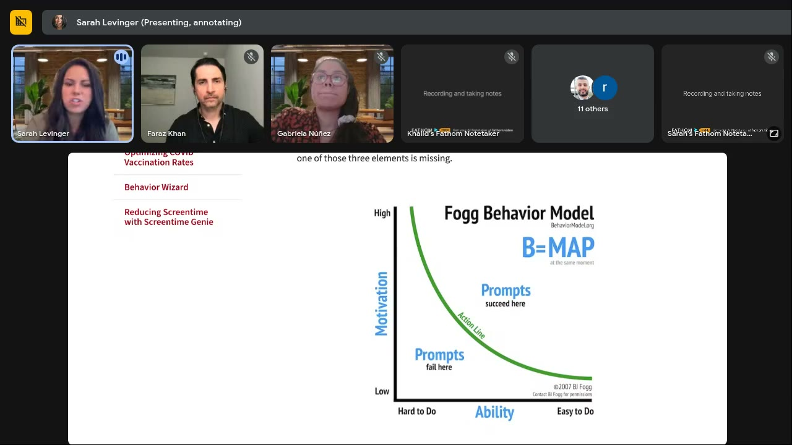
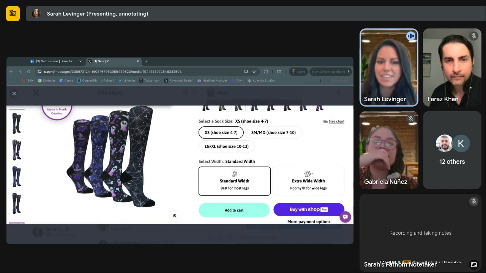
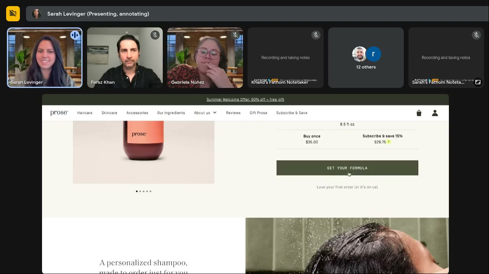
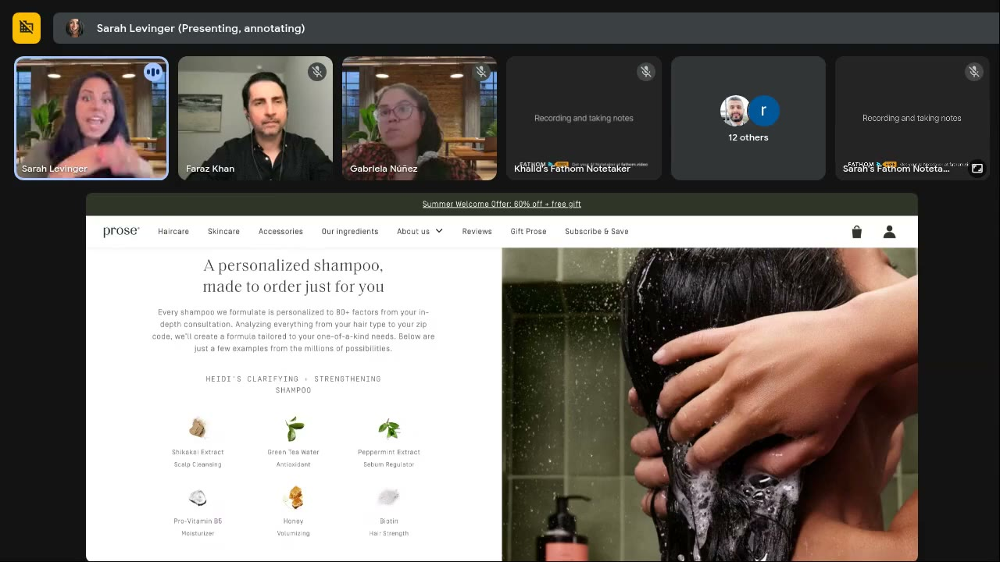
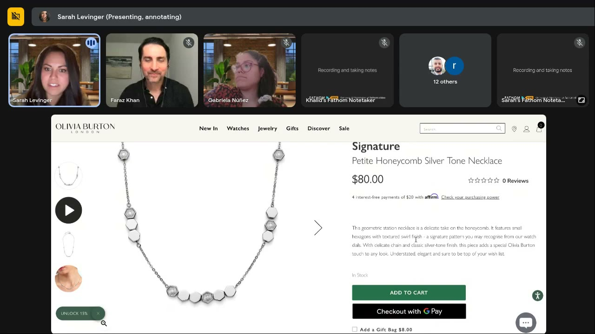
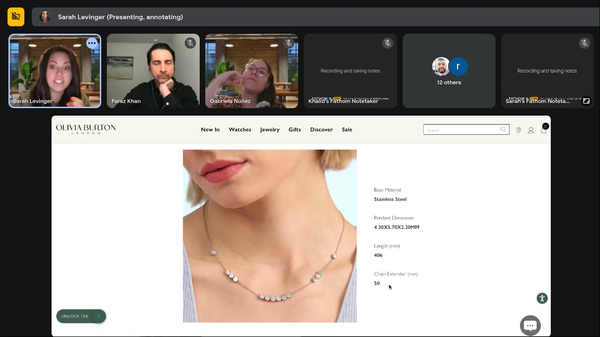
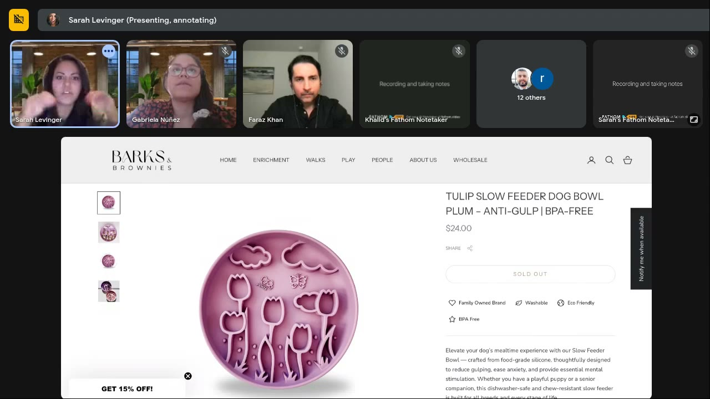
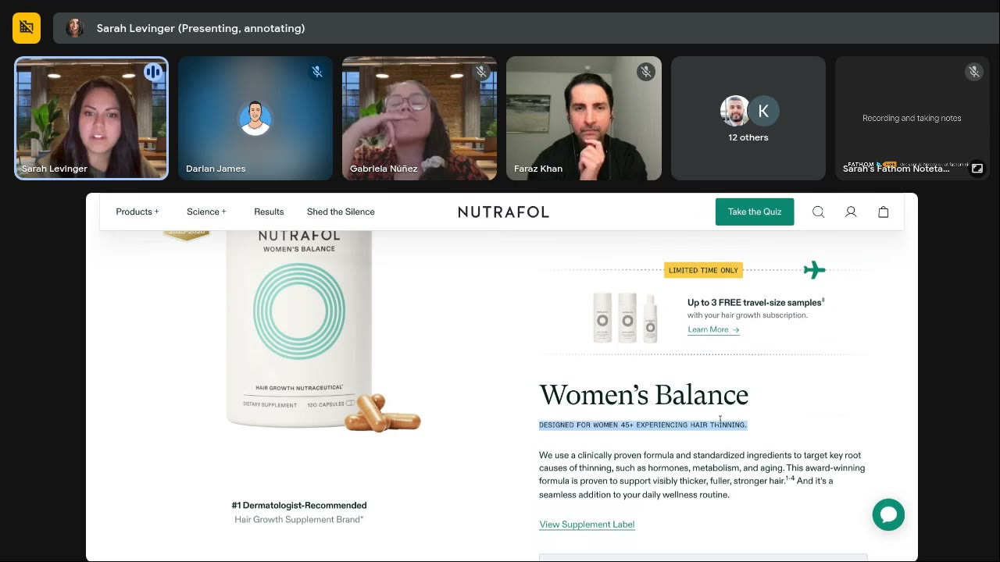
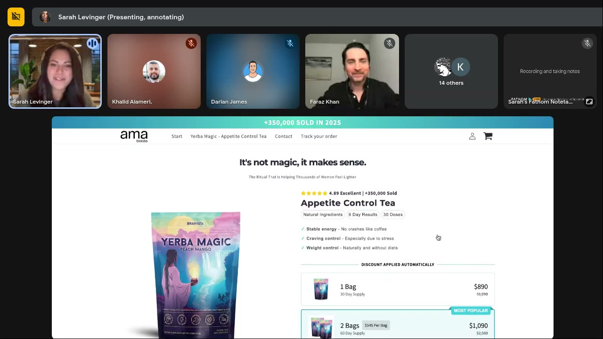
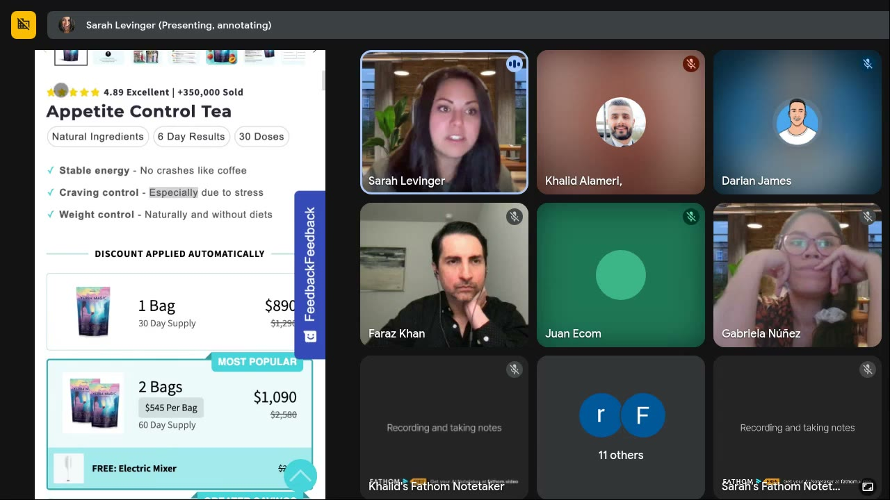

# Live With Sarah, July 16, 2025: The BJ Fogg Behavior Model Applied to Pages and Ads
> Sarah introduces the **Fogg Behavior Model (B = MAP: Motivation, Ability, Prompt)**, argues that marketers over-invest in prompts and motivation and neglect **ability** ("will this work for *me*?"), then live-audits six product pages (compression socks, Prose, Olivia Burton, Barks & Brownies, Nutrafol, Jaxxon, AMA Biolabs) for the three elements, plus buy-box pricing psychology.

## 🤖 Agent use
- **Use when:** writing UGC scripts, statics or creator briefs that must answer the "is this for me / can I do this / will it fit me" doubt; auditing a competitor's ad *and* its landing page for motivation / prompt / ability gaps; writing proof lines ("350,000 ___ love us"); planning buy-box or offer copy that an ad points to.
- **Inputs → outputs:** ad script or PDP (screenshot/URL) + target customer → a three-column audit (Motivation · Prompt · Ability) + the single biggest "ability crusher" + concrete fixes (qualifier lines, "who it's for" lists, time-lapse proof, dollar-amount savings, message order).
- **Rules:**
  - DO audit every asset for all three Fogg elements. Most brands are heavy on prompts (urgency, discounts, "add to cart") and light on ability. [0:05:50–0:06:30]
  - DO find the product's **biggest ability crusher** (fit, size, difficulty, how long it lasts) and answer it visually or in 4–5 words. [0:27:14]
  - DO add micro-qualifiers to choices ("Best for most legs" / "Roomy fit for wide legs"). Two tiny labels lifted conversion ~10%. [0:08:50–0:10:24]
  - DO replace generic nouns with *typed* people: not "women" but "tired / stressed / 45+ / thin-hair women"; not "350,000 sold" but "350,000 tea drinkers love us". [0:39:20; 0:53:50; 0:54:50]
  - DO show, for durability/time claims, a sequence: after 1 month / 2 months / 3 months, or the bowl at 10 / 20 / 40 minutes. [0:26:13; 0:28:18]
  - DO write "you" copy, not "us" copy. [0:24:09]
  - DO raise intensity of word choice (happy → elated; sad → depressed) instead of defaulting to neutral Zone 1 language. Intense ≠ harsh. [0:17:47–0:19:00]
  - DO show savings as a **dollar amount**, keep price steps easy for mental math (79 → 229 rather than 79 → 224). [0:37:47; 0:43:05]
  - DON'T show "0 Reviews". Remove the widget instead. [0:22:30]
  - DON'T put competing claims side by side ("6 Day Results" + "30 Doses"), and DON'T reference something (e.g. "discount applied automatically") before it has been introduced. [0:55:36; 0:58:45]
  - DON'T use layouts that make the eye bounce (image slivers, text overlays): cognitive load kills action. [0:47:50–0:49:25]
- **See also:** [Three selves](../../../concepts/three-selves.md) · [Intensity](../../../concepts/intensity.md) · [Emotional zones](../../../concepts/emotional-zones.md) · [Social proof](../../../concepts/heuristics/social-proof.md) · [Scarcity](../../../concepts/heuristics/scarcity-heuristic.md) · [Processing fluency](../../../concepts/heuristics/processing-fluency.md) · [Fogg Behavior Model](../../../frameworks/fogg-behavior-model.md) (expected page)

Skool page text: title and video length only (no description or links).

## TL;DR
- **B = MAP**: a behavior happens when **Motivation**, **Ability** and a **Prompt** meet at the same moment. Prompts succeed above the "action line" and fail below it. [0:04:10–0:05:50]
- Marketers live on the prompt side ("now is the time", limited-time offers, bundles, discounts). "We're really good at prompting but we're pretty bad, I think, about **making it easy to do**." [0:05:50–0:06:15]
- Case study: a compression-sock brand added two micro-labels under the width choice, "**Best for most legs**" and "**Roomy fit for wide legs**". Result: **+10% conversion**, roughly **300 extra orders** in a month on a page that gets ~750,000 views in peak season. [0:06:30–0:10:24]
- **Ability = "Is this for me / am I capable / will it fit / will it last?"** On PDPs, the fix is usually personalization: list hair types, show chain length on a body, show time-lapse durability, qualify the buyer ("Designed for women 45+ experiencing hair thinning"). [0:13:35; 0:25:11–0:27:14; 0:31:23]
- The Fogg model overlaps with [Self-Discrepancy Theory](../../../concepts/three-selves.md): SDT tells you **whose** ability you're talking to. [0:32:40–0:35:00]
- Buy-box pricing psychology: the brain reacts emotionally to numbers. Make mental math easy, show the dollar saving, and make bundle savings big enough to matter. [0:35:50–0:44:07]

## Session map
| Time | Segment |
|---|---|
| [0:00:00] | Intro (Sarah is in Kihei, Hawaii; earlier three weeks in Germany). |
| [0:01:00] | Topic announced: BJ Fogg model. Plug for the first **two-day creative strategy training** cohort; future versions may be split into a multi-week drip. |
| [0:02:50] | Who BJ Fogg is; influence on James Clear's *Atomic Habits*. |
| [0:04:10] | The Fogg Behavior Model chart: motivation, ability, prompt, action line. Marketers over-prompt. |
| [0:06:30] | CRO case study: compression-sock PDP, "spot the two changes" quiz. +10% CR. |
| [0:10:24] | Q: more examples → **Prose** PDP audit (Zone 1 language, guarantee, personalization abandoned). |
| [0:17:47] | Chat: "vanilla is what I see everywhere". Intensity of language without being harsh. |
| [0:19:56] | Q: Fogg for jewelry → **Olivia Burton** PDP audit (tiny text, 0 reviews, gift bag, length, "us" vs "you"). |
| [0:25:11] | Q (Gabriela): is ability about replacing the physical experience? → ability crushers per category. |
| [0:27:40] | Darian's client **Barks & Brownies** slow feeder: show eating time. |
| [0:29:19] | **Nutrafol** PDP audit: plane icon, 45+ qualifier, mild Zone 2 language, supplement label. |
| [0:32:40] | Q: does Fogg overlap with self-discrepancy (3 selves)? |
| [0:35:50] | Nutrafol buy box: anchoring, dollar savings, bundle gap. "Which classroom course?" (3 Selves). |
| [0:40:00] | Q (Juan): did showing saved amount reduce subscriptions? Q: end prices in 5 or 0? Mental math and price endings. |
| [0:44:40] | **Jaxxon** (Cuban link chains) site audit: pop-ups, "for those who have earned it", cognitive load, prompt-heavy. |
| [0:51:30] | **AMA Biolabs Yerba Magic** appetite-control tea (Spanish site, Juan's competitor): typed social proof, competing claims, message order. |
| [0:59:47] | Wrap: send pages to Sarah in Skool. |

## Key ideas

### 1. The Fogg Behavior Model (B = MAP) [0:02:50–0:06:30]
- **BJ Fogg**: social scientist and author; "he actually had a lot of impact on… **Atomic Habits** by James Clear." Sarah briefly chatted with him when he invited marketers to his courses. [0:02:50–0:03:40] On-screen Google panel: Brian Jeffrey Fogg, research associate and adjunct professor at Stanford, founder and director of the **Stanford Behavior Design Lab** (formerly Persuasive Technology Lab); research interests "Behavior Change, Tiny Habits method".
- The model "basically teaches how behavior gets made inside the brain". [0:03:40]

*The chart Sarah used (BehaviorModel.org, ©2007 BJ Fogg): **B = MAP** "at the same moment"; Motivation high↔low on the y-axis, Ability "Hard to Do"↔"Easy to Do" on the x-axis; prompts **succeed** above the curved Action Line and **fail** below it. [0:05:15]*

- Three ingredients: "people have to have **motivation** to do something, the **ability** to do something and then be **prompted** to do something." [0:04:10]
- High motivation + hard to do + few prompts → "nothing really is going to happen… it feels too hard, so I just stay where I am". [0:04:30]
- Some motivation + prompted + low ability → still "in this kind of fail spot". [0:05:14]
- Goal: "decent ability, high motivation and then some sort of a nudge to move forward." [0:05:30]
- **Where marketers sit:** "We tend to… just do a ton of prompting: now is the time, boost this, get better results… We also do a whole lot of nudging when it comes to prices: limited time offer, here's the discount, this will only be here for 10 days, here's a bundle." [0:05:50–0:06:15]
- **The gap:** "We're really good at prompting but we're pretty bad, I think, about making it easy to do." [0:06:15]
- "I really think it's the **ability piece we miss constantly** as marketers." [0:10:50]

### 2. How Sarah classifies page/ad elements into M / A / P [0:12:29–0:13:50; 0:25:30]
| Element | Fogg bucket (per Sarah) | Examples she names |
|---|---|---|
| Offer delivery, word intensity | **Motivation** | "Motivating words, not necessarily neutral language"; get into higher-[intensity](../../../concepts/intensity.md) zones [0:12:29] |
| Trust signals | **Motivation** ("this is safe, you can move forward") | Badges, buttons, stars, testimonials, quotes, [authority](../../../concepts/heuristics/authority-bias.md) proof [0:13:20] |
| Choice structure | Motivation | Keep choices "pretty small, pretty structured… don't give too many options" [0:12:29] |
| Selection steps | **Prompts** | Size, quantity, formula, pack, "choose your size" [0:13:30] |
| Offers on the ad side | Prompts (partly motivation) | Bundles, discounts, urgency. "These all kind of blend." [0:13:35] |
| Risk reversal | Motivation / risk reduction | "Love your first order or it's on us" [0:14:50] |
| Personalization, fit, "is this for me" | **Ability** | Hair types, sizes, lengths, qualifiers, reviews from people like me [0:13:50; 0:26:13; 0:50:27] |

- **Ability defined (answer to Gabriela):** "Am I capable of getting this right now? Is it easy for me to do?" For SaaS: "Am I going to be able to get inside the product and use it without three hours of training?" For physical products: "When I get into my house, am I going to want to keep it?" [0:25:30–0:26:13]
- "All you're doing when you're trying to talk to ability is **soothe**: it's okay, this is for you, we got you." [0:35:20]

### 3. Intensity of language without "triggering" [0:17:47–0:19:56]
- Chat comment: "vanilla is what I see everywhere." Sarah: marketers fear triggering people, "but at the end of the day we have to motivate somehow to get people across the finish line." [0:17:47]
- "More intense with your language doesn't necessarily mean harsher. Intensity of language has to do with the **choice of words**." [0:18:30]
- **Happy → elated** ("I'm so happy I can't even stand it"); **sad / upset → depressed** ("physically sad about this"). "The difference between those words is not much, but it's a big enough difference that it makes an impact." [0:18:49–0:19:20]
- Ties to [intensity](../../../concepts/intensity.md) and the [tone-shifting](../../../frameworks/tone-shifting.md) verb swap.

### 4. Pricing psychology on the buy box [0:35:50–0:44:07]
- **Anchoring direction:** "We start with the cheapest option and then go up in price and we don't start with the most expensive option and go down… We are anchoring everybody to a $79 option." The $79 → $224 jump then feels "too much, way too high… I'll take the 79." [0:35:50–0:36:44] ("Technically they should be doing this backwards from a scientific standpoint." [0:41:30])
- **Is the bundle worth it?** 3 × $79 = $237 vs $224 → "I'm saving like 10 bucks… I could just come back every month." [0:36:44–0:37:47]
- **Show dollars, not just %:** "Instead of just showing 'save 10%', I want to see the dollar amount… I can't do that math in my head. What is 10% of 224?" "Boost the ability of these people by telling them how much money they're going to save, not just the percentage." [0:37:47–0:38:20]
- **Make bundle savings meaningful:** "Sometimes I'd rather you increase the prices of some… of your actual bundles" (work with finance) so the gap is a bigger saving than $10. [0:38:20–0:38:52] *(As transcribed. The logic implies widening the savings gap between tiers; wiki interpretation.)*
- **Many numbers are OK if visually separated:** core price big, original price struck through, discount in a small yellow box: "using fonts… weighted things… colors to make sure each price has its own spot." [0:41:00–0:42:03]
- **Mental math rule:** "Mental math is so incredibly important when it comes to buy boxes." Jumping 79 → 224 → 422 is hard. [0:42:03–0:43:05]
- **Numbers are emotional:** "The brain actually has an emotional reaction to numbers… it does not [have a logical one]." Ending in 7 or 9 is "technically true-ish for most products… In general I don't really care what you end with." What matters is even delineation: "Instead of 224 I want you to raise this to **229**, that way I can do the math between 79 and 229 pretty easily." [0:43:05–0:44:07]
- Sarah offers to do a full pricing-psychology breakdown in a future session. [0:42:50; 0:44:07]
- Easy-math example done right: Jaxxon "$249 → $199, I can do that math really easily." [0:50:27]

### 5. Fogg × the 3 Selves [0:32:40–0:35:00]
- Attendee question: "Would you say this framework kind of overlaps with self-discrepancy stuff… when we know the actual self we're targeting?"
- Sarah: "100%. I think the BJ Fogg model actually lines up with the self-discrepancy model pretty clearly… **Self-discrepancy, I think, does a better job of choosing whose abilities**." [0:32:40–0:33:00]
- Recap of [selves](../../../concepts/three-selves.md): selves ≠ identities ("that's a totally different topic"); [Actual](../../../concepts/actual-self.md) = who I am right now; [Ideal](../../../concepts/ideal-self.md) = "someday I want to learn how to surf"; [Ought](../../../concepts/ought-self.md) = "more guilt-focused… I ought to do this but I'm not." [0:33:00–0:33:40]
- Applied to Nutrafol: "thicker, fuller, stronger hair" = future → **Ideal**; "a seamless addition to your daily wellness routine" talks to someone who feels it's too much and has tried many products: "keep what you're doing… you just change one specific thing" → **Actual**. "They're split a little bit here." [0:33:40–0:34:40]

### 6. Message order and competing claims [0:55:36–0:59:47]
- Two numbers that tell different stories ("6 Day Results" + "30 Doses") → "competing messaging… either one, I don't have the ability to do this, or two, is this not real." [0:55:36–0:56:50]
- "If we haven't mentioned the discount yet, it's very confusing to say 'discount applied automatically'." [0:58:45]
- "Make sure everything that comes up makes logical sense for your customer… **order your messaging very, very carefully**, so we don't… compete against ourselves." [0:59:20–0:59:47]

## Q&A
1. **Chat (several): "We need more examples" of Fogg on sites.** [0:10:24–0:11:28] → Sarah pulls up Prose as a beauty example (see teardown below).
2. **Darian (chat): for his low-carb pasta client they want a "this is what most people buy" type message for consistent dieting; needs the client to add it on site.** [0:11:50] → "I agree, I think these teeny tiny messages on here are really critically important." (Microcopy that guides the choice = ability.)
3. **Attendee: "What would be a motivator for this model if I want to implement it for a jewelry brand?"** [0:19:56] → Jewelry is tricky "because people are buying for different reasons… the motivation, the prompts… and the ability is different for everyone, depends on what kind of jewelry you're actually selling." Then audits Olivia Burton: language slightly more intense than Prose; tiny text unreadable for an (assumed) older buyer; 0 reviews is a nudge **away**; "4 interest-free payments of $20" (Affirm) is a little ability for budget shoppers; gift-bag option belongs on the cart page, not the PDP; necklace length/dimension info is real ability ("a longer chain is going to sit in a very weird spot on your neck" for shorter people); otherwise the page talks about the brand. "What can I wear this with? What does it usually pair with? Who usually buys this? Are those people like me?" Switch "from us to you, you, you". [0:20:40–0:25:11]
4. **Gabriela Núñez: Is ability, to an extent, giving people what they can't get online that they'd get from a physical experience (knowing how long something is, the weight)? Is that framing?** [0:25:11] → Ability = "Am I capable of getting this right now? Is it easy for me to do?" Depends on product: SaaS = no three-hour training; physical = will I keep it once it's home. Copy toward ability: hair types; "it'll fit around your wrist at this length, it'll hang about this low"; pictures of it. Dog toys: show chew marks over time ("after one month it's this small, after two months… after three months"), suggested for **Leslie** (a member with a dog-toy brand). "Identify what is the biggest **ability crusher**… the thing that's going to drop their ability level to the point where they don't want to buy." Her own crusher on Olivia Burton: "I just don't know how big those chains are… the images are moving so fast… we need to slow down." [0:25:30–0:27:40]
5. **Darian (chat): "Sick idea. I just picked this client up. They have beautiful visuals but nothing showing how long these will last."** [0:27:40] → Barks & Brownies slow feeders: show the bowl after 5 / 10 / 20 minutes, "show them this thing is going to make them eat for at least 20 minutes". Darian: no video yet, could do a static (start / 10 / 20 / 40 min, finished). Sarah: add it **directly to the product shot as three circles** so they see it on arrival, and test it for CRO. [0:28:18–0:29:19]
6. **Attendee: "Would you say this framework overlaps with self-discrepancy stuff, when we know the actual self we're targeting?"** [0:32:40] → Yes, 100%; SDT picks *whose* ability (see Key idea 5).
7. **Attendee (name garbled, sounds like "Casey"): where is the course?** [0:38:52] → "Inside Skool, inside the Classroom tab… you're going to see one that says **three self** or three selves." It covers which person you're targeting in your ad or landing page: actual, ideal or ought. (Also "go take the three self course, like 30 minutes, super super easy". [0:32:55])
8. **Juan (Juan Ecom): On his store, customers took fewer subscriptions after he showed how much they save. Was it too many numbers, or "too good to be true" (saving £20–30)?** [0:40:00] → Hard to tell without the site. "Too many numbers are not necessarily a bad thing if you're very good about splitting them up" (Nutrafol shows three numbers per tier, separated by font weight, strike-through and a yellow badge). "What I think was probably happening was more of the actual number itself was causing a little bit of slowdown." [0:41:00–0:42:03]
9. **Juan follow-up: Should prices end in 5 or 0, some "determination" of number?** [0:42:03] → "I want to see how quickly people can do the mental math." 7/9 endings "true-ish", but the delineation matters: raise 224 to 229 to make 79 → 229 easy. "Come back and tell me how that test ran." [0:42:03–0:44:07]
10. **Show of hands: who wants to learn price psychology?** Attendees: "Yes, me, me." [0:44:07] (An attendee then mentions their own buy box for 1 / 3 / 6 months; garbled.)
11. **Khalid Alameri: the Jaxxon page isn't his; "we just learn from these guys… the top one on the market."** [0:48:22] → Sarah: then "I would not do this if I were them": image sliver causes cognitive load. Still, the page might work because for a Cuban-link buyer "you might not need a whole lot of motivational text… it's actually better for our dudes if we prompt… urgency, scarcity… offers." Wants to ask someone at the brand how it converts. [0:48:22–0:51:30]
12. **Juan Ecom: why "6 Day Results"?** It comes from a listicle whose headline says a mom went from 64 to 61 kg in six days. [0:55:50–0:56:36] → Keep "6 day results" if it's 100% real (it's why people enter the ecosystem) but add an asterisk "not typical results" "for a legal reason"; drop or reframe "30 doses" because it says you don't need 30. Juan: the 30/60-day supply is shown in the variants anyway, and it's a **competitor**. Sarah: "they might want to take off… 30 doses and see what that does… it's causing ability slowdown." [0:56:36–0:58:10]

## Ad / page teardowns
*All "ads" in this session are product/landing pages (the destination of the ad). The structure transfers directly to UGC scripts: each PDP fix is also a line or visual a creator can say/show.*

### Compression-sock brand (Nate's store; brand name not shown)

*The winning variant (shared by "Nate" on X; socks "Made in North Carolina"). The only change: the two 4–5-word labels under the width boxes. +10% CR. [0:08:30]*

| Brand / product (niche) | Format | Hook / opening | What works | What fails | Fix suggested | Principle | Source |
|---|---|---|---|---|---|---|---|
| Compression-sock DTC brand, Nate's (apparel / compression socks) | PDP, CRO A/B test | Size + width selector | Added "Best for most legs" / "Roomy fit for wide legs" under the width options → **+10% conversion**, ~300 extra orders this month (page ~750k views in peak season). Page already had plenty of prompts (pick size/color) and motivation (add to cart, Shop Pay, more payment options). | Original page left buyers unsure "will this fit my legs, will it work for me" | (Already fixed.) Add more "this is going to work for you" micro-labels | Fogg **Ability**: tell people which option fits them so they don't guess. "My ability just [went] up by 100%." | [0:06:30–0:10:24] |

Sarah ran a picture-based survey for this brand first (transcribed "CIM"; see Tools). [0:07:18]

### Prose (custom haircare)

*Prose PDP: "A gentle, clarifying shampoo that does it all, from rebalancing roots to gently hydrating lengths…"; "Love your first order (or it's on us)" under the CTA. [0:15:45]*

*The missed ability moment: "personalized to 80+ factors from your in-depth consultation", then a grid of ingredients (Shikakai, green tea, peppermint…) instead of hair types. [0:17:15]*

| Brand / product (niche) | Format | Hook / opening | What works | What fails | Fix suggested | Principle | Source |
|---|---|---|---|---|---|---|---|
| Prose (personalized haircare) | PDP | "Truly custom haircare and skincare" / "A gentle, clarifying shampoo that does it all" | Guarantee "Love your first order (or it's on us)" = risk reduction, "way more motivating". "Get your formula" = a prompt. Starts into ability with "made to order just for you… 80+ factors". | Very neutral **Zone 1** language ("two gentles in one sentence"), "not very motivated". Hardly any prompts/nudges. Personalization section switches to ingredients: "they went back into look at us". | Under "personalized shampoo made for you" show **hair types**: coarse, fine, curly, thick-dry-coarse… "as many of them on a page as you can think of" so the visitor thinks "I am this hair type… this will work for mine." Separate ingredients (different concept). | Ability via personalization. "Behavioral scientists are giving us the map; we just stopped halfway through it." | [0:11:28–0:17:47] |

### Olivia Burton London (jewelry)

*"0 Reviews" sits right under the price, a nudge away from buying. Note the tiny body copy and the gift-bag checkbox. [0:21:45]*

*The one ability element on the page: length/dimensions next to an on-body shot. [0:24:05]*

| Brand / product (niche) | Format | Hook / opening | What works | What fails | Fix suggested | Principle | Source |
|---|---|---|---|---|---|---|---|
| Olivia Burton London (jewelry/watches) | PDP | "Signature: Petite Honeycomb Silver Tone Necklace" | Language slightly more intense than Prose ("delicate", "understated elegant"). Affirm "4 interest-free payments of $20" = ability for budget shoppers. Length/dimension info = ability. | Body text too small for a likely older buyer, "probably just skipping this entirely". **0 Reviews** shown = nudge away. Gift-bag add-on on the PDP splits buyers into gift vs self. "Eyecatching essentials" section = brand talking about itself. Fast-moving images hide scale. | Remove the review widget when there are no reviews. Move gift bag to cart. Add "what can I wear this with / who usually buys this". Switch "us" → "you". Slow images, show scale on a body. | Ability = "does it fit me?"; [social proof](../../../concepts/heuristics/social-proof.md) works in reverse when it's zero | [0:19:56–0:27:14] |

### Barks & Brownies (Darian's client, pet)

*Beautiful product visual and badges (Family Owned, Washable, Eco Friendly, BPA Free), but nothing shows how much slower the dog eats. [0:28:30]*

| Brand / product (niche) | Format | Hook / opening | What works | What fails | Fix suggested | Principle | Source |
|---|---|---|---|---|---|---|---|
| Barks & Brownies slow-feeder dog bowls (pet) | PDP + static ad idea | Tulip Slow Feeder Dog Bowl, "Anti-Gulp" | "Beautiful visuals" (Darian) | "Nothing showing how long these will last" / how much they slow eating | Show the bowl at **start → 10 → 20 → 40 min → finished** (static is fine). Put three timed circles **on the product shot** itself; test for CRO. | Ability via visible time-to-result. "I have a feeling that's all people need to understand ability." | [0:27:40–0:29:19] |

*(Same brand appears in [Roast My Ads #3](2025-07-23-roast-my-ads-3.md) with comparison statics.)*

### Nutrafol Women's Balance (hair-growth supplement)

*The plane icon (instead of a clock) for a limited-time offer, and the qualifier line "Designed for women 45+ experiencing hair thinning". [0:31:30]*

*Buy box anchored low ($79 first), percentage-only savings, hard mental math (79 → 224 → 422). Left: "100% of women showed improvement in hair growth after 9 months". [0:36:45]*

| Brand / product (niche) | Format | Hook / opening | What works | What fails | Fix suggested | Principle | Source |
|---|---|---|---|---|---|---|---|
| Nutrafol Women's Balance (hair-growth supplement) | PDP + buy box | "Limited time only" with a **plane** icon; "Designed for women 45+ experiencing hair thinning" | Plane beats a clock: "it's leaving soon… very visceral reactions to missing out… especially if it's a flight" (urgency/[loss aversion](../../../concepts/heuristics/loss-aversion.md)). Qualifier ticks every box = ability. "Award-winning… visibly thicker, fuller, stronger hair" = mild **Zone 2**, intense, motivating copy. "View Supplement Label" calms ingredient worriers (ability). Prices visually separated. Selves: **Ideal** (future hair) + **Actual** ("seamless addition to your routine"). | Samples offer = "more of a prompt", not motivating (no time limit). Buy box starts cheapest (anchors $79), 3-month saves only "like 10 bucks" vs 3 × monthly ($237 vs $224), % only, hard math. "100% of women…" doesn't say *which* women. | Show $ saved, widen the bundle savings gap, use easy-math prices (229 not 224), maybe start high. Say "women with hair loss / thin hair / alopecia" in the stat. Copy the plane idea. | Prompt + motivation + ability all present; pricing = [anchoring](../../../concepts/heuristics/anchoring-effect.md) and mental-math fluency | [0:29:19–0:44:07] |

### Jaxxon (men's Cuban link chains; competitor Khalid studies)

*Homepage hero speaks to repeat buyers ("Best Sellers"), not first-time visitors. A "$57 OFF, expires in 1 minute" pop-up appeared first. [0:45:45]*

*The image "sliver" in the middle makes the eye bounce (cognitive load). Note how prompt-heavy the buy box is. [0:48:00]*

*Stacked nudges: free clasp, free engraving, save $50, free shipping, returns. [0:50:15]*

| Brand / product (niche) | Format | Hook / opening | What works | What fails | Fix suggested | Principle | Source |
|---|---|---|---|---|---|---|---|
| Jaxxon (men's gold chains/jewelry) | Homepage + PDP | "Best Sellers: Top Picks, Limited Supply"; "$57 OFF, expires in 1 minute" pop-up | Gorgeous, chic photography. Massive prompting/urgency ($50 off, countdown, pre-selected options). Easy price math $249 → $199. 1,968 reviews let men check "are any of these dudes like me" (ability). May work because Cuban-link buyers need little motivational text. | Pop-up as first thing a first-time buyer sees ("love-hate relationship"). "Best sellers / top picks" doesn't sell a first-time visitor. Image sliver = cognitive load ("your eyes are just bouncing all over the place"). Product isn't described until you click in. "Very little activation of any sort of self." | Headline like "**Jewelry for those who have earned it**" (Sarah's tested winner) / "for those who have earned respect / finally made it": "this is it for you, this is the one". Shrink the image to fit its box; make the layout seamless. | Men buy one forever piece; women buy pieces to match outfits. Cognitive load kills behavior. | [0:44:40–0:51:30] |

### AMA Biolabs, Yerba Magic Appetite Control Tea (Juan's competitor; Spanish-language site, viewed translated)

*Desktop (auto-translated; the prices are not USD, Sarah says to ignore them). [0:52:30]*

*The competing badges ("6 Day Results" vs "30 Doses") and the out-of-order "Discount applied automatically". [0:54:45]*

| Brand / product (niche) | Format | Hook / opening | What works | What fails | Fix suggested | Principle | Source |
|---|---|---|---|---|---|---|---|
| AMA Biolabs "Yerba Magic" appetite-control tea (weight-loss supplement, Mexico/LatAm) | PDP (mobile), arrives from a listicle | "It's not magic, it makes sense." / "The ritual that is helping thousands of women feel lighter" | Calm **Zone 1** language. Lots of social proof (4.89, +350,000 sold). "Appetite control tea" naming ("keep that as is"). Benefit ticks "Stable energy / Craving control / Weight control" speak to capability and motivation. "Natural ingredients" motivating for that buyer. | Overlay elements on top of text (desktop "waterfall" layout) slow reading. "Thousands of women" is generic. "350,000 sold" but to whom? "6 Day Results" + "30 Doses" = competing messages ("I don't have the ability… or is this not real"). "Discount applied automatically" appears before any discount is mentioned. Badges "might be doing more damage than good". | "Thousands of **tired / frazzled / stressed-out women / women with racing thoughts**". "**350,000 tea drinkers love us**". Keep "6 day results" if real, add "*not typical results" asterisk; drop/reframe "30 doses". Re-order messages logically. | Ability via typed social proof; message order; claim congruence | [0:51:30–0:59:47] |

### Session summary teardown table
| Brand / product (niche) | Format | Hook / opening | What works | What fails | Fix suggested | Principle | Source |
|---|---|---|---|---|---|---|---|
| Compression socks (Nate) | PDP test | Width selector | 2 micro-labels → +10% CR | (orig.) fit uncertainty | More "works for you" labels | Ability | [0:06:30] |
| Prose | PDP | "A gentle, clarifying shampoo…" | Guarantee; personalization claim | Zone 1 neutral; ingredients instead of hair types | List hair types | Ability via personalization | [0:11:28] |
| Olivia Burton | PDP | Petite Honeycomb necklace | Length info; Affirm | Tiny text; 0 reviews; gift bag; "us" copy | Hide 0 reviews; you-copy; show scale | Ability; reverse social proof | [0:19:56] |
| Barks & Brownies | PDP / static | Tulip slow feeder | Visuals | No time-to-eat proof | 10/20/40-min circles on product shot | Ability (show result over time) | [0:27:40] |
| Nutrafol | PDP / buy box | Plane "limited time" + 45+ qualifier | Plane icon; qualifier; Zone 2 copy; label link | Low anchor; % savings; hard math; untyped "100% of women" | $ savings; 229; typed stat | Anchoring; mental math | [0:29:19] |
| Jaxxon | Home / PDP | "Best Sellers, Limited Supply" | Prompts; easy math; reviews | Pop-up; sliver layout; no self activation | "For those who have earned it"; clean layout | Cognitive load; male buying | [0:44:40] |
| AMA Biolabs Yerba Magic | Mobile PDP | "It's not magic, it makes sense" | Social proof; benefits | Generic "women"; 6 days vs 30 doses; order | Typed proof; asterisk; re-order | Claim congruence; ability | [0:51:30] |

## Structured units

### Hooks
*Heuristic, zone and self tags are wiki tags unless the citation says Sarah stated them.*

| Hook (verbatim or near) | Heuristic(s) | Emotion / zone | Self targeted | Why it works | Source |
|---|---|---|---|---|---|
| "Jewelry for those who have earned it" (also "for those who have earned respect", "for those who have finally made it") | Identity/status, [framing](../../../concepts/heuristics/framing-effect.md) | Pride, Zone 2 (wiki tag) | Actual/Ideal: commemorating an achievement (wiki tag) | Sarah's tested "really, really strong" headline for anyone commemorating something; men buy "the one" forever piece | [0:46:11–0:47:30] |
| "Designed for women 45+ experiencing hair thinning" | Qualifier / self-selection | Reassurance, Zone 1 | Actual | "If I'm a woman, yes; 45+, yes; experiencing [thinning], yes… this is for me" (ability) | [0:31:23] |
| "350,000 tea drinkers love us" (rewrite of "+350,000 sold") | [Social proof](../../../concepts/heuristics/social-proof.md) + identity | Belonging, Zone 1 | Actual | "That 'tea drinkers' language… is going to tell me… I'm a tea drinker, so yes I can do this" | [0:54:50] |
| "The ritual that is helping thousands of tired / frazzled / stressed-out women feel lighter" (rewrite) | Social proof + typed identity | Relief, Zone 1→3 | Actual | Generic "women" doesn't let her recognize herself | [0:53:50] |
| "Limited time only" + plane icon | [Scarcity](../../../concepts/heuristics/scarcity-heuristic.md)/urgency, loss aversion, [salience](../../../concepts/heuristics/salience-bias.md) | Mild anxiety (missing a flight), Zone 4-lite | n/a | Plane = "it's leaving soon"; more visceral than a clock | [0:29:40–0:30:50] |
| "Best for most legs" / "Roomy fit for wide legs" | [Processing fluency](../../../concepts/heuristics/processing-fluency.md), self-selection | Reassurance | Actual | Removes the guess; +10% CR | [0:08:50] |

### Angles
| Angle | Core desire / pain | Heuristic(s) | Best format | Example line | Source |
|---|---|---|---|---|---|
| "It'll fit / work for *you*" (ability angle) | Fear it won't fit or work for my body/hair/situation | Fluency, self-selection | PDP microcopy, UGC "if you have X, get Y" | "Roomy fit for wide legs" | [0:08:50–0:10:24] |
| "Made for your type" (personalization) | "Is this for someone like me?" | Social proof, identity | Static grid of hair types / UGC creators of each type | "Thick, dry, coarse hair? This was formulated for yours." (wiki example) | [0:16:43] |
| Time-to-result proof | Doubt it will last / work | Visual proof, goal gradient (wiki tag) | Static sequence or time-lapse | Bowl at start / 10 / 20 / 40 min; chew toy after 1 / 2 / 3 months | [0:26:13; 0:28:18] |
| Earned status (men's jewelry) | "I made it" / commemoration | Identity, pride | Hero headline, static | "Chains for those who have earned it" | [0:46:11] |
| Small change, no overhaul | "It's too much to change everything" | Low effort (ability) | PDP / UGC | "A seamless addition to your daily wellness routine" | [0:34:00] |

### Rewrites (before → after)
| Before | After | What changed (verb / visual / promise / self / intensity) | Source |
|---|---|---|---|
| Width boxes: "Standard Width" / "Extra Wide Width" | + "Best for most legs" / "Roomy fit for wide legs" | Added ability microcopy (who each option is for) | [0:08:50] |
| "A personalized shampoo, made to order just for you" + ingredient grid | Same headline + grid of hair types (coarse, fine, curly, thick/dry/coarse…) | Visual: ingredients → buyer types (ability, self-recognition) | [0:16:43] |
| "Best Sellers / Top Picks, Limited Supply" | "Jewelry/chains for those who have earned it" | Promise: popularity → identity/achievement; first-timer focus | [0:46:11] |
| "100% of women showed improvement…" | "100% of women with hair loss / thin hair… showed improvement…" | Typed identity added | [0:39:20] |
| "+350,000 sold" | "350,000 tea drinkers love us" | Social proof + identity | [0:54:50] |
| "Helping thousands of women feel lighter" | "…thousands of tired / frazzled / stressed-out women…" | Self-recognition | [0:53:50] |
| "Save 10%" | "Save $X" (dollar amount) | Ability: remove mental math | [0:37:47] |
| $79 / $224 / $422 | $79 / $229 / … | Easy-math price steps | [0:43:05] |
| Badges "6 Day Results" + "30 Doses" | "6 Day Results*" (*not typical results), drop "30 doses" | Remove competing claim; legal asterisk | [0:56:36–0:57:43] |
| "happy" / "sad" | "elated" / "depressed" | Intensity up via word choice | [0:18:49] |

### Rules of thumb
- **DO** check every page/ad for Motivation, Prompt and Ability; expect ability to be the missing one. [0:05:50; 0:10:50]
- **DO** ask "What is the biggest ability crusher for this product?" and solve it first. [0:27:14]
- **IF** a product has sizes/fits/variants **THEN** label each option with who it's for in 4–5 words. [0:08:50–0:10:24]
- **IF** the claim is durability or speed **THEN** show a time sequence (after 1/2/3 months; 10/20/40 minutes), ideally on the main product shot. [0:26:13; 0:28:50]
- **IF** you claim personalization **THEN** show the buyer types it serves, not your ingredients. [0:16:43]
- **DO** replace generic audience nouns ("women", "customers", "sold") with typed people. [0:39:20; 0:53:50; 0:54:50]
- **DON'T** show "0 reviews"; hide the widget. [0:22:30]
- **DON'T** put gift-bag/gift options on the PDP; put them in cart. [0:23:30] *(Sarah's preference for this jewelry page.)*
- **DO** switch copy from "us" to "you": what to wear it with, who usually buys it, are they like me. [0:24:09]
- **DO** use more intense words instead of more harsh words. [0:18:30]
- **DO** use a plane rather than a clock for limited-time offers (wiki generalization of her praise; she calls the plane "even better"). [0:30:00]
- **DO** show savings as dollars; keep tier prices easy to subtract; make bundle savings large enough to matter. [0:37:47–0:38:52; 0:43:05]
- **IF** a price block has several numbers **THEN** give each its own visual weight (size, strike-through, colored badge). [0:41:30]
- **DON'T** stack claims that contradict each other or reference offers before introducing them; order messages logically. [0:55:36; 0:58:45; 0:59:20]
- **DON'T** make the first thing a first-time visitor sees a pop-up (Sarah's "love-hate" view). [0:44:40]
- **DON'T** use layouts that split attention (image slivers, overlays on text); cognitive load is "a big brain killer". [0:48:22–0:49:25; 0:53:30]
- **IF** a bold result claim comes from a listicle/testimonial **THEN** keep it but add "*not typical results". [0:56:36]
- **IF** selling men's "forever" jewelry **THEN** say "this is the one", status/earned language; women's jewelry is bought piece-to-outfit. [0:46:30–0:47:30]

## Tools, books, people, metrics mentioned
- **Fogg Behavior Model / B = MAP** (BehaviorModel.org, ©2007 BJ Fogg); on-screen "Prompts succeed here / Prompts fail here", "Action Line". [0:04:10]
- **BJ Fogg** (Stanford Behavior Design Lab; "Tiny Habits method" shown on screen). *(Context, not from course: Fogg's book is* Tiny Habits *(2019).)* [0:02:50]
- **Atomic Habits** by **James Clear**: "really really good one… talks a lot about just how the brain makes habits… very applicable to marketers." [0:02:50–0:03:20]
- **"CIM"** (as transcribed): Sarah's service: "I run basically picture-based surveys to help people pull out all of these emotional motivators, and specifically behavioral ones." *(Wiki interpretation: possibly ZMET, the Zaltman Metaphor Elicitation Technique, a picture-based research method. Name unconfirmed.)* [0:07:18]
- **Two-day training** (first cohort of Sarah's two-day creative-strategy intensive, built in a Monday board); future versions possibly as a ~6-week drip. [0:01:40–0:02:50]
- **Three Selves course** (Classroom tab, "like 30 minutes"). → [Self-targeting system module](../04-self-targeting-system/README.md). [0:32:55; 0:38:52]
- **Metrics:** sock test **+10% CR**, ~**750,000** page views in peak season, **≈300 extra orders** that month. [0:07:18–0:08:19]
- **Affirm** (pay in 4) seen on Olivia Burton as an ability element. [0:23:05]

## Notable quotes
- "We're really good at prompting but we're pretty bad, I think, about making it easy to do." [0:06:15]
- "I really think it's the ability piece we miss constantly as marketers." [0:10:50]
- "A lot of these behavioral scientists are giving us the map; we just stopped halfway through it." [0:17:47]
- "More intense with your language doesn't necessarily mean harsher." [0:18:30]
- "I'd rather see no reviews at all than you show the fact that nobody has purchased this and loved it enough to leave a review." [0:22:30]
- "I would so much rather us switch our language from us to you, you, you." [0:24:40]
- "All you're doing when you're trying to talk to ability is soothe." [0:35:20]
- "The brain actually has an emotional reaction to numbers." [0:43:05]
- "Cognitive load is a big brain killer." [0:49:25]
- "Order your messaging very, very carefully." [0:59:30]

## How to apply
- [ ] For a competitor ad + landing page, fill a 3-column table: Motivation / Prompt / Ability. Mark the weakest.
- [ ] Write one sentence naming the product's biggest ability crusher (fit, size, effort, durability, "is it for me").
- [ ] In the UGC script, add one ability beat: creator names their type ("I have wide calves…", "I have thick, coarse hair…") or shows a time sequence.
- [ ] Rewrite every generic proof line with a typed noun ("___ drinkers", "women with ___").
- [ ] Raise intensity of 2–3 words without adding negativity.
- [ ] Check the landing page: no 0-review widgets, no competing claims, offers introduced before referenced, savings in dollars, easy-math tier prices.

## Related
- Brand case files: [Prose](../../../brands/prose.md) · [Olivia Burton](../../../brands/olivia-burton.md) · [Barks & Brownies](../../../brands/barks-and-brownies.md) · [Nutrafol](../../../brands/nutrafol.md) · [Jaxxon](../../../brands/jaxxon.md) · [AMA Biolabs Yerba Magic](../../../brands/ama-biolabs-yerba-magic.md) · [all brands by niche](../../../brands/README.md)
- [Three selves](../../../concepts/three-selves.md) · [Actual self](../../../concepts/actual-self.md) · [Ideal self](../../../concepts/ideal-self.md) · [Ought self](../../../concepts/ought-self.md) · [Self-targeting](../../../concepts/self-targeting.md)
- [Intensity](../../../concepts/intensity.md) · [Valence](../../../concepts/valence.md) · [Emotional zones](../../../concepts/emotional-zones.md) · [Tone-shifting](../../../frameworks/tone-shifting.md)
- [Social proof](../../../concepts/heuristics/social-proof.md) · [Scarcity](../../../concepts/heuristics/scarcity-heuristic.md) · [Salience](../../../concepts/heuristics/salience-bias.md) · [Processing fluency](../../../concepts/heuristics/processing-fluency.md) · [Framing](../../../concepts/heuristics/framing-effect.md) · [Authority](../../../concepts/heuristics/authority-bias.md) · [Loss aversion](../../../concepts/heuristics/loss-aversion.md)
- Related pages (some still to be written): [Fogg Behavior Model](../../../frameworks/fogg-behavior-model.md) · [BJ Fogg](../../../people/bj-fogg.md) · [Anchoring](../../../concepts/heuristics/anchoring-effect.md)
- [Sarah Levinger](../../../people/sarah-levinger.md)
- Other July 2025 sessions: [Roast My Ads #3 (Jul 23)](2025-07-23-roast-my-ads-3.md) · [Live With Sarah (Jul 9)](2025-07-09-live-with-sarah.md) · [Live With Sarah (Jul 2)](2025-07-02-live-with-sarah.md)

## Sources
- Transcript: [2. Live With Sarah - July 16 2025 - Recordings.txt](../../../../raw/tether-lab/_transcripts/5.%20Recordings/July%202025/2.%20Live%20With%20Sarah%20-%20July%2016%202025%20-%20Recordings.txt) · [.srt](../../../../raw/tether-lab/_transcripts/5.%20Recordings/July%202025/2.%20Live%20With%20Sarah%20-%20July%2016%202025%20-%20Recordings.srt)
- Session page text: [2_Live_With_Sarah!_July_16,_2025_Recordings_·_Tether_La.md](../../../../raw/tether-lab/_extracted/5.%20Recordings/July%202025/2_Live_With_Sarah!_July_16,_2025_Recordings_%C2%B7_Tether_La.md) (title + length only)
- Name fixes from on-screen text: "pros" → Prose; "neutral" → Nutrafol; "Olivia Burton London" (on screen); Jaxxon (on screen); "AMA Biolabs / Yerba Magic" (on screen + Juan's chat link); "depression based stuff" → compression socks (inferred from product); "four inches paid for 20 bucks" → "4 interest-free payments of $20" (on screen); "bj thought / vj fog" → BJ Fogg.
