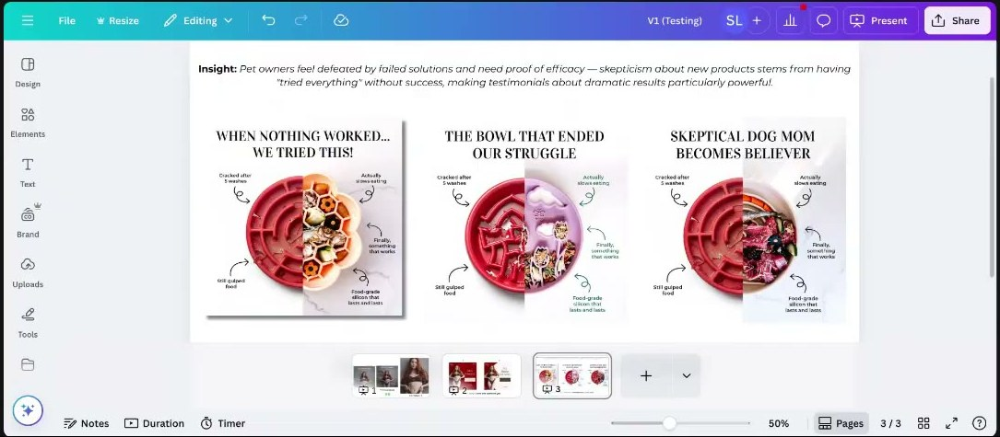
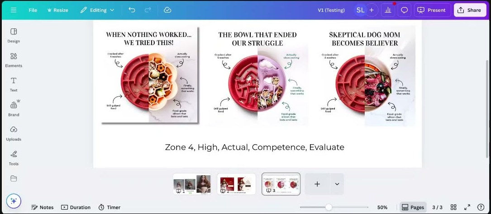
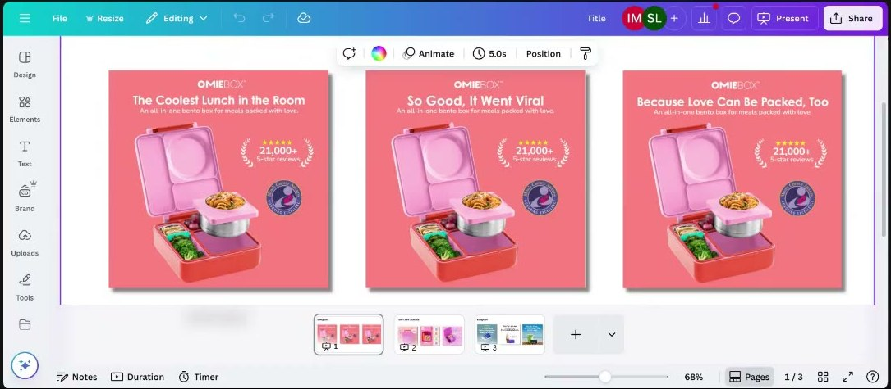
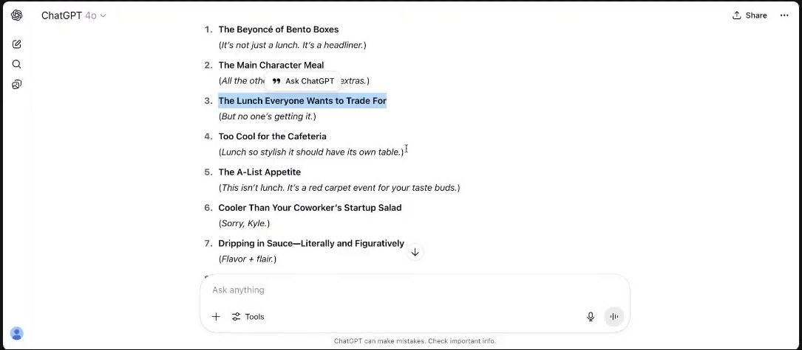
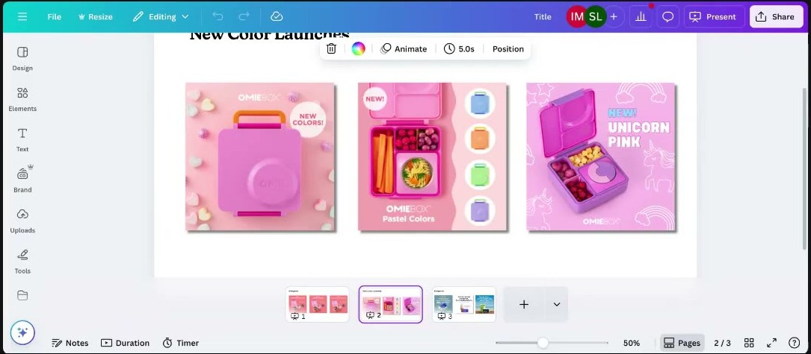
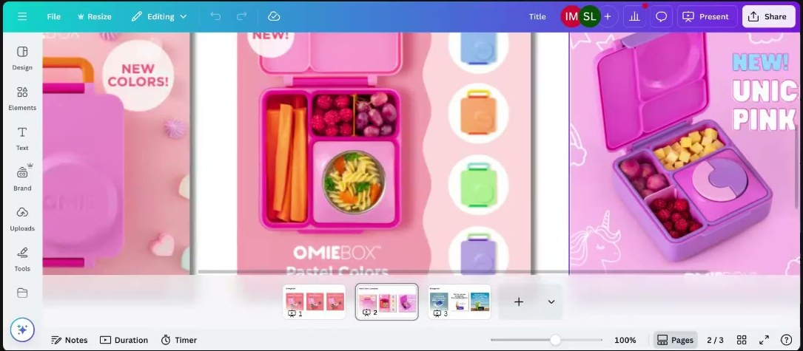

# Roast My Ads #3, July 23, 2025: Net Positive, Slow-Feeder Bowls, OmieBox and Milky
> Sarah live-roasts the ads of two members across four brands: Darian James (Net Positive underwear, slow-feeder dog bowls) and Bren Harper (OmieBox lunchboxes, Milky lactase cards). Lessons: read the model image like body language; move what wins at the purchase stage up into prospecting ads; never drop the winning message when you turn a static into a video; go "four levels deep" with situational copy at the evaluate stage; mine a winning headline for the *type* of desire it hit; use "drop" language and saturated colour for launches; and break format fatigue by moving the product, not by replacing it.

## 🤖 Agent use
- **Use when:** tearing down a competitor static or UGC video (image choice, model expression, badge stack, message order); iterating on a winning static (new heuristic badges, static→video conversion, headline variants); writing launch ("new colour") ads; planning creative tests and how to structure them on Meta.
- **Inputs → outputs:** a winning ad + its test history (what won, at which journey phase) → a list of iterations with one variable each (headline variant by *desire type*, heuristic badge, product position/scale, competitor desaturation, message-first video order), each tagged with zone, self, heuristic and TEEP phase.
- **Rules:**
  - DO treat the model's **face and body** as the first message: the image is processed before the text. Check eyebrows, lid level, smile vs smirk, posture, body type, hair colour. [0:06:17–0:08:23; 0:32:37]
  - DO make every visual signal repeat the same message (expression + hair + body language + headline = "confident, ditch what doesn't serve you"). [0:12:36]
  - DO copy lines that win in **purchase-stage** ads (e.g. "You're 1 click away from better underwear") into net-new and prospecting statics. [0:14:42; 0:17:51]
  - DO use heuristic badges (scarcity, social proof, urgency, stars, icons) as **supporting characters** for one core message, never as the message. [0:17:51–0:18:56]
  - DON'T let a static-to-video conversion drop the winning element. **Show the winning message in frame 1**, then bring in the model or product. [0:19:01–0:21:32]
  - DON'T open with skin and no context (US audiences, women's products): the viewer assumes it's "weird" and scrolls. [0:20:31–0:21:08]
  - DO write **situational** copy at the *evaluate* stage. Keep general, high-level lines for *exploration*. Go "four levels deep", not one. [0:33:42–0:35:44]
  - DO desaturate or grey out the competitor or "old way" side of a comparison so the colour sits on your product. [0:35:44–0:37:49]
  - DO mine a winning headline for the **type** of desire it hit (peer popularity, status or celebrity popularity, inner confidence), then test one variant per type with a clarifying subtext. [0:43:07–0:46:24]
  - IF a brand refuses negative valence THEN stay positive and generate "a hundred different ways" to say the winner. [0:42:03–0:43:07]
  - DO use **"drop"** language and give every sale or launch a **reason**. "New colours" alone implies forever availability, so there is no urgency. [0:46:24–0:48:30]
  - DO push colour **saturation up** on product and launch creatives. Test it rather than toning it down. [0:48:30–0:50:35]
  - IF a format wins and you (not the audience) are bored of it THEN keep it and vary the **product treatment**: close-up, crop, two products, tiny product, in hand, personified product. [0:51:41–0:58:59]
  - DO keep the zone and intensity that already work when you vary visuals. [0:58:59–0:59:30]
  - DO pick a Meta testing structure based on *what you're trying to learn*, then stick with it. [0:23:50–0:26:19]
- **See also:** [Valence](../../../concepts/valence.md) · [Intensity](../../../concepts/intensity.md) · [Emotional zones](../../../concepts/emotional-zones.md) · [Three selves](../../../concepts/three-selves.md) · [Scarcity](../../../concepts/heuristics/scarcity-heuristic.md) · [Social proof](../../../concepts/heuristics/social-proof.md) · [Salience bias](../../../concepts/heuristics/salience-bias.md) · [Framing effect](../../../concepts/heuristics/framing-effect.md) · [Heuristic stacking](../../../concepts/heuristic-stacking.md) · [Tone-shifting](../../../frameworks/tone-shifting.md) · [Rewriting ads for new selves](../../../frameworks/rewriting-ads-for-new-selves.md)

Skool page text: title and video length only (no description or links).

**Participants (from on-screen name tiles and chat):** Sarah Levinger (host). Roasted: **Darian James** (Net Positive underwear; slow-feeder dog bowls) and **Bren Harper** (OmieBox; Milky). A third roastee didn't show up [0:01:01]. Also present: **Khalid Alameri**, **Faraz Khan**, **Gabriela Núñez**. Whisper wrote Bren as "brand" throughout.

## TL;DR
- **Image psychology carries statics.** Net Positive's winning model is a redhead with a confident look: both eyebrows centred and slightly pulled in, lowered lids or squint, a smirk rather than a smile. Elbows on the wall push her chest out (confidence). Her body is normal, not airbrushed. Similar "confident" models who weren't redheads didn't perform. [0:05:14–0:12:36]
- **Purchase-phase copy moved up-funnel works.** "You're 1 Click Away From Better Underwear" (from a purchase-stage ad) plus the badge "Only 9 sets left in this color" beat the V1 static, which had already hit a 6.5–7% CTR in a traffic campaign. Scarcity here also signals [social proof](../../../concepts/heuristics/social-proof.md) and checks how much buyers value the colour. [0:04:08; 0:12:36–0:17:51]
- **The video failed because it ditched the message.** The V3 motion version shows the model first and "Ditch Polyester" only halfway through. The fix is message first on the grey background, model second. [0:18:56–0:21:32]
- **Evaluate-stage copy must be situational and "four levels deep".** "When nothing worked… we tried this!" is one level deep. Better: "Every other bowl was a failure", "Every bowl we gave him, he destroyed", or a skeptic's quote. [0:33:42–0:35:44]
- **A winning headline tells you what the buyer is sensitive to.** OmieBox's "The Coolest Lunch in the Room" won, so parents care about their child's **lunchroom popularity** (Zone 2: pride, popularity). Next, test *which kind* of popularity: "The Lunch Everyone Wants to Trade For" (peers), "The Beyoncé of Bento Boxes" (status), "The Main Character Meal" (inner confidence). [0:38:53–0:46:24]
- **Launches:** use "drop" language, give a reason for the sale, go *more* saturated (Pinterest Predicts "aura" colours, Lisa Frank palette). **Format fatigue:** a frequency of 2 isn't fatigue, so vary product position and scale or personify the product (evil-eyed ice cream, an "AI cow") instead of abandoning a winning format. [0:46:24–0:58:59]

## Session map
| Time | Segment |
|---|---|
| [0:00:00] | Intro; roster (Bren, Darian; the third roastee absent). Roasting "from a psychology-focused lens". |
| [0:02:05] | **Darian, Net Positive underwear.** Overview: V1 static (testing), V2 static (heuristics), V3 video, then cherry-coded concepts (not yet approved). |
| [0:04:08] | V1: "start testing with statics"; traffic campaigns for net-new headline tests (6.5–7% CTR). |
| [0:05:14] | Why the image works: facial expression, redhead, eyebrows and eyelids, body type, body language. |
| [0:09:29] | Aside (Faraz Khan): redheads and bright blondes in hair-care ads. |
| [0:12:36] | V2: purchase-ad line "You're 1 click away…", the **TEEP** journey model, "Only 9 sets left in this color" (scarcity = social proof; colour value). |
| [0:17:51] | Recap: takeaways from V1/V2; heuristics as "supporting characters". |
| [0:18:56] | V3 video: message appears too late. Fix: message first. |
| [0:21:32] | **Q&A: heuristic iterations get no spend in the same ad set** (Darian, Khalid, Bren weigh in). |
| [0:23:18] | **Q&A: creative diversity after the Meta update.** Sarah: decide what you're testing, then pick the structure. |
| [0:26:19] | Cherry-coded statics (Pinterest Predicts trend); circle vs no circle; "Not Plastic. Not Sorry." misread risk. |
| [0:30:30] | "Hit score"; insight tracking from the two-day intensive. |
| [0:31:35] | **Darian, slow-feeder dog bowls**: insight, "brain" image association, one-level-deep copy, evaluate-stage situational copy, grey out the competitor. |
| [0:37:49] | **Bren, OmieBox lunchboxes**: evergreen headline test ("The Coolest Lunch in the Room" won). |
| [0:42:03] | **Q&A: the brand won't allow negative valence.** |
| [0:43:07] | ChatGPT: "10 different ways to say" the winner. Pick 3 by popularity type. |
| [0:46:24] | **Q&A: new-colour launches fade; how to keep the excitement without clutter?** Drop language, reason for sale, saturation. |
| [0:50:35] | **Bren, Milky lactase**: evergreen product-centre statics take most of the spend. How to take a big swing? |
| [0:55:52] | "You're Lactose Intolerant. Start Acting Like It." Zone 3 / a bit of Zone 4. |
| [0:56:53] | Darian's "AI cow" idea; anthropomorphism (googly or evil eyes on the product). |
| [0:59:01] | Keep zone and intensity; next copy test. Darian borrows the line for low-carb pasta. Wrap. [1:00:02] |

## Key ideas

### 1. Reading the model image: face, hair, body [0:05:14–0:12:36]
- Darian's V1 used an image that "jumped out of the folder". When he tried the same messaging on other "same vibe" models, it didn't work as well. Sarah: "Good image choice psychologically… because she's a **redhead**… her level of confidence is going to look different because of what we assume about people with red hair." [0:05:14–0:06:17]
- "One woman's confident face will just crush and another woman's confident face will be like nobody paid attention at all." [0:06:17]
- **Blondes:** in Sarah's experience with female brands, blondes with *confident* looks "don't necessarily do well". For blondes, the face that works is **seductive**, not confident. "They're two totally different faces." [0:06:28–0:06:55] (Her own observation, not a cited study.)
- **How to tell confident from seductive:** look at the eyebrows. "Seductive women usually have one eyebrow that's higher than the other." Confident: both eyebrows "centred… pulled in a little bit". Squinting or lowered lids ("filtering the light") read as seductive or confident; a subtle **smirk rather than a smile**. All of this together says "confident… I just don't care about what people think about me." [0:06:55–0:08:23]
- "Body language is freaking huge… body language all starts in the face." [0:07:21]
- **Body type:** a model who "just looks like a normal human being". Millennial women are "in this kind of movement" of wanting **normal, un-airbrushed bodies** ("if she's got cellulite please just show me a real human"); visible skin folds help. [0:10:32–0:11:33]
- **Posture:** elbows touching the wall and not the whole body pushes the chest out. "You don't push out your chest unless you're trying to convey my body is bigger than it seems" → confidence. [0:11:33–0:12:36]
- **Cultural fit:** "Ditch polyester" + the expression = "leave something behind that's just not for you anymore", a big trend among millennial women of "leaving behind old patterns… things that just don't serve us anymore". [0:08:23–0:09:29]
- Next step: find more redheads, or "go to chat and see if chat can generate some new… red hair models". [0:08:23]
- Why she reads this much into images: "the brain is scanning all of that first. **The image gets processed before everything else.**" [0:32:37–0:33:42]

### 2. Move purchase-stage winners up the funnel (the TEEP model) [0:12:36–0:15:46]
- V2's "You're 1 Click Away From Better Underwear" came from Darian's **purchase-stage** ads, where it had done well. Added to the V1 image, it beat V1. [0:12:36–0:13:39]
- **TEEP** (as Sarah calls it): **T**rigger event → **E**xploration → **E**valuation → **P**urchase. It comes from "a Google study" of the consumer journey. Unlike a funnel, people "morph between exploration phase, evaluation phase, back and forth… until something, usually enough **emotional pressure**, happens where they kick out into purchase". The trigger phase is one-way: "once the trigger phase happens… now you're kind of in the ecosystem". [0:13:39–0:14:42] *(Context, not from course: this matches Google's 2020 "Decoding Decisions: The Messy Middle of Purchase Behavior" research, with its exploration/evaluation loop between trigger and purchase.)*
- "We can take things that are working at the purchasing phase and copy and paste them into other places", because they show "which messaging is going to work to push that… emotional pressure back up the funnel". [0:14:42]
- Darian tags concepts by phase. His dog-bowl slide reads "Zone 4, High, Actual, Competence, Evaluate" (zone · intensity · self · need · TEEP phase; the "Competence" label is the wiki's reading). [0:34:44; 0:36:00]

### 3. Scarcity badge that doubles as social proof and a colour test [0:14:42–0:17:51]
- "Only 9 sets left in this color" adds "a crap ton of framing". [0:14:42]
- "**In this color**" does "the majority of the heavy lifting when it comes to objections crushing". When face, body language and text all line up with what I believe, "the next thing I'm going to look for is a **reason not to buy**… the brain is going to go through its negative checklist". [0:15:46–0:16:50]
- It's **implied social proof**: "people have purchased it enough that we only have this many left… a way to use social proof without actually saying five stars." [0:16:50]
- It's also a **diagnostic**: the uptick shows "brown is apparently a very valuable color". If nothing had changed, "maybe people just don't like brown". [0:16:50–0:17:51]
- The claim wasn't true. Darian: "wasn't actually true that there was nine sets left, I just made that up". Sarah: it "probably would have worked better" with the same message on the landing page too. [0:15:00; 0:17:00] *(Wiki note: in the [July 9 call](2025-07-09-live-with-sarah.md) Sarah argues fake scarcity backfires and recommends real limited drops. Agents must not invent stock counts; use only true scarcity.)*
- **Takeaways Sarah lists:** facial expression and hair colour; body language; copy purchase-test winners onto net-new tests; add social proof, urgency or scarcity "in little places". "It's a **supporting character**… the core message is what we're really trying to hone in on. Any badges, buttons, stars, symbols, icons, emojis… just support the main message." [0:17:51–0:18:56]

### 4. Static → video: don't ditch what was working [0:18:56–0:21:32]
- V3 is a moving version with a soft lo-fi track. It "showed her first and then the message second". Early results: clicks but no sales, while the statics "got sales straight away". [0:18:56–0:19:30]
- Sarah: get more data, but "the messaging is actually pulling a lot of the weight… the messaging doesn't come in until almost halfway through the video… by the time people hit it they're going to scroll." [0:19:30–0:20:01]
- **Fix:** "Put 'Ditch Polyester' in the middle on this grey background and then have her come in… second", so people "stop on that messaging" and understand what the model is attributed to. [0:20:01–0:20:31]
- Darian: "if you just see a woman in underwear, nothing else, you're gonna assume that's weird". Sarah: "especially in the US cultures, especially if you see a lot of skin for women… this could be for something a little weird, so I'm just gonna… scroll past." [0:20:31–0:21:08]
- "Once we got to the video we actually ditched everything that was working… which was the messaging." [0:21:13–0:21:32]

### 5. Slow-feeder bowls: go deeper and be situational at the evaluate stage [0:31:35–0:37:49]
- Darian's insight (on slide): "Pet owners feel defeated by failed solutions and need proof of efficacy — skepticism about new products stems from having 'tried everything' without success, making testimonials about dramatic results particularly powerful." Concept: compare the brand's aesthetic slow feeders with "crappy plastic Amazon ones". [0:31:35]
- **Image association:** Sarah reads the maze bowl as a **brain** (the "creative vs analytical brain" image). If these images work, test pairing them with a "smart" message: "my hypothesis is that it's because it looks like a brain." [0:31:35–0:33:42]
- **Depth:** the insight is that they *feel defeated*, not just that they "tried everything". "When nothing worked… we tried this!", "The bowl that ended our struggle" and "Skeptical dog mom becomes believer" are "**one level deep**. We need to go like **four levels deep** for these women." [0:33:42–0:34:44]
- Use **"every"**: "Every other bowl was a failure" or "Every bowl that we gave him he destroyed". "When you use the word *every* it tells people how many times you've tried it." [0:33:42]
- "Skeptical dog mom becomes believer sounds like a headline… a news title." Better as a quote: "I didn't think that this would work because it looks like every other bowl, but this one… was just different." "**Go for the situation, don't just use general language.**" [0:34:44]
- **Phase rule:** the concepts were tagged *Evaluate*. "Exploration phase is a good place to use more general language… high levels." At evaluation, "she's actually trying to make a decision between you and somebody else… if she's dating and it's you and somebody else, what are you gonna say that's gonna make me feel like you're different… comes down to how well can you connect with my situation." [0:34:44–0:35:44]
- **Visual fix:** the beat-up competitor bowls are red. Red "is causing a little bit of… attraction", but test making them **grey or desaturated** so the "colorful, lovely, wonderful" product on the right is what you want. Darian made the images with Midjourney and can desaturate in Canva. [0:35:44–0:37:49]
- The food looks appetizing to humans ("like a poke bowl"). "Most of the time when it comes to dog bowls you want the food… to look appetizing to the human." [0:37:20–0:37:49]

### 6. OmieBox: read what the winning headline reveals, then test the desire type [0:38:53–0:46:24]
- Evergreen headline test on identical statics: **"The Coolest Lunch in the Room"** (winner), "So Good, It Went Viral", "Because Love Can Be Packed, Too". Same subhead ("An all-in-one bento box for meals packed with love."), "21,000+ 5-star reviews" badge and award seal. It won the test but "didn't scale super well". Bren wants evergreen ads that carry the "crazy" social proof and authority, and to know "what actually pulls parents to want to buy". [0:38:53–0:39:56]
- Sarah: "Whatever lunchbox you have says a lot about who you are as a kid… **hierarchy is created in the lunchroom**." Parents "may not care if this is a viral product" and "didn't really care about the love aspect because they're packing it with love anyway". So "parents are very sensitive to the **popularity of their own children**". [0:39:56–0:40:57]
- Zone: "Coolest lunch in the room is very positive. It's actually more **Zone 2**… confidence, pride, popularity… a little bit more intense than just happy." [0:40:57] → see [emotional zones](../../../concepts/emotional-zones.md).
- Next: test valence variants around children's popularity, plus urgency badges, e.g. back to school: "Back to school is almost here" or "Don't get left behind". [0:40:57–0:42:03]
- Customer-review line Bren found: "**This is the BMW of lunch boxes**". It helps justify a high price point (most lunchboxes are about $20). [0:43:07]
- See Q&A for the valence constraint and the ChatGPT variant list.

### 7. Launch ("new colour") creative: drop language, reasons, saturation [0:46:24–0:50:35]
- See the Q&A below. Key points: say **"drop"**, never just "new colours"; "giving a **reason for your sale** can increase conversions astronomically" ("the Fourth of July sale", "the Father's Day sale"). [0:46:24–0:47:27]
- Pastel "unicorn" palette = Pinterest Predicts' trending "**aura beauty**" colours. "I don't know that you need to tone it down… you could probably **tone it up**": use a unicorn gradient, push toward a **Lisa Frank** palette. [0:48:30–0:49:34]
- Pastel colour zones signal "this is for young children". [0:49:34]
- A study she discussed on her podcast: **saturated colours make products seem higher quality "because they make them seem bigger"**. Phones vary (brightness down, colour settings, colour vision), so saturate the product even when it feels too much, and test it. [0:49:34–0:50:35]

### 8. Format fatigue: change the product's treatment, not the format [0:50:35–0:58:59]
- Bren's Milky statics (product centre-shot on clean backgrounds) take most of the spend. She wants a "bigger swing" so people don't "become blind". [0:50:35–0:51:41]
- Sarah: "People are only seeing maybe one percent of the ads that we put out… a frequency of two… I've seen it twice now in my whole life… that's no time." The format clearly works for this account, so keep testing it. [0:51:41–0:52:41]
- "It more comes down to like **I'm fatigued**… it's boring." (Bren: "I've been making these for two months.") [0:53:44–0:54:47]
- **Ladder of variations, one product only** (don't add "matcha, ice cream and candy and cookies and pickles… in one shot"): [0:52:41–0:55:52]
  1. **Close-up** so close the product is recognisable only by its signature shape (an ice-cream swirl up the side of the frame, the side of a green iced-matcha cup).
  2. Product pushed to **one side** of the frame.
  3. **Two products**: "two ice-cream cones… one for you, one for another person", "now you can go out to ice cream together".
  4. **Shrink** the product "to 80%… tiny".
  5. **In hand**, to show size (Bren's idea; the card's size is the point).
  6. **Crop**: the top of the matcha at the bottom of the screen, "you can only see into the cup".
  7. A **cherry on top**, which is "its own message".
  8. **Personify** the product (see 9).

### 9. Weird works: personified products [0:56:53–0:58:59]
- Darian's idea: an **AI cow** "punching someone in the stomach", like the Chick-fil-A cows ("eat more chicken") causing chaos. Sarah: "That would crush this… I would click." Variants: a cow in a robber mask, "the cows of the evil one". [0:56:53–0:57:59]
- Sarah couldn't recall the term: "making a personification out of things that are not alive" (anthropomorphism, wiki label). Add googly eyes, or "evil eyes on ice cream… a really evil smile, like he's about to do some damage". [0:57:59–0:58:30]
- "Weird works, especially… in the algorithm and the actual feed… because it jumps out at you." [0:58:30]

## Q&A

**Q1 (Darian James). My V3 video (moving version of the winning static) isn't converting like the statics. What did I mess up? [0:02:05; 0:18:56–0:21:32]**
- Too early to judge, but the likely cause is message order. The message carries the ad and it only appears halfway through. Put "Ditch Polyester" on the grey background first and bring the model in second. Without context, skin reads as "weird" and people scroll. "Just flip it." [0:19:30–0:21:32]
- Darian also never put the V2 badge in the video. [0:02:05]

**Q2 (likely Faraz Khan; his tile is active at 0:21:45). When I add heuristics to a creative that's already doing well, Facebook gives the new version no spend because it's in the same ad set with the "trusted" one. How do we add improvements? [0:21:32–0:21:56]**
- **Darian:** puts heuristic variants (V2 + "three or four other ads with different heuristics") as a batch in a **new ad set** in the creative-testing campaign. [0:21:56–0:22:25]
- **Darian / Bren:** "They need to duke it out… it's almost like putting your best fighter in the ad set." If a variant gets no spend, "that means it was a dud." [0:22:07–0:22:31]
- **Khalid Alameri:** "Set a **minimum spend** if you do a CBO… $50 a day and it will take a couple of days." He calls it "a bug, not the algorithm", seen "for the last four months". Chat: "Ad set level, minimum spend on an ad set." [0:22:31–0:23:08]
- **Bren:** "We haven't seen that… we're letting them duke it out… new ones will rise if they really hit." [0:23:08–0:23:18]
- **Sarah:** it depends on how the account is trained. Bren puts tests "right next to the other winner"; Khalid finds that "every time we [put winners next to each other] they just both… flop". A participant warns that forcing spend "creates lower quality clicks". "Whatever ad account structure is working for you, keep using that… **pick a method and stick with it**, because you're continuously training the math on the back end." [0:23:50–0:24:54]

**Q3 (attendee, speaker unclear). With the new Meta update rewarding creative diversity (different formats and concepts), how do you mix new concepts while still iterating on the same thing? [0:23:18–0:23:50]**
- "You've got to understand what you're trying to test for. In this case we're trying to test heuristics, not… can we beat our winner." [0:24:54–0:25:16]
- Sarah splits tests into ad sets "because I'm trying to learn very specific things… this specific ad set might just be testing heuristics". [0:25:16]
- There's no definitive answer: some accounts crush with full Advantage+ and keep "dumping creative"; others still move winners from testing into scaling. "Meta reps… 'well, it depends'… nobody knows." [0:25:16–0:26:19]
- **Rule:** "Pick a test front. What are we trying to learn? Testing heuristics → this heuristic in this ad set, this one, this one… Trying to beat the winner → put it right next to the winner… in one campaign, one ad set. **Decide what you're testing and then pick a structure.**" [0:25:44–0:26:19]

**Q4 (Darian). Cherry-coded versions, left (full red, no circle) or right (red circle on cream)? [0:26:19–0:30:30]**
- Sarah guesses **right**. The circle keeps focus on the model. With no circle, "I'm kind of torn between looking at the Ditch Polyester messaging and just the model… I don't get to the text beneath it for a while." Red is salient: "as soon as you see it you stop". [0:27:22–0:28:25]
- Caveat: several things change at once. [0:28:25]
- "Not Plastic. Not Sorry." risks a misread: "because we see her whole body, people might assume that… she's not plastic… hasn't had any surgery done". Darian says the line had already got good clicks on the grey image, which also scaled. [0:29:26–0:30:30]
- Darian: the concept's "**hit score**" was massive because it was so easy to make (term from the two-day intensive, not defined here). Sarah: track insights "on the front end" to know what worked, why, and what to combine. [0:30:30–0:31:35]

**Q5 (Darian). Slow-feeder comparison concepts built on the "defeated by failed solutions" insight: feedback? [0:31:35–0:37:49]**
- See Key ideas §5 above: go four levels deep, use "every", write situational quotes for the evaluate stage, grey out the competitor bowls, test a "smart" message on the brain-like image.

**Q6 (Bren Harper). The OmieBox headline test found a winner that didn't scale. How do we make better evergreen ads that use all the social proof, and what pulls parents to buy? [0:38:53–0:42:03]**
- See Key ideas §6 above. Praise for the method: "This is the reason why we do messaging tests… if you have a budget for it, test net-new concepts very carefully so we can understand which messaging is going to hit." [0:40:57]

**Q7 (Bren). I'd like to test low valence, but this brand is protective and wants "good vibes". I can't go to "your kid's going to be left out, don't leave them with a sad lunch". How do you balance that? [0:42:03–0:46:24]**
- "If the brand is just really against going negative… that's totally fine. You don't have to test negative valence, even though it would probably work in some cases. There are **so many ways to say the same thing**… and it doesn't have to come across in just text." [0:42:03–0:43:07]
- "Let's stick with the positivity and figure out **a hundred different ways to say 'the coolest lunch in the room'**." [0:43:07]
- Her live move: ask ChatGPT "give me 10 different ways to say *the coolest lunch in the room*". Results on screen (verbatim, ChatGPT-4o): [0:43:07–0:44:10]
  1. The Beyoncé of Bento Boxes (*It's not just a lunch. It's a headliner.*)
  2. The Main Character Meal (*All the others are extras.*)
  3. The Lunch Everyone Wants to Trade For (*But no one's getting it.*)
  4. Too Cool for the Cafeteria (*Lunch so stylish it should have its own table.*)
  5. The A-List Appetite (*This isn't lunch. It's a red carpet event for your taste buds.*)
  6. Cooler Than Your Coworker's Startup Salad (*Sorry, Kyle.*)
  7. Dripping in Sauce—Literally and Figuratively (*Flavor + flair.*)
  8+. Spoken only: "The lunchbox people whisper about", "VIP…" (cut off)
- Her picks: Beyoncé of Bento Boxes ("hilarious, I would use that today"), Main Character Meal and The Lunch Everyone Wants to Trade For ("trading is big at lunch"). "Too Cool for the Cafeteria" is "a little too bland" but testable. [0:43:07–0:44:30]
- Each targets a different **type of popularity**: peer popularity ("everyone wants to trade for"), high-level popularity or status ("Beyoncé… are you just the most popular in school"), inner confidence ("Main Character… I am the main character in my life"). Run three statics, one per type, to learn "what type of popularity are you guys interested in". [0:45:18–0:46:24]
- Cautions: Beyoncé is "beloved by Gen Xers and males usually", so the line may pull in a different customer type. "Main Character Meal" needs **subtext** so it doesn't read as an adult lunchbox. The winner worked partly because its "packed with love" subtext shows it's a child's lunchbox. [0:44:30–0:45:18]

**Q8 (Bren). New-colour launches spike (top spender in the account) and then fade. They aren't limited editions, so I can't use pressure. How do I keep the newness and add evergreen elements without overcrowding busy creatives? [0:46:24–0:50:35]**
- "Whenever I do any sort of new colour test we always use **the drop language**… meaning it's not going to be here very long." [0:46:24]
- "Giving a reason for your sale can increase conversions astronomically just by having a reason for it": the Fourth of July sale, the Father's Day sale. "Never just say these are just new colours because we decided we wanted to do new colours… it seems like it's going to be here forever… I'll come back and get it later." Say "new drop" or "just dropped". [0:46:24–0:47:27]
- Case: a Skool member's landing page said shipping would take four weeks. Sarah's advice: "don't tell people that it's going to take four weeks to ship, just tell them **the next drop comes in a week**". Conversion rate rose "like overnight". [0:47:27–0:48:00]
- "People are very sensitive to the weirdest things… **give me context for how long [it'll] last**." [0:48:00–0:48:30]
- Colour: tone it up, not down (see §7). Bren adds that creators are making a **unicorn-themed lunch video** (rainbow sushi) to match "Unicorn Pink". [0:48:30–0:50:35]

**Q9 (Bren). Milky: these evergreen image ads take the bulk of the spend. How do we take a big swing, keep the learnings and pivot the format so people don't go blind? [0:50:35–0:58:59]**
- See §8 and §9: frequency isn't fatigue, keep the format, change the product's treatment one variable at a time, try personification.

**Comment (Faraz Khan, chat): "Darian I would love to test this woman with my haircare brand :)" [0:09:00–0:10:32]**
- Faraz: at a hair-care brand he worked on (curly, coarse hair), **redheads and bright blondes** "always performed super well… in video ads". Sarah: interesting, because blondes usually don't do well for her, and curly hair is usually darker. Bright hair is salient ("look at those curls"). [0:09:29–0:10:32]

**Comment (Darian, chat, end): "I'm going to test that messaging on our low carb pasta brand: You're on a diet, start acting like it." Sarah: "Oh Darian, that's so good." [1:00:00–1:00:02]**

## Ad teardowns

Zone labels follow the course map: Zone 1 = high valence/low intensity, Zone 2 = high/high, Zone 3 = low/low, Zone 4 = low/high. Heuristic and self tags are the wiki's unless a timestamp shows Sarah said it.

### Net Positive underwear: V1 "Ditch Polyester" static (Darian James)

*Darian's test history: V1 static (won), V2 static with heuristics (won bigger), V3 video (unclear). Same redhead model, grey wall, brown set. V1 copy: "DITCH POLYESTER / Net Positive / No Itch No Irritation / Naturally Breathable". [0:04:30]*

| Brand / product (niche) | Format | Hook / opening | What works | What fails | Fix suggested | Principle | Source |
|---|---|---|---|---|---|---|---|
| Net Positive, natural-fibre women's underwear (apparel) | Static, V1 headline test run as a **traffic** campaign | "DITCH POLYESTER" + benefit callouts "No Itch / No Irritation", "Naturally Breathable" | 6.5–7% CTR. A redhead with a **confident** face (centred brows, lowered lids, smirk), a normal un-airbrushed body, chest-out posture. Every element says "confident; leave behind what doesn't serve you". Taps a millennial-women trend. Zone 2-ish (confidence, pride), wiki tag. **Ideal**/**Actual** self (wiki tag): a confident woman who has dropped what doesn't serve her. | Same message on other (non-redhead) models underperformed | Find or AI-generate more redhead models. Keep the "ditch" message. | The image is processed first. Expression, hair, body language and text must say one thing. | [0:04:08–0:12:36] |

### Net Positive underwear: V2 "heuristics" static

*V2 adds a dark circle badge "ONLY 9 SETS LEFT in This Color" and the purchase-ad line "You're 1 Click Away From Better Underwear" at the bottom. It beat V1. [0:07:30]*

| Brand / product (niche) | Format | Hook / opening | What works | What fails | Fix suggested | Principle | Source |
|---|---|---|---|---|---|---|---|
| Net Positive (apparel) | Static, V1 + heuristics | "DITCH POLYESTER" + badge "Only 9 sets left in this color" + footer "You're 1 Click Away From Better Underwear" | Beat V1. Footer line imported from purchase-phase ads. [Scarcity](../../../concepts/heuristics/scarcity-heuristic.md) + implied [social proof](../../../concepts/heuristics/social-proof.md). "In this color" clears the brain's "reason not to buy" checklist and shows brown is valued. [Framing](../../../concepts/heuristics/framing-effect.md). | Scarcity claim was invented (Darian). Not echoed on the landing page. | Put the same message on the landing page. (Wiki: use only true stock counts.) | Copy purchase-stage winners up-funnel. Heuristics are supporting characters. | [0:12:36–0:18:56] |

### Net Positive underwear: V3 motion video

*The video's opening: model first, the "Ditch Polyester" headline not yet on screen. [0:02:15]*

*The winning message only arrives about halfway through, which is the problem Sarah diagnoses. [0:19:30]*

| Brand / product (niche) | Format | Hook / opening | What works | What fails | Fix suggested | Principle | Source |
|---|---|---|---|---|---|---|---|
| Net Positive (apparel) | Short motion video of the static, lo-fi music | Model in underwear, no headline. Then "DITCH POLYESTER / No forever chemicals. No plastic. No compromises." | Same strong image | Clicks but no early sales. The winning message arrives halfway, after the scroll decision. Skin with no context reads as "weird" (US, women's products). Badge dropped. | Open on "Ditch Polyester" over the grey background, then bring the model in. Keep the badge. | Static→video: keep the winner's message in frame 1. | [0:18:56–0:21:32] |

### Net Positive underwear: "cherry-coded" statics (not yet live)

*Pinterest Predicts trend (cherries) applied to the winner. Sarah's bet: the right-hand circle version wins because the circle holds attention on the model. [0:27:45]*

| Brand / product (niche) | Format | Hook / opening | What works | What fails | Fix suggested | Principle | Source |
|---|---|---|---|---|---|---|---|
| Net Positive (apparel) | Static, trend skin (cherries), 2 layouts | "Ditch Polyester." / "Not Plastic. Not Sorry." + "You're 1 click away from better underwear" | Cheap trend test (cherries are a Pinterest Predicts 2025 trend, common in women's underwear). Red is [salient](../../../concepts/heuristics/salience-bias.md). The circle keeps focus on the model. High "hit score" (easy to make). | Several variables at once. "Not plastic" next to a full body risks reading as "she's had no surgery". | Watch left vs right. Test incrementally. | Trend colour as a cheap test. Layout directs the eye. | [0:26:19–0:30:30] |

### Slow-feeder dog bowls (Darian; brand likely Barks & Brownies)

*Darian's insight line on top and three split-image statics. Left half: a battered red plastic maze bowl ("Cracked after 5 washes", "Still gulped food"). Right half: the brand's flower-shaped silicone feeder ("Actually slows eating", "Finally, something that works", "Food-grade silicon that lasts and lasts"). [0:32:15]*

*Darian's concept tags: zone, intensity, self, (need), TEEP phase. A useful pattern for tagging our own concepts. [0:36:00]*

*Sarah wants the red competitor half greyed out so the colour lands on our product. [0:36:45]*

| Brand / product (niche) | Format | Hook / opening | What works | What fails | Fix suggested | Principle | Source |
|---|---|---|---|---|---|---|---|
| Aesthetic silicone slow-feeder dog bowls (pet), Darian's new client, likely Barks & Brownies (see [July 16](2025-07-16-live-with-sarah.md)) | Static, split-image us-vs-them comparison with arrow callouts (AI-generated images) | "When nothing worked… we tried this!" / "The bowl that ended our struggle" / "Skeptical dog mom becomes believer" | Insight-led (defeated by failed solutions → proof). Strong contrast. Food looks appetizing to humans ("poke bowl"). Red stops the scroll. Maze bowl reads as a "brain" (possible "smart" association). Tags: Zone 4, high intensity, **Actual** self, Evaluate (Darian). | Copy is "one level deep" and general. "Skeptical dog mom becomes believer" sounds like a news headline. Colour sits on the competitor. | Go "four levels deep" with the defeat: "Every other bowl was a failure", "Every bowl we gave him, he destroyed", or a skeptic quote ("I didn't think this would work because it looks like every other bowl…"). Grey or desaturate the competitor half. Test a "smart" message on the brain-like image. | Evaluate stage = situational, specific. Exploration = general. Colour belongs on your product. | [0:31:35–0:37:49] |

### OmieBox: evergreen headline test (Bren Harper)

*Incremental headline test with everything else held constant. "The Coolest Lunch in the Room" won (marked "winner" on Bren's board). [0:45:45]*

*Sarah's live variant generation. Her top three: Beyoncé of Bento Boxes, Main Character Meal, The Lunch Everyone Wants to Trade For. [0:44:15]*

| Brand / product (niche) | Format | Hook / opening | What works | What fails | Fix suggested | Principle | Source |
|---|---|---|---|---|---|---|---|
| OmieBox, kids' bento lunchbox, premium price (kids / parenting) | Static, product on pink, headline test | "The Coolest Lunch in the Room" (won) vs "So Good, It Went Viral" vs "Because Love Can Be Packed, Too". Subhead "An all-in-one bento box for meals packed with love." | Clean incremental test. Shows parents are sensitive to their **child's lunchroom popularity**, not virality or love. Zone 2 (pride, popularity; Sarah). Heavy social proof (21,000+ 5-star) + [authority](../../../concepts/heuristics/authority-bias.md) seal. Self: parent's **Ideal** for the child (wiki tag). | Won the test but didn't scale. Brand forbids negative valence. | Generate many positive phrasings. Test three by popularity type (peer / status / inner confidence) with a "child's lunchbox" subtext. Add urgency badges (back to school: "Back to school is almost here", "Don't get left behind"). Use the "BMW of lunch boxes" review to justify price. | A winning headline reveals the sensitivity. Test the *type* of desire next. | [0:38:53–0:46:24] |

### OmieBox: new-colour launch statics (Bren)

*Launch creatives. Busy, pastel, no reason to buy now. [0:46:40]*

*Pastel "aura" colours are already on-trend. Sarah says push saturation further (Lisa Frank). [0:49:30]*

| Brand / product (niche) | Format | Hook / opening | What works | What fails | Fix suggested | Principle | Source |
|---|---|---|---|---|---|---|---|
| OmieBox new colours (kids) | Static launch set | "NEW COLORS!", "Pastel Colors", "NEW! UNICORN PINK" | Novelty spike (top spender at launch). On-trend "aura beauty" pastels (Pinterest Predicts). Pastels signal "for young kids". | Fades after launch. "New colours" implies permanent availability, so no urgency. Busy layouts. | Use **drop** language ("new drop", "just dropped"). Give a reason or occasion. Saturate *more* (unicorn gradient, Lisa Frank palette). Pair with a creator video of a matching unicorn/rainbow lunch. | Reason + time context create urgency without fake scarcity. Saturated colour reads as higher quality. | [0:46:24–0:50:35] |

### Milky lactase cards: evergreen statics (Bren)

*Product-centre statics on clean backgrounds that hold most of the account's spend. Supporting lines: "Judith A., Verified Buyer ★★★★★", "24 pills per card / fits in your wallet", "FODMAP-free" (a fourth small line is hard to read); "A Month of Lactase In Your Wallet."; "Trusted by 35,000+ Dairy Lovers"; "★★★★★ 4.9 (1,200+ reviews)". [0:51:00]*

| Brand / product (niche) | Format | Hook / opening | What works | What fails | Fix suggested | Principle | Source |
|---|---|---|---|---|---|---|---|
| Milky, wallet-sized lactase pill card (supplements / digestive health) | Static, single product beside a trigger food (ice cream, iced matcha, milk splash), clean background | "You're Lactose Intolerant. Start Acting Like It." / "Works Now… So You Don't Pay for It Later" / "I have used Lactaid for years. Milky is better." | Proven format for this account. Strong copy: **Zone 3, a bit of Zone 4** (Sarah). Moderate intensity, "guilt-tripping them into changing behaviour". Speaks to long-time sufferers (older audience, "used Lactaid for years"). Self: **Ought** (wiki tag: "start acting like it"). Competitor comparison + social proof. | Creator fatigue more than audience fatigue (frequency ≈2). Product never shown close up, in hand, or in pairs. | Keep format, zone and intensity. Vary the product: close-up crop, one side, two products ("one for you, one for another"), tiny, in hand (size), top-of-cup crop, cherry on top. Personify (evil-eyed ice cream, Darian's AI cow). Next copy: "I know you don't want to be lactose intolerant, but you are, honey." | A frequency of 2 isn't fatigue. Vary one visual variable at a time. Weird stops the scroll. | [0:50:35–1:00:02] |

### Session summary teardown table
| Brand / product (niche) | Format | Hook / opening | What works | What fails | Fix suggested | Principle | Source |
|---|---|---|---|---|---|---|---|
| Net Positive V1 (underwear) | Static | "DITCH POLYESTER" | Confident redhead, normal body, posture; 6.5–7% CTR | Other models underperform | More redhead models (AI-generated if needed) | Image processed first; one message across all signals | [0:04:08–0:12:36] |
| Net Positive V2 | Static + badges | + "Only 9 sets left in this color", "You're 1 Click Away…" | Beat V1. Scarcity = social proof + colour test. Purchase-stage line moved up-funnel. | Invented scarcity; not on the landing page | Mirror on the landing page (use true numbers) | Heuristics are supporting characters | [0:12:36–0:18:56] |
| Net Positive V3 | Motion video | Model first, headline later | Same image | Message arrives too late; skin without context | Message first, model second | Static→video: keep the winning element in frame 1 | [0:18:56–0:21:32] |
| Net Positive cherry-coded | Static, trend skin | "Ditch Polyester." / "Not Plastic. Not Sorry." | Pinterest trend; salient red; the circle focuses the eye | Multi-variable; "not plastic" misread | Run and compare | Cheap trend tests | [0:26:19–0:30:30] |
| Slow-feeder bowls | Split comparison static | "When nothing worked… we tried this!" | Insight-led contrast; appetizing food | One level deep; colour on the competitor | "Every…" situational quotes; grey out the competitor | Evaluate = situational | [0:31:35–0:37:49] |
| OmieBox evergreen | Static headline test | "The Coolest Lunch in the Room" | Reveals sensitivity to kids' popularity (Zone 2) | Didn't scale | 3 popularity-type variants + subtext + back-to-school urgency | Mine the winner for desire type | [0:38:53–0:46:24] |
| OmieBox new colours | Static launch | "NEW! UNICORN PINK" | Novelty; trend pastels | Fades; no reason to buy now | Drop language; reason for sale; more saturation | Context on how long it lasts | [0:46:24–0:50:35] |
| Milky lactase | Product-centre statics | "You're Lactose Intolerant. Start Acting Like It." | Zone 3/4 guilt nudge; proven format | Creator boredom | Product close-up / pair / scale / in hand / personify | Vary the product, keep the format | [0:50:35–1:00:02] |

## Structured units

### Hooks
| Hook (verbatim or near) | Heuristic(s) | Emotion / zone | Self targeted | Why it works | Source |
|---|---|---|---|---|---|
| "Ditch Polyester." | [Framing](../../../concepts/heuristics/framing-effect.md) (common enemy), cultural trend | Confidence, liberation. Zone 2 (wiki tag). | Ideal (wiki tag) | "Leave behind what doesn't serve you", a millennial-women trend; matches the model's confident face | [0:08:23–0:09:29] |
| "You're 1 Click Away From Better Underwear" | [Goal-gradient](../../../concepts/heuristics/goal-gradient-effect.md) / ease (wiki tag) | Positive, mild | Actual (wiki tag) | Proven at the purchase stage; lifts net-new statics when moved up-funnel | [0:12:36–0:14:42] |
| "Only 9 sets left in this color" | [Scarcity](../../../concepts/heuristics/scarcity-heuristic.md), implied [social proof](../../../concepts/heuristics/social-proof.md) | Urgency | not specified | "In this color" crushes objections; shows others bought | [0:14:42–0:17:51] |
| "Not Plastic. Not Sorry." | Framing, contrast | Defiant, positive | Ideal (wiki tag) | Good clicks, scaled. But it can read as being about the model's body. | [0:29:26–0:30:30] |
| "Every other bowl was a failure." / "Every bowl that we gave him, he destroyed." | Specificity, repetition ("every") | Defeat → relief. Zone 3→1 (wiki tag). | Actual | "Every" implies many failed attempts, which goes deeper than "when nothing worked" | [0:33:42] |
| "I didn't think this would work because it looks like every other bowl, but this one was just different." | Social proof (skeptic testimonial) | Skepticism → belief | Actual | Situational, quote-form copy for the evaluate stage | [0:34:44] |
| "The Coolest Lunch in the Room" | Social status / popularity | Pride, popularity. Zone 2 (Sarah). | Parent's Ideal for the child (wiki tag) | Lunchroom hierarchy; parents care about their child's popularity | [0:39:56–0:40:57] |
| "The Beyoncé of Bento Boxes" | Authority/celebrity association, humour | Status popularity, Zone 2 | Ideal | High-level popularity; funny. May pull Gen X/male buyers. | [0:43:07; 0:44:30; 0:45:18] |
| "The Main Character Meal" | Identity framing | Inner confidence, Zone 2 | Ideal | "I am the main character in my life". Needs a kid-context subtext. | [0:43:07; 0:45:18] |
| "The Lunch Everyone Wants to Trade For" | Social proof (peer desire) | Peer popularity, Zone 2 | Ideal (child) | Lunch trading is a real behaviour | [0:44:10; 0:45:18] |
| "Back to school is almost here" / "Don't get left behind" (badges) | Urgency, [temporal](../../../concepts/heuristics/temporal-discounting.md) | Mild urgency | Ought | Seasonal reason to buy now | [0:40:57–0:42:03] |
| "New drop" / "Just dropped" | Scarcity via context | Anticipation, Zone 2 | not specified | Signals the item may not be around long. No fake deadline. | [0:46:24–0:47:27] |
| "The next drop comes in a week" (instead of "ships in 4 weeks") | Framing, scarcity | Anticipation | not specified | Raised CVR "overnight" on a member's landing page | [0:47:27–0:48:00] |
| "You're Lactose Intolerant. Start Acting Like It." | Framing (identity confrontation) | Zone 3, a bit of Zone 4 (Sarah) | Ought (wiki tag) | Talks "straight to that need of: you don't want to be this" | [0:55:52–0:59:01] |
| "Works Now… So You Don't Pay for It Later" | [Temporal discounting](../../../concepts/heuristics/temporal-discounting.md), loss framing | Zone 3 | Ought | Immediate benefit vs later pain | [0:51:00; 0:58:59] |
| "I have used Lactaid for years. Milky is better." | Social proof, competitor comparison | Mild positive | Actual | A long-time sufferer validates switching from the category leader | [0:51:00; 0:56:30] |
| "I know you don't want to be lactose intolerant, but you are, honey." | Framing, empathy + confrontation | Zone 3 | Ought / Actual | Next test Sarah proposes. Acknowledges the resistance, then nudges. | [0:59:01] |
| "You're on a diet. Start acting like it." (low-carb pasta) | Same structure transferred | Zone 3 | Ought | Darian's live remix of the Milky line | [1:00:00] |

### Angles
| Angle | Core desire / pain | Heuristic(s) | Best format | Example line | Source |
|---|---|---|---|---|---|
| Ditch what doesn't serve you | Shed old habits/materials; body confidence | Framing (common enemy) | Static, confident model + bold 2-word headline | "Ditch Polyester." | [0:08:23] |
| Defeated by failed solutions (pet) | "I've tried everything and it broke/didn't work" | Social proof, contrast, specificity | Split comparison static; skeptic testimonial | "Every bowl we gave him, he destroyed." | [0:31:35–0:35:44] |
| My kid's lunchroom popularity | Parents want their child to be cool and liked | Social status, social proof | Static product + headline + kid-context subtext | "The Lunch Everyone Wants to Trade For" | [0:39:56–0:46:24] |
| Premium justified by status | High price vs $20 category norm | Anchoring (wiki tag), social proof | Review-quote static | "This is the BMW of lunch boxes." | [0:43:07] |
| Limited drop | Get it before it's gone (without fake deadlines) | Scarcity via context, reason-why | Launch statics / UGC unboxing | "New drop: Unicorn Pink" | [0:46:24–0:48:30] |
| Stop pretending (identity confrontation) | Denial of a condition or goal ("I can still have milk") | Framing, Ought pressure | Static with trigger food + product | "You're Lactose Intolerant. Start Acting Like It." | [0:55:52–0:59:01] |
| Pay now or pay later | Avoid the after-effects | Temporal discounting | Static, trigger food in an aspirational setting | "Works Now… So You Don't Pay for It Later" | [0:51:00] |

### Rewrites (before → after)
| Before | After | What changed (verb / visual / promise / self / intensity) | Source |
|---|---|---|---|
| Video: model first, "Ditch Polyester" halfway through | "Ditch Polyester" on the grey background first, model enters second | Message order (visual sequence) | [0:20:01] |
| "When nothing worked… we tried this!" | "Every other bowl was a failure." / "Every bowl that we gave him, he destroyed." | Depth/specificity ("every"); more defeat (intensity) | [0:33:42] |
| "Skeptical dog mom becomes believer" | "I didn't think this would work because it looks like every other bowl, but this one was just different." | Headline → situational first-person quote | [0:34:44] |
| Competitor bowl in red | Competitor bowl greyed or desaturated | Visual: colour moves to our product | [0:36:47] |
| "The Coolest Lunch in the Room" | "The Lunch Everyone Wants to Trade For" / "The Beyoncé of Bento Boxes" / "The Main Character Meal" (+ subtext) | Same promise split into 3 popularity types (peer / status / inner) | [0:43:07–0:46:24] |
| "New colors!" | "New drop" / "Just dropped" + a reason (occasion) | Promise: adds time context and urgency | [0:46:24–0:47:27] |
| "Shipping takes 4 weeks" | "The next drop comes in a week" | Framing a delay as scarcity | [0:47:27] |
| Pastel colours | Unicorn gradient, saturated (Lisa Frank palette) | Visual intensity up | [0:48:30–0:50:35] |
| Product centred, full view | Close-up crop / one side / two products / tiny / in hand / top-of-cup crop / evil-eyed product | Visual variation, same format | [0:52:41–0:58:30] |
| "You're Lactose Intolerant. Start Acting Like It." | "I know you don't want to be lactose intolerant, but you are, honey." | Adds empathy before the confrontation; same zone | [0:59:01] |
| "You're Lactose Intolerant. Start Acting Like It." | "You're on a diet. Start acting like it." (low-carb pasta) | Structure transferred to a new category | [1:00:00] |

### Rules of thumb
- **DO** start testing a concept with statics: cheapest to produce and easiest to vet. [0:04:08]
- **DO** (Darian's method) run net-new headline tests as **traffic** campaigns to knock out bad headlines cheaply. Sarah notes almost everyone else uses conversion campaigns even for net-new. [0:04:08–0:05:14]
- **DO** judge model images by face (eyebrows, lids, smile vs smirk), hair colour, body type and posture. [0:06:17–0:12:36]
- **IF** female brand + blonde model **THEN** test a seductive rather than confident expression; **IF** redhead **THEN** confident works (Sarah's experience). [0:06:28]
- **DO** show real, un-airbrushed bodies for millennial women. [0:11:33]
- **DO** take what wins at the purchase stage and paste it onto net-new prospecting ads. [0:14:42; 0:17:51]
- **DO** add small heuristic badges (scarcity, social proof, urgency) to statics as supporting characters. [0:17:51]
- **DO** use colour-specific scarcity ("in this color") to test which colour buyers value. [0:16:50–0:17:51]
- **DO** mirror ad messaging on the landing page. [0:15:00]
- **DON'T** convert a winning static into a video that delays the winning message. [0:20:01–0:21:32]
- **DO** decide what you're trying to learn, then choose the account structure. Keep using whatever structure your account is trained on. [0:24:32; 0:26:19]
- **DO** use Pinterest Predicts trends (cherries, aura colours) as cheap creative skins. [0:26:19–0:27:22; 0:48:30]
- **DO** use shapes (a circle) to keep the eye on the subject. [0:28:25; 0:29:26]
- **DON'T** use a headline that can be read as being about the model's body. [0:29:26]
- **DO** track insights from the front end so you know why something worked and what to combine. [0:30:30]
- **DO** test associations the image triggers (a maze bowl as a "brain") with matching messages. [0:32:37]
- **IF** the ad targets the evaluate phase **THEN** use situational, first-person copy. **IF** exploration **THEN** general, high-level copy. [0:34:44–0:35:44]
- **DO** go "four levels deep" into the emotion behind the insight (defeated, not just "tried everything"). [0:33:42–0:34:44]
- **DO** make the "old way" side of a comparison grey and your side colourful. [0:36:47]
- **DO** make pet food look appetizing to the human. [0:37:20]
- **IF** a brand rejects negative valence **THEN** stay positive and generate many phrasings of the winning message. Expression "doesn't have to come across in just text". [0:42:03–0:43:07]
- **DO** add subtext that pins the audience (child's lunchbox, not adult) when the headline is ambiguous. [0:44:30–0:45:18]
- **DO** use "drop" language and a reason for every sale. **DON'T** say "new colours" alone. [0:46:24–0:47:27]
- **DO** give time context: how long it will last, when the next drop comes. [0:48:00]
- **DO** saturate product colour. Test "too saturated" before toning down. [0:49:34–0:50:35]
- **DON'T** confuse your own boredom with audience fatigue. A frequency of 2 isn't fatigue. [0:51:41; 0:54:47]
- **DO** vary one product variable at a time (scale, crop, count, position, hand, personification). **DON'T** cram multiple products into one shot. [0:52:41–0:55:52]
- **DO** try weird (personified products, chaos animals). "Weird works… because it jumps out at you." [0:58:30]
- **DO** keep the zone and intensity that already work when varying visuals. [0:58:59]

## Tools, studies, trends, metrics mentioned
- **Canva**: all boards were shared and annotated in Canva. Desaturation can be done there. [0:36:47]
- **ChatGPT (4o)** prompt, spoken: *"Give me 10 different ways to say 'the coolest lunch in the room'."* Her habit: "when I have a good message that hit and I'm just like how many different ways can I say this". [0:43:07]
- **Midjourney**: Darian generated the dog-bowl images ("me journey" in transcript). [0:36:47]
- **Pinterest Predicts**: "Pinterest's best guess as to what's gonna trend this year"; Sarah says it has "an **80% accuracy rate**". 2025 trends named: **cherries**, **aura beauty** (pastel unicorn colours), "pickles". [0:26:19–0:27:22; 0:48:30]
- **TEEP / Google consumer-journey study**: Trigger · Exploration · Evaluation · Purchase. [0:12:36–0:14:42]
- **Reason-for-sale research**: "they've done a lot of scientific studies… giving a reason for your sale can increase conversions astronomically". Not cited. [0:46:24]
- **Saturation study**: discussed on Sarah's podcast. Saturated colours make products seem bigger, therefore higher quality. Not cited. [0:49:34]
- **Benchmarks:** Net Positive V1 traffic-campaign CTR **6.5–7%** [0:04:08]. Khalid's min-spend workaround: **$50/day per ad set** for a couple of days [0:22:40]. Lunchbox category price norm about **$20** [0:43:07]. Frequency of **2** isn't fatigue [0:51:41].
- **Two-day intensive** (Tether Lab, just completed; see [July 2](2025-07-02-live-with-sarah.md)): where "cherry coded", insight tracking and the "hit score" came from. [0:26:19; 0:30:30]
- **Cultural references:** Lisa Frank (saturated rainbow palette) [0:49:34]; Chick-fil-A cow ads [0:56:53]; a TikTok creator whose underwear brand is built around cherries (unnamed) [0:03:07].

## Notable quotes
- "The image gets processed before everything else." [0:32:37]
- "Body language all starts in the face." [0:07:21]
- "It's a supporting character… the core message is what we're really trying to hone in on." [0:17:51]
- "Once we got to the video we actually ditched everything that was working." [0:21:17]
- "Decide what you're testing and then pick a structure." [0:26:19]
- "Go for the situation, don't just use general language." [0:34:44]
- "These are one level deep. We need to go like four levels deep." [0:33:42]
- "Hierarchy is created in the lunchroom." [0:39:56]
- "Let's just figure out a hundred different ways to say the coolest lunch in the room." [0:43:07]
- "Never just say these are just new colours because we decided we wanted to do new colours." [0:47:27]
- "Weird works." [0:58:30]

## How to apply
- [ ] For each competitor static, describe the model's eyebrows, lids, mouth, posture, body type and hair colour, and the single message they add up to.
- [ ] Tag each concept with **zone · intensity · self · need · TEEP phase** (Darian's pattern: "Zone 4, High, Actual, Competence, Evaluate").
- [ ] Pull the best-performing purchase/retargeting lines and test them on prospecting statics.
- [ ] Add one heuristic badge per variant (true scarcity, typed social proof, seasonal urgency). Keep the core message unchanged.
- [ ] When making a video from a static, storyboard frame 1 = the winning headline.
- [ ] For evaluate-stage scripts, write the creator line as a situational first-person story ("Every bowl we gave him, he destroyed…").
- [ ] Take a winning headline, generate 10+ phrasings, cluster them by desire type, and test one per type.
- [ ] For launches, write "drop" copy with a reason and a time context. Push saturation.
- [ ] For a fatigued winning format, plan a 6-cell visual test (close-up, side, pair, tiny, in hand, personified) with copy and zone fixed.

## Related
- Brand case files: [Net Positive](../../../brands/net-positive.md) · [Barks & Brownies](../../../brands/barks-and-brownies.md) · [OmieBox](../../../brands/omiebox.md) · [Milky](../../../brands/milky.md) · [all brands by niche](../../../brands/README.md)
- Tool pages: [Pinterest Predicts](../../../tools/pinterest-predicts.md) · [Meta ads algorithm (Andromeda)](../../../tools/meta-andromeda.md)
- Concepts: [Valence](../../../concepts/valence.md) · [Intensity](../../../concepts/intensity.md) · [Emotional zones](../../../concepts/emotional-zones.md) · [Three selves](../../../concepts/three-selves.md) · [Ought self](../../../concepts/ought-self.md) · [Ideal self](../../../concepts/ideal-self.md) · [Actual self](../../../concepts/actual-self.md) · [Heuristics](../../../concepts/heuristics.md) · [Heuristic stacking](../../../concepts/heuristic-stacking.md) · [Subconscious vs conscious mind](../../../concepts/subconscious-vs-conscious-mind.md) · [Angle rut](../../../concepts/angle-rut.md)
- Heuristics: [Scarcity](../../../concepts/heuristics/scarcity-heuristic.md) · [Social proof](../../../concepts/heuristics/social-proof.md) · [Salience bias](../../../concepts/heuristics/salience-bias.md) · [Framing effect](../../../concepts/heuristics/framing-effect.md) · [Authority bias](../../../concepts/heuristics/authority-bias.md) · [Temporal discounting](../../../concepts/heuristics/temporal-discounting.md) · [Goal-gradient effect](../../../concepts/heuristics/goal-gradient-effect.md)
- Related pages: [TEEP / messy-middle journey model](../../../frameworks/teep-journey.md) · [Anthropomorphism](../../../concepts/heuristics/anthropomorphism.md) · [Model image psychology](../../../concepts/model-image-psychology.md) · [Pinterest Predicts](../../../tools/pinterest-predicts.md) · [ChatGPT](../../../tools/chatgpt.md)
- Frameworks: [Valence-Intensity diagnostic](../../../frameworks/valence-intensity-diagnostic.md) · [Tone-shifting](../../../frameworks/tone-shifting.md) · [Rewriting ads for new selves](../../../frameworks/rewriting-ads-for-new-selves.md) · [Testing ads by self type](../../../frameworks/testing-ads-by-self-type.md)
- Other July 2025 sessions: [Live With Sarah, July 16](2025-07-16-live-with-sarah.md) (Barks & Brownies slow feeders, Darian's pet client) · [July 9](2025-07-09-live-with-sarah.md) (real vs manufactured scarcity) · [July 2](2025-07-02-live-with-sarah.md) (Darian's low-carb pasta bundles)
- [Sarah Levinger](../../../people/sarah-levinger.md)

## Sources
- Transcript: [1. Roast My Ads #3 July 23, 2025 - Recordings.txt](../../../../raw/tether-lab/_transcripts/5.%20Recordings/July%202025/1.%20Roast%20My%20Ads%20%233%20July%2023,%202025%20-%20Recordings.txt) · [.srt](../../../../raw/tether-lab/_transcripts/5.%20Recordings/July%202025/1.%20Roast%20My%20Ads%20%233%20July%2023,%202025%20-%20Recordings.srt)
- Session page text: [1_Roast_My_Ads_#3_July_23,_2025_Recordings_·_Tether_Lab.md](../../../../raw/tether-lab/_extracted/5.%20Recordings/July%202025/1_Roast_My_Ads_%233_July_23,_2025_Recordings_%C2%B7_Tether_Lab.md) (title + length only)
- Screenshots: video frames at the cited times, cropped to the shared Canva/ChatGPT window.
- Name fixes from on-screen tiles, chat and ad text: "brand/bren" → Bren Harper; "darian" → Darian James; "khalid" → Khalid Alameri; Faraz Khan (chat); "teat model" → TEEP; "me journey" → Midjourney; OmieBox, Milky, Net Positive, Lactaid (on the ads); "lisa frank" → Lisa Frank. Unresolved: the dog-bowl brand name (not shown; Barks & Brownies inferred from the July 16 session); who asked Q2 and Q3; the absent third roastee's name.
