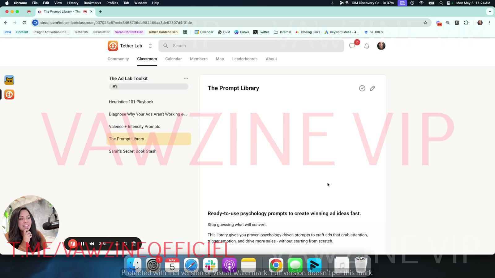

# Module 6: The Ad Lab Toolkit
> The course's downloads shelf: "anything outside of the current… roster of products". It holds the three e-books/prompt PDFs from Modules 2–3, the Prompt Library PDF and tutorial, Sarah's rare-book list, a CreativeOS free-month code (listed twice), and the Tether Signal newsletter. It teaches nothing new. Each item points to where its content is covered in this wiki.

## 🤖 Agent use
- **Use when:** locating a course asset (prompt set, e-book, reading list, partner tool) for an ad-creation task.
- **Inputs → outputs:** "I need X" (a prompt, a diagnostic, a template library, theory) → the wiki page holding it.
- **Rules:**
  - DO go to the **[Prompt Library](../07-prompt-library/README.md)** for concept/hook generation, the **[V+I prompts](../../../resources/valence-intensity-prompts.md)** for tone shifts, and the **[3 selves prompts](../../../resources/three-selves-prompts.md)** for identity rewrites. Those three sets cover the generation side of the pipeline.
  - DO use [CreativeOS](../../../tools/creativeos.md) (code `TETHER`, 1 month free) for static templates and Evergreen (90+ days live) competitor references.
  - DON'T treat the "FREE Ad Creatives" item as a library of free ads. It's only the CreativeOS code again ([details](06-free-ad-creatives.md)).
- **See also:** [Start Here: Welcome tour](../01-start-here/01-welcome-to-tether-lab.md) · [Prompt Library](../07-prompt-library/README.md) · [Heuristics hub](../../../concepts/heuristics.md)

## What Sarah says it is
In the [Welcome tour](../01-start-here/01-welcome-to-tether-lab.md), The Ad Lab Toolkit is "anything outside of the current like roster of products": the Heuristics 101 material, the valence–intensity prompts, plus "some super secret things" and extra downloadable resources ([03:49]–[04:08]). Classroom tile: "Prompts, books, templates, resources.. you name it!"

*The toolkit at Welcome-tour time [03:51]: Heuristics 101 Playbook, the "Diagnose Why Your Ads Aren't Working" e-book, Valence + Intensity Prompts, The Prompt Library, Sarah's Secret Book Stash. Items 6–8 were added later.*

## Toolkit items

| # | Item (Skool title) | What it is | Download in raw | Wiki page |
|---|---|---|---|---|
| 1 | Heuristics 101 Playbook | E-book: "9 proven shortcuts that make your customer's brain say 'yes.'" Same PDF as the Module 2 bonus | `2. Heuristics 101 e-book (1).pdf` | [Heuristics 101 e-book](../../../resources/heuristics-101-ebook.md) · [Module 2](../02-heuristics-101/README.md) |
| 2 | Diagnose Why Your Ads Aren't Working e-Book | E-book: "Fix the emotional tone of your ads and turn 'meh' into money." Same PDF as the Module 3 bonus | `2. Diagnose Why Your Ads Aren't Working (1).pdf` | [Diagnose e-book](../../../resources/diagnose-why-your-ads-arent-working-ebook.md) · [Module 3](../03-valence-intensity-model/README.md) |
| 3 | Valence + Intensity Prompts | "Quick prompts to rewrite any ad and instantly shift its emotional impact": one alteration prompt per zone. Same PDF as the Module 3 bonus | `3. Valence + Intensity - Prompts (1).pdf` | [Valence + Intensity prompts](../../../resources/valence-intensity-prompts.md) |
| 4 | The Prompt Library | "Ready-to-use psychology prompts to create winning ad ideas fast." The 29-page PDF (#1–#14) plus the 4:37 tutorial video | `4. Prompt Library - Tether Lab.pdf` | [Prompt Library PDF notes](../../../resources/prompt-library-pdf.md) · [Module 7 hub + tutorial notes](../07-prompt-library/README.md) |
| 5 | Sarah's Secret Book Stash | "11 Rare & Underrated Books on Behavioral Science and Psychology" (3-page PDF) | `5. Rare Behavioral Science Books.pdf` | [Book stash](05-sarahs-secret-book-stash.md) → [Books](../../../resources/books.md) |
| 6 | FREE Ad Creatives 🤩 | Only the CreativeOS 1-month-free code (`Tether`) and logo | – | [FREE Ad Creatives](06-free-ad-creatives.md) |
| 7 | Creative OS: 1 Month FREE 🤩 | Partner pitch + code `TETHER`. Same text as the Module 4 bonus | – | [CreativeOS](../../../tools/creativeos.md) |
| 8 | The Tether Signal Newsletter | Link to Sarah's newsletter (signal.tetherinsights.io) | – | [The Tether Signal](08-the-tether-signal-newsletter.md) |

The three PDFs in items 1–3 have the same extracted text as the copies in Modules 2 and 3 (a line-by-line diff found no differences). Each item is covered once, on the pages linked above.

## The tutorial video in this module
Item 4 embeds the same Loom tutorial as Module 7's "0. Video Tutorial" (transcribed under `_transcripts/6. The Ad Lab Toolkit/4. The Prompt Library.txt`). Notes with timestamps are on the [Prompt Library hub](../07-prompt-library/README.md#video-tutorial-how-to-use-the-prompt-library).

## How the toolkit maps to the agent pipeline *(derived)*

| Pipeline step | Toolkit item |
|---|---|
| Tear down a competitor ad: label heuristics | [Heuristics 101 e-book](../../../resources/heuristics-101-ebook.md) → [heuristics hub](../../../concepts/heuristics.md) |
| Tear down: diagnose emotional tone/zone | [Diagnose e-book](../../../resources/diagnose-why-your-ads-arent-working-ebook.md) + [V+I diagnostic prompt](../../../resources/valence-intensity-prompts.md#diagnostic-prompt-from-lesson-4) |
| Find references / templates | [CreativeOS](../../../tools/creativeos.md) (Evergreen ads, tag collections) |
| Generate new angles, concepts, hooks | [Prompt Library](../07-prompt-library/README.md) |
| Shift tone of a concept | [V+I alteration prompts](../../../resources/valence-intensity-prompts.md) |
| Rewrite for another self | [Three selves prompts](../../../resources/three-selves-prompts.md) (Module 4, not in this toolkit) |
| Deeper theory | [Books](../../../resources/books.md) · [The Tether Signal](08-the-tether-signal-newsletter.md) |

## Related
- [Course hub](../README.md) · Previous: [05 – Live recordings](../05-live-recordings/2025-07-09-live-with-sarah.md) · Next: [07 – The Prompt Library](../07-prompt-library/README.md)
- [Sarah Levinger](../../../people/sarah-levinger.md)

## Sources
- Skool pages: [`raw/tether-lab/_extracted/6. The Ad Lab Toolkit/`](<../../../../raw/tether-lab/_extracted/6. The Ad Lab Toolkit/>) (originals: [`raw/tether-lab/6. The Ad Lab Toolkit/`](<../../../../raw/tether-lab/6. The Ad Lab Toolkit/>))
- Tutorial transcript: [4. The Prompt Library.txt](<../../../../raw/tether-lab/_transcripts/6. The Ad Lab Toolkit/4. The Prompt Library.txt>)
