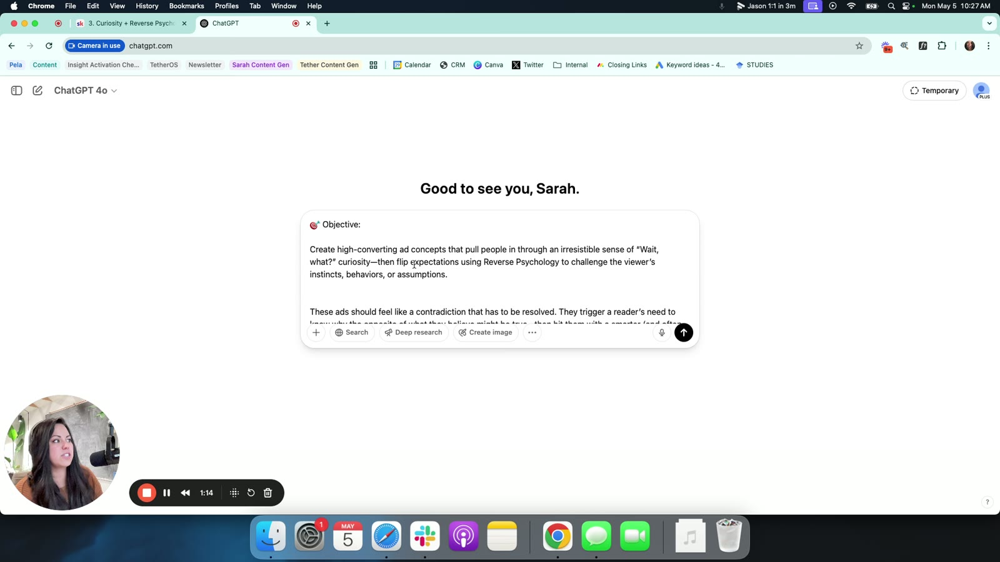

# Module 7: The Prompt Library
> 15 copy-paste ChatGPT prompts. Each one **pairs two psychological levers** (e.g. Curiosity + Reverse Psychology) and returns 3 full ad concepts (or 3–5 hooks for #15) for your brand. Paste the prompt, add your brand at the bottom, then iterate in the same chat. This page is the hub: how to run them, the tutorial notes, a master table, and a decision table for picking one.

## 🤖 Agent use
- **Use when:** generating new angles/concepts/hooks for our brand, especially after a competitor teardown. Identify the competitor winner's lever pair, run the matching prompt for our product, then write the UGC script from the best concept.
- **Inputs → outputs:** chosen prompt (verbatim) + brand/product/URL block (+ optional context: audience, self, zone, format, approved claims, competitor mechanism) → 3 ad concepts (Big Idea, Narrative Angle/Hook, Psychological Mechanism, Suggested Formats) → follow-ups (headlines, second round) → UGC script/brief.
- **Rules:**
  - DO paste the **whole** prompt verbatim, then add the brand "at the very, very bottom" [01:01]–[01:58]. The prompts contain no brand line on purpose ("it depends on what you're working with… D2C brand or B2B").
  - DO check every concept's "Psychological Mechanism in Use" line to confirm both levers were used [02:02]–[02:36].
  - DO iterate in the same chat ("second round", "Let's do headlines") [04:04].
  - DO feed real data (stats, reviews, deadlines, claims) for #9, #10, #11 and #13. LLMs invent numbers and testimonials. Never ship an unverified stat or quote.
  - DO run the output through the [V+I diagnostic](../../../resources/valence-intensity-prompts.md) and the [3 selves diagnostic](../../../frameworks/three-selves-diagnostic.md) before scripting, so you know which zone and self each concept hits.
  - DON'T paraphrase the prompts. Variants break comparability between tests.
  - DON'T copy the PDF version of #4 as-is. Its psychology section is wrong (see [#4](04-shock-factor-and-transformation-shortcut.md#pdf-vs-skool-differences)).
- **See also:** [Heuristic stacking](../../../concepts/heuristic-stacking.md) · [Heuristics hub](../../../concepts/heuristics.md) · [Valence + Intensity prompts](../../../resources/valence-intensity-prompts.md) · [Three selves prompts](../../../resources/three-selves-prompts.md) · [Prompt Library PDF notes](../../../resources/prompt-library-pdf.md) · [Ad Lab Toolkit](../06-ad-lab-toolkit/README.md)

## How the library works
- **Origin:** Sarah built them to "take two psychological concepts, mash them together, and then get us some good hooks… predominantly using all psychology. I didn't really want to just use this like us versus them or like typical concepts." She uses them "for all of my clients on… the tether side" [00:00]–[01:01]. Pairing two levers per ad is the course's [heuristic stacking](../../../concepts/heuristic-stacking.md) principle (2–3 shortcuts per ad).
- **Anatomy of prompts #1–#14** (identical skeleton, so outputs are comparable):
  1. **🎯 Objective**: what kind of concepts and the target feeling.
  2. **🧠 Psychology Behind This Prompt**: definition of lever A, definition of lever B, why the pair works. "It's basically telling your GPT what you want it to generate." [01:01]
  3. **🛠️ Instructions**: 4 steps.
  4. **✍️ Format for Each Concept**: Big Idea / Premise · Narrative Angle or Hook · Psychological Mechanism in Use · Suggested Formats.
  5. **✅ Output Instructions**: "Generate 3 ad concepts", a 4-item checklist, and a 3-adjective tone line.
- **#15** is different: a first-person instruction that generates **3–5 hooks** using hindsight bias + bounded rationality, with 9 example lines built in.
- **Where they live:** Skool lessons 1–15 in Module 7 (plus "16. More to come shortly!", which is empty), and a 29-page PDF in the [Ad Lab Toolkit](../06-ad-lab-toolkit/README.md) containing #1–#14 ([PDF notes](../../../resources/prompt-library-pdf.md)).
- **Model used in the demo:** ChatGPT 4o, in a Temporary chat (frame [01:00]).

## Standard run (for agents)
1. **Pick** the prompt with the [decision table](#decision-table-which-prompt-for-which-situation) (or match the competitor ad's levers).
2. **Paste** the prompt's verbatim block from its page.
3. **Append** the fill-in block: `Brand: {{brand_name}} / Product: {{product_name}} ({{one_line_description}}) / Website / landing page: {{url_or_pasted_page_copy}}`, plus the optional context block from that page (wiki addition).
4. **Check** each concept's psychology line names both levers.
5. **Follow up** in the same chat. Course follow-ups: "second round", "Let's do headlines" [04:04]. Wiki follow-ups *(not from the course)*: "Turn concept {{n}} into a 30-second UGC script with timestamps, on-screen text and B-roll notes", "Rewrite concept {{n}} for the {{actual|ideal|ought}} self" ([3 selves prompts](../../../resources/three-selves-prompts.md)), "Shift concept {{n}} into Zone {{1–4}}" ([V+I alteration prompts](../../../resources/valence-intensity-prompts.md)).
6. **Verify** claims, stats and testimonials against real data before anything goes to a creator brief.

## Video tutorial: How to use the Prompt Library
The same Loom video (4:37) is "0. Video Tutorial" in Module 7 and "4. The Prompt Library" in the Ad Lab Toolkit. Recorded 5 May (Skool clock in frame) by [Sarah Levinger](../../../people/sarah-levinger.md).

- **[00:00]** Sarah shows the classroom. She's been "using these for all of my clients" and will keep adding.
- **[00:19]** The prompt list in the Prompt Library module (screenshot below). "I have 15 or 14 generator. Now I have 15 more ready to go. I just haven't posted them yet." The extra 15 aren't in the saved course.
- **[00:00]–[01:01] Why lever pairs:** "a prompt that was basically going to take two psychological concepts, mash them together… I wanted to specifically see if we could test some of these mashups and psychological heuristics, shortcuts, basically so that we could get people to buy faster."
- **[01:01] Demo prompt:** [#3 Curiosity + Reverse Psychology](03-curiosity-and-reverse-psychology.md). "All you basically have to do is just copy this whole thing, paste it over here in chat."
- **[01:01]–[01:58] The one caveat: add your brand.** The Objective and Psychology sections tell GPT what to generate. "The last thing that you need to do, which I don't have in here mostly because again, it depends on what you're working with. If you're a D2C brand or B2B, you need to tell it which brand you want it to create for… You can put your brand, my website, my landing page, my product, whatever you'd like down in here at the very, very bottom." (The demo brand is transcribed as "Avi". The outputs suggest a collagen/supplement brand.)
- **[02:02] Reading the output:** "Three bold curiosity-triggering ad concepts…". The output names the framework, which "should match the exact prompt that you pulled out of the classroom", customised to the brand. Each concept has a big idea/premise, narrative angle/hook, the **psychological mechanism** ("always in here in every single one of these prompts, mostly so you can double check and make sure that it's giving you exactly the two psychology concepts that you wanted"), a resolution, and suggested formats.
- **[02:02]–[04:04] The three demo concepts:** "Go ahead, keep skipping breakfast", "If you really want to age faster, do this", "The longer you wait, the more it won't work". Full hooks table on the [#3 page](03-curiosity-and-reverse-psychology.md#example-outputs-from-the-course-tutorial-demo-supplementcollagen-brand). Sarah: "I love reverse psychology because it really does qualify the customer at the top of the funnel." [03:03]
- **[02:36]** "I need to expand these out. So double check these prompts when you're going through, give me some feedback on what else you would like it to include."
- **[04:04] Iterate:** the model asks "do you want a second round? Do you want to do headlines?…", and you type, e.g., "Let's do headlines." "I've tried to make these as drag as drop as possible. The only thing you're going to have to remember to do… is just put in whatever brand you're currently working on." Closing line: "ad concepts are so much easier if we can use psychology."

*[00:19] The Prompt Library module in Skool: lessons 1–13 visible (First Principles Thinking + Loss Aversion … Counterintuitive Insight + Specificity), 0% progress.*

*[01:00] Prompt #3 pasted whole into ChatGPT 4o ("🎯 Objective: Create high-converting ad concepts…"). The brand line goes at the bottom before sending.*

## Master table

| # | Prompt (levers) | Output | Best for | Self *(derived)* | Zone *(derived)* | Funnel *(derived)* |
|---|---|---|---|---|---|---|
| 1 | [First Principles Thinking + Loss Aversion](01-first-principles-thinking-and-loss-aversion.md) · [FPT](../../../concepts/heuristics/first-principles-thinking.md), [loss aversion](../../../concepts/heuristics/loss-aversion.md) | 3 concepts | Attacking an entrenched routine; switching argument with a cost of waiting | Ought, Actual | Z4 → Z1 | MOFU |
| 2 | [Status Signaling + Open Loop](02-status-signaling-and-open-loop.md) · [status](../../../concepts/heuristics/status-signaling.md), [open loop](../../../concepts/heuristics/open-loop.md) | 3 concepts | Premium/trend/insider products; curiosity clicks | Ideal | Z2 | TOFU |
| 3 | [Curiosity + Reverse Psychology](03-curiosity-and-reverse-psychology.md) · [curiosity gap](../../../concepts/heuristics/curiosity-gap.md), [reverse psychology](../../../concepts/heuristics/reverse-psychology.md) | 3 concepts (**demoed**) | Sarcastic, qualifying TOFU hooks against a bad habit | Ought, Actual | Z4/Z3 → Z2 | TOFU |
| 4 | [Shock Factor + Transformation Shortcut](04-shock-factor-and-transformation-shortcut.md) · [shock](../../../concepts/heuristics/shock-factor.md), [shortcut](../../../concepts/heuristics/transformation-shortcut.md) | 3 concepts | Max scroll-stop + easy fix for a complex problem | Ideal | Z4 → Z2 | TOFU |
| 5 | [Tribal Belonging + Vulnerability](05-tribal-belonging-and-vulnerability.md) · [tribe](../../../concepts/heuristics/tribal-belonging.md), [vulnerability](../../../concepts/heuristics/vulnerability.md) | 3 concepts | Hidden/embarrassing struggles, community brands, UGC confessionals | Actual | Z3 → Z1 | TOFU–MOFU, loyalty |
| 6 | [Pattern Disruption + Hidden Truth](06-pattern-disruption-and-hidden-truth.md) · [disruption](../../../concepts/heuristics/pattern-disruption.md), [hidden truth](../../../concepts/heuristics/hidden-truth.md) | 3 concepts | Saturated, same-y categories; insider education | Actual, Ought | spike → Z1 | TOFU |
| 7 | [What If Scenario + Pain Point Amplification](07-what-if-scenario-and-pain-point-amplification.md) · [what-if](../../../concepts/heuristics/what-if-scenario.md), [pain](../../../concepts/heuristics/pain-point-amplification.md) | 3 concepts | High-commitment/high-ticket purchases; cost of inaction | Actual ↔ Ideal gap | Z2 ↔ Z3/Z4 | MOFU–BOFU |
| 8 | [Contrast + Aspirational Identity](08-contrast-and-aspirational-identity.md) · [contrast](../../../concepts/heuristics/contrast.md), [aspiration](../../../concepts/heuristics/aspirational-identity.md) | 3 concepts | Transformation/before-after products, brand building | Ideal (watch the [angle rut](../../../concepts/angle-rut.md)) | Z3 → Z2 | TOFU–MOFU |
| 9 | [Gamification + Time-Sensitive Offer](09-gamification-and-time-sensitive-offer.md) · [gamification](../../../concepts/heuristics/gamification.md), [scarcity](../../../concepts/heuristics/scarcity-heuristic.md) | 3 concepts | Real promos, drops, challenges, referral pushes | Ideal | Z2 + Z4 urgency | BOFU, retargeting |
| 10 | [Anonymity + Social Proof](10-anonymity-and-social-proof.md) · [anonymity](../../../concepts/heuristics/anonymity.md), [social proof](../../../concepts/heuristics/social-proof.md) | 3 concepts | Many reviews/surveys, private problems, testimonial fatigue | Actual | Z1/Z3 | MOFU |
| 11 | [Authority Borrowing + Data-Driven Insight](11-authority-borrowing-and-data-driven-insight.md) · [borrowed authority](../../../concepts/heuristics/authority-borrowing.md), [data](../../../concepts/heuristics/data-driven-insight.md) | 3 concepts | Skeptical/analytical buyers, real research/press | Ought | Z1 (low intensity) | MOFU–BOFU |
| 12 | [Micro-Story + Suspense](12-micro-story-and-suspense.md) · [micro-story](../../../concepts/heuristics/micro-story.md), [suspense](../../../concepts/heuristics/suspense.md) | 3 concepts | Narrative UGC; lifting hold rate; part-1/part-2 series | Actual | any | TOFU |
| 13 | [Counterintuitive Insight + Specificity](13-counterintuitive-insight-and-specificity.md) · [counterintuitive](../../../concepts/heuristics/counterintuitive-insight.md), [specificity](../../../concepts/heuristics/specificity.md) | 3 concepts | Myth-busting with exact numbers; shareable education | Actual, Ought | Z2 / mild Z3 | TOFU–MOFU |
| 14 | [Reframing Perception + Emotional Trigger](14-reframing-perception-and-emotional-trigger.md) · [reframing](../../../concepts/heuristics/reframing.md), [emotional trigger](../../../concepts/heuristics/emotional-trigger.md) | 3 concepts | Normalised problems; precise control of the emotion/zone | any (set by emotion) | set by emotion | TOFU–MOFU |
| 15 | [The "Why Didn't I See This?" Framework](15-hindsight-bias-and-bounded-rationality.md) · [hindsight bias](../../../concepts/heuristics/hindsight-bias.md), [bounded rationality](../../../concepts/heuristics/bounded-rationality.md) | **3–5 hooks** (Skool only) | Switching/competitor-conquest hooks that don't blame the customer | Actual | Z3 → Z1 | TOFU–MOFU |

*Self, zone and funnel columns are wiki-derived from each prompt's objective and tone line, cross-referenced with [three selves](../../../concepts/three-selves.md) and [emotional zones](../../../concepts/emotional-zones.md). They aren't stated by Sarah, except that reverse psychology qualifies "at the top of the funnel" (#3) and #7 is "perfect for high-commitment conversions".*

## Decision table: which prompt for which situation
*Derived guidance. Match the first row that fits.*

| IF the situation is… | THEN run | Why |
|---|---|---|
| A competitor winner uses sarcasm / "keep doing X if you want Y" / "don't buy this" | [#3](03-curiosity-and-reverse-psychology.md) | Same lever pair; Sarah's demo prompt |
| A competitor winner says "you've been doing X wrong" / dismantles the category routine | [#1](01-first-principles-thinking-and-loss-aversion.md) (concepts) or [#15](15-hindsight-bias-and-bounded-rationality.md) (hooks, no blame) | Deconstruction + cost, or hindsight + absolution |
| Viewers use a competitor/old way and you need switching hooks fast | [#15](15-hindsight-bias-and-bounded-rationality.md) | Generates 3–5 hooks that validate the past choice |
| All ads in the niche look the same (teardown shows one format/zone) | [#6](06-pattern-disruption-and-hidden-truth.md) (structural break) or [#4](04-shock-factor-and-transformation-shortcut.md) (emotional jolt) | Break the pattern, then pay it off |
| You have a genuinely surprising fact or myth to bust | [#13](13-counterintuitive-insight-and-specificity.md) (with exact numbers) or [#6](06-pattern-disruption-and-hidden-truth.md) (with a disruptive open) | Dissonance resolved by specifics |
| You have real stats, studies, certifications, expert/press backing; buyers are skeptical | [#11](11-authority-borrowing-and-data-driven-insight.md) | Proof over hype |
| You have lots of reviews/survey answers but few on-camera testimonials | [#10](10-anonymity-and-social-proof.md) | Anonymous voices + volume |
| The problem is embarrassing or rarely talked about | [#5](05-tribal-belonging-and-vulnerability.md) or [#10](10-anonymity-and-social-proof.md) | Vulnerability/anonymity lower defences |
| You need narrative UGC, or hold rate is weak though hook rate is fine | [#12](12-micro-story-and-suspense.md) | Story + withheld payoff increases time-on-ad |
| Premium, trend-led or "in-the-know" product | [#2](02-status-signaling-and-open-loop.md) | Status + open loop |
| Transformation product with a visible before/after | [#8](08-contrast-and-aspirational-identity.md), then rewrite for Actual/Ought | Contrast + identity (Ideal-self heavy) |
| High-ticket / high-commitment purchase needing emotional urgency | [#7](07-what-if-scenario-and-pain-point-amplification.md) | Dream state vs. amplified cost of inaction |
| A real promo window, drop, challenge or referral push | [#9](09-gamification-and-time-sensitive-offer.md) | Game + real clock |
| The audience has normalised the problem ("it's just genetics") | [#14](14-reframing-perception-and-emotional-trigger.md) | Change the meaning, then attach one emotion |
| You must hit a specific emotional zone or self (from a V+I or 3-selves diagnosis) | [#14](14-reframing-perception-and-emotional-trigger.md) with the target emotion; or the matching row in the master table | Emotion choice sets the zone |
| Account is stuck in an Ideal-self [angle rut](../../../concepts/angle-rut.md) | Actual-self prompts: [#5](05-tribal-belonging-and-vulnerability.md), [#10](10-anonymity-and-social-proof.md), [#15](15-hindsight-bias-and-bounded-rationality.md); Ought: [#11](11-authority-borrowing-and-data-driven-insight.md), [#1](01-first-principles-thinking-and-loss-aversion.md) | Rotate selves (Module 4) |
| Account is all high-intensity Zone 4 and fatigued/anxious | [#5](05-tribal-belonging-and-vulnerability.md), [#10](10-anonymity-and-social-proof.md), [#11](11-authority-borrowing-and-data-driven-insight.md), [#15](15-hindsight-bias-and-bounded-rationality.md) | Lower-intensity zones |
| You need a high-intensity variant to test against calm ones | [#4](04-shock-factor-and-transformation-shortcut.md), [#3](03-curiosity-and-reverse-psychology.md), [#7](07-what-if-scenario-and-pain-point-amplification.md) | Zone 4 openers |

**Competitor-teardown shortcut:** tag the competitor ad's two dominant levers (see each lever page's "Spot it in a competitor ad" section), then run the prompt that pairs those levers *for our product*. Copy the mechanism, not the asset.

## Differences between the PDF and Skool versions
- **Coverage:** the PDF has #1–#14. #15 is Skool-only. "16. More to come shortly!" is an empty placeholder.
- **Wording:** a word-level comparison of #1–#14 found the wording identical, except in **#4**: the PDF's "Psychology Behind This Prompt" (p.8) is copied from #3. Use the Skool text.
- **Numbering:** Skool titles carry the prompt number (1.–15.). The PDF only has page numbers (1–28, printed one lower than the file page).
- Details: [Prompt Library PDF notes](../../../resources/prompt-library-pdf.md).

## Related
- Course: [Course hub](../README.md) · [Ad Lab Toolkit](../06-ad-lab-toolkit/README.md) · [Start Here: Welcome tour](../01-start-here/01-welcome-to-tether-lab.md) (describes the library at [03:15]–[03:49])
- Other prompt sets: [Valence + Intensity prompts](../../../resources/valence-intensity-prompts.md) · [Three selves prompts](../../../resources/three-selves-prompts.md)
- Concepts: [Heuristics hub](../../../concepts/heuristics.md) · [Heuristic stacking](../../../concepts/heuristic-stacking.md) · [Emotional zones](../../../concepts/emotional-zones.md) · [Three selves](../../../concepts/three-selves.md)

## Sources
- Skool lesson pages: [`raw/tether-lab/_extracted/7. The Prompt Library/`](<../../../../raw/tether-lab/_extracted/7. The Prompt Library/>) (originals: [`raw/tether-lab/7. The Prompt Library/`](<../../../../raw/tether-lab/7. The Prompt Library/>))
- Tutorial transcript: [4. The Prompt Library.txt](<../../../../raw/tether-lab/_transcripts/6. The Ad Lab Toolkit/4. The Prompt Library.txt>) (Loom embed `5282645d06b148b1a83903b23da3b3d3`)
- PDF: [4. Prompt Library - Tether Lab.pdf](<../../../../raw/tether-lab/6. The Ad Lab Toolkit/4. Prompt Library - Tether Lab.pdf>) · [extracted text](<../../../../raw/tether-lab/_extracted/6. The Ad Lab Toolkit/4. Prompt Library - Tether Lab.md>)
