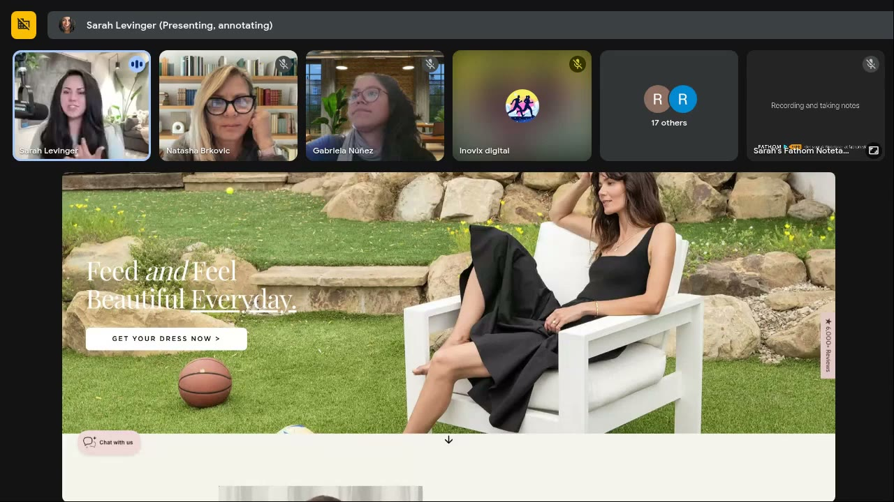
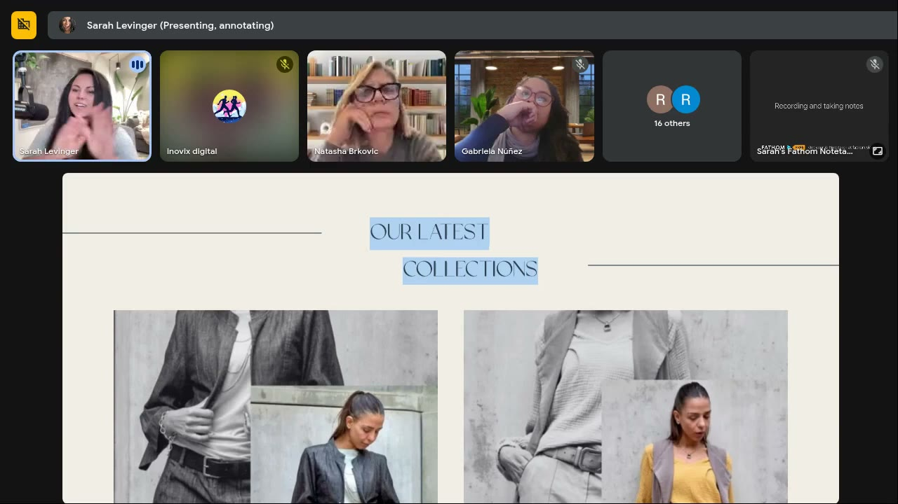
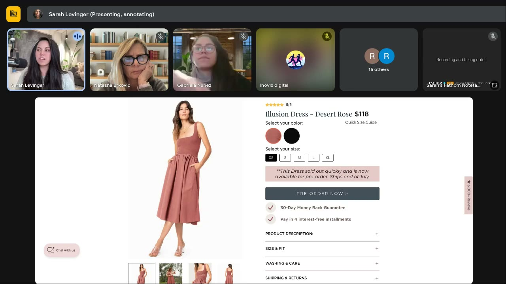
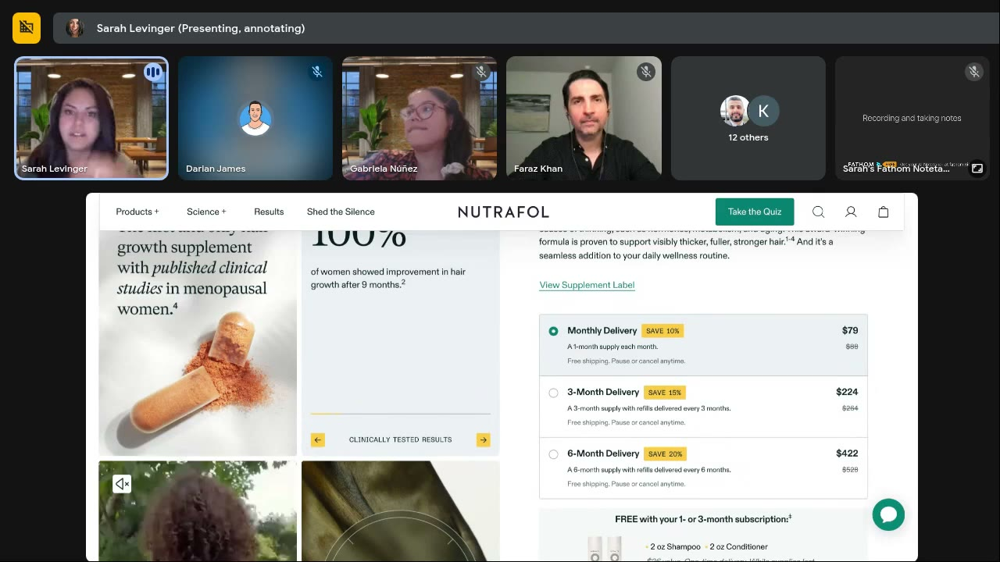
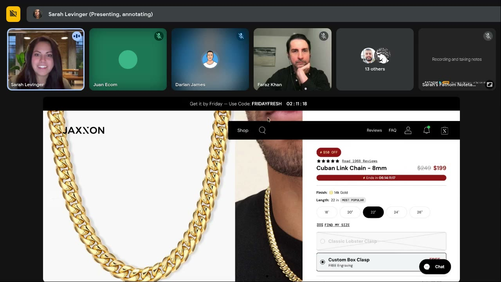

# Landing-Page Psychology Audit (Cognitive Load → Message → CTA)
> Sarah's three-lens audit for any page an ad sends traffic to (lander, PDP, listicle, home page): first **cognitive load** (is it easy for an energy-saving brain?), then **message** (what does it tell people to believe, and is it about *them*?), then **CTA** (does every button push buying, not browsing?). Add a retail-store section order, an ability pass ([Fogg](fogg-behavior-model.md)) and a buy-box pricing pass from July 16.

## 🤖 Agent use
- **Use when:** (a) tearing down a competitor's winning ad, because the landing page shows the full funnel and which promise the ad has to set up; (b) writing or briefing the landing page, advertorial or PDP for our own UGC ads; (c) checking that a new UGC script's hook, promise, tone and CTA match the page it points to; (d) writing end-card, overlay and caption CTAs.
- **Inputs → outputs:** page URL or desktop + mobile screenshots, the ad(s) that feed it, product category and price → a 3-pass audit table (Cognitive load · Message · CTA) + ability and buy-box notes + top 3 fixes + rewritten headlines and CTAs + a recommended section order (template below).
- **Rules:**
  - DO audit in this fixed order: **cognitive load → message → CTA**. [R2 0:03:42; 0:11:51; 0:19:19]
  - DO make the hero carry the feeling for the whole page, and make the overlay text **match the model's facial expression and body language**. [R2 0:06:23; 0:16:49; 0:23:24]
  - DO put the single core message on hero slide 1, because visitors see 1–2 carousel slides at most. [R2 0:16:49–0:17:58]
  - DO keep nav to ~3 items, images within one screen, bullets at 3–5 items of ≤2 lines, and use icons, big numbers and arrows instead of text. [R2 0:07:14; 0:08:25; 0:29:29; 0:35:54; 0:55:46]
  - DO check every prop and background object, and review mobile separately. [R2 0:25:31–0:27:32; 0:32:52]
  - DO write "you" copy ("Your next favorite"). Keep "our" only for the USP (materials, manufacturing). [R2 0:14:49–0:15:45; J16 0:24:09]
  - DO name the specific emotion ("boardroom-level confidence", not "confidence"). [R2 0:17:58; 0:22:56]
  - DO use buying verbs: "Get", "Grab", "Select", "Order yours now", "Pre-order now". [R2 0:13:41; 0:47:34–0:49:14]
  - DON'T use "Shop", "Browse", "Learn more" or, ideally, "Add to cart" on a true lander. "The add-to-cart button is a save-for-later button." [R2 0:12:19; 0:48:38; R1 0:27:05–0:29:09]
  - DO find the product's biggest **ability crusher** (fit, size, scale, durability, "is this for me") and answer it on the page. [J16 0:27:14]
  - DO show savings in dollars, use easy-math price steps (79 → 229, not 79 → 224) and give each number its own visual weight. [J16 0:37:47; 0:41:00–0:43:05]
  - DON'T show "0 reviews", stack competing claims, or mention something (e.g. "discount applied automatically") before you have introduced it. [J16 0:22:30; 0:55:36; 0:58:45]
  - DO mirror the ad's message (and any scarcity claim) on the landing page. [R3 0:15:00–0:17:00; Chase 0:08:26]
  - IF fashion at a normal price THEN show, don't tell: earlier buy buttons, less persuasion. IF info product or service THEN long copy is fine but formatting has to do the work. [R2 0:42:17–0:43:31; 0:50:20–0:52:01]
- **See also:** [Fogg Behavior Model](fogg-behavior-model.md) (ability pass) · [Offer & bundle psychology](offer-and-bundle-psychology.md) (buy box, badges, time framing) · [Visual weight hierarchy](visual-weight-hierarchy.md) (static layout rules that also apply to page sections) · [Three Vs of creative](three-vs-of-creative.md) (Vibe = ad ↔ page congruence) · [Valence-intensity diagnostic](valence-intensity-diagnostic.md) and [Three selves diagnostic](three-selves-diagnostic.md) (message pass) · [Cognitive load](../concepts/heuristics/cognitive-load.md) · [Choice overload](../concepts/heuristics/choice-overload.md) · [Processing fluency](../concepts/heuristics/processing-fluency.md) · [Active CTA language](../concepts/active-cta-language.md)

**Source key** (used in citations): **R2** = [Roast My Ads #2, Jun 25 2025](../courses/tether-lab/05-live-recordings/2025-06-25-roast-my-ads-2.md) · **J16** = [Live, Jul 16 2025](../courses/tether-lab/05-live-recordings/2025-07-16-live-with-sarah.md) · **J9** = [Live, Jul 9 2025](../courses/tether-lab/05-live-recordings/2025-07-09-live-with-sarah.md) · **J2** = [Live, Jul 2 2025](../courses/tether-lab/05-live-recordings/2025-07-02-live-with-sarah.md) · **R1** = [Roast My Ads #1, May 28 2025](../courses/tether-lab/05-live-recordings/2025-05-28-roast-my-ads-1.md) · **R3** = [Roast My Ads #3, Jul 23 2025](../courses/tether-lab/05-live-recordings/2025-07-23-roast-my-ads-3.md) · **Chase** = [Guest session, Chase Mohseni, Jun 2025](../courses/tether-lab/05-live-recordings/2025-06-guest-session-02-chase-mohseni.md)

## Definition
A fixed-order psychological audit of a post-click page. Sarah's reasoning: ads only need a click, but a landing page decides "what is this doing to the brain to help people understand what they're supposed to do next" [R2 0:02:08–0:03:10]. The brain is "about a three-pound organ", uses "about 20 percent of the glucose" you take in, and judges every page on "do I want to exert energy on this?", so the page "has to be easy to process" [R2 0:04:14–0:05:18].

| Lens | Question | Sarah's definition | Source |
|---|---|---|---|
| 1. Cognitive load | Is anything hard for the brain to look at? | "It helps the brain understand whether or not it wants to exert energy on what it's currently looking at." | [R2 0:03:42] |
| 2. Message | What does the page tell people to believe, and is it about them? | "Messaging… tells people what to believe about your product", "communicated a lot through imagery but backed up by the text." | [R2 0:11:51–0:12:19] |
| 3. CTA | Does every clickable spot push buying? | Count the clickable places, keep them few, make each "encourage that shopping behavior". | [R2 0:19:19–0:20:04] |

## Why it matters for an ad agent
- The page is the other half of the ad. Chase: only ~30% of ads he sees go to a unique landing page, and the "vibe" between ad and post-click page has to match, because you get less than half a second on the site [Chase 0:08:26; 0:18:43–0:19:10].
- Winning ad messages should be repeated on the page: Sarah says Darian's "Only 9 sets left in this color" static "probably would have worked better" with the same message on the landing page [R3 0:15:00–0:17:00].
- Ad concepts work as page sections and vice versa: the Illusion lander's "If you're done with…" block is "an ad concept… injected into the landing page. I freaking love this." [R2 0:28:34–0:28:57]

## Inputs
| Input | Notes |
|---|---|
| Page | Desktop **and** mobile screenshots (mobile "changed a ton of the cognitive load") [R2 0:32:52] |
| Feeding ad(s) | Hook, promise, tone, zone, self, any badge or offer the ad shows |
| Category + price | Decides page length and how much persuasion is needed (decision table below) |
| Page type | True lander vs home or category page (browse verbs are OK only on real category pages) [R2 0:12:19] |
| Optional | Heat map (decides the next CTA) [R2 0:20:04–0:21:10]; review count; buy-box prices |

## Procedure
0. **Congruence check (vibe).** Put the ad next to the page. Same tone, palette, promise, emotional zone and self? Is the ad's claim (e.g. scarcity, a result) repeated on the page? If not, flag it before anything else. [Chase 0:08:26; R3 0:15:00]
1. **Pass 1: cognitive load.** "Step back and look at it almost as if you were looking at a mountain scene… is there anything that's difficult for the brain to look at because there's too much going on?" [R2 0:58:54]. Run the checklist below on desktop, then on mobile.
2. **Pass 2: message.** Score the hero message with [valence-intensity](valence-intensity-diagnostic.md) and the [three selves](three-selves-diagnostic.md): "Make sure your message fits the person you're actually trying to bring in." [R2 0:59:12]. Then check you-vs-us copy, specific vs generic emotion, the customer's own words, and whether the innovation or USP appears early.
3. **Pass 3: CTA.** List every button and link. Replace browse/shop/add-to-cart verbs with action verbs ("action, action, action words" [R2 0:59:31]). Add buy buttons wherever the visitor is likely convinced, not only at the bottom [R2 0:38:05].
4. **Pass 4: ability** (from July 16). Name the biggest ability crusher and check the page answers it. See [Fogg Behavior Model](fogg-behavior-model.md). [J16 0:27:14]
5. **Pass 5: buy box.** Apply the pricing rules below and in [Offer & bundle psychology](offer-and-bundle-psychology.md). [J16 0:35:50–0:44:07]
6. **Section order.** Compare the page's order with the retail walk-through order below. [R2 0:37:41–0:40:29]
7. **Write the output** (template below): 3-pass table, top 3 fixes, rewrites, recommended order, and what the ad/UGC script must set up.

### Pass 1 checklist: cognitive load
| # | Check | Pass if… | Source |
|---|---|---|---|
| 1 | Hero text ↔ face | Overlay words describe what the model's face and body are doing | [R2 0:06:23–0:06:50] |
| 2 | Hero sets the feeling | "Any image at the top has to tell people exactly what they should feel" | [R2 0:23:24–0:23:57] |
| 3 | Navigation | ~3 items. "Choice overload is… one of the biggest drivers of bounce rates I've ever seen." | [R2 0:07:14–0:07:41] |
| 4 | Image size | Each image fits inside one screen | [R2 0:08:25–0:10:31] |
| 5 | Eye path | Contrast overrides the Z/F reading pattern: is the heaviest element the one you want seen first? | [R2 0:24:27–0:25:08] |
| 6 | Props and background | Every object tells the right story for the target customer (basketball → "boy mom") | [R2 0:25:31–0:27:32] |
| 7 | Text legibility | Light text on busy images has a dark fade. Body text ≥17px on mobile, ~20 ideal; never below ~12pt. Older buyers can't read tiny copy | [R2 0:28:03–0:28:44; J9 0:10:14–0:11:19; J16 0:21:45] |
| 8 | Bullets | 3–5 bullets, ≤2 lines each. Over 5 → paragraph; 3–4 lines → listicle | [R2 0:29:29–0:30:05] |
| 9 | Heavy sections | One or two dense sections only. No duplicated info (list + table saying the same thing) | [R2 0:30:40–0:31:46; 0:36:00] |
| 10 | Icons, numbers, arrows | Information shown as icons, large numbers, arrows where possible. "Arrows are freaking amazing." | [R2 0:35:54; 0:55:46] |
| 11 | Motion | No two pulsing or moving elements in competing colors above the fold | [R2 0:51:07] |
| 12 | Image quality | Sharp. "Sharper imagery actually communicates quality." Recreate fuzzy testimonial screenshots | [R2 0:54:48–0:55:31] |
| 13 | Layout bounce | No layouts that make the eye bounce (Jaxxon's image sliver, overlays on text). "Cognitive load is a big brain killer." | [J16 0:48:22–0:49:25; 0:53:30] |
| 14 | Page length | Watch page fatigue: "the farther they scroll, the harder it is to click that purchase button" | [R2 0:36:55; 0:41:15] |
| 15 | Fabric / movement (apparel) | Video of the product moving on a body | [R2 0:09:29–0:10:31; 0:29:42] |
| 16 | Repeated blocks | Similar cards are color-coded and filterable | [R2 0:52:55–0:54:01] |
| 17 | PDP USP icons | Elevated/luxury brand → clean images. Everyday product → test ~3 USP icons (Amazon-familiar) | [J9 0:11:19–0:13:23] |

### Pass 2 checklist: message
| # | Check | Rule | Source |
|---|---|---|---|
| 1 | One core message up top | Pick one hero image (most versatile, most product) and one message that "dictates the rest of the page" | [R2 0:16:49–0:17:58] |
| 2 | You, not us | "All the language on any website needs to push out instead of in." "Our" only for the USP + a "this is how we're different" subhead | [R2 0:14:49–0:15:45] |
| 3 | Specific emotion | "Confidence is great, but what type of confidence?" | [R2 0:17:58–0:18:30] |
| 4 | Customer vocabulary | "Nursing dress", not "feeding dress" | [R2 0:46:20] |
| 5 | Innovation early | Lead with the paradox ("stretchy compression"), not 70% down the page | [R2 0:45:31–0:46:08] |
| 6 | Intensity | Raise word intensity without harshness (happy → elated). Neutral Zone 1 copy is "not very motivated" | [J16 0:12:29–0:17:47; 0:18:30] |
| 7 | Typed proof | "350,000 tea drinkers love us", not "350,000 sold"; "women with thin hair", not "women" | [J16 0:39:20; 0:53:50; 0:54:50] |
| 8 | Claim congruence and order | No competing claims ("6 Day Results" + "30 Doses"). Introduce before you reference. "Order your messaging very, very carefully." | [J16 0:55:36–0:59:47] |
| 9 | Category fit | Fashion and home decor are "function forward" (as transcribed): emotional messaging "usually doesn't hit" until people wear it | [R2 0:22:16–0:22:35] |
| 10 | Belief fit | Don't make a claim the visitor's beliefs reject (pasta ≠ weight loss → frame by use case) | [J2 0:38:47–0:40:48] |

### Pass 3: CTA wording
| Before | After | Why (Sarah) | Source |
|---|---|---|---|
| "Shop now" / "Shop" | "Get it", "Grab it", "Get yours" | "Shop" is "too vague for the brain… I can get to it later" | [R2 0:47:34–0:48:38; R1 0:27:05] |
| "Browse by categories" | "Find your favorites", "Choose your size", "Select the look" | Encourage buying, not browsing (fine on real category pages) | [R2 0:12:19–0:13:47] |
| "Shop the look" | "Get / Select / Buy this look" | Active acquiring verb | [R2 0:13:47] |
| "Add to cart" | "Order yours now", "Pre-order now" | "The add-to-cart button is a save-for-later button" | [R2 0:48:38–0:49:14] |
| "View all categories" | "Shop our best sellers" / "Get our best sellers" (pick from heat map) | Use the most-clicked category | [R2 0:20:04–0:21:10] |
| Meta's fixed "Shop now" button (ads) | Definitive CTA in the ad copy: "See how it works", "Let us show you why…" | Meta limits buttons; put the real CTA in the text | [R1 0:27:05–0:28:09] |
| Sign-up offer | "Sign up" is fine | Matches the action | [R1 0:28:09] |
| Lead-gen lander | Same single CTA ("Schedule a call") in every section | One action per page | [R2 0:53:57; 0:58:14] |

CRO note: "changing your passive language over towards active language does amazing things for conversion rate" [R2 0:49:14].

### Section order: the retail walk-through [R2 0:37:41–0:40:29]
Goal: get the visitor to "overcome their objections pretty quickly". "How do we shop in retail?" You find the section, a **color** catches you, you "pick up the item and turn it over in our hands… look at the pockets." Drop that experience onto the page:

| # | Section | Job | Buy button? |
|---|---|---|---|
| 1 | Hero: brand- or product-focused message + image that sets the feeling | Say why we're different, set the emotion. "First… help them see the whole product, especially in fashion." | Optional |
| 2 | Why you'd enjoy it | Benefits in you-language | — |
| 3 | See it move (drape / demo video) | Proof of quality | **Yes**: "Did you like it? Let's choose your color" [R2 0:38:05] |
| 4 | Close-up details ("turn the piece over in their hands") | Fit, materials, features | **Yes**: "Find your color, find your fit" |
| 5 | Why this one beats everything else | Differentiator / innovation | — |
| 6 | Objection list (e.g. the "No list") | Clear remaining objections, combined bullets | — |
| 7 | Comparison as a graphic (not another table) | Final contrast | Yes |

*Sarah built this order for the Illusion nursing-dress lander. Using it for non-fashion products is (derived): keep the logic "whole product → enjoy → see it work → details → why better → objections".*

### Pass 5: buy-box pricing psychology (Jul 16)
| Rule | Sarah | Source |
|---|---|---|
| Anchoring direction | Brands start with the cheapest option, which anchors everyone to it ($79), so the $224 tier "feels too much". "Technically they should be doing this backwards from a scientific standpoint." | [J16 0:35:50–0:36:44; 0:41:00] |
| Is the bundle worth it? | 3 × $79 = $237 vs $224 → "I'm saving like 10 bucks… I could just come back every month." Make tier savings big enough to matter (work with finance) | [J16 0:36:44–0:38:52] |
| Show dollars, not % | "What is 10% of 224?" Show the dollar saving: it boosts ability | [J16 0:37:47–0:38:20] |
| Easy mental math | 79 → 229 instead of 79 → 224. Price endings (7/9) are "true-ish"; the even delineation matters more | [J16 0:42:03–0:44:07] |
| Separate the numbers | Core price big, original struck through, discount in a small colored badge: "each price has its own spot" | [J16 0:41:00–0:42:03] |
| Numbers are emotional | "The brain actually has an emotional reaction to numbers" | [J16 0:43:05] |
| Pay-over-time | Affirm "4 interest-free payments of $20" = ability for budget shoppers | [J16 0:23:05] |
| Easy math done right | Jaxxon $249 → $199 | [J16 0:50:27] |
| Late first buy point | The Illusion lander's only buy box sits far down the page. Add earlier buy points | [R2 0:37:00; 0:41:15] |

Badges, bundles, time framing and subscription wording for the buy box: [Offer & bundle psychology](offer-and-bundle-psychology.md).

## Decision table: how much page does this product need?
| Product / situation | Page approach | Source |
|---|---|---|
| Fashion at normal price (US dresses $80–200) | **Show, don't tell.** Look, drape, color, price. Buy buttons early; little persuasion | [R2 0:42:17–0:43:31] |
| Fashion / home decor messaging | Lead with function and look. Emotion lands "only after they get them on themselves" | [R2 0:22:16–0:22:35] |
| Info product, service, agency (knowledge purchase) | Long text OK. Formatting does the work: big and bold first, light and small second; highlight; ellipses; one CTA everywhere | [R2 0:50:20–0:52:42] |
| Men's "forever" jewelry (Cuban link) | Little motivational text needed; prompts (urgency, offers) can carry it. Add an identity headline ("for those who have earned it") | [J16 0:46:11–0:51:30] |
| Luxury / elevated | Clean images, no USP icons, no bundles or discounts | [J9 0:12:43; Jun18 0:11:31–0:12:31](../courses/tether-lab/05-live-recordings/2025-06-18-live-with-sarah.md) |
| Personalized products | Show the buyer types served (hair types), not ingredients | [J16 0:16:43] |
| Durability / time claims | Time sequence on the main product shot (10 / 20 / 40 min; 1 / 2 / 3 months) | [J16 0:26:13; 0:28:18–0:29:19] |
| No reviews yet | Hide the review widget | [J16 0:22:30] |
| Bold result claim from a listicle | Keep if 100% real, add "*not typical results" | [J16 0:56:36] |
| No dedicated lander | Clone the home page and change the copy | [Chase 0:18:43–0:19:10] |

## Carrying the audit into the ad and UGC script
*Sarah teaches these on pages. Applying them to scripts is (derived) unless cited.*

| Page principle | UGC / ad equivalent | Status |
|---|---|---|
| Hero text matches facial expression | On-screen text in each shot matches the creator's expression (excited face → excited line) | Derived (session "How to apply") |
| Props = context | Brief props and setting to the customer's life stage (newborn props, not a basketball) | Derived from [R2 0:46:56] |
| One core message in the first slide | One core message in the first 1–3 seconds; it must also appear early in video, not halfway (Net Positive video) | Cited for video: [R3 0:19:30–0:20:31] |
| You-language, customer vocabulary | Creator says "you" and uses the customer's words ("nursing") | Derived |
| Specific emotion | Hook names a specific situation ("boardroom-level confidence") | Cited (hooks table in R2) |
| Action CTA | End card / caption: "Get yours", "Order yours now"; never "Shop now" | Cited [R1 0:27:05–0:28:09] |
| Ellipsis pulls the reader on | Use "…" in overlays and captions. Sarah: "for ads, landing pages, emails, anything" | Cited [R2 0:51:32] |
| Ability crusher answered | Creator names their type or shows the fit/time sequence on camera | See [Fogg](fogg-behavior-model.md) |
| Page claim = ad claim | Any badge, number or scarcity line in the ad is repeated on the page with true numbers | Cited [R3 0:15:00–0:17:00] |

## Output template
```markdown
### Landing-page audit: <brand> / <URL> (fed by ad: <ad id / hook>)
- Category / price: <…> · Page type: <lander | PDP | home | listicle> · Approach: <show-don't-tell | long-form | …>
- Congruence (ad ↔ page): tone <match/mismatch> · promise <…> · zone/self <…> · ad claims repeated on page? <y/n>

| Lens | What works | What fails | Fix |
|---|---|---|---|
| 1. Cognitive load (desktop) | | | |
| 1. Cognitive load (mobile) | | | |
| 2. Message (zone · self · you/us · specific emotion · claim order) | | | |
| 3. CTA (list every button) | | | |
| 4. Ability (biggest ability crusher: <…>) | | | |
| 5. Buy box (anchor · $ savings · mental math · badges) | | | |

- Top 3 fixes (in impact order): 1) … 2) … 3) …
- Rewrites: | Before | After | What changed |
- Recommended section order: hero → enjoy → see it move → details → why better → objections → comparison graphic (buy buttons after 3 and 4)
- For the ad/UGC script: hook must set up <promise>; on-screen claim <…> must match page; CTA line "<…>"
```

## Examples
| Brand / product (niche) | Format | Hook / opening | What works | What fails | Fix suggested | Principle | Source |
|---|---|---|---|---|---|---|---|
| ANATATI (women's fashion) | Brand home / lander | Carousel "Style that speaks" / "Confidence that attracts" … | Low load; copy matches expressions; 3 nav items; fabric video; ~3 CTAs | "Us" copy; browse/shop verbs; 5 messages when 1–2 are seen; generic "confidence"; images bigger than one screen | One hero + one specific message ("boardroom-level confidence"); "Your next favorite"; "Find your favorites"; shrink images | All three lenses | [R2 0:02:08–0:22:16](../courses/tether-lab/05-live-recordings/2025-06-25-roast-my-ads-2.md) |
| Illusion Nursing Dress ($118 nursing fashion) | Custom lander | "Feed and Feel Beautiful Everyday." + "Get your dress now" | Contrast hero; "If you're done with…" block; drape video; big numbers; No list; "Pre-order now" | Basketball context; "feed"; text on green; 11-item list; duplicate table; one late buy box; stretch innovation buried | Newborn props; "Nurse and feel beautiful every day"; earlier CTAs; lead with the stretch; "hug"; retail section order | Context priming; show-don't-tell | [R2 0:23:24–0:49:44](../courses/tether-lab/05-live-recordings/2025-06-25-roast-my-ads-2.md) |
| Clickmatix (agency lead gen) | Long-form lander | "Outperform… in the next 90 days, or we work for FREE!" | One CTA everywhere; arrows + big numbers; authority logos; awards; risk reversal | Competing pulsing red/green elements; identical charts; fuzzy testimonials; repeats | Drop pulsing dot, add "…"; highlight; color-code charts; sharp Canva testimonials | Formatting carries long copy | [R2 0:49:44–0:58:54](../courses/tether-lab/05-live-recordings/2025-06-25-roast-my-ads-2.md) |
| Nutrafol Women's Balance (hair supplement) | PDP + buy box | Plane icon "Limited time only" + "Designed for women 45+ experiencing hair thinning" | Plane > clock; qualifier = ability; mild Zone 2 copy; "View Supplement Label"; prices visually separated | Anchored low ($79 first); % savings only; 79 → 224 → 422 math; ~$10 bundle saving; "100% of women" untyped | Dollar savings; 229 not 224; widen the gap; type the stat | Buy-box psychology | [J16 0:29:19–0:44:07](../courses/tether-lab/05-live-recordings/2025-07-16-live-with-sarah.md) |
| Jaxxon (men's chains) | Home + PDP | "Best Sellers, Top Picks, Limited Supply"; "$57 OFF, expires in 1 minute" pop-up | Chic photos; heavy prompts; easy math $249 → $199; 1,968 reviews | Pop-up first; "best sellers" doesn't sell first-timers; image sliver = eye bounce; no self activation | "Jewelry for those who have earned it"; fit images in their boxes | Cognitive load; identity headline | [J16 0:44:40–0:51:30](../courses/tether-lab/05-live-recordings/2025-07-16-live-with-sarah.md) |
| Olivia Burton (jewelry) | PDP | Petite Honeycomb necklace, $80 | Length info; Affirm 4 × $20 | Tiny text; "0 Reviews"; gift bag on PDP; brand-talk | Hide 0 reviews; gift option to cart; you-copy; show scale on a body | Ability; reverse social proof | [J16 0:19:56–0:27:14](../courses/tether-lab/05-live-recordings/2025-07-16-live-with-sarah.md) |
| AMA Biolabs Yerba Magic (appetite tea) | Mobile PDP from a listicle | "It's not magic, it makes sense." | Social proof 4.89 / +350,000 sold; calm Zone 1 | Overlays on text; generic "women"; "6 Day Results" vs "30 Doses"; discount referenced before introduced | Typed proof; asterisk; drop "30 doses"; re-order messages | Claim congruence; message order | [J16 0:51:30–0:59:47](../courses/tether-lab/05-live-recordings/2025-07-16-live-with-sarah.md) |
| Member lander (unnamed) | Shipping message | "Ships in 4 weeks" | — | Long wait framing | "The next drop comes in a week". CVR up "like overnight" | Time framing | [R3 0:47:27–0:48:00](../courses/tether-lab/05-live-recordings/2025-07-23-roast-my-ads-3.md) |


*Pass 1 in one picture: the high-contrast black dress pulls the eye first, the basketball reframes the visitor as a "boy mom", and white text on green is hard to read. [R2 0:24:00]*


*Pass 2: us-focused copy. Rewrite as "Your next favorite". [R2 0:15:00]*


*Pass 3: "Pre-order now" is a strong action CTA, but this is the first buy point and it sits far down the page. [R2 0:37:00]*


*Pass 5: anchored to the cheapest tier, percentage-only savings, hard mental math. [J16 0:36:45]*


*The image sliver makes the eye bounce ("cognitive load is a big brain killer"), while the buy box is all prompts. [J16 0:48:00]*

## Common mistakes
- Auditing message before cognitive load: a good message on an exhausting page still gets skipped.
- Desktop-only review. The Illusion hero read completely differently on mobile [R2 0:32:52].
- Rotating five hero messages. Visitors see one or two [R2 0:16:49].
- "Shop now / Add to cart" everywhere, teaching people to come back later [R1 0:28:09; R2 0:48:38].
- Only one buy button, at the bottom of a long page [R2 0:37:00; 0:41:15].
- Duplicating the same information as a list, then a table, then testimonials twice [R2 0:36:00; 0:56:33].
- Showing "0 reviews", untyped proof ("thousands of women") or two competing headline numbers [J16 0:22:30; 0:53:50; 0:55:36].
- An ad claim (scarcity, a result, a price) that the page never repeats [R3 0:15:00–0:17:00].
- Personalization claims followed by an ingredient grid instead of "who it's for" [J16 0:16:43].

## Conflicts and nuances between sessions
- **"Add to cart":** Roast #1 says on a landing page use "a CTA that encourages people to… add something to cart, buy it", while in the same answer calling add-to-cart "literally just a save-for-later button" [R1 0:28:09–0:29:09]. Roast #2 is firmer: replace "Add to cart" with "Order yours now" / "Pre-order" [R2 0:48:38–0:49:14]. **Default:** action verb ("Order yours now", "Get yours"); "Add to cart" only beats "Shop now".
- **The "sliver":** Roast #2 praises the mobile carousel where one card plus a sliver of the next prompts a swipe [R2 0:33:45]. July 16 criticises Jaxxon's image-sliver PDP layout as eye-bouncing cognitive load [J16 0:48:22–0:49:25]. **Reading:** a peek of the *next carousel card* is good; a *split image layout* that fragments the product is bad.
- **Bullet limit:** 3–5 bullets is the rule, yet Clickmatix's long industry checklist is fine because "nobody reads it", and the volume itself signals breadth [R2 0:57:39–0:58:14].
- **Pricing order:** Sarah says cheapest-first is "backwards from a scientific standpoint" [J16 0:41:00] but doesn't explicitly prescribe a high-to-low order. Treat "start with the highest tier" as a test, not a rule.

## Where it's taught
- [Roast My Ads #2 (Jun 25, 2025)](../courses/tether-lab/05-live-recordings/2025-06-25-roast-my-ads-2.md): the framework [0:03:10–0:05:18], ANATATI [0:05:18–0:22:16], Illusion [0:23:24–0:49:44], section order [0:37:41–0:40:29], Clickmatix [0:49:44–0:58:14], homework [0:58:54–0:59:53]
- [Live With Sarah (Jul 16, 2025)](../courses/tether-lab/05-live-recordings/2025-07-16-live-with-sarah.md): ability audits on PDPs [0:10:24–0:35:00], buy-box pricing [0:35:50–0:44:07], Jaxxon [0:44:40], message order [0:55:36–0:59:47]
- [Live With Sarah (Jul 9, 2025)](../courses/tether-lab/05-live-recordings/2025-07-09-live-with-sarah.md): font sizes [0:09:10–0:11:19], PDP USP icons [0:11:19–0:13:23]
- [Roast My Ads #1 (May 28, 2025)](../courses/tether-lab/05-live-recordings/2025-05-28-roast-my-ads-1.md): definitive CTAs, add-to-cart ≠ intent [0:26:52–0:29:09]
- [Roast My Ads #3 (Jul 23, 2025)](../courses/tether-lab/05-live-recordings/2025-07-23-roast-my-ads-3.md): mirror ad scarcity on the page [0:15:00–0:17:00]; "next drop in a week" [0:47:27]
- [Guest session: Chase Mohseni (Jun 2025)](../courses/tether-lab/05-live-recordings/2025-06-guest-session-02-chase-mohseni.md): vibe / post-click congruence [0:07:58–0:12:50], 30% unique-lander stat [0:18:43]
- [CreativeOS bonus lesson](../courses/tether-lab/02-heuristics-101/08-bonus-creativeos.md): Funnel Congruence Analysis tool [04:05]

## Related
[Fogg Behavior Model](fogg-behavior-model.md) · [Offer & bundle psychology](offer-and-bundle-psychology.md) · [Visual weight hierarchy](visual-weight-hierarchy.md) · [Three Vs of creative](three-vs-of-creative.md) · [Creative testing system](creative-testing-system.md) · [Valence-intensity diagnostic](valence-intensity-diagnostic.md) · [Three selves diagnostic](three-selves-diagnostic.md) · [Cognitive load](../concepts/heuristics/cognitive-load.md) · [Choice overload](../concepts/heuristics/choice-overload.md) · [Processing fluency](../concepts/heuristics/processing-fluency.md) · [Salience bias](../concepts/heuristics/salience-bias.md) · [Social proof](../concepts/heuristics/social-proof.md) · [Authority bias](../concepts/heuristics/authority-bias.md) · [Anchoring effect](../concepts/heuristics/anchoring-effect.md) · [Active CTA language](../concepts/active-cta-language.md) · [CreativeOS](../tools/creativeos.md) · [Sarah Levinger](../people/sarah-levinger.md)
