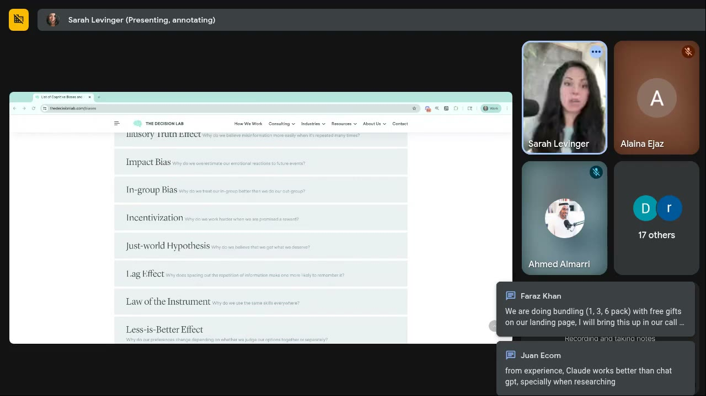
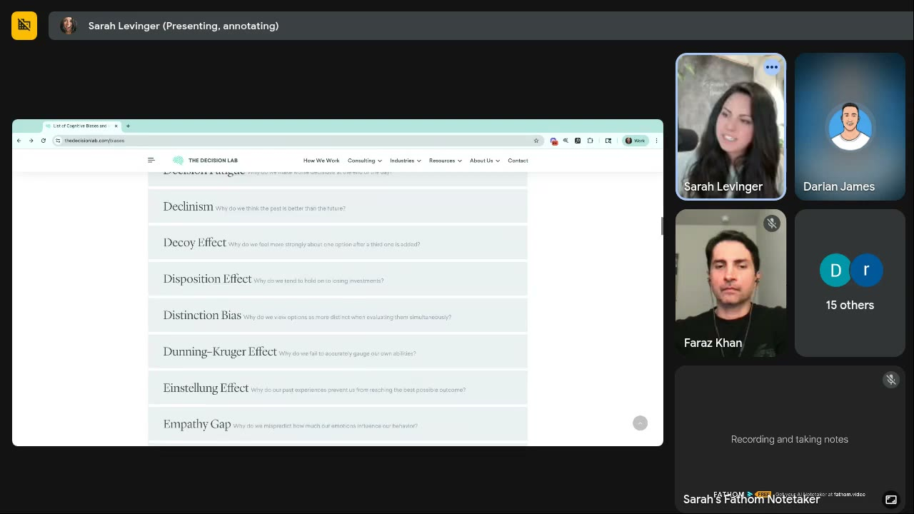

# Offer & Bundle Psychology
> "All of this comes down to making the decision easier": size bundles to how people really use the product, give the brain a **frame of reference** (what most people buy, how long it lasts, what it makes), pick time units by the result the buyer wants, never say "subscription" or "free trial" when a better frame exists, and lay out the buy box for easy mental math. [J2 0:55:50–0:57:05]

## 🤖 Agent use
- **Use when:** (a) a competitor ad leads with an offer, bundle, trial or badge and you need to decide what is transferable; (b) writing the purchase-stage ads, offer badges and UGC offer lines for our product; (c) briefing the PDP / buy box / subscription copy that our ads point to; (d) planning offer A/B tests.
- **Inputs → outputs:** product + usage rate (days, uses, servings per unit) + time-to-results + buyer goal (fast vs high-quality results) + luxury or not + current bundles/prices → bundle sizes, default, badge copy, time framing, subscription/trial label, buy-box price layout, matching ad/UGC offer lines and an A/B test list (template below).
- **Rules:**
  - DO size bundles to **real consumption**, so customers run out just as results show. DON'T oversupply: "you're going to create your own churn… betting against your own company." [J2 0:24:05–0:26:12]
  - DO bundle quantities or logical pairings ("it's got to have a point"). DON'T bundle subjective things like flavors. [J2 0:16:21–0:19:33]
  - DO prefer odd numbers (they "seem like they were specifically chosen"), or buckets that match usage (2 / 4 / 8). [J2 0:16:51; 0:35:38–0:36:39]
  - DO add a frame-of-reference badge: "Most customers buy X", "Lasts 180 days / 15 washes", "Buy a 36 pack, make 100 dinners". Test the "most customers buy" badge **on ads too**. [J2 0:37:45–0:41:53; 0:56:36; J9 0:04:59–0:06:08]
  - DON'T lie in a badge. Put "most customers buy" on the true best seller, or use **transparency modelling** ("Most people buy the 12 pack, but the 36 pack will get you 100 dinners a year"). [J2 0:43:59–0:45:03]
  - IF the buyer wants **fast** results THEN use the small-sounding unit ("30 days", not "one month"). IF they want **high-quality** results THEN use the substantial-sounding unit ("six weeks", not "45 days"). [J2 0:32:40–0:34:34]
  - DO express quantities and cadence in the buyer's **usage units** (days of use, washes, dinners), not calendar months or weeks. [J2 0:47:10–0:49:11; 0:55:05–0:55:50]
  - DON'T say "subscription". Say "auto ship and save" (or "stock and save"). [J2 0:53:44–0:54:43]
  - DO say "$0 trial", not "free trial". IF a trial needs a credit card THEN call out the friction ("Yeah, we're sketched out about having to put in a credit card too"). [J9 0:21:49–0:22:03; Joanna 0:38:48–0:39:50]
  - DO frame a costly upfront ask as **paying for access / the front of the line**, with "this isn't for everybody" language. [J9 0:33:23–0:38:09]
  - DO show savings as a **dollar amount**, use easy-math tier prices (79 → 229), and give each number its own visual weight. [J16 0:37:47–0:44:07]
  - DO give every sale or launch a **reason** and use drop language ("just dropped", "next drop in a week"). [R3 0:46:24–0:48:30]
  - DON'T bundle or discount a luxury product: price up and gate access. [Jun18 0:10:29–0:12:31]
  - DON'T claim more than the product does in an offer frame ("three months of weight loss" for pasta). Frame by the **use case**. [J2 0:38:47–0:40:48]
  - DON'T invent stock counts or "most customers" claims. Use true numbers only. [J9 0:43:49–0:47:00; J2 0:44:21]
- **See also:** [Landing-page psychology audit](landing-page-psychology-audit.md) (buy box in context) · [Fogg Behavior Model](fogg-behavior-model.md) (offers are prompts; dollar savings are ability) · [TEEP journey](teep-journey.md) (purchase-stage ads are offer ads) · [Anchoring effect](../concepts/heuristics/anchoring-effect.md) · [Decoy effect](../concepts/heuristics/decoy-effect.md) · [Bandwagon effect](../concepts/heuristics/bandwagon-effect.md) · [Scarcity](../concepts/heuristics/scarcity-heuristic.md) · [Framing effect](../concepts/heuristics/framing-effect.md) · [Luxury positioning](../concepts/luxury-positioning.md)

**Source key:** **J2** = [Live, Jul 2 2025](../courses/tether-lab/05-live-recordings/2025-07-02-live-with-sarah.md) (main source) · **J16** = [Live, Jul 16 2025](../courses/tether-lab/05-live-recordings/2025-07-16-live-with-sarah.md) · **J9** = [Live, Jul 9 2025](../courses/tether-lab/05-live-recordings/2025-07-09-live-with-sarah.md) · **R3** = [Roast My Ads #3, Jul 23 2025](../courses/tether-lab/05-live-recordings/2025-07-23-roast-my-ads-3.md) · **Jun18** = [Live, Jun 18 2025](../courses/tether-lab/05-live-recordings/2025-06-18-live-with-sarah.md) · **Jun4** = [Live, Jun 4 2025](../courses/tether-lab/05-live-recordings/2025-06-04-live-with-sarah.md) · **Joanna** = [Guest session, Joanna Wallace, May 23 2025](../courses/tether-lab/05-live-recordings/2025-05-23-guest-session-01-joanna-wallace.md) · **May14** = [Live, May 14 2025](../courses/tether-lab/05-live-recordings/2025-05-14-live-with-sarah.md)

## Definition
Offer psychology is how the *presentation* of quantities, prices, durations and commitments changes what people choose. Sarah's core idea is the **frame of reference**: "humans… don't have a frame of reference for how much do I actually need to see results" [J2 0:31:50–0:32:40], so most brands pick numbers that "feel good" or copy competitors [J2 0:23:51; 0:35:38]. The fix is to answer the buyer's silent questions: "how long am I going to use it, how long is it going to last, do I need more than I'm actually purchasing… can I use this for like 800 dinners or am I going to get 20" [J2 0:55:50]. "All of these heuristics come down to make it easier for the brain to say yes." [J2 0:56:36]

## Why it matters
- Two behaviors drive bundle choice. **On site**, the buyer is in their [actual self](../concepts/actual-self.md), "making a guesstimate… if I'm a new customer three seems like a lot", so they default to the cheapest option and AOV drops. **At home**, "I'll take it for probably the first five days and then I'll forget"; many stop halfway through a 30-day supply. [J2 0:24:36–0:28:17]
- Marketers over-rely on offers as prompts ("limited time offer, here's the discount… here's a bundle") and under-invest in making the choice easy [J16 0:05:50–0:06:15]. Clear offer framing is an ability fix, not just a prompt.
- Offer wording can lift conversion with no creative change: "the next drop comes in a week" instead of "ships in four weeks" raised CVR "like overnight" [R3 0:47:27–0:48:00].

## Inputs
| Input | How to get it |
|---|---|
| Consumption rate | Survey or quiz your list: "how fast does your specific family go through a bag?" Average it [J2 0:35:38; 0:47:10–0:49:11] |
| Time to first visible results | Product claims, reviews |
| Buyer goal | Fast result (wedding in six weeks) vs best/high-quality result [J2 0:33:32–0:34:34] |
| Industry education level | Do buyers already know what "90 days" means here? [J2 0:45:20–0:46:05] |
| Positioning | Luxury/exclusive or everyday? |
| Current offer | Bundle sizes, default, prices, badges, subscription and trial wording |
| Best seller (true) | Order data; needed for honest badges |

## Procedure
1. **Positioning gate.** IF luxury or exclusive THEN skip bundles and discounts: "Do not bundle, dear God, do not bundle." Price up, make access hard, compare to something far more expensive (Maserati at private-jet shows). Go to step 9. [Jun18 0:10:29–0:12:31; 0:29:21–0:30:27]
2. **Map consumption.** Units used per week/month and time to results. "Everybody go check your products… how long does it take somebody to consume the product, and then can we make it so that they can make it just barely to the end of what they want to see." [J2 0:26:12]
3. **Size the bundles** to end just past the results point (decision table A). Example: 1 / 2 / 5 instead of 1 / 3 / 6, so that by month five "I'm kind of running out… now I need to go back and buy more". The 1-pack is the tester. [J2 0:25:09–0:26:12]
4. **Compose bundles** with a point: quantities or conceptual pairings ("peanut butter and jelly"), "works best with this topping", toppings/add-ons as upsells. For build-your-own, pre-pick **two matched items and let them add a third** (keeps cognitive load low, adds an [IKEA effect](../concepts/heuristics/ikea-effect.md)). [J2 0:09:55–0:11:27; 0:16:21–0:19:33]
5. **Consider sequencing.** Split a regimen into "first 15 days / second 15 days" (two bottles). Sarah recalls an antibiotic study where 15 white + 15 blue pills raised completion "by like 85 percent" (her recollection; she said she needs to re-check the study). [J2 0:28:17–0:29:24]
6. **Set the default and badge.** Default to the bundle you want (Darian's pasta AOV dropped when the default was the single pack) [J2 0:36:39]. Add "Most customers buy X" (bandwagon on top of the decoy ladder) [J2 0:37:45–0:38:47]. Keep it true; use transparency modelling if the target bundle isn't the best seller [J2 0:43:59–0:45:03].
7. **Add a usage-unit frame of reference.** "Buy a 36 pack, make 100 dinners"; "30 days of use / 90 days of use"; "lasts 180 days, 15 washes, 5,000 dinners" [J2 0:40:48–0:41:53; 0:55:33; 0:56:36]. Frame by the **behavioral use case**, not the USP [J2 0:38:47].
8. **Choose time framing** (decision table B) and **subscription wording/cadence** (table C).
9. **Choose the entry offer for non-product or high-commitment sales** (table D): $0 trial, small paid access, pay-for-access, tripwire.
10. **Lay out the buy box** (table E): anchor, dollar savings, easy math, separated numbers.
11. **Give the offer a reason and an end.** Holiday or event reason; "new drop" / "just dropped" language for launches; real limited drops, precise odd counts ("53 left") if true. [R3 0:46:24–0:47:27; J9 0:43:49–0:48:04]
12. **Carry it into the ads.** Put the badge or frame on purchase-stage ads ("most customers buy this product" on an ad "work[s] incredibly well" [J9 0:05:49]), and write matching UGC lines (section below). Keep offer, price and badge identical between ad and page.
13. **Test** one offer variable at a time (badge vs none; honest vs transparency-modelling copy; "30 days" vs "one month"; dollar vs % saving).

### A. Bundle sizing and composition
| Situation | Do | Don't | Source |
|---|---|---|---|
| Consumable with a results window (supplements) | 1 / 2 / 5 packs so they run out just after results | 1 / 3 / 6 copied from affiliates; 30/90/180 "for no reason" | [J2 0:23:45–0:26:12] |
| Usage ≈ 2 units a month | Buckets of two: 2 / 4 / 8 | 3 / 6 / 12 "because they feel good" | [J2 0:35:38–0:36:39] |
| Dieters / habit products | Big bundles work ("consistency bias is already there") | Defaulting to the single pack | [J2 0:34:50–0:36:39] |
| Food / dessert | Quantities (2, 3, 7) with a decoy; conceptual pairings | Flavor bundles ("taste is subjective") | [J2 0:15:40–0:19:33] |
| Pet / multi-size range | Logical sub-bundles (small / medium / large dog) then "what do you want to add?" | Unrelated items (cat toys in a dog-chew bundle) | [J2 0:10:24–0:11:27; 0:18:52] |
| AOV/LTV justifies a huge pack | Large upsell can work (Obvi 12-month ~$400 "crushing") | Assuming bigger always wins: oversupply causes churn | [J2 0:31:50–0:32:40; 0:24:36] |
| Acquisition vs profit products | Pick the product that "gets them in the door the fastest" for ads; upgrade them into the profit product on subscription | Leading ads with the long-lasting profit product | [May14 0:39:32–0:40:09] |
| Luxury | No bundles, no discounts | Following advisors who say "bundle and discount" | [Jun18 0:10:29–0:11:31] |

### B. Time framing
| Buyer / context | Use | Instead of | Why (Sarah) | Source |
|---|---|---|---|---|
| Wants fast results | "30 days" | "one month" | "One month sounds longer even though the number is smaller" | [J2 0:33:32–0:34:00] |
| Wants high-quality results | "six weeks" | "45 days" | "45 days doesn't sound long enough for me to achieve anything important" | [J2 0:34:00–0:34:34] |
| Return window | Lengthen (45, 60, 180 days) and say "one month" rather than "30 days" | "30-day returns" | Longer windows → fewer returns (a study she cites); "you want people to feel like I have time" | [J2 0:49:11–0:50:50] |
| Industry with a familiar frame (weight loss: "12 lb in 90 days") | "90 days" is fine | — | The industry has repeated it | [J2 0:45:20] |
| Industry without one (shampoo, agency results) | Usage units: "30 days of use", washes | "90 days", "6 months" | "How many shampoos is that?" | [J2 0:45:20–0:47:08; 0:55:05–0:55:50] |
| Long wait (shipping, restock) | "The next drop comes in a week" | "Ships in 4 weeks" | Context for how long; CVR up "overnight" | [R3 0:47:27–0:48:30] |
| Future-benefit product (insurance) | Bring the future close ("Next Tuesday your home is going to flood") | "Protect your family" | Temporal discounting | [Jun4 0:17:41–0:19:46] |

### C. Subscriptions
| Rule | Detail | Source |
|---|---|---|
| Benchmark | ~4% first-order take rate is already "pretty high" | [J2 0:51:55–0:52:10] |
| Why people resist | An e-com subscription doesn't feel like value (unlike Netflix): product arrives on a schedule, not when needed; bottles stack up and people cancel | [J2 0:52:20–0:53:21] |
| Name | "Auto ship and save" (preferred) or "stock and save". Not "subscription", not "subscribe & save" | [J2 0:53:44–0:54:43] |
| Cadence | Use days or uses, not "every 2/4/6 weeks" | [J2 0:47:10] |
| Recommend the size | "Most people go through this bag in three months, so you're going to want the four-month pack." Reads as a favor | [J2 0:48:10] |
| Two selectors on a PDP | Express options as uses ("30 days of use / 90 days of use"), then pre-select | [J2 0:55:05–0:55:50] |
| Savings display | Show dollar savings, but watch for slowdown: Juan's subscriptions dropped after showing savings; Sarah suspects "the actual number itself was causing a little bit of slowdown" | [J16 0:40:00–0:42:03] |
| Wording list | Sarah promised a list of "subscribe" alternatives in the community (not in the recordings) | [J2 0:57:05] |

### D. Trials, paid access and entry offers
| Situation | Frame | Source |
|---|---|---|
| Free trial (SaaS / app) | "**$0 trial**", not "free trial": the dollar amount sometimes lands better | [J9 0:21:49–0:22:03] |
| Trial users | They hunt for "one little piece… just wrong enough so that I can get out before I have to pay". Find the snag and fix it before they hit it | [J9 0:22:03–0:23:53] |
| Alternative to a free trial | "Buy us a coffee" model (~$8 to look around): "even a little bit of a monetary investment causes the brain to commit" | [J9 0:23:53–0:24:24] |
| Credit card required for a trial | Barrier buster: "Yeah, we're sketched out about having to put in a credit card too… we won't charge it." Trial email: "you've had a busy week, let's just extend it" | [Joanna 0:38:48–0:40:56] |
| Upfront payment against industry norm (B2B wholesale) | "You're paying up front for access", front of the line (concert ticket analogy). Add an application and "this isn't for everybody" | [J9 0:33:23–0:37:41] |
| E-com version of the same | "This hair care product doesn't work for everyone… but it might work for you": builds "automatic scarcity" | [J9 0:37:31–0:38:09] |
| Info product | One specific problem; a 1–5-page cheat-sheet **tripwire** with a self-diagnosis checklist that ladders into the main product | [Jun4 0:40:55–0:46:18] |
| Kindness / reciprocity | "We wish we could give this away for free, but… so $X, and we'll throw in Y" (KFC $1 fries) | [J2 0:11:27–0:13:34] |

### E. Buy-box anchoring and price display (Jul 16)
| Rule | Detail | Source |
|---|---|---|
| Anchor direction | Cheapest-first anchors everyone to the low tier ($79), making $224 feel "way too high". Cheapest-first is "backwards from a scientific standpoint" | [J16 0:35:50–0:36:44; 0:41:00] |
| Meaningful savings | If 3 × monthly ≈ the 3-month price (237 vs 224), "I could just come back every month". Widen the gap (work with finance) | [J16 0:36:44–0:38:52] |
| Dollars, not % | "What is 10% of 224?" Show "Save $X" | [J16 0:37:47–0:38:20] |
| Easy mental math | 79 → 229, not 79 → 224 → 422. Endings (7/9) matter less than even steps | [J16 0:42:03–0:44:07] |
| Many numbers OK if separated | Big core price, struck-through original, small colored discount badge | [J16 0:41:00–0:42:03] |
| Pay over time | "4 interest-free payments of $20" helps budget shoppers (ability) | [J16 0:23:05] |
| Easy math example | Jaxxon $249 → $199 | [J16 0:50:27] |
| Choice architecture | Pre-selected options and decoys change what people choose (*The Elements of Choice*) | [J9 0:15:58–0:16:33] |
| Limited-time icon | A plane ("it's leaving soon") beats a clock for limited-time offers | [J16 0:29:40–0:30:50] |

## Rewrites (before → after)
| Before | After | What changed | Source |
|---|---|---|---|
| 1 / 3 / 6 pack | 1 / 2 / 5 pack | Sized to results window | [J2 0:26:12] |
| 3 / 6 / 12 | 2 / 4 / 8 | Mapped to consumption | [J2 0:36:39] |
| 3 / 6 / 12 / 36 (no badge) | "Most customers buy 36" → honest: "Most people buy the 12 pack, but the 36 pack will get you 100 dinners a year" | Bandwagon + frame of reference, kept true | [J2 0:37:45; 0:44:21] |
| "Three months of weight loss" | "Make up to 15 dinners… more suited to your goal" / "Buy a 36 pack, make 100 dinners" | USP → use case; removes cognitive dissonance | [J2 0:39:48–0:41:53] |
| "One-month supply" (fast-results buyer) | "30-day supply" | Shorter-sounding unit | [J2 0:33:32] |
| "45 days" (quality buyer) | "Six weeks" | Substantial-sounding unit | [J2 0:34:00] |
| "30-day returns" | "One-month returns" (and longer) | Longer-sounding window | [J2 0:50:14] |
| "Subscribe & save" | "Auto ship and save" | Says what they get | [J2 0:54:24–0:54:43] |
| Every 2 / 4 / 6 weeks | "Most people go through this bag in three months, so you're going to want the four-month pack" | Social-norm frame; reads as a favor | [J2 0:48:10] |
| 1 / 3 / 6 months (serum) | 30 / 90 days of use (or washes) | Usage units | [J2 0:55:33] |
| "Free trial" | "$0 trial" | Explicit dollar amount | [J9 0:21:58] |
| "Save 10%" | "Save $X" | No mental math | [J16 0:37:47] |
| $79 / $224 / $422 | $79 / $229 / … | Easy subtraction | [J16 0:43:05] |
| "Ships in 4 weeks" | "The next drop comes in a week" | Wait reframed as anticipation | [R3 0:47:27] |
| "New colors" | "New drop" / "Just dropped" (+ a reason for any sale) | Implies it won't last | [R3 0:46:24–0:47:27] |
| "Limited time / only five left" (luxury) | Higher price, no discounts, gated access ("see if you qualify") | Urgency → exclusivity | [Jun18 0:19:49–0:20:52] |

## Carrying offers into ads and UGC scripts
*Lines marked (derived) adapt Sarah's PDP/offer advice to creator scripts; the rest are cited.*

| Offer element | Ad / UGC use | Status |
|---|---|---|
| "Most customers buy this" badge | Badge on the static or overlay on the UGC video | Cited: "put it on ads too" [J9 0:04:59–0:06:08] |
| Usage-unit frame | Creator: "One box makes 3–4 dinners, so the 36 pack is basically 100 dinners." | Derived from [J2 0:40:48] |
| Bundle recommendation as a favor | Creator: "Most people go through a bag in three months, so get the four-month one." | Derived from [J2 0:48:10] |
| Reciprocity | Founder to camera: "We wish we could give this away for free, but…" | Cited template [J2 0:13:00–0:13:34] |
| Barrier buster | Creator: "I was sketched out about putting my card in too, but they remind you before it charges." | Derived from [Joanna 0:39:23] |
| Not for everyone | Hook: "This isn't for everyone… but it might work for you." | Cited [J9 0:37:31] |
| Drop language | "They just dropped this color" / "next drop is in a week" | Derived from [R3 0:46:24–0:48:00] |
| Time framing | Fast-result product: "in 30 days"; quality product: "after six weeks" | Derived from [J2 0:32:40–0:34:34] |
| Purchase-stage messaging up-funnel | Lines that win in purchase ads can be copied into earlier-stage ads ("You're 1 Click Away From Better Underwear") | Cited [R3 0:14:42] |

## Output template
```markdown
### Offer brief: <product>
- Positioning: <everyday | luxury → no bundles/discounts>
- Consumption: <units per week/month> · Results visible after: <…> · Buyer goal: <fast | high-quality> · Industry frame known? <y/n>
- Bundles: <e.g. 1 / 2 / 5> (why: runs out at <…>) · Default: <…> · Composition: <quantities | pairing "works best with…" | 2 + add a third>
- Badge(s): "Most customers buy <true best seller>" · frame: "<36 pack = 100 dinners | 30 days of use | lasts 15 washes>"
- Time framing: "<30 days | six weeks>" · Returns: "<one month / 60 days>"
- Auto-ship: label "Auto ship and save" · cadence in <days/uses> · recommendation line "<…>"
- Entry offer (if relevant): <$0 trial | $8 access | pay for access | tripwire> · barrier buster line: "<…>"
- Buy box: tiers <…> (easy-math steps) · show "Save $X" · number hierarchy <big price / strike / badge>
- Reason / scarcity (true only): <holiday | drop | real stock count>
- Ad/UGC lines that match: 1) … 2) …
- A/B tests: 1) badge vs none 2) honest vs transparency modelling 3) $ vs % saving 4) <time framing>
```

## Examples
| Brand / product (niche) | Format | Hook / opening | What works | What fails | Fix suggested | Principle | Source |
|---|---|---|---|---|---|---|---|
| Faraz Khan's brand (consumable, "90 days to see results") | LP bundles + free gifts | 1 / 3 / 6 pack | 1-pack tester; 3-pack = 90-day window | Numbers copied from affiliates; 6 arbitrary; oversupply → churn | 1 / 2 / 5 packs | Size to consumption | [J2 0:23:45–0:26:12](../courses/tether-lab/05-live-recordings/2025-07-02-live-with-sarah.md) |
| Low-carb pasta (Darian James's client) | PDP bundle ladder 3 / 6 / 12 / 36 | (selector) | Decoy ladder; dieters stock up; 12-pack default restored AOV | Arbitrary numbers; weight-loss frame clashes with "pasta isn't healthy" | "Most customers buy…" (honest/transparency); "Buy a 36 pack, make 100 dinners"; buckets of 2 | Use case > USP; frame of reference | [J2 0:34:50–0:45:03](../courses/tether-lab/05-live-recordings/2025-07-02-live-with-sarah.md) |
| Obvi (weight-loss supplements) | 12-month upsell ~$400 | — | "Crushing": no frame of reference for how much is needed | Likely oversupply (women may need 30–60 days) | — | Absent frame of reference | [J2 0:31:50–0:32:40](../courses/tether-lab/05-live-recordings/2025-07-02-live-with-sarah.md) |
| Gelato (Ahmed Almarri) | Bundles / cross-sell | Flavors + toppings | Intentional pairings | Flavor bundles; even numbers | Quantities 2 / 3 / 7 with a decoy; "works best with…" | Bundles need a point; odd numbers | [J2 0:15:40–0:19:33](../courses/tether-lab/05-live-recordings/2025-07-02-live-with-sarah.md) |
| Dog food (attendee) | Subscription every 2 / 4 / 6 weeks | — | Consistent usage | Nobody knows how much a dog should eat | Survey → "Most people go through this bag in three months…" | Frame of reference as a favor | [J2 0:47:10–0:49:11](../courses/tether-lab/05-live-recordings/2025-07-02-live-with-sarah.md) |
| Nutrafol Women's Balance | Buy box $79 / $224 / $422 | Plane "Limited time only" | Plane icon; numbers visually separated | Low anchor; % only; ~$10 saving; hard math | $ savings; 229; widen the gap | Anchoring; mental math | [J16 0:35:50–0:44:07](../courses/tether-lab/05-live-recordings/2025-07-16-live-with-sarah.md) |
| Jaxxon (men's chains) | Buy box | "$50 OFF", countdown, free clasp + engraving | Easy math $249 → $199; stacked nudges suit this buyer | Pop-up first; prompt-heavy, little self activation | Identity headline "for those who have earned it" | Prompts work for "forever piece" buyers | [J16 0:44:40–0:51:30](../courses/tether-lab/05-live-recordings/2025-07-16-live-with-sarah.md) |
| KFC $1 fries | Campaign (described) | "We want to give these to you for free but we can't, so… a dollar" | Reciprocity; recalled ~56% lift | — | Transfer to "we wish it were free" scripts | Ben Franklin effect | [J2 0:11:51–0:13:34](../courses/tether-lab/05-live-recordings/2025-07-02-live-with-sarah.md) |
| Lingopie (language app) | Trial card-entry copy + emails (proposal) | "Yeah, we're sketched out about having to put in a credit card too." | Names and defuses the friction | Card-for-trial barrier; forgotten trials | "Let's just extend it" trial email | Barrier buster | [Joanna 0:38:48–0:40:56](../courses/tether-lab/05-live-recordings/2025-05-23-guest-session-01-joanna-wallace.md) |
| B2B VR app (elderly care, schools) | Installable trial | Free trial | — | "Free" wording; trial snags | "$0 trial"; fix snags; or "buy us a coffee" access | Monetary commitment | [J9 0:18:40–0:24:24](../courses/tether-lab/05-live-recordings/2025-07-09-live-with-sarah.md) |
| Wholesale ice cream (Ahmed Almarri) | B2B terms | Pay upfront vs net 30/60 | Unique product | Not the industry norm | "Pay for access", front of the line, application, "not for everybody" | Framing; scarcity | [J9 0:32:21–0:37:41](../courses/tether-lab/05-live-recordings/2025-07-09-live-with-sarah.md) |
| High-end athleisure / Maserati | Offer strategy | Advisors push bundles/discounts | Maserati shown next to jets "looks like a steal" | Bundling luxury | No bundles/discounts; price up; gate access | Luxury = exclusivity; anchoring | [Jun18 0:10:29–0:12:31; 0:29:21](../courses/tether-lab/05-live-recordings/2025-06-18-live-with-sarah.md) |
| AG1 (greens powder) | UGC-style offer static | "Get your $76 Free Welcome Kit Now" | Bundle-as-gift framing (canister, shaker, travel packs, D3+K2) | — | (shown as purchase-stage contrast to AG1's other ads) | Purchase-stage offer ad | [Jun 11 0:06:40](../courses/tether-lab/05-live-recordings/2025-06-11-live-with-sarah.md) |
| Member lander (unnamed) | Shipping copy | "Ships in 4 weeks" | — | Long wait framing | "Next drop comes in a week". CVR up overnight | Time framing | [R3 0:47:27–0:48:00](../courses/tether-lab/05-live-recordings/2025-07-23-roast-my-ads-3.md) |


*Faraz Khan's bundle question, which led to the 1 / 2 / 5 recommendation and the "size to consumption" rule. [J2 0:21:05]*


*Sarah scrolled to the decoy effect while explaining why "Most customers buy 36" stacks bandwagon on top of a decoy ladder. [J2 0:38:50]*


*A prompt-heavy buy box with easy price math ($249 → $199). [J16 0:50:15]*

## Common mistakes
- Bundle numbers chosen because they "feel good" or were copied [J2 0:23:51; 0:35:38].
- Packs so large they outlast motivation and create churn [J2 0:24:36].
- Defaulting the selector to the single unit [J2 0:36:39].
- A fake "most customers buy" badge on the biggest pack [J2 0:43:59–0:45:03].
- Calendar units the buyer can't picture ("90 days" of shampoo) [J2 0:45:20].
- Calling it a "subscription" with cadence in weeks [J2 0:47:10; 0:53:44].
- Percent-only savings and uneven tier prices [J16 0:37:47; 0:43:05].
- Discounting or bundling a luxury product [Jun18 0:10:29].
- Invented scarcity (see conflicts below).

## Conflicts and nuances between sessions
- **Discounts and bundles at all:** normally "Sarah tells you do not run discounts like please don't do that, bundle your products if you can" [J9 0:00:57–0:01:02]. For 2025 "because of tariffs… at this point do what you got to do" [J9 0:01:02]. Luxury: never bundle or discount [Jun18 0:10:29–0:12:31]. July 16 says marketers over-prompt with discounts and bundles [J16 0:05:50]. **Default:** everyday products → prefer bundles (sized to consumption) over discounts; luxury → neither.
- **"Most customers buy" badge placement:** first suggested on the 36-pack ("Most customers buy 36") [J2 0:37:45], then corrected in the same session to the true best seller (12) or transparency modelling [J2 0:43:59–0:45:03]. On ads it "did something very different than I thought" for Faraz, with no details [J9 0:05:49]. **Default:** honest badge, A/B test.
- **Invented scarcity:** July 9 says fake scarcity ("closing down", perpetual countdowns) backfires; use real limited drops [J9 0:43:49–0:47:00]. July 23 discusses Darian's made-up "Only 9 sets left in this color" badge as a win and says mirroring it on the page would have worked better [R3 0:15:00–0:17:00]. **Rule for agents:** never invent counts; use real stock or real drops.
- **"30 days" vs "one month":** not a contradiction but easy to misapply. Both rules rest on "one month sounds longer": use "30 days" when you want it to feel short (results), "one month" when you want it to feel long (returns) [J2 0:33:32; 0:50:14].
- **Showing savings:** July 16 says show the dollar saving [0:37:47], but Juan's subscriptions fell after he showed savings; Sarah couldn't diagnose without the site [J16 0:40:00–0:42:03]. Test it.
- **Anchor direction:** cheapest-first is "backwards from a scientific standpoint" [J16 0:41:00], but no explicit "start high" instruction was given. Test it.

## Where it's taught
- [Live With Sarah (Jul 2, 2025)](../courses/tether-lab/05-live-recordings/2025-07-02-live-with-sarah.md): bundling core model [0:15:40–0:30:29], time framing [0:32:40–0:34:34; 0:45:20–0:47:08], pasta badges and dinners framing [0:34:50–0:45:03], subscriptions [0:47:10–0:49:11; 0:51:55–0:56:36], returns [0:49:11–0:50:50], wrap-up [0:55:50–0:57:05]
- [Live With Sarah (Jul 16, 2025)](../courses/tether-lab/05-live-recordings/2025-07-16-live-with-sarah.md): buy-box pricing psychology [0:35:50–0:44:07], plane icon [0:29:40]
- [Live With Sarah (Jul 9, 2025)](../courses/tether-lab/05-live-recordings/2025-07-09-live-with-sarah.md): tariffs and discounts [0:00:57], "most customers buy" on ads [0:04:59], $0 trial and paid access [0:21:49–0:24:24], pay for access [0:32:21–0:38:09], real vs fake scarcity [0:43:49–0:48:04]
- [Roast My Ads #3 (Jul 23, 2025)](../courses/tether-lab/05-live-recordings/2025-07-23-roast-my-ads-3.md): drop language, reason for a sale, "next drop in a week" [0:46:24–0:48:30]; scarcity badge [0:14:42–0:17:51]
- [Live With Sarah (Jun 18, 2025)](../courses/tether-lab/05-live-recordings/2025-06-18-live-with-sarah.md): luxury, no bundles/discounts, Maserati anchoring [0:10:29–0:12:31; 0:29:21–0:30:27]
- [Live With Sarah (Jun 4, 2025)](../courses/tether-lab/05-live-recordings/2025-06-04-live-with-sarah.md): info-product tripwire [0:40:55–0:46:18]; bring the future closer [0:17:41]
- [Guest session: Joanna Wallace (May 23, 2025)](../courses/tether-lab/05-live-recordings/2025-05-23-guest-session-01-joanna-wallace.md): Lingopie barrier buster [0:38:48–0:40:56]
- [Live With Sarah (May 14, 2025)](../courses/tether-lab/05-live-recordings/2025-05-14-live-with-sarah.md): acquisition vs profit product [0:39:32–0:40:09]

## Related
[Landing-page psychology audit](landing-page-psychology-audit.md) · [Fogg Behavior Model](fogg-behavior-model.md) · [TEEP journey](teep-journey.md) · [Creative testing system](creative-testing-system.md) · [Anchoring effect](../concepts/heuristics/anchoring-effect.md) · [Decoy effect](../concepts/heuristics/decoy-effect.md) · [Bandwagon effect](../concepts/heuristics/bandwagon-effect.md) · [Consistency bias](../concepts/heuristics/commitment-and-consistency.md) · [Cognitive dissonance](../concepts/heuristics/cognitive-dissonance.md) · [IKEA effect](../concepts/heuristics/ikea-effect.md) · [Reciprocity](../concepts/heuristics/reciprocity.md) · [Ben Franklin effect](../concepts/heuristics/reciprocity.md) · [Scarcity](../concepts/heuristics/scarcity-heuristic.md) · [Social proof](../concepts/heuristics/social-proof.md) · [Temporal discounting](../concepts/heuristics/temporal-discounting.md) · [Framing effect](../concepts/heuristics/framing-effect.md) · [Barrier buster](../concepts/barrier-buster.md) · [Luxury positioning](../concepts/luxury-positioning.md) · [Actual self](../concepts/actual-self.md) · [Sarah Levinger](../people/sarah-levinger.md)
