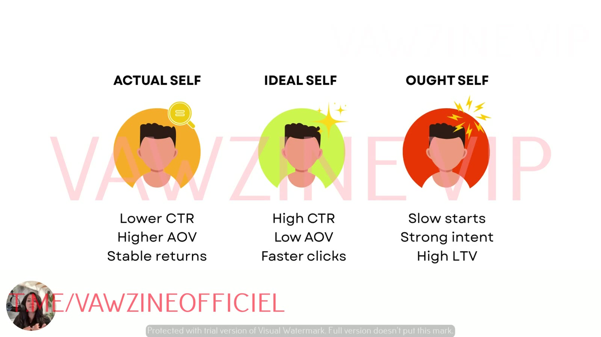

# Testing Ads by Self Type
> Test the Actual, Ideal and Ought versions of one ad **in a single ad set with everything else held constant**, then read results as identity signals (CTR, AOV, add-to-cart, LTV) to learn which self buys and how to weight the next batch.

## 🤖 Agent use
- **Use when:** writing the test plan for self variants produced by [Rewriting ads for new selves](rewriting-ads-for-new-selves.md), or interpreting results to plan the next iteration.
- **Inputs → outputs:** 3 self variants + offer and campaign context → a test brief (structure, constants, metrics, read-out schedule). Later: per-variant metrics → a verdict per self + next-batch ratio and directions.
- **Rules:**
  - DO use **one campaign → one ad set → three ads** (Actual, Ideal, Ought) in a campaign that gives them good spend [L8 00:57].
  - DO hold constant: product, landing page, price, offer, CTA, and visual design as far as possible [L8 01:18], [01:35].
  - DO test one self-shift at a time. Never combine it with an offer change [L7 00:38], [00:57].
  - DO measure identity response: speed (CTR, time to first purchase), strength (CVR, add-to-cart), depth (AOV, LTV/repeat), not just "which converted best" [L8 00:26–00:41].
  - DON'T kill an Ought variant in its first ~2 weeks just for a slow start [L8 03:35].
  - DON'T scale a high-CTR Ideal variant without checking AOV and conversion [L8 02:50].
- **See also:** [Rewriting ads for new selves](rewriting-ads-for-new-selves.md) · [Three selves diagnostic](three-selves-diagnostic.md) (Prompt 2 for the read-out) · [3 selves](../concepts/three-selves.md)

## Inputs
| Input | Notes |
|---|---|
| 3 variants | One per self, from the same winning ad, labelled A / I / O |
| Constants | Product, LP, price, offer/discount/bundle, CTA, layout and visual |
| Campaign | Whichever of your campaign structures "is going to give these ads good spend" [L8 01:02] |
| Metrics to track | CTR, CVR, ROAS (Prompt 2), plus AOV, add-to-cart rate and LTV/repeat purchase (L8 signatures) |

## Procedure
1. **Build** three variants: Actual, Ideal, Ought ([rewriting](rewriting-ads-for-new-selves.md)).
2. **Structure**: one campaign, one ad set, three ads [L8 00:57].
3. **Control**: keep everything else the same. "The only thing that's going to be different is the ad." [L8 01:18] Make the creative "as close to… carefully constructed as possible" [L8 01:47].
4. **Run** and watch for **pattern differences in performance** [L8 01:28]. Allow enough time for Ought's slow start.
5. **Read** the results with the decision table below.
6. **Analyse** with [Prompt 2](../resources/three-selves-prompts.md#bonus-prompt-2-self-discrepancy--performance-analysis): scores + CTR/CVR/ROAS → which self correlates with top performance, under-used selves, **recommended ratio** (e.g. 50% Actual / 30% Ideal / 20% Ought), next test directions.
7. **Iterate**: diagnose → reframe → test again [L8 05:08]. Optionally layer [valence and intensity](valence-intensity-diagnostic.md) per self [L6 02:20].

## Decision table: read the result

*Lesson 8's performance signatures per self, which Sarah bases on her own analyses of many such tests.*

| Observed pattern | Likely self activated | Why (Sarah) | What to do |
|---|---|---|---|
| Lower CTR, higher AOV, stable returns | **Actual** | Present-mode scrollers aren't "click happy", but identity alignment raises spend after the click [L8 02:12] | Judge on AOV and ROAS stability. Good conversion-stage workhorse |
| High CTR, low AOV, fast clicks, lots of engagement, little commitment | **Ideal** | "Exploratory evaluative mode… somebody give me an answer". They "don't really trust the product yet" [L8 02:50] | Use for awareness and traffic. Pair with Actual/Ought for conversion. Don't scale on CTR alone |
| Slow start (~2 weeks), then strong intent: add-to-carts, high LTV | **Ought** | Duty-driven buyers keep doing it once committed: "very, very loyal, very quickly" [L8 03:25] | Be patient. Value on LTV and cohort repeat rate |
| A variant's metrics don't match its intended self's signature | The ad may be activating a different self than intended | *(Agent inference)* | Re-score the variant with the [diagnostic](three-selves-diagnostic.md). Sharpen the self cues |

**Funnel placement** (e-book ch. 6) for scaling decisions: Awareness = Ideal or Ought · Consideration = Actual or Ideal · Conversion = Actual or Ought. "Ideal: pull them in with possibility. Actual: calm their nerves with familiarity. Ought: nudge them off the fence with pressure or logic."

## Test brief output format
```markdown
### Self-type test: <product> / <source winner>
- Campaign: <name> · Ad set: <one> · Budget: <…> · Start: <date>
- Constants: offer <…> · LP <…> · price <…> · CTA <…> · visual <same template>
- Variants: A = Actual "<headline>" · I = Ideal "<headline>" · O = Ought "<headline>"
- Primary read-outs: CTR, CVR, AOV, add-to-cart rate, ROAS · Secondary: 30/60-day LTV, repeat rate
- Read-out schedule: day 3 (CTR), day 7 (CVR/AOV), day 14+ (Ought verdict), day 30+ (LTV)
- Hypothesis: A → lower CTR / higher AOV; I → high CTR / low AOV; O → slow start / high LTV
- Next step: run Prompt 2 on results → ratio + next directions
```
*(The read-out days are an agent heuristic. The course only gives "two weeks" as an example of Ought's slow start.)*

## Common mistakes
- Testing the self variant against an old ad in a different ad set or with a different offer.
- Visually different variants. Sarah's own demo had this problem because she lacked the original file, and she flags it [L8 01:35].
- Declaring a winner on conversions only [L8 00:26].
- Scaling only one identity. "A pretty unsafe way to scale" [L8 04:58].

## Where it's taught
- [L8 How to Test Your Ads by Self Type](../courses/tether-lab/04-self-targeting-system/08-how-to-test-your-ads-by-self-type.md) [00:00–06:09]
- [L7](../courses/tether-lab/04-self-targeting-system/07-how-to-rewrite-winning-ads-for-new-selves.md) [00:38–01:00] (one self at a time, same offer) · [L6](../courses/tether-lab/04-self-targeting-system/06-how-to-use-the-prompts-for-instant-insights.md) [00:37–01:45] (Prompt 2 ratio)
- E-book ch. 6 (funnel): [Which 'You' Are You Selling To?](../resources/which-you-are-you-selling-to-ebook.md)

## Related
[Rewriting ads for new selves](rewriting-ads-for-new-selves.md) · [Three selves diagnostic](three-selves-diagnostic.md) · [Actual](../concepts/actual-self.md) / [Ideal](../concepts/ideal-self.md) / [Ought](../concepts/ought-self.md) · [Self-targeting](../concepts/self-targeting.md) · [Angle rut](../concepts/angle-rut.md)
