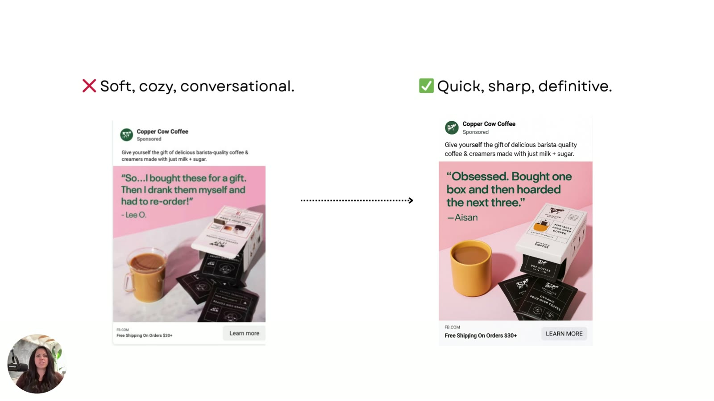
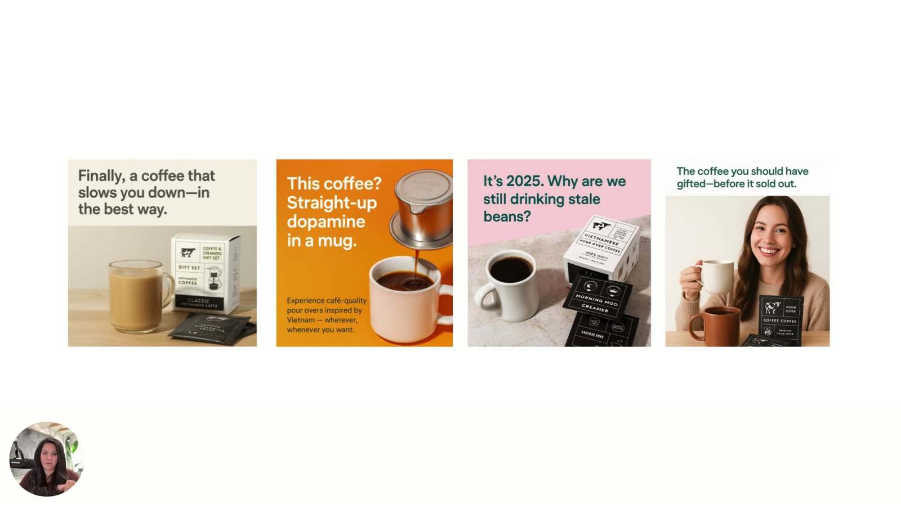

# Tone-Shifting: Move an Ad Between Emotional Zones Without Rebuilding It
> Once the [diagnostic](valence-intensity-diagnostic.md) gives you a current zone and a target zone, move the ad with three levers, from lightest to deepest: **(1) verbs/headline**, **(2) visual tone**, **(3) emotional promise**. Then generate the new copy and image direction with the matching zone prompt, and test until you land in the right quadrant.

## 🤖 Agent use
- **Use when:** remixing a competitor's winning ad into our product's zone; writing variant hooks/scripts for an iteration test; fixing an ad diagnosed as a misfire; writing the visual direction section of a creator/production brief.
- **Inputs → outputs:** original ad or script + current zone + target zone (from the [diagnostic](valence-intensity-diagnostic.md)) → 1–4 variants, each changing **one lever**, with new headline/first line, visual direction (colour, framing, light, expression) and the emotional promise named, plus a test note.
- **Rules:**
  - DON'T rebuild from scratch. "You don't need to scrap your ad." Tune the emotional temperature. [L5 00:25]
  - DO make the headline/first line **match the image/first frame**. The image is processed first and the largest headline second. [L5 00:50]
  - DO use **verbs** as "emotional accelerators" to raise intensity while keeping the core message. [L5 01:03–02:05]
  - DO raise visual intensity with **saturated/bold colour** and **zoom-in/close-ups**. DO lower it with **desaturation, zoom-out, soft/morning light**. [L5 02:28–03:39]
  - DO treat the **emotional promise** as the most powerful lever. Ask "which emotion are we selling vs which should we be selling". [L5 03:42–04:03]
  - IF valence stays the same and only intensity changes THEN keep the message and change the delivery. [L5 02:00]
  - IF the intended emotion was never communicated THEN change the promise, not the verbs. [L6 02:10]
  - DO include the original ad when running a zone prompt. [L5 06:52]
  - DON'T use Zone 3/4 rewrites to shame or trigger trauma. Aim for longing (Z3) or urgent relevance (Z4). [L5 05:01, 07:59]
  - DON'T run "static emotions in a dynamic feed". Plan emotional arcs across variants. [L5 09:18]
- **See also:** [Valence + Intensity prompts](../resources/valence-intensity-prompts.md) · [Emotional promise](../concepts/emotional-promise.md) · [Intensity](../concepts/intensity.md) · [Emotional zones](../concepts/emotional-zones.md) · [Prompt library](../courses/tether-lab/07-prompt-library/README.md)

## The three levers

| # | Lever | Mainly moves | How (course) | When to pick it |
|---|---|---|---|---|
| 1 | **Verbs / headline** | Intensity | Soft, cozy, conversational → quick, sharp, definitive. "Please pay attention to us" → "hey, don't ignore this". Give a reason to buy *right now*. E-book: "find" vs "seize". [L5 00:44–02:05] | Valence is right but energy is off, or the target emotion (e.g., empowerment) is under-expressed [L6 01:46] |
| 2 | **Visual tone** | Intensity | **Up:** more intense colour (soft baby pink → intense pink), zoom in ("up close and personal is very intense"), bolder colours, sensory punch. **Down:** desaturate, zoom out, show more body, soft/morning light. E-book: "Zoom in = more intensity. Bold colors = more urgency. Morning light = calm. Desaturated tones = trust." [L5 02:09–03:39] | Too intense (causing fear/anxiety where calm is wanted), or visually flat [L6 01:56] |
| 3 | **Emotional promise** | Valence (and intensity) | Name the emotion sold now (e.g., indulgence, surprise & delight) and the one to sell (e.g., stimulation, instant reward; or panic/loss/anxiety, carefully). E-book: "Indulgence? Safety? Control? Change that, and the whole ad pivots." [L5 03:42–06:03] | Wrong valence, wrong motive, or the message isn't landing "at all". Sarah's #1 focus. [L5 03:51; L6 02:10] |

## Procedure
1. **Start from the diagnosis:** current zone, target zone, customer state. → [diagnostic](valence-intensity-diagnostic.md)
2. **Pick the lightest lever that closes the gap** (decision table in diagnostic Step 7).
3. **Lever 1, verbs:** rewrite only the headline/first line. Keep the layout, product and claims. Check the line matches the image.
4. **Lever 2, visuals:** specify colour saturation, framing distance, lighting, facial expression and contrast for the target zone:

   | Target zone | Visual direction (course) |
   |---|---|
   | Z1 | Morning light, soft pastels, gentle copy; zoomed out; desaturated; calm expression [e-book p6; L5 03:18] |
   | Z2 | Bold type, energy visuals, saturated colour, close-up, "celebration or transformation", "feel unstoppable" [e-book p7; prompts PDF] |
   | Z3 | Sighs, subtle sarcasm, "the tension before the solution", "a gentle ache… 'This used to mean something'" [e-book p7; prompts PDF] |
   | Z4 | Harsh lighting, high contrast, jarring visuals, "an interruption in their feed… visually wrong enough to force the scroll to stop" [e-book p7; prompts PDF] |

5. **Lever 3, promise:** write the new emotional payoff in one phrase, then run the **zone prompt** with the original ad attached to get headlines and image ideas. → [prompts](../resources/valence-intensity-prompts.md)
6. **Ethics check** (Z3/Z4): are you evoking an emotion already tied to the customer's real experience? [L3 03:56]
7. **Test** one lever per variant. "Keep going until you hit the right quadrant." [L6 02:19]

## Rewrites (before → after)
| Before | After | What changed (verb / visual / promise / self / intensity) | Source |
|---|---|---|---|
| "So…I bought these for a gift. Then I drank them myself and had to re-order!" – Lee O. (soft pink, glass latte) | "Obsessed. Bought one box and then hoarded the next three." – Aisan (same layout) | **Verb/headline**: soft, cozy, conversational → quick, sharp, definitive. Intensity ↑, valence unchanged (Z1 → Z2) | [L5 01:00–02:05] |
| Soft baby-pink background, product small in scene | Saturated hot-pink background, product stacked large in frame ("Obsessed… hoarded the next three." – Phoebe G.) | **Visual**: colour intensity ↑, closer framing. Intensity ↑ | [L5 02:00–02:41] |
| Intense ad (bright, bold colours, intense expression) | Soft, desaturated, zoomed-out lifestyle shot: woman sipping, eyes closed. "Really enjoyed this coffee. Will order again." – Jenny J. / "Enjoy the gift of sweet and creamy barista-quality coffee at home." | **Visual** (+ milder copy): desaturate, zoom out, soft light. Intensity ↓ | [L5 03:00–03:39] |
| "So…I bought these for a gift…" (indulgence, surprise & delight) | "This coffee? Straight-up dopamine in a mug." (saturated orange, pour-over close-up) | **Promise**: indulgence → stimulation/instant reward. Z1 → Z2 | [L5 05:30–05:57] |
| Original Copper Cow testimonial (Z1) | Z1: "Finally, a coffee that slows you down—in the best way." | **Promise** → relief/slowing down (Zone 1 prompt). Warm neutral, morning-light styling | [L5 08:30] |
| Original Copper Cow testimonial (Z1) | Z2: "This coffee? Straight-up dopamine in a mug." | **Promise + intensity** → breakthrough/stimulation (Zone 2 prompt) | [L5 08:30] |
| Original Copper Cow testimonial (Z1) | Z3: "It's 2025. Why are we still drinking stale beans?" | **Promise + valence ↓** → quietly calling out an avoided truth (Zone 3 prompt). Muted pink, plain black coffee | [L5 08:30] |
| Original Copper Cow testimonial (Z1) | Z4: "The coffee you should have gifted—before it sold out." | **Promise + valence ↓ + intensity ↑** → regret/scarcity, "big mistake" (Zone 4 prompt) | [L5 08:30] |
| "Nourish your skin while you sleep." (lilac, woman asleep) | "Wake up to younger looking skin (overnight)." (bright turquoise, smiling woman, sparkles) | **Verb + visual + promise**: passive care → visible result. Intensity ↑ | [e-book p9] |
| Pela: "Serving spring, with built-in protection." (soft florals in greenery) | Pela: "If Plastic Could Protect, We Would Use It." + "4x stronger protection—from plants, not petroleum." + "Our Best Styles Are Selling Out Quick!" | Shown as low- vs higher-emotion contrast (not narrated): stronger claim, contrast, scarcity badge. Intensity ↑ | [L4 05:27–05:30] |

*Lever 1: same ad, sharper verbs. [L5 01:00]*

*Lever 3 via the four zone prompts: one product, four emotional promises. [L5 09:17]*

## Applying this to UGC video *(wiki extrapolation, not from course)*
The course examples are static Meta ads. Map the levers to UGC like this:
- **Verbs** → the creator's first spoken line + on-screen text overlay in the first 1–3 s.
- **Visuals** → framing (close-up selfie vs wide room shot), set lighting (window/morning light vs harsh ring-light contrast), colour grade (desaturated vs saturated), creator energy and facial expression, cut pace.
- **Promise** → the payoff the creator "testifies" to (calm/relief vs rush/results vs quiet regret vs urgent avoidance).

Brief each variant with: target zone, first line, delivery energy, framing, light, grade, promise.

## Rules of thumb
- **DO** keep the core message and change the delivery when only intensity is wrong. [L5 02:00]
- **DO** go in close for intensity. "Far away feels better" for comfort. [L5 02:41–02:56]
- **DO** use morning light for calm. [L5 03:27]
- **IF** a calm testimonial is selling an energy product **THEN** sell stimulation/instant reward instead of indulgence. [L5 05:41]
- **IF** you're ~10% off on the map **THEN** expect the ad to "feel completely wrong". Fine-tune, don't rebuild. [L5 05:17]
- **DON'T** run one static emotion everywhere. Design emotional arcs. [L5 09:18]
- Sarah's anecdote: an intense pink "works really well every time" she tests it on Meta. Treat it as a hypothesis to test, not a law. [L5 02:33]

## Common mistakes
- Changing several levers at once, so you can't tell what worked *(wiki note)*.
- Polishing verbs when the promise itself is wrong. [L6 02:10]
- A headline/image mismatch (e.g., an urgent headline over a sleepy image). [L5 00:58]

## Where it's taught
- [L5 Fixing the Tone Without Rebuilding the Ad](../courses/tether-lab/03-valence-intensity-model/05-fixing-the-tone-without-rebuilding-the-ad.md) [00:00–09:55]
- [L6 Map + Move Your Messaging](../courses/tether-lab/03-valence-intensity-model/06-map-and-move-your-messaging.md) [01:06–02:32]
- [E-book Chapters 5–6](../resources/diagnose-why-your-ads-arent-working-ebook.md#chapter-5-fixing-the-tone-without-rebuilding-the-ad)
- [Prompts PDF](../resources/valence-intensity-prompts.md)

## Related
[Valence-Intensity diagnostic](valence-intensity-diagnostic.md) · [Emotional promise](../concepts/emotional-promise.md) · [Intensity](../concepts/intensity.md) · [Valence](../concepts/valence.md) · [Emotional zones](../concepts/emotional-zones.md) · [Emotional misfire](../concepts/emotional-misfire.md)
