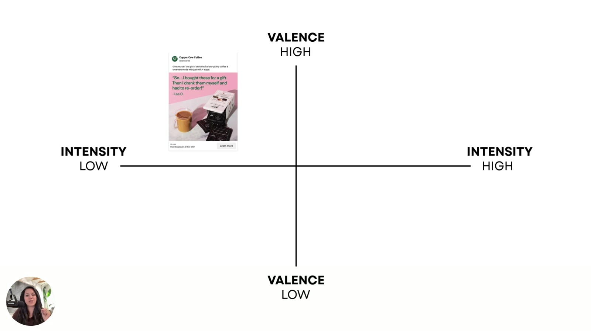

# Valence-Intensity Diagnostic (runnable)
> A step-by-step procedure for placing any ad or script on the valence × intensity map, comparing it with the customer's emotional state and the feeling needed to buy, and outputting the zone gap plus the lever to pull. It runs on **competitor winners** (to extract the transferable emotional pattern) and on **our own drafts or losers** (to fix misfires).

## 🤖 Agent use
- **Use when:** (a) tearing down a competitor ad, to record its emotional zone and *why that zone fits its buyer*; (b) QA-ing our own UGC script or static concept before production; (c) post-mortem on an ad that "should be working" but isn't converting; (d) reviewing a winner to learn what to keep.
- **Inputs → outputs:** ad asset (static image + copy, or video/UGC script with first 3 s described) + product + customer context → a filled [output block](#output-format): current zone, scores, evidence, customer state, target zone, gap, lever(s), zone-prompt to run, test plan.
- **Rules:**
  - DO score **valence first, then intensity**. They are separate dials. [L3 00:32–01:05]
  - DO read the **image/first frame first and the largest headline second**. That's the processing order, and the core message lives there. [L5 00:50; L4 02:41]
  - DO judge the zone against **this customer's state and purchase motive**, never in the abstract. "It depends on what your customer wants to feel." [L4 03:52]
  - DO check for **under-emotion**. Ads often fail because they're "not emotional enough". [L4 05:37]
  - DON'T blame hook, price, targeting or format first. "It's not your hook, it's not your price, it's your vibe." [L1 01:25]
  - DON'T recommend a full rebuild. Tune one lever at a time. [L5 00:25]
  - DON'T pick Zone 3 in a saturated category, and DON'T use Zone 4 to shame or trigger trauma. [L3 03:10, 03:48]
  - DO diagnose **winners too**, so you can copy the mechanism. [L6 00:12]
- **See also:** [Tone-shifting](tone-shifting.md) (execute the fix) · [Valence + Intensity prompts](../resources/valence-intensity-prompts.md) · [Emotional zones](../concepts/emotional-zones.md) · [Three Selves diagnostic](three-selves-diagnostic.md) (who the buyer is) · [Heuristics hub](../concepts/heuristics.md) (which bias the ad uses)

## Source procedure (what the course actually says)
Lesson 4 / e-book Chapter 4, verbatim questions:
1. "Is the **emotion** it communicates positive or negative?"
2. "Is it **high energy** or **low energy**?"
3. "What state is my customer in when they see this?"
4. "What do I want them to feel instead?"

Lesson 6 loop (slide): "1. Choose 1 ad that's not converting. 2. Identify the zone your ad lives in. 3. Shift verbs, visual tone, or emotion. 4. Test again until you hit the right quadrant."

AI shortcut [L4 01:30]: `Analyze the following ad for sentiment. Place it within one of the 4 quadrants on the Valence + Intensity Map.`

The numeric scoring below **operationalizes** these questions for agents. The scales and indicator lists are a wiki construction (not from the course). Every indicator is drawn from course statements, cited where possible.

## Procedure

### Step 0: Gather inputs
| Input | Required | Notes |
|---|---|---|
| Ad asset | yes | Static: image + on-image headline + primary text + CTA. Video/UGC: first frame, first spoken line, on-screen text, visual style, facial expression, pacing. |
| Product + category | yes | Note whether the category is **saturated** (many competitors on similar angles). |
| Purchase motive | yes | Why people buy it (e.g., coffee = "a boost" [L4 05:04]). |
| Moment of exposure | default: "dopamine scrolling", distracted [L4 01:07] | Override if known: at work and stressed, at home with kids, actively problem-solving, on a deadline. |
| Trust / price level | recommended | High-trust or luxury categories punish high-intensity promo styling. [L4 04:19] |
| Performance data | optional | Converting or not, and whether it's a winner or a loser. |
| Mode | yes | `teardown` (competitor winner) or `fix` (our ad or draft). |

### Step 1: Extract the core message
- Describe the **image / first frame** (subject, framing near or far, colour saturation, lighting, facial expression, contrast).
- Quote the **largest headline / first spoken line** verbatim.
- Name the **dominant emotion** and the **[emotional promise](../concepts/emotional-promise.md)** (the payoff being sold, e.g., indulgence, safety, control, stimulation, instant reward, empowerment). [L5 03:51; e-book p9]

### Step 2: Score valence (−2 … +2)
| Score | Meaning | Indicator emotions (course lists) |
|---|---|---|
| +2 | Clearly positive, pull/aspiration | joy, pride, excitement, thrill, hope [L2 00:52] |
| +1 | Mildly positive | comfort, cozy, calm, supportive, reassuring, enjoyment, indulgence, delight [L3; L4 02:31] |
| 0 | Neutral / informational | feature-only, logic-only ("speaks to logic, not emotion", e-book p3) → flag as **under-emotional** |
| −1 | Mildly negative | annoyance, disappointment, fatigue, irritation, unmet expectations, nostalgia/longing [L3 02:48] |
| −2 | Strongly negative, push/risk | fear, panic, loss, anxiety, FOMO, anger, scarcity, threat [L2 01:04; L3 03:32] |

### Step 3: Score intensity (0 … 4)
Add 1 point for each **high-intensity indicator** present (cap at 4). Treat 0–1 as **low** and 2–4 as **high**.

| High-intensity indicator | Low-intensity counterpart | Source |
|---|---|---|
| Quick, sharp, definitive headline; punchy action verbs; "right now" reason to act | Soft, cozy, conversational copy | [L5 01:03–01:40] |
| Urgency / scarcity / deadline / threat language | No urgency, lighthearted | [L4 02:52; L3 03:34] |
| Saturated, bold colour (e.g., hot pink, orange) | Soft pastel, desaturated tones | [L5 02:28; e-book p9] |
| Close-up / zoomed-in product or face ("up close and personal") | Zoomed out, more body/scene visible | [L5 02:38–03:23] |
| Harsh light, high contrast, jarring or "visually wrong" image | Soft / morning light | [L5 03:27; e-book p7] |
| Intense facial expression or intense lifestyle imagery | Calm expression, eyes closed, sipping | [L5 03:08] |

Also ask: "Are we communicating a lot of emotion or just a little bit?" [L4 00:58]

### Step 4: Read the zone
| Valence | Intensity | Zone |
|---|---|---|
| > 0 | low (0–1) | **Zone 1** feel-good |
| > 0 | high (2–4) | **Zone 2** hype |
| < 0 | low (0–1) | **Zone 3** pain-point whisper |
| < 0 | high (2–4) | **Zone 4** danger zone |
| 0 | any | **Unmapped / under-emotional.** Treat as a misfire candidate and choose a target zone. |

Optional cross-check: run the AI shortcut prompt with the ad screenshot (and the [map image](../concepts/emotional-zones.md)). If the model disagrees with your scores, explain why in the output.

### Step 5: Describe the customer's state
- **State at exposure** (Q3): distracted/scrolling, stressed at work, overwhelmed at home, on a deadline, actively comparing. [L4 01:03; L6 01:28]
- **Feeling needed to act** (Q4): what must they feel to "move forward and go check out what we have"? [L4 01:24]
- **Emotional load of the problem:** "How much emotion is going into their problem?" [L4 05:32]

### Step 6: Choose the target zone (decision rules)
| IF … | THEN target | Source |
|---|---|---|
| Product's job is to make people "feel okay inside" (wellness, luxury, intimacy, safety, belonging) | Zone 1 | [L3 01:49] |
| Launch, performance product, achievement, momentum, or you need a physical action | Zone 2 | [L3 02:11–02:26] |
| Purchase motive is energy/stimulation (e.g., coffee "boost") and ad is Z1 | Zone 2 (keep valence, add intensity) | [L4 05:04; L5 01:43] |
| Goal is pain-point awareness, before/after, set-up for relief, **and** category is not saturated | Zone 3 | [L3 02:59–03:21] |
| Category is saturated and the ad (or every competitor) is in Zone 3 | Move out of Zone 3 | [L3 03:10] |
| Limited-time offer, health/safety, financial risk | Zone 4, handled with care | [L3 03:40; e-book p7] |
| Buyer is stressed and wants a fast solution, ad is calm Z1 | Raise intensity (Z2, or Z4 for real risk) | [L4 03:58] |
| High-trust or luxury product, ad is high-intensity promo | Lower intensity (Z1) | [L4 04:19–04:54] |
| Customer feels heavy emotion about the problem, ad is flat or low intensity | Raise intensity | [L4 05:37–06:03] |
| Ad is too intense and causing fear or anxiety where you want calm | Lower intensity (visual tone down) | [L6 01:56] |
| **Teardown mode:** the competitor ad is a winner | Keep its zone. Record *why* its zone matches its buyer's state. That's the transferable pattern. | [L3 04:31] |

### Step 7: Pick the lever (gap → lever)
| Gap between current and target | Lever (from [Tone-shifting](tone-shifting.md)) | Source |
|---|---|---|
| Valence correct, intensity too **low** | **Verbs/headline** sharper + **visuals** up (saturate, zoom in) | [L5 01:08–03:04] |
| Valence correct, intensity too **high** | **Visual tone** down (desaturate, zoom out, morning light) + softer copy | [L5 03:05–03:39; L6 01:56] |
| Intended emotion is present but weakly worded (e.g., "wanted empowered, not saying empowerment") | **Verbs** | [L6 01:46] |
| Valence wrong, or the message isn't being communicated "at all" | **Emotional promise** (change the emotion being sold) | [L5 03:42; L6 02:10] |
| Promise doesn't match the purchase motive | **Emotional promise** | [L4 05:04; L5 05:41] |

### Step 8: Generate and test
- Run the target-zone **alteration prompt** with the original ad attached. [L5 06:52] → [prompts](../resources/valence-intensity-prompts.md)
- Change **one lever per variant** so results are readable *(wiki recommendation)*. Then "test again until you hit the right quadrant". [L6 01:17]

## Output format
```yaml
diagnosis:
  mode: teardown | fix
  ad_id: "<brand / ad name / link>"
  core_message:
    first_frame: "<description>"
    headline_or_first_line: "<verbatim>"
    dominant_emotion: "<e.g., indulgence, surprise & delight>"
    emotional_promise: "<payoff being sold>"
  scores:
    valence: <-2..+2>
    valence_evidence: ["<words/visuals>"]
    intensity: <0..4>
    intensity_evidence: ["<indicators present>"]
  current_zone: Z1 | Z2 | Z3 | Z4 | unmapped
  customer:
    state_at_exposure: "<e.g., distracted scrolling, stressed>"
    purchase_motive: "<e.g., energy boost>"
    feeling_needed_to_act: "<e.g., stimulated, urgent>"
    category_saturated: true | false
    trust_level: low | medium | high
  verdict: match | misfire | under-emotional
  target_zone: Z1 | Z2 | Z3 | Z4
  rule_applied: "<row from Step 6>"
  lever: verbs | visuals | emotional_promise   # primary; list secondary if any
  zone_prompt: "<opening line of the alteration prompt to run>"
  transferable_pattern: "<teardown mode: zone + promise + intensity mechanics to reuse>"
  test_plan: "<variant(s), one lever each>"
```

## Worked example: Copper Cow Coffee (course example)
| Field | Value |
|---|---|
| Headline | "So…I bought these for a gift. Then I drank them myself and had to re-order!" – Lee O. |
| First frame | Soft baby-pink background, glass latte, product box, gentle lighting |
| Dominant emotion / promise | Enjoyment, indulgence, surprise & delight [L4 02:31] |
| Valence | +1 (positive, "somewhat humorous") |
| Intensity | 0 ("no urgency… not really dramatic… no high arousal emotions… soft pink… gentle lighting") [L4 02:52] |
| Current zone | **Z1** (ChatGPT agreed) [L4 03:14] |
| Purchase motive | Coffee = boost energy [L4 05:04] |
| Verdict | Misfire risk: "save for later" or ignore [L4 03:30] |
| Target / lever | Z2 via verbs ("Obsessed. Bought one box and then hoarded the next three."), visuals (intense pink) or promise ("Straight-up dopamine in a mug.") [L5] |


*The Copper Cow ad placed in Zone 1 ([L4 03:00]).*

## Common mistakes
- Changing many things at once ("tweak and tweak and tweak") instead of diagnosing tone first. [L1 01:00]
- Declaring a zone "bad" across the board. "None of these zones are wrong." [L3 04:13]
- Ignoring the moment of exposure. A calm ad for a stressed searcher gets ignored. [L4 04:13]
- Scoring the body copy and ignoring the image and headline, which carry the message. [L4 02:41]

## Where it's taught
- [L3 The 4 Emotional Zones](../courses/tether-lab/03-valence-intensity-model/03-the-4-emotional-zones.md) [00:32–01:18]: map valence, then intensity
- [L4 Diagnosing Emotional Misfires](../courses/tether-lab/03-valence-intensity-model/04-diagnosing-emotional-misfires.md) [00:39–06:16]: four questions, AI prompt, worked example, misfire cases
- [L6 Map + Move Your Messaging](../courses/tether-lab/03-valence-intensity-model/06-map-and-move-your-messaging.md) [01:01–02:27]: 4-step loop, mismatch → lever
- [E-book Chapter 4](../resources/diagnose-why-your-ads-arent-working-ebook.md#chapter-4-diagnosing-emotional-misfires)

## Related
[Valence](../concepts/valence.md) · [Intensity](../concepts/intensity.md) · [Emotional zones](../concepts/emotional-zones.md) · [Emotional misfire](../concepts/emotional-misfire.md) · [Emotional promise](../concepts/emotional-promise.md) · [Tone-shifting](tone-shifting.md)
