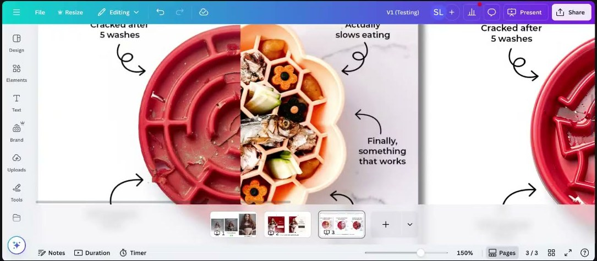

# Visual Weight Hierarchy (Static Ad Layout)
> The eye doesn't read a static in a Z. It jumps from the **heaviest element to the next heaviest**. So decide what the viewer must take away, make exactly those things the heaviest, stack them 1-2-3 on a grid in short lines, and let everything else be a light "supporting character" for **one core emotion**.

## 🤖 Agent use
- **Use when:** briefing a designer on a static; laying out text on a static or on the first frame of a UGC video; tearing down a competitor static ("what gets seen, in what order?"); diagnosing a busy ad that underperforms; turning a winning static into a video.
- **Inputs → outputs:** the core message (one emotion, one headline), the supporting proof (badges, stars, call-outs), the image, the CTA → a weight map (element → rank 1/2/3/skip), a layout brief (stack, line counts, shapes, background, colour), and a list of single-element A/B removals to test.
- **Rules:**
  - DO make "every single thing that's most important… heavy visually on the page". Assume light elements get skipped, and that's fine if all the heavy ones are seen. [R1 0:20:57]
  - DON'T design for the Z-pattern. The eye goes "from the heaviest thing to the heaviest thing… down an arrow". [R1 0:19:55–0:20:57]
  - DO stack text "1, 2, 3, straight line" on a grid. Never scatter equal-weight blocks. [R1 0:34:26–0:36:37]
  - DO cap headlines at **3 lines**, subheads at **2**, call-outs at **3** with the **top line bolded**. "Once you get to four lines then it's a paragraph, the brain will ignore it." [R1 0:36:37–0:38:39]
  - DO keep headlines **4–7 words**. Snip testimonials to one core line. [R1 0:14:42–0:16:53; 0:31:14]
  - DO communicate **one core emotion**: one headline, one CTA. Stars, reviews, badges, buttons, bullets and call-outs only support it. [R1 0:41:46–0:43:52; R3 0:17:51–0:18:56]
  - DO weight the part of a sentence that *is* the message, even if it's the second half ("backwards weight"). [R1 0:39:40]
  - DO use rounded text boxes and buttons. [R1 0:48:07–0:51:22]
  - DO make the background support the text: repeating patterns of objects the buyer already knows. The image is processed before the text. [R1 0:23:01–0:25:34; R3 0:32:37]
  - DO put colour and saturation on *your* product; grey or desaturate the competitor / "old way". [R3 0:35:44–0:37:49; 0:48:30–0:50:35]
  - DON'T let a static → video conversion lose the winning message: show it in **frame 1**. [R3 0:18:56–0:21:32]
  - DON'T use "Shop Now" / "Learn More". Write a definitive CTA in the copy. [R1 0:26:52–0:29:09]
  - DO learn what an element does by A/B testing the same ad with that one element removed. [R1 0:22:01–0:23:01]
  - DON'T treat layout as the fix for a weak message. Arrows, rounded buttons, colours and format are the third layer after identity and emotion. [M7 0:08:28–0:09:40]
- **See also:** [Psychology application ladder](psychology-application-ladder.md) (layout = behavior/tactics layer) · [Format variation ladder](format-variation-ladder.md) · [Creative testing system](creative-testing-system.md) · [Landing-page psychology audit](landing-page-psychology-audit.md) · [Offer and bundle psychology](offer-and-bundle-psychology.md) (buy-box weighting) · [Valence-intensity diagnostic](valence-intensity-diagnostic.md) · [Cognitive load](../concepts/heuristics/cognitive-load.md) · [Processing fluency](../concepts/heuristics/processing-fluency.md) · [Salience bias](../concepts/heuristics/salience-bias.md) · [Von Restorff effect](../concepts/heuristics/von-restorff-effect.md)

**Source key** (session pages):
[R1](../courses/tether-lab/05-live-recordings/2025-05-28-roast-my-ads-1.md) = Roast My Ads #1, May 28, 2025 ·
[R3](../courses/tether-lab/05-live-recordings/2025-07-23-roast-my-ads-3.md) = Roast My Ads #3, July 23, 2025 ·
[J11](../courses/tether-lab/05-live-recordings/2025-06-11-live-with-sarah.md) = Live, June 11 ·
[M7](../courses/tether-lab/05-live-recordings/2025-05-07-live-with-sarah.md) = Live, May 7 ·
[Jl16](../courses/tether-lab/05-live-recordings/2025-07-16-live-with-sarah.md) = Live, July 16 ·
[H4](../courses/tether-lab/02-heuristics-101/04-hook-attention-guide-behavior.md) = Heuristics 101, L4 (salience)

## Definition
**Visual weight** is how strongly an element pulls the eye: size, boldness, contrast, colour saturation, white space around it, and oddness. Sarah's model: "when we weight things with design, whatever is heaviest is going to get looked at first", then the eye moves to the next heaviest, and so on [R1 0:36:37]. A layout is a **ranked reading order you choose on purpose**: "Design is everything… the way you design an ad is going to teach them what they should believe about your message." [R1 0:39:40]

## Why it matters
- You have **~0.48 s** to matter (Sarah's figure, uncited) [R1 0:15:46]. Only the heavy elements get read in that time.
- A busy ad isn't automatically bad: "I don't care how much you stuff in it… but it has to have a natural progression for the eyes." [R1 0:19:55]
- Too many equal-weight blocks or emotions cause [cognitive load](../concepts/heuristics/cognitive-load.md): "the brain doesn't know what to do with it and it will skip out". [R1 0:18:54] "All we're trying to do is raise dopamine one time." [R1 0:41:46–0:42:48]
- "The images are going to get processed **60,000 times faster** than the text" (popular stat, uncited), so the image and background set the frame the text has to fit. [R1 0:25:02]

## Inputs
| Input | Notes |
|---|---|
| Core message | One emotion, one headline (4–7 words, ≤3 lines). Pick it with the [valence-intensity diagnostic](valence-intensity-diagnostic.md) and [three selves diagnostic](three-selves-diagnostic.md) first. |
| Image | Must show what the headline promises (POV "friends are coming" needs friends in frame) [R1 0:04:13]. For a model, check face, eyebrows, posture: the image is read first [R3 0:05:14–0:12:36]. |
| Supporting proof | Stars, review snippet, sold-count seal, scarcity badge, press bar, 3 call-outs. Max one row of each. |
| CTA | A definitive line ("See how it works"), not "Shop Now". |
| Background | Plain white space, a known-object pattern, or a trend colour. |

## Procedure
1. **Pick the one message.** Write the single takeaway as one sentence. If you have two emotional lines (e.g. "Remember chasing thrills…" + "Your heart was made to race…"), cut one. [R1 0:41:46]
2. **Rank every element.** List everything on the canvas and assign rank 1 (headline / core claim), 2 (image or the key visual proof), 3 (value stack or CTA), or "support / OK to skip". Nothing outside ranks 1–3 may be heavier than rank 3.
3. **Weight to the ranks.** Make rank 1 the heaviest (size, bold, contrast, white space around it). Sarah's High Camp order: headline in white space → image → call-outs [R1 0:36:37–0:38:39]. If the message is the second half of a sentence, weight that half ("He put up the tent, but **you brought the flask**") [R1 0:39:40].
4. **Cut the copy to the limits.** Headline 4–7 words, ≤3 lines. Subhead ≤2 lines. Call-outs ≤3 lines each, top line bolded (the top line is "technically a headline"). Testimonials snipped to the core line. Run new lines through ChatGPT: "What's a simple way to say this?" [R1 0:15:00–0:16:53; 0:35:31; 0:37:38]
5. **Stack on a grid.** Left-aligned 1-2-3 column, so the brain goes "oh I get it" instead of working out which block connects to which [R1 0:34:26]. Value-stack call-outs: "here's something valuable ×3" [R1 0:37:38].
6. **Shape and colour.** Rounded pills/bubbles for text boxes and buttons [R1 0:48:07–0:51:22]. Saturate your product; grey out the competitor side of a comparison [R3 0:35:44–0:37:49; 0:48:30]. For a stop-the-scroll centre: one colour field (or white space) with "something dead in the center… pretty drastic. So red, orange, black" [H4 01:22]. Fuchsia ("flower pink, not baby pink") "runs well for any brand in any industry" on Meta (Sarah's experience) [J11 0:54:59].
7. **Background.** Use a repeating pattern of objects the buyer already knows (mandala for wellness, baby bottles for moms, coffee cups for coffee). Check it says the same thing as the text [R1 0:23:01–0:25:34].
8. **Optional oddity.** Break the square: let the product bite out of a corner or sit half off-frame [J11 0:54:59–0:56:04]. Visualise metaphors literally (light switch on the bottle, set to ON) [R1 0:13:39–0:15:00]. Odd carriers (sticky notes, whiteboard, cardboard sign, all-text ad) are pattern disrupts ([Von Restorff](../concepts/heuristics/von-restorff-effect.md)) [R1 0:31:14–0:33:21].
9. **Supporting characters last.** Add at most a few small heuristic badges (scarcity, social proof, urgency) "in little places". They must not compete with rank 1 [R3 0:17:51–0:18:56]. Use only true claims (see Common mistakes).
10. **CTA.** Definitive CTA in the description/copy ("See how it works", "Let us show you why…"). On a landing page: add to cart / buy. "Sign up" is fine for sign-up offers [R1 0:26:52–0:29:09].
11. **Audit and test.** Squint test: which 3 things does the eye hit? If they're not ranks 1–3, re-weight. Then A/B test removing one element at a time [R1 0:21:57–0:23:01]. Homework from Sarah: audit your live ads for what's heaviest [R1 0:21:57].

## Decision tables

### Layout rules at a glance
| Element | Rule | Source |
|---|---|---|
| Headline | 4–7 words, ≤3 lines, heaviest element, ideally in white space | [R1 0:14:42; 0:36:37] |
| Subhead | ≤2 lines | [R1 0:36:37–0:37:38] |
| Call-out | ≤3 lines, top line bold, 3 call-outs = value stack | [R1 0:37:38–0:38:39] |
| Text arrangement | Grid, stacked 1-2-3 in a straight line | [R1 0:34:26] |
| Emotions per ad | One. One headline, one CTA | [R1 0:41:46] |
| Badges / stars / icons / emojis | Supporting characters only | [R1 0:42:48; R3 0:17:51] |
| Shapes | Rounded boxes and buttons | [R1 0:48:07–0:51:22] |
| Background | Known-object pattern that supports the text | [R1 0:23:01–0:25:34] |
| Comparison ads | Colour on your product, competitor greyed/desaturated | [R3 0:35:44–0:37:49] |
| Product colour | Push saturation up and test it | [R3 0:48:30–0:50:35] |
| CTA | Definitive, never "Shop Now" | [R1 0:26:52–0:29:09] |
| Premium buyer | More white space, fewer elements, higher-level language | [R1 0:51:22–0:53:28] |
| Price blocks (buy box) | Many numbers OK if each has its own weight: big price, struck original, small coloured discount badge | [Jl16 0:41:00–0:42:03] |

### Diagnose a static
| Symptom | Likely cause | Fix |
|---|---|---|
| Viewer can't say what the ad is about | Rank 1 isn't the heaviest, or there are two messages | Re-weight; cut the second emotional line [R1 0:41:46] |
| Call-outs ignored | Equal weight, scattered, >3 lines | Stack 1-2-3, bold top line, cut lines [R1 0:35:31–0:38:39] |
| Busy ad still performing | Has a natural heaviest → heaviest path | Keep it, test removing elements one at a time [R1 0:19:55–0:23:01] |
| Image and headline feel disconnected | Image doesn't show the promise, or background says something else | Put the promise in the image; pick a background that supports the text [R1 0:04:13; 0:25:02] |
| Metaphor headline not landing | No literal visual, or the verb breaks the metaphor ("cover" vs "uncover" blind spots) | Add the visual; fix the verb [R1 0:13:39; 0:25:34–0:26:52] |
| Comparison ad, eye lands on competitor | Competitor side is the most saturated (red) | Desaturate competitor half [R3 0:35:44–0:37:49] |
| Video of a winning static gets clicks, no sales | Winning message arrives late | Message in frame 1, model/product second [R3 0:18:56–0:21:32] |
| Ad looks "premium" product but cluttered | DTC best-practice stuffing | White space, fewer elements [R1 0:51:22–0:52:26] |

### Carry the hierarchy into UGC video (derived)
The course teaches these rules on statics; the one direct video rule is "message in frame 1" [R3 0:18:56–0:21:32]. The rest of this table is **(derived)**: an agent's application of the static rules to UGC text overlays.

| Static rule | UGC / video application (derived) |
|---|---|
| Heaviest element = core message | The hook text overlay is the heaviest thing in frame 1: largest type, high contrast, on a calm area of the shot. The winning static headline goes here verbatim. (Frame-1 rule from R3 is sourced; sizing is derived.) |
| One core emotion | One hook line on screen per beat. Don't stack a second emotional claim in the same frame. |
| ≤3 lines headline, 4–7 words | Overlay hook ≤7 words, ≤3 lines in the safe zone. Split longer lines across cuts. |
| 1-2-3 stack, bold top line | Value-stack beats appear one at a time (1 → 2 → 3), each with a bold short top line. |
| Backwards weight | Emphasise (colour/scale) the payoff words of the hook, e.g. bold "you brought the flask". |
| Image read first | The first visual must already show the promise (people for a social promise, ingredients for food). Avoid opening on skin with no context. [R3 0:20:31–0:21:08] (sourced) |
| Supporting characters | Stars, sold counts, scarcity as small corner stickers or end-card elements, never the hook. |
| Definitive CTA | Spoken and on-screen CTA: "See how it works", not "Shop now". |

## Output template
```markdown
### Static layout brief: <product> / <concept name>
- Core message (one emotion): "<headline, 4–7 words>" · Emotion/zone: <…> · Self: <…>
- Weight map:
  1. <headline>, heaviest, ≤3 lines, in white space at <position>
  2. <image: what it must show so it matches the headline>
  3. <value stack: 3 call-outs, ≤3 lines each, bold top line> OR <CTA line>
  - Support (light): <stars / seal / badge, all claims true> · OK to skip: <…>
- Grid: left-aligned stack, 1-2-3 · Shapes: rounded pills/buttons
- Background: <white space / pattern of ___ / trend colour> · Saturation: product up, competitor greyed (if comparison)
- Oddity (optional): <break the square / literal metaphor visual / sticky note>
- CTA (copy): "<definitive CTA>"
- Removal tests: A = full ad · B = without <element 1> · C = without <element 2>
- Video version (derived): frame 1 = "<headline>" overlay before the model/product appears
```

## Examples
Teardown rows for the ads in these sessions that illustrate the rules. Full rows live on the session pages.

| Brand / product (niche) | Format | Hook / opening | What works | What fails | Fix suggested | Principle | Source |
|---|---|---|---|---|---|---|---|
| VITUS Vegan Multi (supplements) | Us-vs-them split static, food list vs scoop, arrow | "All the foods you'd need to eat daily to be your best, healthiest self:" | Busy but has a heaviest → heaviest path down the arrow | High cognitive load; small lines skipped | Keep it and test; remove one element at a time | Visual weight > Z-pattern | [R1 0:18:54–0:23:01](../courses/tether-lab/05-live-recordings/2025-05-28-roast-my-ads-1.md) |
| VITUS (supplements) | Product on a food mandala pattern | "Even a balanced diet has blind spots." | Pattern reads as balance/wellness and supports the text | "Cover them" breaks the metaphor; "Shop now" | "…uncover them"; definitive CTA | Background supports text | [R1 0:23:01–0:29:09](../courses/tether-lab/05-live-recordings/2025-05-28-roast-my-ads-1.md) |
| VITUS (supplements) | Testimonial static | "One scoop a day is all it takes to go from feeling OFF to feeling ON" | Metaphor, use case | Too long; metaphor not visualised; long quote | Light switch on the bottle set to ON; ≤7 words; snip quote | Visualise the metaphor | [R1 0:12:35–0:16:53](../courses/tether-lab/05-live-recordings/2025-05-28-roast-my-ads-1.md) |
| FireClub Activity Club (Gen Z events) | Campfire photo, scattered emoji call-outs | "Remember when moments like this were productive enough?" | Personality lines ("Laughter over LinkedIn") | Hard-to-read headline; call-outs equal weight, scattered | "Do you remember when this was productivity?"; stack 1-2-3 on a grid | Grid = fluency | [R1 0:30:11–0:36:37](../courses/tether-lab/05-live-recordings/2025-05-28-roast-my-ads-1.md) |
| FireClub (events) | Static with two emotional headlines | "Remember chasing thrills, not workout plans?" + "Your heart was made to race…" | Good messaging | Two emotions at once | One headline, one CTA; maybe drop call-outs | One core emotion | [R1 0:40:44–0:43:52](../courses/tether-lab/05-live-recordings/2025-05-28-roast-my-ads-1.md) |
| High Camp Flasks (drinkware), Sarah's own | Headline in white space + in-use photo + 3 call-outs + seal | "Because details matter, even outdoors" | Headline → image → call-outs; ≤3 lines; bold top lines; value stack | Image "a little complicated" | n/a | Weighting = reading order | [R1 0:36:37–0:38:39](../courses/tether-lab/05-live-recordings/2025-05-28-roast-my-ads-1.md) |
| High Camp Flasks | Lifestyle static, press bar | "He put up the tent, but you brought the flask." | Backwards weight on the second clause | n/a | n/a | Weight the message half | [R1 0:39:40](../courses/tether-lab/05-live-recordings/2025-05-28-roast-my-ads-1.md) |
| High Camp Flasks | Product + wine splash, rounded bubbles | "For Wine Lovers Who Know… You Already Bring the Good Stuff" | Rounded shapes "feel less scary" | n/a | n/a | Rounded shapes/buttons | [R1 0:48:07–0:51:22](../courses/tether-lab/05-live-recordings/2025-05-28-roast-my-ads-1.md) |
| Canvas Gelato (dessert) | POV headline over three bowls | "POV: your friends are coming and you order gelato." | Social idea | Image shows product, not friends; generic call-outs | Friends in frame; named ingredients beside the scoop | Image must carry the text's promise | [R1 0:03:09–0:07:22](../courses/tether-lab/05-live-recordings/2025-05-28-roast-my-ads-1.md) |
| Net Positive underwear (apparel) | Static + badge | "DITCH POLYESTER" + "Only 9 sets left in this color" + "You're 1 Click Away From Better Underwear" | Badge as a small supporting character; beat V1 | Scarcity count was invented; not on LP | Mirror on LP; (wiki) only true counts | Badges support one message | [R3 0:12:36–0:18:56](../courses/tether-lab/05-live-recordings/2025-07-23-roast-my-ads-3.md) |
| Net Positive (apparel) | Motion version of the winning static | Model first; "DITCH POLYESTER" halfway | Same image | Message arrives after the scroll decision | "Ditch Polyester" on grey first, model second | Message in frame 1 | [R3 0:18:56–0:21:32](../courses/tether-lab/05-live-recordings/2025-07-23-roast-my-ads-3.md) |
| Net Positive (apparel) | Cherry-coded statics, 2 layouts | "Ditch Polyester." / "Not Plastic. Not Sorry." | Red is salient; the circle layout holds the eye on the model | Several variables at once | Watch left vs right; test incrementally | Layout directs the eye | [R3 0:26:19–0:30:30](../courses/tether-lab/05-live-recordings/2025-07-23-roast-my-ads-3.md) |
| Slow-feeder dog bowls (pet) | Split comparison static | "When nothing worked… we tried this!" | Strong contrast; appetising food | Red competitor bowl steals the colour | Grey/desaturate the competitor half | Colour belongs on your product | [R3 0:35:44–0:37:49](../courses/tether-lab/05-live-recordings/2025-07-23-roast-my-ads-3.md) |


*Left: Sarah's visual-weight example. The eye goes headline → next heaviest → down the arrow, and skipping the small lines is fine. Middle: the mandala pattern that supports "balance". [R1 0:22:30]*


*Equal-weight blocks with no reading order. Sarah wants them stacked 1-2-3 on a grid. [R1 0:34:30]*


*The reference layout: headline (rank 1) → image (rank 2) → value stack (rank 3), each call-out ≤3 lines with a bold top line. [R1 0:37:26]*


*Backwards weight: the second clause carries the message, so it gets the weight. [R1 0:39:42]*


*Rounded text bubbles, which Sarah calls "probably one of the best CRO hacks". [R1 0:49:30]*


*Two emotions in one ad. Cut to one headline and one CTA. [R1 0:42:00]*


*The winning static message shows up halfway through the video, after the scroll decision. Fix: message in frame 1. [R3 0:19:30]*


*The red competitor half pulls the eye. Sarah: grey it out so the colour lands on our product. [R3 0:36:45]*

## Common mistakes
- **Designing for the Z-pattern** instead of the weight order. [R1 0:20:57]
- **Equal-weight blocks**: the brain can't tell what to read first. [R1 0:35:31–0:36:37]
- **Four-line headlines**: "then it's a paragraph, the brain will ignore it". [R1 0:36:37]
- **Two emotions in one ad**, or promoting badges/stars to the main message ("marketers love to over-communicate"). [R1 0:42:48–0:43:52]
- **Background that says something else** from the text, or a metaphor whose verb breaks it. [R1 0:25:02–0:26:52]
- **Colour on the competitor** in comparison ads. [R3 0:35:44]
- **Static → video that drops the winning message** to the middle. [R3 0:21:13–0:21:32]
- **Invented badges.** In R3 the "Only 9 sets left" count was made up and it still won, but Sarah argues on July 9 that fake scarcity backfires (see [July 9](../courses/tether-lab/05-live-recordings/2025-07-09-live-with-sarah.md)). Agents: never invent stock counts, sold counts, press logos or reviews.
- **Fixing layout before message.** Layout and tactics are secondary to identity and emotion. [M7 0:08:28–0:09:40]

## Contradictions and tensions
- **Grid vs "break the grid".** May 28: "everything exists basically on a grid… stacked 1, 2, 3" [R1 0:34:26]. June 11: "Statics are just all about breaking the grid": push the image off the 1080×1080 edge [J11 0:54:59–0:56:04]. *Resolution (derived):* they're about different layers. Keep the **text** on a clean stacked grid; let the **image/product** break the canvas edge to stop the scroll.
- **Rounded buttons as "best CRO hack"** [R1 0:49:14–0:51:22] vs rounded buttons as a secondary tactic "all secondary to identity and emotion" [M7 0:08:28–0:09:40]. Compatible: use them, but they won't save a wrong message.
- **4–7-word headlines** vs **all-text statics** that crushed [R1 0:31:14–0:32:15]. Sarah treats all-text ads as the one exception she's seen, because they don't look like ads.
- **Busy ads**: normally "way too much, cut it down", but VITUS's busy comparison gets a "keep it and test it" because its weight path works [R1 0:19:55].

## Where it's taught
- [Roast My Ads #1 (May 28, 2025)](../courses/tether-lab/05-live-recordings/2025-05-28-roast-my-ads-1.md): image ↔ text [0:03:09–0:05:15] · 4–7 words, 0.48 s [0:14:42–0:16:53] · cognitive load and visual weight vs Z [0:18:54–0:23:01] · patterns, 60,000× [0:23:01–0:26:52] · CTAs [0:26:52–0:29:09] · all-text / Von Restorff [0:31:14–0:33:21] · grid and 1-2-3 stack [0:34:26–0:36:37] · High Camp weighting, 3-line rule, value stack, backwards weight [0:36:37–0:40:44] · one core emotion [0:40:44–0:43:52] · rounded shapes [0:48:07–0:51:22] · premium white space [0:51:22–0:53:28]
- [Roast My Ads #3 (July 23, 2025)](../courses/tether-lab/05-live-recordings/2025-07-23-roast-my-ads-3.md): image read first [0:05:14–0:12:36; 0:32:37] · badges as supporting characters [0:17:51–0:18:56] · message in frame 1 [0:18:56–0:21:32] · circle layout [0:26:19–0:30:30] · desaturate competitor [0:35:44–0:37:49] · saturation [0:48:30–0:50:35]
- [Live, June 11, 2025](../courses/tether-lab/05-live-recordings/2025-06-11-live-with-sarah.md): fuchsia, break the square [0:54:59–0:56:04]
- [Live, May 7, 2025](../courses/tether-lab/05-live-recordings/2025-05-07-live-with-sarah.md): tactics layer (arrows, rounded buttons, colours) [0:08:28–0:09:40]
- [Live, July 16, 2025](../courses/tether-lab/05-live-recordings/2025-07-16-live-with-sarah.md): weighted price blocks on the buy box [0:41:00–0:42:03]
- [Heuristics 101, L4: Hook attention](../courses/tether-lab/02-heuristics-101/04-hook-attention-guide-behavior.md): salience, white space + drastic centre colour [00:39–02:07]

## Related
[Salience bias](../concepts/heuristics/salience-bias.md) · [Processing fluency](../concepts/heuristics/processing-fluency.md) · [Cognitive load](../concepts/heuristics/cognitive-load.md) · [Von Restorff effect](../concepts/heuristics/von-restorff-effect.md) · [Pattern disruption](../concepts/heuristics/pattern-disruption.md) · [Scarcity](../concepts/heuristics/scarcity-heuristic.md) · [Social proof](../concepts/heuristics/social-proof.md) · [Open loops](../concepts/heuristics/open-loop.md) · [Sight smell](../concepts/sight-smell.md) · [Luxury positioning](../concepts/luxury-positioning.md) · [Anthropomorphism](../concepts/heuristics/anthropomorphism.md) · [Format variation ladder](format-variation-ladder.md) · [Creative testing system](creative-testing-system.md) · [Landing-page psychology audit](landing-page-psychology-audit.md) · [Psychology application ladder](psychology-application-ladder.md) · [Skeptic format](skeptic-format.md) · [High Camp Flasks](../brands/high-camp-flasks.md) · [Net Positive](../brands/net-positive.md) · [Sarah Levinger](../people/sarah-levinger.md)
