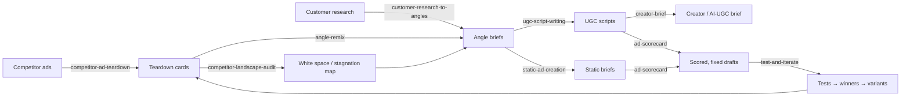

# Overview
> What this knowledge base knows, how the pieces fit together, and what's still missing. Read this for the big picture; use [AGENTS.md](../AGENTS.md) and the [playbooks](playbooks/README.md) to get work done.

## 🤖 Agent use
- **Use when:** orienting yourself, or explaining the overall method to a human or another agent.
- **Inputs → outputs:** none → a mental model of the system and where to go next.
- **Rules:**
  - **DO** run the four lenses (heuristics, zone, self, TEEP stage) on every ad.
  - **DO** prefer remixing a proven mechanism over inventing net-new concepts.
  - **DON'T** fabricate proof. See [contradictions](contradictions.md) row 10.
- **See also:** [index](index.md), [course hub](courses/tether-lab/README.md), [libraries](libraries/README.md).

## Sources ingested

| Course | Instructor | Status | What it adds |
|---|---|---|---|
| [Tether Lab](courses/tether-lab/README.md) | [Sarah Levinger](people/sarah-levinger.md) | ✅ fully ingested: 7 modules, 21 lesson videos, 16 live recordings (≈19 h of video), 9 PDFs, 1 DOCX, ~75 Skool pages | The *psychology* layer: why ads work |
| Zakaria Marketing Masterclass 2026 | Zakaria | ⏳ not yet ingested | Product and market research, avatar research, advertorials, Meta campaigns, UGC engine, copywriting |
| Stefan Georgi: RMBC II | Stefan Georgi | ⏳ not yet ingested | Research → mechanism → brief → copy; VSLs, advertorials, PDPs, upsells, email |
| Ecomtalent (Karlo) | Karlo | ⏳ not yet ingested | Making ads and scaling e-commerce brands |

## The Tether Lab worldview in 8 lines
1. People buy with the **fast subconscious** (≈11M bits/s) and justify with the slow conscious mind (≈40 bits/s), so ads must work in about 3 seconds through shortcuts. ([two minds](concepts/subconscious-vs-conscious-mind.md))
2. Those shortcuts are **heuristics**: 9 core ones, ~50 in total, and they work best **stacked** 2–3 at a time. ([heuristics](concepts/heuristics.md), [stacking](concepts/heuristic-stacking.md))
3. Every ad has an **emotional tone**: valence × intensity places it in one of 4 zones. Most failing ads are emotional misfires, and whole accounts often suffer **emotional stagnation**, with every ad in one zone. ([zones](concepts/emotional-zones.md), [stagnation](concepts/emotional-stagnation.md))
4. Every buyer has **three selves** (Actual, Ideal, Ought). Most brands only ever speak to one, which causes the **angle rut**. Re-targeting a winner to another self creates new angles without new concepts. ([three selves](concepts/three-selves.md), [angle rut](concepts/angle-rut.md))
5. **Identity → emotion → behavior.** Heuristics and formats are secondary characters. ([psychology ladder](frameworks/psychology-application-ladder.md))
6. Buyers move through **TEEP** (Trigger → Exploration → Evaluation → Purchase). Different copy wins at each stage. ([TEEP](frameworks/teep-journey.md))
7. **Ability** is the most neglected lever (B = MAP): show "this works for *me*", and kill friction. ([Fogg](frameworks/fogg-behavior-model.md), [barrier buster](concepts/barrier-buster.md))
8. Test small and often, and **vary proven primitives** rather than chasing net-new ideas. ([creative testing system](frameworks/creative-testing-system.md), [creative primitives](concepts/creative-primitives.md))

## How the knowledge base maps onto the UGC pipeline

| Pipeline step | Playbook | Frameworks used | Libraries used |
|---|---|---|---|
| Tear down competitors | [competitor-ad-teardown](playbooks/competitor-ad-teardown.md), [landscape audit](playbooks/competitor-landscape-audit.md) | V&I diagnostic, three-selves diagnostic, TEEP, Leach mindstates | [ad teardowns](libraries/ad-teardowns.md), [brands](brands/README.md) |
| Find angles | [angle-remix](playbooks/angle-remix.md), [research → angles](playbooks/customer-research-to-angles.md) | rewriting for new selves, tone shifting, research stack | [angles](libraries/angles.md), [prompts](libraries/prompts.md) |
| Write | [ugc-script-writing](playbooks/ugc-script-writing.md), [static-ad-creation](playbooks/static-ad-creation.md) | story frameworks, skeptic format, visual weight, offer psychology | [hooks](libraries/hooks.md), [rewrites](libraries/rewrites.md) |
| Brief & produce | [creator-brief](playbooks/creator-brief.md) | messenger effect, model-image psychology | [rules](libraries/rules.md) |
| Quality gate | [ad-scorecard](rubrics/ad-scorecard.md), [UGC checklist](rubrics/ugc-script-checklist.md) | — | [rules](libraries/rules.md) |
| Test & iterate | [test-and-iterate](playbooks/test-and-iterate.md) | creative testing system, format ladder, 3 Vs | — |

## Coverage notes and gaps
- **Format bias:** Tether Lab mostly teaches **static ads** and landing pages. Guidance for UGC/video is in May 14 (story frameworks), the Joanna Wallace session (humor, skeptic format) and scattered Q&A. Many UGC adaptations in this wiki are marked **(derived)**. The video-heavy courses still to ingest (Zakaria's UGC Engine, Karlo, RMBC VSLs) will fill this gap.
- **Uncited stats:** Sarah often quotes studies from memory. The pages flag them; never use them as claims in ads.
- **Source quality:** transcripts are machine-generated (Whisper large-v3-turbo) with names corrected by hand. The video frames carry a reseller watermark. Quizzes and some promised resources are missing. See [contradictions & open questions](contradictions.md).
