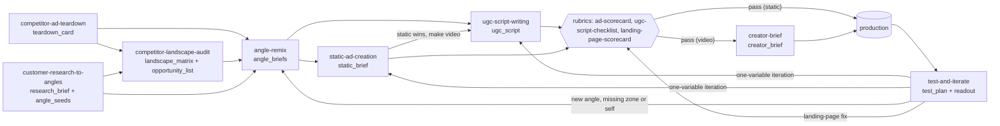

# Playbooks hub: the competitor-to-UGC pipeline
> The playbooks are the procedures agents **execute**. Together they take the best-performing competitor ads, work out what's working and why, remix the mechanism for our product, and produce our own UGC videos and statics, then test and iterate. Each playbook consumes and produces named **artifacts** (YAML/markdown blocks) so agents can hand work to each other. This hub is pipeline design; each playbook cites the Tether Lab sources behind its steps.

## 🤖 Agent use
- **Use when:** starting any creative job: find your entry point in the table, open that playbook, and pass its output artifact to the next one.
- **Inputs → outputs:** whatever you have (a competitor ad, a set of ads, reviews, an angle, a script, live results) → the right playbook → its artifact → the next playbook.
- **Rules:**
  - DO copy the **mechanism**, not the asset: never reuse competitors' footage, exact scripts, characters, trademarks or claims.
  - DO fill the **product truth sheet** before any remix or script; nothing goes into an ad without a `truth_ref`.
  - DON'T fabricate proof, testimonials, scarcity or stats; flag Sarah's uncited stats as anecdotes ([contradictions](../contradictions.md)).
  - DO run the quality gate (rubric) before anything goes to production.
- **See also:** [AGENT-GUIDE](../../AGENT-GUIDE.md) · [Rubrics](../rubrics/README.md) · [Libraries](../libraries/README.md) · [Frameworks: TEEP](../frameworks/teep-journey.md), [V&I diagnostic](../frameworks/valence-intensity-diagnostic.md), [three selves](../frameworks/three-selves-diagnostic.md) · [Contradictions](../contradictions.md)

## Pipeline

Text version: research ⟶ (teardown ⟶ landscape) ⟶ angle remix ⟶ static first ⟶ (if it wins) UGC script ⟶ checklist + scorecard ⟶ creator brief ⟶ production ⟶ test & iterate ⟶ back to remix or scripts. Statics come before video because Sarah tests the message on statics and only then moves it up the format ladder [Jun18 0:59:15–1:01:19](../courses/tether-lab/05-live-recordings/2025-06-18-live-with-sarah.md); if a competitor's proven UGC mechanism is the source, going straight to UGC is allowed (pipeline design).

## Every playbook
| Playbook | Run it when | Inputs | Outputs | Next |
|---|---|---|---|---|
| [customer-research-to-angles](customer-research-to-angles.md) | new product/batch; account fatiguing; need customer words | reviews, Reddit, search data, surveys | `research_brief`, `angle_seeds`, hook candidates | landscape audit or angle remix |
| [competitor-ad-teardown](competitor-ad-teardown.md) | one competitor ad seems to be working | asset, transcript, copy, LP, ad-library data, comments | `teardown_card` (YAML) | landscape audit or angle remix |
| [competitor-landscape-audit](competitor-landscape-audit.md) | entering a niche; before a batch; we look like everyone | 10–30 teardown/lite cards | `landscape_matrix`, `opportunity_list` | angle remix |
| [angle-remix](angle-remix.md) | you have mechanisms and need our own angles | teardown cards, opportunities, angle seeds, product truth sheet | `angle_briefs` (scored) | static creation / UGC script |
| [static-ad-creation](static-ad-creation.md) | testing a new angle; varying a winning static | angle brief, assets | `static_brief` | ad scorecard → production → test |
| [ugc-script-writing](ugc-script-writing.md) | angle ready for video; static won | angle brief, truth sheet, customer phrases | `ugc_script` (3 hooks × 2 bodies) | UGC checklist + scorecard → creator brief |
| [creator-brief](creator-brief.md) | script passed QA | ugc_script, LP, production mode | `creator_brief` | production → test |
| [test-and-iterate](test-and-iterate.md) | assets produced; results in | named assets, metrics | `test_plan`, `readout` | remix / scripts / statics / LP fix |

Quality gates: [ad scorecard](../rubrics/ad-scorecard.md) (any ad or script, ours or theirs) · [UGC script checklist](../rubrics/ugc-script-checklist.md) · [landing-page scorecard](../rubrics/landing-page-scorecard.md).

## Evolve Copywriting playbooks
Course-local playbooks from [Evolve Copywriting](../courses/evolve/copywriting/README.md) (Spencer Pawliw) cover the same pipeline from the copy-craft side. Run them alongside these:

| Job | Evolve playbook | Pairs with |
|---|---|---|
| Idea → brief (avatar → angle → mechanism → authority, mini breakthrough memo) | [ad-idea-to-brief](../courses/evolve/copywriting/playbooks/ad-idea-to-brief.md) | [angle-remix](angle-remix.md), [creator-brief](creator-brief.md) |
| Video ad script (3 hooks + 3 bridges + hold + CTA) | [write-a-video-ad-script](../courses/evolve/copywriting/playbooks/write-a-video-ad-script.md) | [ugc-script-writing](ugc-script-writing.md) |
| Static / image ads | [write-static-image-ads](../courses/evolve/copywriting/playbooks/write-static-image-ads.md) | [static-ad-creation](static-ad-creation.md) |
| After a test: loser / KPI winner / spend winner / breakthrough | [iterate-on-test-results](../courses/evolve/copywriting/playbooks/iterate-on-test-results.md) | [test-and-iterate](test-and-iterate.md) |

## Hand-off artifacts
| Artifact | ID pattern | Produced by | Consumed by | Template |
|---|---|---|---|---|
| `product_truth_sheet` | `PTS-<product>` | human / brand agent | angle remix, scripts, statics, briefs, rubrics | below |
| `research_brief` | `RB-<product>-<date>` | customer research | landscape audit, angle remix | [research stack](../frameworks/customer-research-stack.md#output-template-research-brief) |
| `angle_seeds` | `SEED-<nn>` | customer research | angle remix | [customer-research-to-angles](customer-research-to-angles.md#output) |
| `teardown_card` / `lite_card` | `TD-<brand>-<date>-<nn>` | teardown | landscape audit, angle remix | [teardown](competitor-ad-teardown.md#output-teardown-card) |
| `landscape_matrix`, `opportunity_list` | `OPP-<nn>` | landscape audit | angle remix | [landscape](competitor-landscape-audit.md#output) |
| `angle_briefs` | `ANG-<nn>` | angle remix | statics, UGC scripts, test plan | [angle remix](angle-remix.md#output-angle-brief-list) |
| `static_brief` | `STA-ANG-<nn>-v<n>` | static creation | designer / production, scorecard | [static](static-ad-creation.md#output-static-brief) |
| `ugc_script` | `SCR-ANG-<nn>-v<n>` | UGC script writing | checklist, scorecard, creator brief | [UGC script](ugc-script-writing.md#output-ugc-script) |
| `creator_brief` | `CB-SCR-<…>` | creator brief | creator / production agent | [creator brief](creator-brief.md#output-creator-brief) |
| `scorecard` | `SC-<asset id>` | rubrics | all | [ad scorecard](../rubrics/ad-scorecard.md#scoring-template) |
| `test_plan`, `readout` | `TP-<date>-<nn>` | test and iterate | next cycle | [test and iterate](test-and-iterate.md#output-templates) |
| Ad name | `<STAGE>_<EMOTION>_<angle>_<format>_<variant>_v<n>` | statics / scripts / briefs | ads manager, readouts | [TEEP](../frameworks/teep-journey.md#output-templates) |

### Product truth sheet (required before remixing)
```yaml
product_truth_sheet:
  id: PTS-<product>
  product: "<name + one line>"
  price_and_offers: ["<real price, bundles, guarantee, trial, drops with dates>"]
  usage: "<servings/uses per unit, time to results>"          # for offer framing
  claims_allowed:
    - id: C1
      claim: "<exact claim wording we may use>"
      evidence: "<test, study, certification, internal data>"
      limits: "<e.g. '*not typical results', regulatory wording>"
  claims_forbidden: ["<medical/regulated claims, competitor comparisons we can't prove>"]
  real_quotes:
    - id: Q1
      text: "<verbatim review>"
      source: "<platform, date, reviewer initials>"
      permission: yes | no
  numbers:
    - id: N1
      what: "<review count, rating, customers, units sold>"
      value: "<exact>"
      as_of: <date>
  authority: ["<real expert/press relationships with proof>"]
  demonstrable_on_camera: ["<claims a creator can show in one shot>"]
  scarcity_real: ["<true stock limits, drop dates, deadlines>"] | none
  ability_crushers: ["<fit, size, taste, 'is this for me'>"]
  landing_pages: ["<url: promise, tone, offer>"]
  brand_constraints: ["<e.g. no negative valence (OmieBox case), tone, words to avoid>"]
```

## Non-negotiables (every playbook)
1. **Mechanism, not asset.** No competitor footage, exact script lines, characters, catchphrases, trademarks, claims or stats ([angle remix fidelity check](angle-remix.md#step-4-fidelity-check-anti-copy-pipeline-design)).
2. **No fabrication.** No invented proof, testimonials, scarcity, stats, endorsements or results — even though one roasted ad's invented "Only 9 sets left" badge won ([contradictions](../contradictions.md) row 10).
3. **Uncited stats stay out of copy** ("0.48 s", "60,000× faster", "+13.6% likability" are Sarah's anecdotes).
4. **One learning goal per test**, one core emotion per ad, one variable per iteration.
5. **When pages disagree**, apply the default in [contradictions](../contradictions.md).

## Related
[AGENT-GUIDE](../../AGENT-GUIDE.md) · [Overview](../overview.md) · [Index](../index.md) · [Rubrics](../rubrics/README.md) · [Libraries](../libraries/README.md) · [Brands hub](../brands/README.md) · [Prompt library](../courses/tether-lab/07-prompt-library/README.md) · [Native advertising](../concepts/native-advertising.md)
