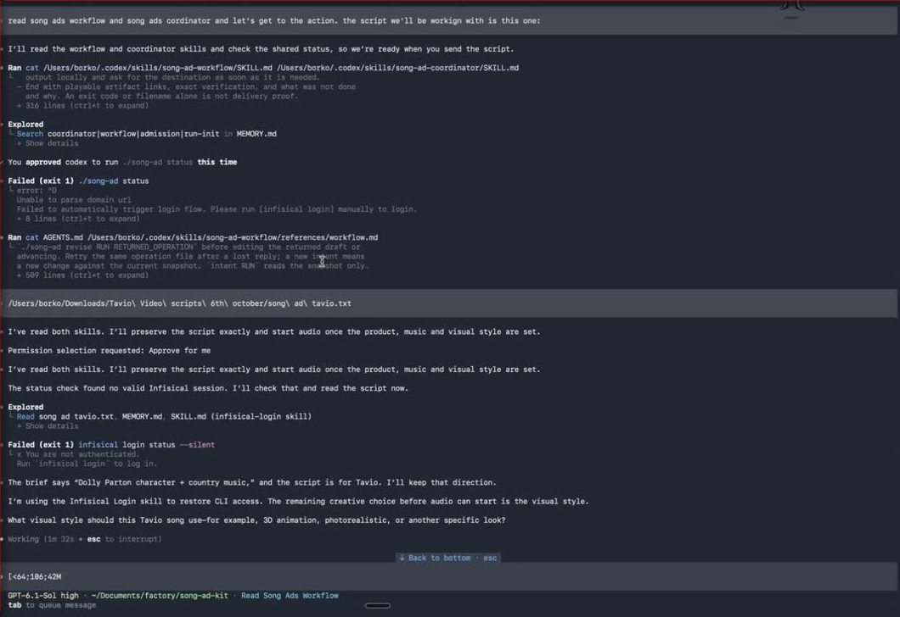
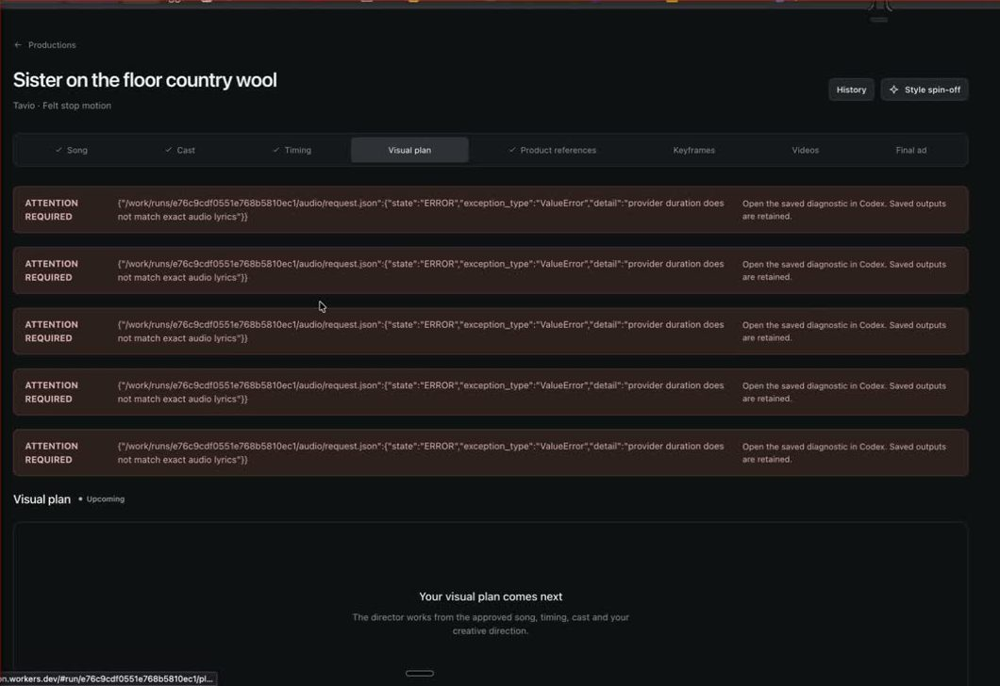
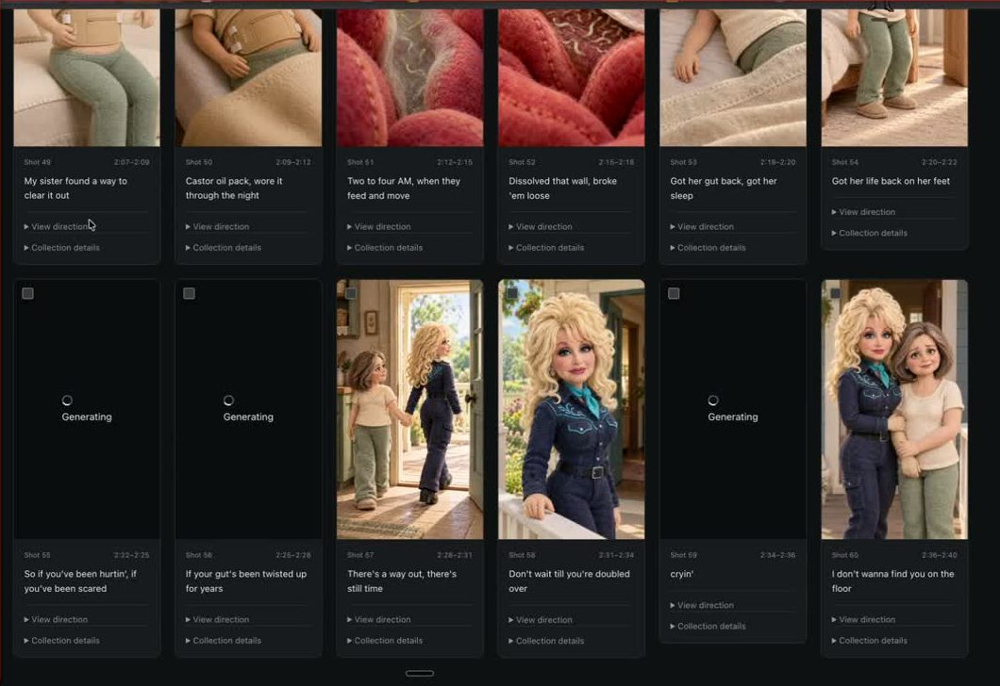

# Automated AI song-ad pipeline (Loom demo)
> A 13-minute screen recording (uploaded 6 Oct 2026) of an agent-driven system that turns a finished ad script into a finished AI-animated "song ad" in about an hour, with a human approving each stage. Use it as a **reference architecture** for our own creative engine, not as proof of results: no performance data is shown.

## 🤖 Agent use
- **Use when:** designing or automating an AI video-ad production pipeline (song ads, voiceover "yapper" ads, animated drama ads); deciding which steps need a human gate; estimating production time per ad.
- **Inputs → outputs:** finished script + format (song) + visual style + cast + product reference images + API keys → song audio → cast → timing → visual plan (shot list) → storyboard keyframes → per-shot video clips → stitched final ad with and without captions.
- **Rules:**
  - **DO** split production into fixed stages with an approval gate after cast, after keyframes and after clips: "here there's like a button and you click … approve and it's done" [01:00].
  - **DO** run a separate review sub-agent over the storyboard before rendering video; it caught "bad hand physics" and a character facing the wrong way [05:24; 06:33–07:34].
  - **DO** fix errors per shot ("at 43 seconds there's this mistake… shot 18"), re-render only that shot and re-stitch [09:37].
  - **DO** store product reference images once per product and reuse them ("set forever per product") [09:37].
  - **DO** batch: prepare 10 scripts and run them in parallel; the slow step (visual plan) runs per ad in the background [02:04; 10:44].
  - **DON'T** treat the stated speeds as benchmarks: they are the presenter's claims from one demo (instructor claim).
  - **DON'T** copy the demo ad's claims or likeness (see Limitations): a celebrity look-alike character and gut "parasites" / "biofilm" lines are claim and right-of-publicity risks.
- **See also:** [AI UGC tools](../tools/ai-ugc-tools.md) · [Ad Creators Lab course](../courses/ad-creators-lab/ai-ads-ugc-animations/README.md) · [song-ad workflow](../courses/ad-creators-lab/ai-ads-ugc-animations/frameworks/song-ad-workflow.md) (the manual version of this pipeline) · [Claude Code ad operator](../courses/ad-creators-lab/ai-ads-ugc-animations/frameworks/claude-code-ad-operator.md) · [LLM output claim audit](../courses/stefan-georgi/rmbc-ii/rubrics/llm-output-claim-audit.md)

## Pipeline (as shown)
| # | Stage | What happens | Human gate | Time stated | Source |
|---|---|---|---|---|---|
| 1 | Setup | Agent reads the workflow and coordinator skills, checks API-key login (a secrets manager holds every key) | — | — | [00:00–01:00] |
| 2 | Song | Song generated from the script; script is kept exactly as written | Approve song | — | [01:00; 09:37] |
| 3 | Visual style + cast | Agent proposes the visual style and cast; user approves | Approve cast | — | [01:00] |
| 4 | Timing | Done once the song is done (lyrics aligned to audio) | — | — | [01:00; 09:37] |
| 5 | Visual plan | A frontier-model sub-agent writes the shot list: framing, performance, duration per shot | Optional | ~30 min ("the longest part") | [02:04; 05:24] |
| 6 | Product references | Style-matched product views, reused per product | — | one-off | [09:37] |
| 7 | Keyframes (storyboard) | One image per shot; review sub-agent flags problems | Approve keyframes; fix 2–3 bad shots (~5 min) | storyboard ~15 min | [05:24–07:34; 09:37] |
| 8 | Videos | Each keyframe rendered into a clip | Optional per-clip review | — | [07:34] |
| 9 | Final ad | Clips stitched; clean and captioned versions | Point to a timestamp to redo one shot | ~1 h script-to-ad overall | [08:37–09:37] |

Error rate claimed: "between zero and three mistakes per 100 frames" [04:17] (instructor claim). Format note: song ads are the hardest because "every three seconds you need something new"; voiceover and animated drama formats reuse the same pipeline with a simpler visual plan [03:12].

## Screenshots

*The agent (Codex CLI) reads two skill files, `song-ad-workflow` and `song-ad-coordinator`, then a project CLI (`./song-ad status`) and a secrets-manager login check; it asks for the visual style before starting audio. The pipeline is skills + a CLI, not a single prompt. [00:45]*

*The review web app: one production with tabs Song → Cast → Timing → Visual plan → Product references → Keyframes → Videos → Final ad, a "Style spin-off" button, and several "attention required" errors (audio duration mismatch). The demo run was not error-free. [03:50]*

*Storyboard view: each card is a shot number, its time range, its lyric line, a "view direction" panel and the generated keyframe; unfinished shots show "Generating". This is the main human review surface. [06:40]*

## How to apply (derived, for our creative engine)
- [ ] Write each stage as its own skill or script with a saved output file, so a failed stage can be rerun without redoing the rest.
- [ ] Keep one product-reference set per product (packshot, label, scale) and pass it to every image step.
- [ ] Add a review step (a second model) that checks keyframes for anatomy, continuity and on-screen text before paying for video renders.
- [ ] Log time and cost per stage for the first 5 ads; the demo's "one hour" is a target to test, not a fact.
- [ ] Run the finished script through the claim audit **before** generating audio; once a song is made, a claim fix means redoing every later stage.

## Sources and limitations
- [Transcript](<../../raw/loom/boris-vaserv-song-ad-pipeline/_transcripts/creating-ads-automatically-from-storyboard-to-video.txt>) (faster-whisper large-v3-turbo, machine transcription, casual speech; "frontier motto" = frontier model, "clot" = Claude). Loom description and metadata in `originals/…info.json`.
- Tools named only on screen: Codex CLI running a GPT model, a custom `song-ad` CLI, a secrets manager (Infisical) and a custom review web app. The skills, CLI and web app are **not** included or public; the demo shows the workflow, not the code.
- The demo ad uses a look-alike of a real celebrity singer and lyrics about gut "parasites" and a "biofilm shield, tests can't see 'em" [06:40 frames]. Do not reuse either: a real person's likeness needs permission, and those health claims are unsupported.
- No ad performance, spend or ROAS is shown. Speeds and error rates are the presenter's claims.
