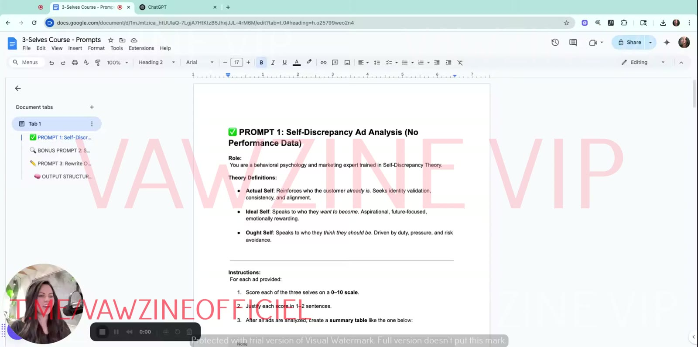

# 3-Selves Course: Prompts
> The three ChatGPT prompts from the Module 4 bonus doc "3-Selves Course – Prompts", reproduced **verbatim**, with when and how to use each (as shown in lessons 5–7). Also includes the on-screen variant of Prompt 1 and the e-book's one-line prompts.

## 🤖 Agent use
- **Use when:** scoring ads by self (Prompt 1), linking self to performance and planning the test mix (Prompt 2), or generating self-shifted variants of a winner (Prompt 3). An LLM agent can also follow these instructions directly instead of pasting them into ChatGPT.
- **Inputs → outputs:** P1: numbered ads (copy or images) → 0–10 scores, justifications, summary table and paragraph. P2: ads + CTR/CVR/ROAS → per-ad blocks, table with dominant self, summary, recommended ratio, next tests. P3: one ad → primary self + rewrites for the two other selves (headline, subhead, social proof, bullets/badge).
- **Rules:**
  - DO paste the prompt first, then the ads. If you upload screenshots, delete the `[INSERT NUMBERED AD COPY HERE]` placeholder [L6 03:14].
  - DO reply "proceed" or "continue" when ChatGPT finishes extracting and asks to go on [L6 04:43].
  - DO keep the numeric scoring. That's the "fences" that stop random output [L6 04:18].
  - DO map ad names to metrics before running P2 (spreadsheet with names, ad text, metrics) [L5 05:41].
  - DO change P3's output to "generate an ad script" when you need video/UGC [L7 02:18].
  - DON'T keep invented social proof from P3 output. Verify it.
- **See also:** [Three selves diagnostic](../frameworks/three-selves-diagnostic.md) · [Rewriting ads for new selves](../frameworks/rewriting-ads-for-new-selves.md) · [Testing ads by self type](../frameworks/testing-ads-by-self-type.md) · [Prompt library](../courses/tether-lab/07-prompt-library/README.md)

## Which prompt when
| Situation | Prompt | Lesson |
|---|---|---|
| "Which self are our (or a competitor's) ads talking to?" No metrics. | **Prompt 1** | [L5](../courses/tether-lab/04-self-targeting-system/05-run-the-3-selves-diagnostic-on-your-ads.md) [03:00], [L6](../courses/tether-lab/04-self-targeting-system/06-how-to-use-the-prompts-for-instant-insights.md) [00:18], [02:50]–[08:33] live demo |
| "Which self actually performs, and what ratio should we test next?" Have CTR/CVR/ROAS. | **Bonus Prompt 2** | [L5](../courses/tether-lab/04-self-targeting-system/05-run-the-3-selves-diagnostic-on-your-ads.md) [05:20], [L6](../courses/tether-lab/04-self-targeting-system/06-how-to-use-the-prompts-for-instant-insights.md) [00:37] |
| "Turn this winner into new angles without changing the offer." | **Prompt 3** | [L7](../courses/tether-lab/04-self-targeting-system/07-how-to-rewrite-winning-ads-for-new-selves.md) [01:08] |
| Quick one-off ad draft for a given self | **E-book one-liners** | e-book ch. 5 |


*The source doc as shown in lesson 6. Tabs: PROMPT 1, BONUS PROMPT 2, PROMPT 3, OUTPUT STRUCTURE.*

> Formatting note: the text below is verbatim from the DOCX. Bold and italics (e.g. on "already is", "0–10 scale", "summary table") are dropped inside code blocks. The emoji in the titles are kept.

---

## Prompt 1: Self-Discrepancy Ad Analysis (No Performance Data)

**When:** first pass on a sample (Sarah uses 9 ads: 3 top / 3 mid / 3 flop). **How:** paste into ChatGPT, then add numbered ad copy, or upload screenshots and delete the placeholder. ChatGPT also scores the images [L5 03:30]. For video ads, paste transcripts [L5 04:00].

```text
✅ PROMPT 1: Self-Discrepancy Ad Analysis (No Performance Data)

Role:
You are a behavioral psychology and marketing expert trained in Self-Discrepancy Theory.

Theory Definitions:
- Actual Self: Reinforces who the customer already is. Seeks identity validation, consistency, and alignment.
- Ideal Self: Speaks to who they want to become. Aspirational, future-focused, emotionally rewarding.
- Ought Self: Speaks to who they think they should be. Driven by duty, pressure, and risk avoidance.

Instructions:
For each ad provided:
1. Score each of the three selves on a 0–10 scale.
2. Justify each score in 1–2 sentences.
3. After all ads are analyzed, create a summary table like the one below:

| Ad # | Actual Score | Ideal Score | Ought Score | Notes |
|------|--------------|-------------|-------------|-------|
| 1    |      8       |      2      |      3      | Identity-based validation and belonging |
| 2    |      1       |      9      |      2      | Strong emotional future-pacing         |

4. Write a short summary paragraph explaining which self is most commonly used across ads.

Insert Ads Below:
[INSERT NUMBERED AD COPY HERE]
```

**What you get** (L6 demo): a text summary and language analysis per ad (emotion, descriptive words, adjectives, verbs), a summary table, and takeaways, e.g. "Actual self is the most consistently activated… Ideal self is the most used when elevating the product… Ought self is only playing a minor supportive role" [L6 06:37–07:54].


*Prompt 1 running in ChatGPT 4o with 9 High Camp Flasks screenshots attached.*

---

## Bonus Prompt 2: Self-Discrepancy + Performance Analysis

**When:** you have per-ad metrics. Sarah: "if I was doing this in real time… for a brand… I would a hundred percent want metric data" [L6 03:00]. **How:** upload a spreadsheet with ad names (naming conventions), ad text and key metrics, and map names to metrics so ChatGPT can cross-reference [L5 05:41]. Pull metrics from Motion, Facebook or wherever you track them [L6 00:57]. **Output highlight:** a recommended self ratio for future testing and next test directions [L6 01:02].

```text
🔍 BONUS PROMPT 2: Self-Discrepancy + Performance Analysis

Role:
You are a marketing analyst trained in behavioral psychology and Self-Discrepancy Theory.

Instructions:
For each ad provided (with performance data), follow this process:
1. Score each self (Actual, Ideal, Ought) from 0–10.
2. Justify each score in 1–2 sentences.
3. Analyze performance metrics:
   - CTR (Click-Through Rate)
   - CVR (Conversion Rate)
   - ROAS (Return on Ad Spend)

Format Each Ad Like This:
### Ad 1  
**Ad Text**: "Your comfort shouldn't be negotiable."  
**Scores**  
- Actual Self: 7/10 → Reinforces current identity and comfort as deserved.  
- Ideal Self: 3/10 → Slight nod to becoming more self-caring.  
- Ought Self: 2/10 → Weak prevention or responsibility angle.
**Performance**  
- CTR: 1.8%  
- CVR: 3.2%  
- ROAS: 2.1

After All Ads, Include This Table:
| Ad # | Actual | Ideal | Ought | CTR | CVR | ROAS | Dominant Self | Notes |
|------|--------|-------|-------|-----|-----|------|----------------|-------|
| 1    |   7    |   3   |   2   | 1.8 | 3.2 | 2.1  | Actual         | High ROAS from validation-heavy copy |
| 2    |   2    |   9   |   1   | 2.4 | 1.7 | 1.4  | Ideal          | High CTR, weak conversions          |

Then Write a Summary:
- Which self correlates with top performance?
- Are there underused selves?
- Provide a recommended ratio for future ad testing (e.g., 50% Actual / 30% Ideal / 20% Ought).
- Suggest next test directions (e.g., "Test Ought Self framing using duty, responsibility, and protection angles.")

Insert Ad Dataset Below:
[INSERT AD TEXT + PERFORMANCE DATA HERE]
```

Note: Sarah's spoken ratio example in L6 ("50% actual, 10% ought and the rest… ideal", [01:32]) differs from the prompt's own example (50/30/20). Both are illustrations, not a rule. The example rows match the [L8 signatures](../frameworks/testing-ads-by-self-type.md#decision-table-read-the-result): Actual has high ROAS, Ideal has high CTR and weak conversions.

---

## Prompt 3: Rewrite One Ad for All Three Selves

**When:** you have a winner and want new self variants with the **same offer** [L7 00:38]. **How:** paste the prompt, then the winning ad. ChatGPT names the primary self and writes versions for the other two [L7 01:17]. For video, change the output to "generate an ad script" [L7 02:18].

```text
✏️ PROMPT 3: Rewrite One Ad for All Three Selves

Role:
You are a behavioral psychology copywriter trained in Self-Discrepancy Theory.

Theory Reminder:
- Actual Self = Validates current identity (comfort, pride, belonging)
- Ideal Self = Aspiration and emotional growth (future you)
- Ought Self = Duty and responsibility (should do)

Instructions:
1. I will give you an ad.
2. Identify the primary self it currently targets.
3. Rewrite that ad for the two other selves not already targeted.
4. Use this output structure for each rewrite:

🧠 OUTPUT STRUCTURE (for each rewritten self):
- Headline: 4–7 words. Punchy and emotionally clear.
- Subhead: 1–2 lines expanding the benefit and the “self” motivation.
- Social Proof (optional): Quote, review, press badge, or stat.
- Bullets or Badge: Choose one format. Highlight key features or benefits.

Example – Ideal Self Version
- Headline: Cook Like the Future You
- Subhead: Cleaner cookware for the version of you who doesn’t cut corners.
- Social Proof: ★★★★★ 40,000+ happy kitchens
- Bullets:
  - Non-toxic ceramic coating
  - Oprah-approved design
  - Calmer cooking, sleeker kitchen

Insert the Original Ad to Rewrite Below:
[INSERT AD COPY]
```

**Example output (L7):** input "Spill The Tea, Not Your Wine." was classed Ideal. The output gave an Ought version ("Don't Risk the Bottle…") and an Actual version ("For Wine Lovers Who Know…"). The full text is on the [L7 page](../courses/tether-lab/04-self-targeting-system/07-how-to-rewrite-winning-ads-for-new-selves.md).


*Prompt 3 output for the wine-flask ad.*

**Script-output tweak** (Sarah's instruction [L7 02:18], applied by an agent): replace step 4 and the OUTPUT STRUCTURE block with an instruction to generate an ad script for each rewritten self. Keep the rest of the prompt unchanged. *(The exact replacement wording isn't given in the course.)*

---

## On-screen variant of Prompt 1 (lesson 5)
Lesson 5 [03:00] shows an earlier or alternate version of Prompt 1 in ChatGPT, titled "✅ SELF-DISCREPANCY AD ANALYSIS PROMPT". Transcribed from the frame. Text cut off at the right edge is marked `[…]`:

```text
You are an expert in behavioral psychology and marketing. I'm giving you a group of ads.

There are three "selves" in this model:
- **Actual Self**: Reinforces current identity and behavior. Seeks validation and consist[…]
- **Ideal Self**: Aspirational. Chases improvement, possibility, and emotional gains.
- **Ought Self**: Responsible. Feels obligation or pressure to meet internal/external sta[…]

Your task:
1. Read each ad and score it from **0–10** on how strongly it speaks to each self.
2. Justify each score in 1–2 sentences.
3. After all individual analyses, create a **summary table** like this:

| Ad # | Actual Score | Ideal Score | Ought Score | Notes |
|------|--------------|-------------|-------------|-------|
| 1    |      8       |      2      |      3      | Mostly identity-reinforcing copy |
| 2    |      1       |      9      |      2      | Strong emotional future-pacing  |
| ...  |     ...      |     ...     |     ...     | ...   |

4. After the table, include:
- A short **summary paragraph** explaining which "self" you most often speak to.
- If performance data (e.g. CTR, CVR, ROAS) is provided, comment on which self aligns wit[…]
- Suggestions for balance or re-alignment (e.g., "You rarely speak to the Ought Self — co[…]
```


*Source frame for the variant above. Use the DOCX version as canonical. This variant adds the "suggestions for balance or re-alignment" step, which is worth adding when you run Prompt 1.*

---

## E-book one-line prompts (chapter 5)
From [Which 'You' Are You Selling To?](which-you-are-you-selling-to-ebook.md), p. 8, verbatim:

```text
ACTUAL SELF PROMPT:
"Write an ad that validates who the customer already is. Emphasize identity, comfort, and ease."

IDEAL SELF PROMPT:
"Write an ad that speaks to who the customer wants to become. Emphasize transformation, possibility, and pride."

OUGHT SELF PROMPT:
"Write an ad that reminds the customer of what they should be doing. Emphasize responsibility, social proof, and consequences."
```

## Tips from the lessons
- **Give ChatGPT fences.** Scores, numbers, percentages. Open-ended asks return "random stuff" [L6 04:18].
- **Start small.** Use 9 ads, not the whole account [L2 00:45].
- **Images count.** ChatGPT scores visuals as well as copy [L5 03:44].
- **Combine with emotion.** After picking the self, pick the emotion with [valence](../concepts/valence.md) and [intensity](../concepts/intensity.md) [L6 02:00].
- **Help is offered** in the Skool comments [L6 06:21].

## Related
- Bonus lesson page: [11 – Bonus: 3-Selves Analysis Prompts](../courses/tether-lab/04-self-targeting-system/11-3-selves-analysis-prompts.md)
- [Three selves diagnostic](../frameworks/three-selves-diagnostic.md) · [Rewriting ads for new selves](../frameworks/rewriting-ads-for-new-selves.md) · [Testing ads by self type](../frameworks/testing-ads-by-self-type.md) · [3 selves](../concepts/three-selves.md) · [Prompt library](../courses/tether-lab/07-prompt-library/README.md)

## Sources
- DOCX: [11. 3-Selves Course - Prompts.docx](<../../raw/tether-lab/4. The Self Targeting System/11. 3-Selves Course - Prompts.docx>) · markdown conversion: [11. 3-Selves Course - Prompts.md](<../../raw/tether-lab/_extracted/4. The Self Targeting System/11. 3-Selves Course - Prompts.md>)
- E-book p. 8: [10. eBook … .md](<../../raw/tether-lab/_extracted/4. The Self Targeting System/10. eBook Which ‘You’ Are You Selling To (2).md>)
