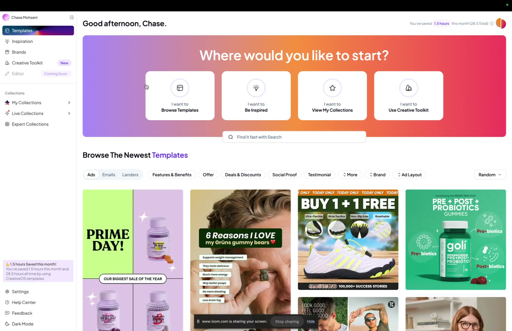
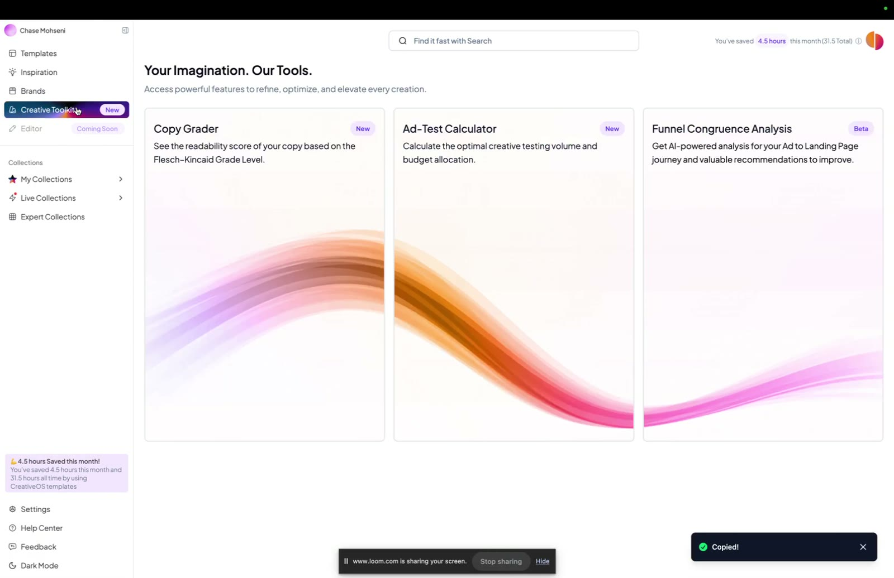

# CreativeOS

> A template and inspiration library for e-commerce creative (static ads, emails, landing pages) that exports to Canva or Figma. It also has a Creative Toolkit (Copy Grader, Ad-Test Calculator, Funnel Congruence Analysis). It's Tether Lab's partner tool, and members get **1 month free with code `TETHER`**.

## 🤖 Agent use
- **Use when:** researching competitor or category creative (inspiration library, brand pages, Evergreen = live 90+ days), finding a static layout for a chosen heuristic, grading copy readability, sizing a creative test, or checking ad-to-landing-page congruence.
- **Inputs → outputs:** a heuristic or angle (e.g. social proof) → matching templates or examples via tag/collection; an ad's copy → readability grade and gaps (urgency, benefits, scarcity, social proof); budget → number of creatives to test.
- **Rules:**
  - DO treat **Evergreen ads** (live > 90 days) as performance-validated references for teardowns.
  - DO use tag collections that map to heuristics (Social Proof, Testimonial, Deals & Discounts, Features & Benefits, Offer).
  - DO aim the Copy Grader at about "first grade level" (processing fluency).
  - DON'T copy a template's assets. Copy the layout or mechanism and swap in our product, brand and claims.
- **See also:** [Bonus lesson walkthrough](../courses/tether-lab/02-heuristics-101/08-bonus-creativeos.md), [Heuristics hub](../concepts/heuristics.md), [Heuristic stacking](../concepts/heuristic-stacking.md).

## The offer
- <https://www.creativeos.com/>, code **TETHER**, 1 month free for Tether Lab members.
- Sarah's reason for the partnership: "static ad templates are the quickest, easiest way to put the ideas we teach into action... theory doesn't mean much unless you can test it fast." CreativeOS gives "thousands of proven templates, no creative team or design skill required. You just copy to Figma, tweak the branding, and you're ready to launch." Benefits she lists: test concepts quickly and consistently, validate ideas without long production cycles, learn from real-world data.

## Features (from the walkthrough video)

| Area | What it does | Timestamp |
|---|---|---|
| **Templates** | Thousands of templates. Ads, emails or landing pages depending on plan. Find them by tag (Features & Benefits, Offer, Deals & Discounts, Social Proof, Testimonial, More), brand (e.g. Allbirds), ad layout, or free-text search (e.g. "purple") | [00:00]–[00:57] |
| **Export** | To **Canva** (an example page plus an editable template page; swap in your product image, brand image, fonts) or **Figma** | [01:01]–[01:43] |
| **Inspiration** | Ad library of ads/emails/landers ("The Best. Not The Rest."). **Shuffle** for random sparks. Filters: format, status, ad layout, time live, industry, brand. **Request a template**. Drawer shows how long an ad has run, its landing page, and **readability and persuasion scores**. Save to collections. | [01:43]–[02:45] |
| **Brands** | Brand pages for 1,000+ curated brands ("only the best brands") | [02:45]–[03:12] |
| **Creative Toolkit: Copy Grader** | Readability score based on the Flesch-Kincaid Grade Level, plus gaps (demo: "lacks a lot of urgency or the benefits... could have a little bit more scarcity and social proof") | [03:12]–[03:59] |
| **Creative Toolkit: Ad-Test Calculator** | "How many pieces of creative you should be testing, given your budget" | [03:59]–[04:05] |
| **Creative Toolkit: Funnel Congruence Analysis** (Beta) | Upload an ad and a landing-page screenshot to get a congruence score and AI recommendations | [04:05]–[04:34] |
| **Expert Collections** | Tag mega-collections by CreativeOS (e.g. Deals & Discounts 524 items, Social Proof 465, Testimonial 458, Product Showcase 384). On the pro package, collections curated by e-commerce experts (e.g. Barry Hott) | [04:34]–[05:02] |
| **Live Collections** | Auto-graded sets: **Evergreen ads** (live > 90 days, presumed strong performers), Testing Lab, Hidden Gems | [05:02]–[05:23] |
| Other | Dark mode; an "Editor (Coming Soon)" entry; a "you've saved X hours" counter | [05:23] |

*The CreativeOS home screen and template browser ([00:00]).*

*Creative Toolkit: Copy Grader, Ad-Test Calculator, Funnel Congruence Analysis ([03:32]).*

## How it fits the Tether Lab method
1. Pick 2–3 heuristics ([Heuristic stacking](../concepts/heuristic-stacking.md)).
2. Find a matching template or Evergreen example by tag.
3. Export to Canva or Figma and rebrand.
4. Grade the copy, size the test, then launch.

## Where it's taught
- [Bonus: Get CreativeOS (1 Month Free)](../courses/tether-lab/02-heuristics-101/08-bonus-creativeos.md): video walkthrough and offer page
- [Ad Lab Toolkit](../courses/tether-lab/06-ad-lab-toolkit/README.md): the offer is listed twice there, as items 6 "[FREE Ad Creatives](../courses/tether-lab/06-ad-lab-toolkit/06-free-ad-creatives.md)" (code only, written "Tether") and 7 "Creative OS: 1 Month FREE" (same pitch as above)

## Related
- [Sarah Levinger](../people/sarah-levinger.md) · [Heuristics 101](../courses/tether-lab/02-heuristics-101/README.md)
