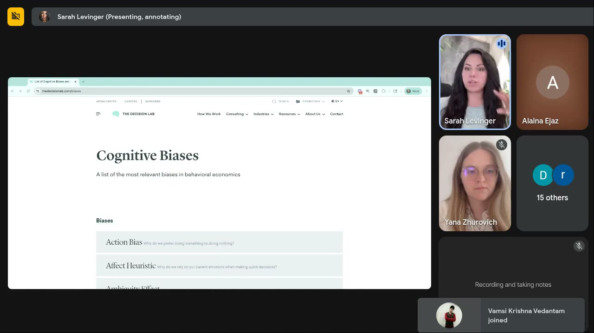
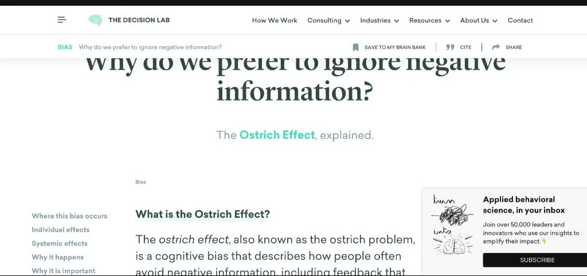

# The Decision Lab (cognitive-bias list)
> A behavioral-science consultancy whose free **"Cognitive Biases" list** (thedecisionlab.com/biases) is Sarah's go-to lookup for heuristics beyond the nine in Heuristics 101: "if you've ever seen Sarah post anything about heuristics, this is the list that I'm pulling from" ([July 2 0:03:03](../courses/tether-lab/05-live-recordings/2025-07-02-live-with-sarah.md)).

## 🤖 Agent use
- **Use when:** you've used up the standard DTC heuristics (social proof, authority, scarcity, urgency, offer) and need a fresh lever for a hook, a script beat or a test batch; or you've spotted an unfamiliar mechanism in a competitor ad and want its name and definition.
- **Inputs → outputs:** a product + customer situation → 1–3 candidate biases from the list → a hook or scene that dramatizes each (the way Sarah turned the ostrich effect into a founder-video hook).
- **Rules:**
  - DO put the bias in the **hook** first: "mostly in hooks… just because it's easier to put them in there real quick" ([July 9 0:53:44](../courses/tether-lab/05-live-recordings/2025-07-09-live-with-sarah.md)).
  - DO check behavioural fit and season: every heuristic "technically will work", but which one wins depends on the product and the time of year (price-sensitive or authority-sensitive periods) ([July 9 0:51:11–0:51:59](../courses/tether-lab/05-live-recordings/2025-07-09-live-with-sarah.md)).
  - DO give an LLM the bias definition plus a detailed persona when asking it to apply one ([ChatGPT](chatgpt.md) pattern: "I want to use the observer expectancy effect in my retention emails… how should I use this?").
  - DON'T expect a ranking. The list is alphabetical; Sarah doesn't rank biases by effectiveness ([July 2 0:05:11](../courses/tether-lab/05-live-recordings/2025-07-02-live-with-sarah.md)).
- **See also:** [Heuristics hub](../concepts/heuristics.md) · [Heuristic stacking](../concepts/heuristic-stacking.md) · [ChatGPT](chatgpt.md) · [Tools hub](README.md)

## What it is (as described)
- "Basically a consultancy… based on behavior science… with brands that are I think in B2B", with "a lot of really good resources on their page" ([July 2 0:02:01–0:03:03](../courses/tether-lab/05-live-recordings/2025-07-02-live-with-sarah.md)). On July 9 she describes it as "an agency that works… predominantly with non-profits", whose list has "hundreds" of entries organised by when and where each applies ([July 9 0:49:06–0:50:55](../courses/tether-lab/05-live-recordings/2025-07-09-live-with-sarah.md)).
- Each bias page has an explainer article and illustrations ([July 2 0:06:14](../courses/tether-lab/05-live-recordings/2025-07-02-live-with-sarah.md)).

*The list Sarah pulls her heuristics from: "Cognitive Biases: A list of the most relevant biases in behavioral economics", alphabetical from Action Bias. [July 2 0:03:45]*

## Biases Sarah pulled from the list, and how she used them
| Bias (Decision Lab page) | Ad application she gave | Source |
|---|---|---|
| [Gambler's fallacy](../concepts/heuristics/gamblers-fallacy.md) | Call out what buyers have failed at before ("I've tried a lot of times to lose weight…"), so the expected pattern breaks | [July 2 0:06:14–0:08:20](../courses/tether-lab/05-live-recordings/2025-07-02-live-with-sarah.md) |
| [IKEA effect](../concepts/heuristics/ikea-effect.md) | Let buyers take part: "swipe to choose your best shirt" carousels, build-your-bundle | [July 2 0:08:20–0:09:55](../courses/tether-lab/05-live-recordings/2025-07-02-live-with-sarah.md) |
| Ben Franklin effect / [reciprocity](../concepts/heuristics/reciprocity.md) | Be kind in the ad: KFC's "we wish we could give these fries free" → "We really wish that we could give this serum away for free…" | [July 2 0:11:27–0:13:34](../courses/tether-lab/05-live-recordings/2025-07-02-live-with-sarah.md) · [KFC](../brands/kfc.md) |
| [Observer expectancy effect](../concepts/heuristics/observer-expectancy-effect.md) | Someone staring into the camera: "Did you take your creatine today?" / "Did you buy gelato today?" | [July 2 0:21:00–0:23:03](../courses/tether-lab/05-live-recordings/2025-07-02-live-with-sarah.md) |
| [Decoy effect](../concepts/heuristics/decoy-effect.md) | Why a "Most customers buy 36" bundle badge works | [July 2 0:38:50](../courses/tether-lab/05-live-recordings/2025-07-02-live-with-sarah.md) |
| [Ostrich effect](../concepts/heuristics/ostrich-effect.md) | Founder hook: "There's hair all over the floor and I'm just not going to look at it…" → "Even if you ignore it, it's still there." | [July 9 0:52:12–0:53:32](../courses/tether-lab/05-live-recordings/2025-07-09-live-with-sarah.md) |
| [In-group bias](../concepts/heuristics/in-group-bias.md) | Two women, one losing her hair; a friend: "I'm losing mine too. It's totally fine, because I found this shampoo…" | [July 9 0:53:32–0:53:55](../courses/tether-lab/05-live-recordings/2025-07-09-live-with-sarah.md) |

*Sarah picked the ostrich effect at random from the list and turned it into a founder-video hook on the spot. [July 9 0:53:15]*

## Procedure: pick a new lever from the list
1. Write the customer's real situation in one sentence (what they keep doing, avoiding or fearing).
2. Scan the list for a bias that names that behaviour (ignoring bad news → ostrich effect; repeated failure → gambler's fallacy).
3. Dramatize it as a hook or opening scene, then turn to the product.
4. Batch 3–5 such hooks and test them against your control (see [Creative testing system](../frameworks/creative-testing-system.md)).

## Planned
Sarah offered to build a GPT that matches Decision Lab heuristics to a brand or industry ([July 9 0:50:55–0:51:11](../courses/tether-lab/05-live-recordings/2025-07-09-live-with-sarah.md)). No such GPT appears in the saved course.

## Where it's mentioned
- [Live With Sarah, July 2, 2025](../courses/tether-lab/05-live-recordings/2025-07-02-live-with-sarah.md): mini-training tour of the list [0:01:58–0:23:03]
- [Live With Sarah, July 9, 2025](../courses/tether-lab/05-live-recordings/2025-07-09-live-with-sarah.md): answer to Joe Hides, hook demos [0:49:06–0:53:55]

## Related
[Heuristics hub](../concepts/heuristics.md) · [ChatGPT](chatgpt.md) · [Sarah Levinger](../people/sarah-levinger.md)
